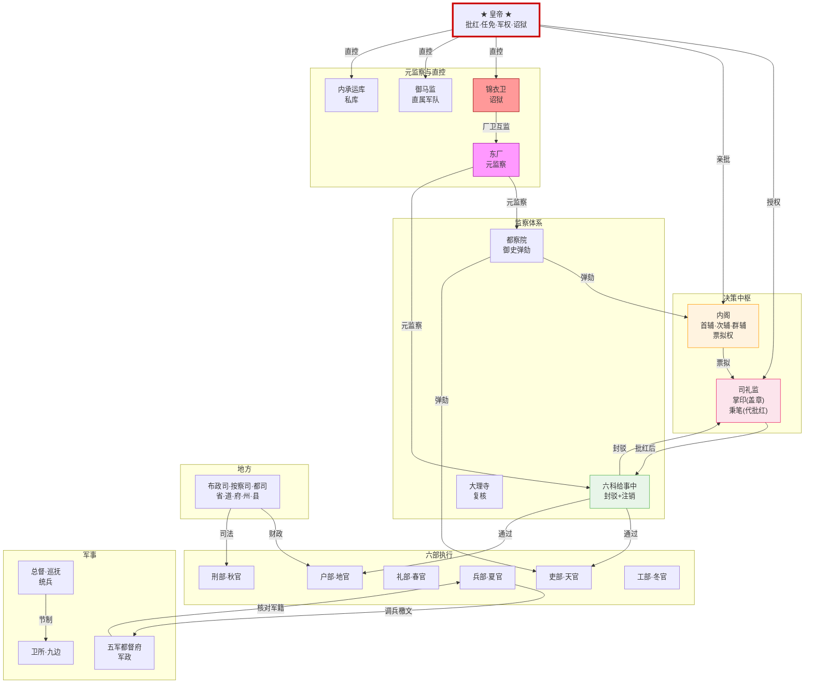
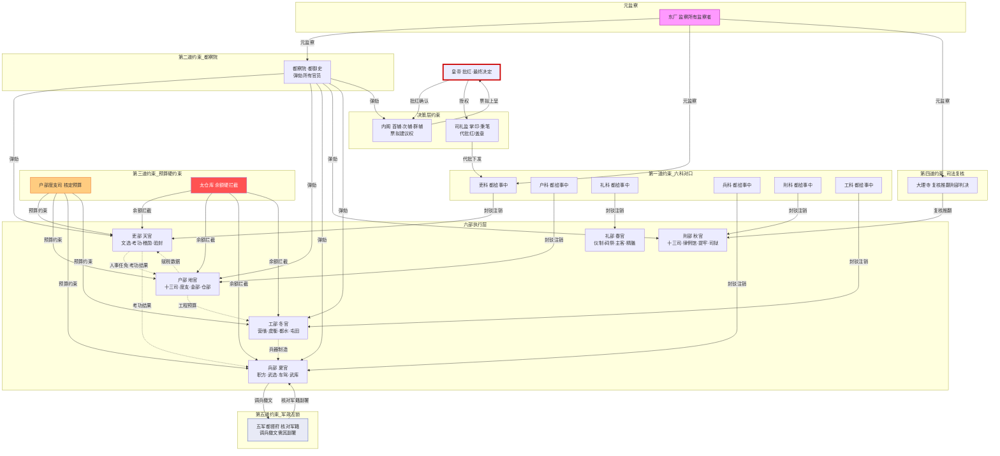
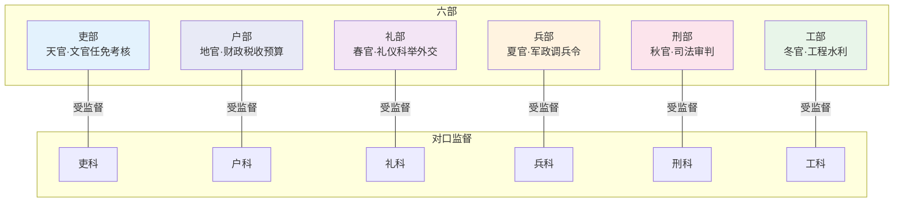
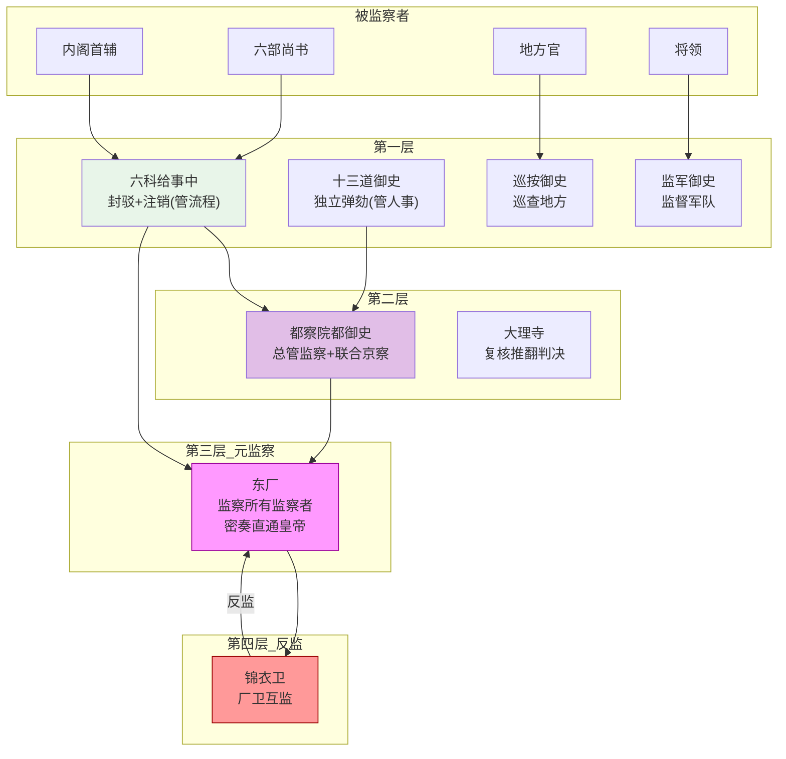
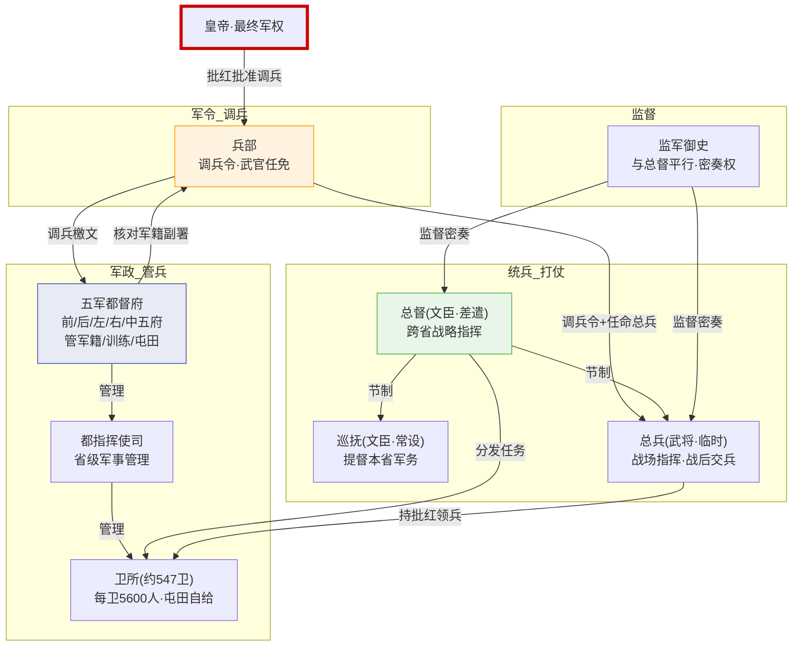
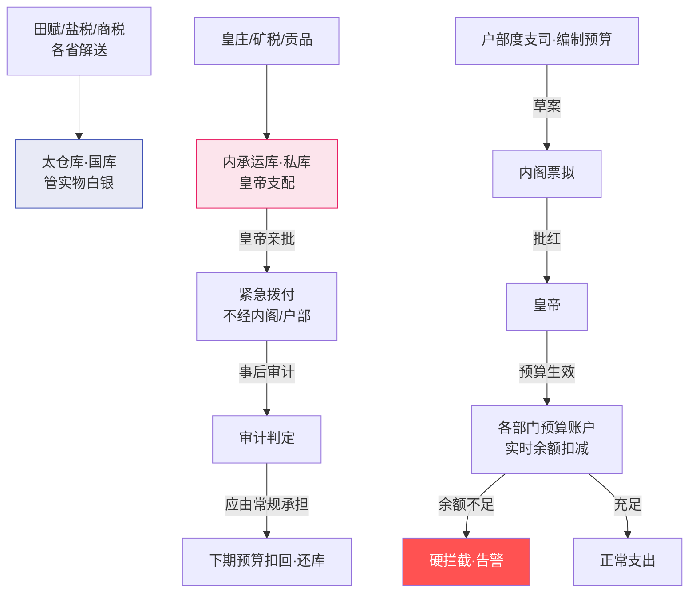
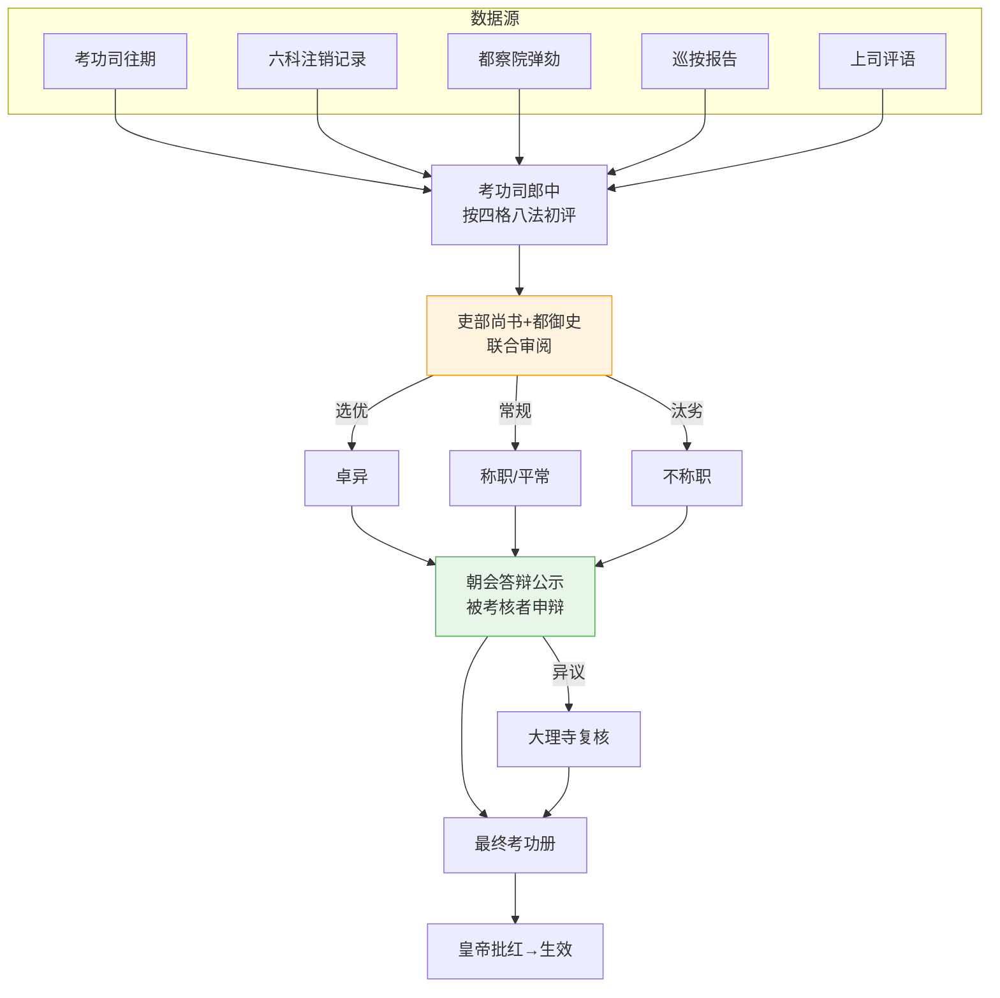
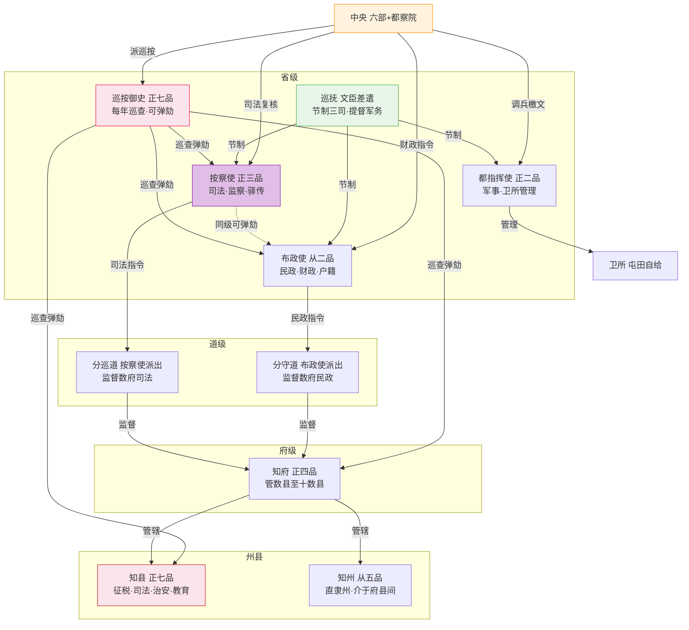

# 大明制度总览

> 本文档是明朝制度体系的**唯一总入口**。将所有架构图、职位关系、制度逻辑集中在一起。  
> 每个板块末尾有 **→ 详见链接**，指向分散的细节文档。

---

## 总架构图

---

## 一、皇权中枢

### 皇帝
| 做什么 | 受谁制约 | 监督谁 |
|:--|:--|:--|
| 批红（最终批准决策）、任免三品以上官员、宣战/议和、启动诏狱、动用内承运库、调用御马监 | 祖宗成法（制度惯性）、六科封驳、廷议压力、文官集团的道德约束 | 所有人——但通过多层代理执行：内阁提建议、六部执行、司礼监代批、东厂和锦衣卫直接监控 |

### 内阁
| 职位 | 做什么 | 制约关系 |
|:--|:--|:--|
| **首辅** | 分配奏章给次辅/群辅票拟 → 汇总 → 加权裁决 → 打回不完备方案 → 形成最终票拟上呈皇帝 | 皇帝可推翻票拟、六科可封驳、都察院可弹劾、次辅有独立票拟权非首辅下属 |
| **次辅** | 独立票拟（与首辅平权），首辅出缺时递补。分管特定领域奏章（军事/财政/人事） | 首辅可打回票拟但次辅可绕开直接上呈皇帝 |
| **群辅** | 每人独立票拟分管领域，人数3-8人不等 | 独立票拟权——不须首辅批准 |

### 司礼监
| 职位 | 做什么 | 制约关系 |
|:--|:--|:--|
| **掌印太监** | 掌管玉玺，所有批红文书需盖章才生效。管全体宦官人事。盖章权与批红权分离 | 不能自己批红——批红在秉笔太监手里 |
| **秉笔太监** | 代皇帝批红常规事务。每天从内阁接收票拟，按皇帝意思在票拟上批写最终决定 | 代批范围由律例限制（7类决策不可代批）。盖章权在掌印手里。越权代批一经查实即作废 |

> **→ 详见**：[皇帝制度](../01-决策链/01-皇帝制度.md) | [内阁制度](../01-决策链/02-内阁制度.md) | [司礼监](../01-决策链/03-司礼监与宦官体系.md) | [御马监](../02-执行链/军事执行/06-御马监与直控军队.md) | [宗人府三公三孤](../01-决策链/06-宗人府与三公三孤.md) | [詹事府尚宝司符节](../02-执行链/文官执行/03-詹事府尚宝司与符节.md)

### 一补充：后宫、外戚与宗室

| 制度 | 核心设计 | 详见 |
|:--|:--|:--|
| **后宫制度** | 选秀从民间→外戚无根基；外戚封爵不任实职→防止外戚专权；女官六局一司→后宫自治 | [后宫与外戚](../01-决策链/07-后宫与外戚制度.md) |
| **藩王制度** | 靖难后系统性削藩→藩禁政策（不得领兵/出城/做官/科举/经商）；宗室人口从58人膨胀到30万→财政崩溃 | [藩王与宗室](../01-决策链/08-藩王与宗室制度.md) |
| **宦官二十四衙门** | 十二监四司八局→与六部/五寺职能平行对应的"内廷政府"；内廷可自给自足→绕开外朝体系 | [宦官二十四衙门](../01-决策链/04-宦官二十四衙门全览.md) |

关键洞察：外戚（有家族有血缘→可能篡位）被彻底架空，宦官（无后代无根基→不可能篡位）被赋予大权——这是经过计算的选择。

---

## 二补充：六部协同约束全景图

这张图展示了六部受到的**五层约束链**：
1. **六科给事中** —— 对口封驳和注销（流程约束）
2. **都察院** —— 对任何官员的弹劾权（人事约束）
3. **户部/太仓库** —— 预算核定和余额硬拦截（财政约束）
4. **大理寺** —— 对刑部判决的复核推翻（司法约束）
5. **五军都督府** —— 对兵部调兵檄文的军籍联署（军政互锁）

约束链的叠加防止了任何单一部门的失控。这种约束不是"一个上级监管六个下级"——而是每条约束链都独立运行，被约束者无法通过控制一个约束方来解除所有约束。

---

## 二、六部体系

### 各部职位与司职

| 部 | 尚书(正二品) | 侍郎(正三品) | 核心司 | 每司长官(郎中正五品) |
|:--|:--|:--|:--|:--|
| **吏部** | 总管文官任免考核 | 分管各司 | 文选司(选任) / 考功司(考核) / 稽勋司(档案) / 验封司(封爵) | 各一人 |
| **户部** | 总管财政税收 | 分管各司 | 十三清吏司(分省管财政) / 度支司(预算) / 金部司(现金) / 仓部司(粮仓) | 各省一人 |
| **礼部** | 总管礼仪科举外交 | 分管各司 | 仪制司(典礼规范) / 祠祭司(祭祀) / 主客司(外交翻译) / 精膳司(宴会) | 各一人 |
| **兵部** | 总管军政调兵 | 分管各司 | 职方司(军事情报) / 武选司(武官任免) / 车驾司(军马驿传) / 武库司(兵器) | 各一人 |
| **刑部** | 总管司法审判 | 分管各司 | 十三清吏司(分省管司法) / 律例馆(规则副本) / 提牢厅(监狱) / 司狱司(案底) | 各省一人 |
| **工部** | 总管工程水利 | 分管各司 | 营缮司(宫殿) / 虞衡司(山林) / 都水司(水利) / 屯田司(屯田) | 各一人 |

**部内层级**：尚书 → 侍郎(有独立上奏权·制衡尚书) → 郎中(主持各司日常) → 员外郎(郎中副手) → 主事(正六品·科级执行)

**协同方式**：会推(多部推选官员) / 会审(多部联合审理) / 转行(公文跨部流转) / 关白(部门通报) ——均通过公文系统而非当面商议

> **→ 详见**：[六部体系](../02-执行链/文官执行/01-六部体系.md) | [户部与财政制度](../05-资源链/01-户部与财政制度.md) | [大明律](../03-监察链/04-大明律与祖宗成法.md) | [盐法漕运马政](../05-资源链/04-盐法漕运马政.md) | [兵部深度制度](../02-执行链/军事执行/02-兵部深度制度.md)

---

## 三、监察体系

### 各监察职位

| 职位 | 品级 | 做什么 | 受谁制约 |
|:--|:--|:--|:--|
| **都御史(都察院)** | 正二品 | 总管全国监察、弹劾百官、与吏部联合主持京察 | 东厂元监察、锦衣卫反监、皇帝可驳回弹劾 |
| **十三道御史** | 正七品 | 独立弹劾——不须都御史批准即可上奏。品极低权极大 | 弹劾须附证据(诬告反坐)、东厂可质疑 |
| **巡按御史** | 正七品 | 代天子巡狩地方——查账、重审案件、考核地方官。一年一轮 | 任期限一年、不能带家属、东厂 |
| **监军御史** | 正七品 | 随军监督——核实战功自报、密奏直通皇帝。不参与指挥 | 不能独立撤销将领(需总督联署)、密奏虚假反坐 |
| **都给事中(六科)** | 正七品 | 封驳权(封还皇帝诏旨、驳正六部奏章)、注销监督(跟踪六部任务完成) | 皇帝可无视封驳强行下发、都察院可弹劾 |

**核心设计**：最低品级(正七品)配备最大监察权——七品御史可弹劾二品尚书。监察权独立于行政权。多层监察无人能最终独断。

**厂卫互监**：东厂(宦官)监视锦衣卫(武将)，锦衣卫反监东厂。两者密奏都直达皇帝。再加西厂(短暂存在)的教训——监察最多两层，超过则系统瘫痪。

> **→ 详见**：[都察院与十三道御史](../03-监察链/01-都察院与十三道御史.md) | [六科给事中](../03-监察链/02-六科给事中.md) | [大理寺与三法司](../03-监察链/03-大理寺与三法司.md) | [通政司与贴黄](../04-信息链/01-通政司与贴黄.md) | [锦衣卫](../03-监察链/05-锦衣卫.md) | [东厂](../03-监察链/06-东厂.md) | [厂卫互监](../03-监察链/08-厂卫互监与皇权控制.md) | [西厂](../03-监察链/07-西厂与内行厂.md) | [皇史宬档案](../05-资源链/10-皇史宬与档案制度.md)

---

## 四、军事体系

### 军事职位链

| 职位 | 谁担任 | 做什么 | 受谁制约 |
|:--|:--|:--|:--|
| **五军左/右都督** | 武将(正一品) | 管理军籍/训练/屯田/军饷。**无权调兵** | 兵部(调兵权分离)、兵科给事中、都察院 |
| **兵部尚书** | 文官(正二品) | 下达调兵令、武官任免。**无军队日常管理权** | 五军都督府(调兵檄文需其副署)、兵科给事中 |
| **总督** | 文官·都察院差遣 | 跨省战略指挥、兵力调配、节制巡抚总兵、持旗牌令 | 监军御史、兵科、军功勘验、户部预算 |
| **巡抚** | 文官·都察院常设 | 节制本省三司、提督军务、民政后勤、主持大计 | 总督(军事配合)、巡按御史、户部 |
| **总兵官** | 武将·临时差遣 | 战场指挥。战后交还兵权 | 总督(战略)、监军御史、兵部 |
| **提督** | 武将/文官 | 战术执行、具体军事行动 | 总督、总兵、监军御史 |

### 竞功考核流程
各路自报战功 → 第一验(自报核验) → 第二验(交叉比对) → 第三验(过程回放·塘报+行军日志) → 第四验(多部门会审·兵部+都察院+监军) → 第五验(最终敲定·叙功册) → 内阁票拟 → 皇帝批红 → 军功勘验使事后复盘

### 军事力量分布
- **京营**：三大营协同——五军营(步兵·正面)、三千营(骑兵·侧翼)、神机营(火器·远程)
- **九边**：北方九个重镇，总督-巡抚-总兵三角制衡
- **卫所**：全国约547卫，屯田自给，三分守城七分屯种
- **御马监**：皇帝直属~2-3万精锐，绕开五军和兵部
- **水师**：沿海卫所水师+郑和远洋舰队(临时编制)

> **→ 详见**：[五军都督府](../02-执行链/军事执行/01-五军都督府.md) | [调兵与选锋](../02-执行链/军事执行/10-调兵与选锋.md) | [卫所制度](../02-执行链/军事执行/03-卫所制度.md) | [九边](../02-执行链/军事执行/04-九边防御体系.md) | [总督巡抚](../02-执行链/军事执行/07-总督与巡抚制度.md) | [竞功军功考核](../02-执行链/军事执行/11-竞功与军功考核.md) | [京营水师](../02-执行链/军事执行/05-京营三大营与水师.md) | [塘报驿传](../04-信息链/04-塘报邸报驿传.md)

---

## 五、财政体系

### 财政职位

| 职位 | 做什么 | 制约 |
|:--|:--|:--|
| **户部尚书** | 总管全国财政税收、审核预算 | 内阁票拟、户科给事中、太仓库余额硬拦截 |
| **度支司郎中** | 编制全国收支预算、审批各部门支出 | 预算草案需内阁→皇帝批红、太仓库的实际余额是硬约束 |
| **太仓库太监** | 管实物白银库房、开预算账户、每日出纳日报 | 户部度支司(管账的批预算但碰不到钱)、审计、东厂 |
| **内承运库太监** | 管皇帝私库、执行紧急拨付 | 内库总额上限(不超过国库X%)、大额拨付需皇帝亲批、审计事后审查 |

**关键分离**：管账的(户部度支司)碰不到钱，管钱的(太仓库)不能批预算。国库(常规通道)和内库(紧急通道)完全隔离。预备金独立划出、启用需皇帝亲批。

> **→ 详见**：[户部与财政制度](../05-资源链/01-户部与财政制度.md) | [太仓库与内承运库](../05-资源链/02-太仓库与内承运库.md) | [预算与资源调度](../05-资源链/03-预算与资源调度.md)

### 五补充：货币制度与数据基础

| 制度 | 核心内容 | 详见 |
|:--|:--|:--|
| **大明宝钞** | 洪武发行纯信用纸币→无准备金/无节制超发→永乐年间贬值70%以上→宣德后形同虚设 | [货币制度](../05-资源链/05-货币制度与白银货币化.md) |
| **白银货币化** | 宝钞崩溃→民间自选用银→隆庆开关后美洲/日本白银大量流入→一条鞭法统一折银 | [同上] |
| **一条鞭法** | 张居正改革——赋税徭役合并→统一折银征收→效率提升但"谷贱伤农" | [同上] |
| **黄册** | 十年一造的全国户籍册——四柱清册格式（旧管/新收/开除/实在） | [黄册与鱼鳞图册](../05-资源链/06-黄册与鱼鳞图册.md) |
| **鱼鳞图册** | 全国土地登记册——每块地的形状和所有者→与黄册构成赋税的双重验证 | [同上] |

关键洞察：黄册和鱼鳞图册是赋税体系的数据基础设施——当数据不再可信，整个赋税就建立在谎言之上。明末不是不知道数据失真，而是已无能力再做全国土地清丈。

---

## 六、考核体系

**四格**(评分维度)：守(品德) / 才(能力) / 政(政绩) / 年(精力)  
**八法**(劣汰标准)：贪/酷/浮躁/不及/老/病/罢软/不谨  
**考成法**：三本簿册(内阁+六科+六部各存一本)。每月六科检查→超期降权停俸→连两次不称职废黜

> **→ 详见**：[考功制度](../05-资源链/07-考功制度.md)

---

## 七、地方行政

**核心设计**：三司并立互不隶属——布政使管民政、按察使管司法（且同级可弹劾布政使）、都指挥使管军事。巡抚从临时差遣逐渐常设为实际上最高长官。巡按御史（正七品）每年从中央派出，可弹劾从布政使到知县的所有地方官。知县（正七品）是最基层朝廷命官——承接中央全部政策链条的末端、直接面对百姓——"上面千条线，下面一根针"。

**权力制约链**：
- 布政使(民政) ⇄ 按察使(司法制衡) ⇄ 都指挥使(军事)
- 巡抚节制三司 ⇄ 巡按御史独立巡查巡抚
- 分守道/分巡道(省级派出) → 知府 → 知县（行政层级递减）
- 三司各自对中央对口部门负责（布政→户部、按察→刑部+都察院、都司→五军都督府）

> **→ 详见**：[地方行政体系](../02-执行链/文官执行/04-地方行政体系.md)

### 七补充：基层社会、海禁与特殊治理

| 制度 | 核心内容 | 详见 |
|:--|:--|:--|
| **里甲制度** | 110户一里，里长十年一轮→征税/派役/编制黄册/治安。里长需垫付缺额→从荣誉变成负担 | [基层社会组织](../02-执行链/基层执行/01-基层社会组织.md) |
| **粮长制度** | 民间大户负责收粮解运→明初的"快速通道"（优秀者可授官）→明中后期变成倾家荡产的灾难 | [同上] |
| **士绅与宗族** | 退休官员+举人+宗族领袖→县级以下的真正权力；知县依赖士绅提供信息→士绅控制"信息框架" | [同上] |
| **乡约保甲** | 王阳明推行的基层治理：乡约管道德教化、保甲管治安联防 | [同上] |
| **海禁** | "片板不许下海"→将贸易从合法逼入非法→嘉靖"倭寇"（实为武装走私商团）→隆庆开关后合法化 | [海禁与海外贸易](../07-特殊治理/03-海禁与海外贸易.md) |
| **土司制度** | 西南少数民族地区——朝廷承认世袭土司的自治权换取名义臣服→成本最低的间接统治方案 | [土司制度](../02-执行链/基层执行/02-土司制度.md) |
| **南京留都** | 完整但与北京平行的政权架构→日常不运作但对南直隶行使职权→"政权备胎"→南明时验证了其价值 | [南京留都详解](../07-特殊治理/02-南京留都详解.md) |

关键洞察："皇权不下县"意味着知县以下无朝廷命官——但基层社会并非无组织，里甲、士绅、宗族三重力量填充了这个真空。海禁和土司分别是"禁止不如监管"和"间接统治成本更低"的典型案例。

---

## 八、文教科举与外交

### 科举三级
院试(秀才) → 乡试(举人) → 会试+殿试(进士·分三甲) → 一甲入翰林院 → 庶吉士馆选(精英加速通道)

### 相关机构
| 机构 | 职能 | 详见 |
|:--|:--|:--|
| 翰林院 | 学术智囊+高级官员储备库 | [翰林院](../06-私人智囊/02-翰林院与格物学士.md) |
| 国子监 | 最高学府 | [国子监与钦天监](../05-资源链/09-国子监与钦天监.md) |
| 钦天监 | 天文历法 | [同上] |
| 会同馆 | 外交使节招待所 | [会同馆四夷馆](../04-信息链/07-会同馆四夷馆.md) |
| 四夷馆 | 翻译机构(八馆) | [同上] |
| 市舶司 | 海上贸易管理(宁波/泉州/广州) | [同上] |
| 僧录司/道录司 | 佛教/道教管理 | [僧道录司](../07-特殊治理/05-僧道录司与宗教管理.md) |
| 郑和下西洋 | 宝船舰队·双轨指挥·自洽后勤 | [郑和下西洋](../07-特殊治理/04-郑和下西洋.md) |

### 八补充：奏章流转与制度异化

| 制度 | 核心内容 | 详见 |
|:--|:--|:--|
| **奏章流转完整路径** | 通政司→首辅分配→票拟→批红→六科审查→六部执行→注销归档，全程7个环节各有独立审查权 | [奏章流转](../04-信息链/03-奏章流转完整路径图.md) |
| **党争与制度异化** | 大礼议/国本之争/东林阉党→京察考核工具化→封驳弹劾武器化→"否决僵局"→制度空转 | [党争与制度异化](../03-监察链/11-党争与制度异化.md) |

关键洞察：分权制衡对抗"个体暴君"有效，但对抗"跨机构朋党联盟"反而更脆弱——因为每个环节都可以被朋党"合规"地执行破坏性操作。

---

## 十、权力制约核心原则

| 原则 | 明代体现 | 编排系统对应 |
|:--|:--|:--|
| **决策与执行分离** | 内阁票拟(建议) ≠ 皇帝批红(决定) ≠ 六部(执行) | 规划层→总控批红→六部执行 |
| **军政军令分离** | 五军都督府(管兵) ≠ 兵部(调兵) ≠ 总兵(统兵) | 调兵Agent(选将) ≠ 总督(分发) ≠ 提督(执行) |
| **管账管钱分离** | 户部(管账) ≠ 太仓库(管钱) | 户部核定预算 ≠ 太仓库扣减Token |
| **同级监察** | 按察使可弹劾同级布政使 | 审计Agent对监督Agent无指挥权但信息共享 |
| **最低品级最大监察权** | 七品御史可弹劾二品尚书 | 监督Agent低权限但高上报优先级 |
| **元监察** | 东厂监察所有监察者 | 东厂Agent对各层监察再监察 |
| **互监** | 厂卫互监(东厂⇄锦衣卫) | 监察层级互相监视·信息直达总控 |
| **多层验证** | 五道验功·三法司会审·京察公示 | 多眼交叉验证·朝会答辩·审计复核 |
| **外戚架空与宦官重用** | 外戚封而不任（有家族血缘→可能篡位）vs 宦官无后代无根基（不可能篡位）| 代理选择原则：无独立根基的 Agent 比有家族网络的 Agent 更安全 |
| **终身供养的规模陷阱** | 宗室从58人膨胀至30万人→无衰减机制的终身承诺必然崩溃 | 所有"永久有效"的资源承诺必须有硬上限和衰减机制 |
| **数据基础设施的崩溃** | 黄册和鱼鳞图册失真→赋税分配不公→贫户逃亡→数据更失真→财政崩溃 | 资源计量系统（太仓库出纳日报）的准确性是整个编排系统的基石 |
| **取消不如监管** | 海禁催生走私和武装商团→隆庆开关后合法化反而可管控 | 禁止行为不如开放受监管的合法通道 |
| **间接统治的成本优势** | 土司制度——承认自治换臣服，成本远低于直接统治 | 外部模块自治+遵守接口协议 > 强行统一内部规则 |
| **灾备的"保险"逻辑** | 南京留都完整但不运作→崇祯十七年验证了其灾备价值 | 温备副本：规则同步、不参与决策、可随时激活 |
| **否决僵局** | 皇帝缺位时各派互相否决无人决策→制度合法瘫痪 | 批红超时机制：超过N天自动退回重拟→防止系统陷入合法但瘫痪的状态 |
| **跨机构朋党** | 东林vs阉党——分权制衡对抗个体暴君有效，对抗集体暴政反而脆弱 | 联盟探测：多个独立Agent输出高度一致时触发审查 |

---

## 十、全部职位品级速查

| 品级 | 代表职位 |
|:--|:--|
| 正一品 | 左/右都督(五军)、太师/太傅/太保(三公) |
| 从一品 | 少师/少傅/少保(三孤) |
| 正二品 | **六部尚书**、都指挥使、左/右都御史 |
| 从二品 | **布政使** |
| 正三品 | 六部侍郎、通政使、大理寺卿、**锦衣卫指挥使**、按察使 |
| 从三品 | 光禄寺卿、太仆寺卿 |
| 正四品 | 左/右通政、左/右佥都御史(总督常带)、大理寺少卿、**知府** |
| 从四品 | 道员 |
| 正五品 | **六部郎中**、**翰林学士**、**大学士本职**(内阁!) |
| 从五品 | 知州(直隶州)、员外郎 |
| 正六品 | **六部主事**、百户 |
| 正七品 | **都给事中**、**监察御史**、**知县**、**巡按御史**(品极低权极大) |
| 从七品 | 给事中 |
| 从九品 | 驿丞 |

> **→ 详见**：[职位关系全景图](../99-附录/02-职位关系全景图.md) | [官职品级表](../99-附录/01-官职品级表.md)

---

## 十一、文档索引

### 总览文档
- **../00-总览/大明制度总览.md** ← 你在这里
- [文官监察体系总览](文官监察体系总览.md) — 中枢+六部+监察+财政+地方 汇总
- [军事特务体系总览](军事特务体系总览.md) — 五军+卫所+九边+竞功+厂卫+郑和 汇总

### 分散细节文档
按目录浏览——见 [README]() 完整导航，共59个文件覆盖所有明朝制度细节。

### 本轮新增文档（v4.3.2）
| 目录 | 新文件 | 主题 |
|:--|:--|:--|
| 01-皇权与中枢 | 10-后宫与外戚、11-藩王与宗室、12-宦官二十四衙门 | 后宫外戚制衡、藩禁与宗室膨胀、内廷政府全貌 |
| 02-监察与司法 | 09-党争与制度异化 | 京察工具化、国本之争、制度空转的五种模式 |
| 05-财政与考核 | 06-货币制度、07-黄册与鱼鳞图册 | 宝钞崩溃与白银化、赋税数据基础设施 |
| 06-特殊机制 | 03-基层社会、04-海禁与贸易、05-土司、06-南京留都 | 里甲粮长士绅、海禁与开关、羁縻统治、政权备胎 |
| 07-文教科举与外交 | 08-奏章流转完整路径 | 端到端奏章生命周期全景图 |
| — | 扩展：内阁制度、锦衣卫、宗人府 | 内阁演变史、锦衣卫内部结构、宗室管理深化 |
