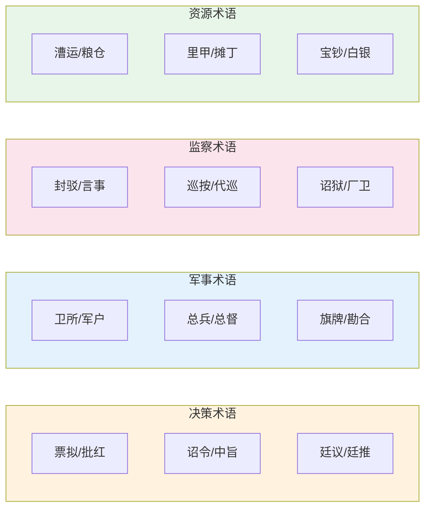

# 术语速查表

> 明史概念 → 编排系统对应 → 简要解释，方便速查。

## 政府与行政

| 明朝术语 | 英文对应 | 编纂系统对应 | 一句话解释 |
|:--|:--|:--|:--|
| 票拟 | Drafting (piao ni) | 规划 Agent 生成拆解方案 | 内阁大学士在奏章上写处理建议的小纸条 |
| 批红 | Imperial endorsement (pi hong) | 总控 Agent 最终确认 | 皇帝用红笔在票拟上批写最终决定 |
| 贴黄 | Yellow label summary | 交互审核 Agent 摘要 | 奏章末尾的黄色摘要条，概括核心内容 |
| 封驳 | Veto/return | 交互审核 Agent 驳回 | 六科给事中将皇帝诏旨封还或驳正 |
| 廷议 | Court conference | 朝会模式 | 皇帝召重臣讨论重大国事 |
| 再议 | Send back for revision | 用户批"再议" | 皇帝不满意票拟时退回要求重新讨论 |
| 中旨 | Direct imperial decree | 总控不经内阁的直接指令 | 皇帝不经内阁和六科直接下发的命令 |

## 六部与考核

| 明朝术语 | 英文对应 | 编纂系统对应 | 一句话解释 |
|:--|:--|:--|:--|
| 六部 | Six Ministries | 六部司职体系 | 吏户礼兵刑工六个中央行政机关 |
| 尚书 | Minister | 尚书级 Agent | 六部最高长官，正二品 |
| 清吏司 | Bureau | 司级 Agent | 部下面的职能司，由郎中主持 |
| 会推 | Joint recommendation | 六部协同——跨部联合推选 | 多部门共同推选重要官员 |
| 会审 | Joint trial | 三法司会审 | 多部门联合审理重大案件 |
| 转行 | Document routing | 协作总线公文流转 | 公文在多部门之间依序流转 |
| 关白 | Inter-departmental notice | 协作总线部门公告 | 部门之间通报信息 |
| 考成簿 | Performance ledger | 考成簿（任务文书） | 任务绑定负责人/时限/验收标准的簿册 |
| 京察 | Capital evaluation | 京察（京官考核） | 京官六年一次的全面考核 |
| 大计 | Provincial evaluation | 大计（地方官考核） | 地方官三年一次的全面考核 |
| 四格八法 | Four criteria, eight dismissals | 考功册评分标准 | 考核四维度和八种劣汰标准 |
| 卓异 | Outstanding | 考功册最高等级 | 考核最优者的评定用语 |
| 不称职 | Unfit | 考功册最低等级 | 考核最差者的评定用语 |

## 监察体系

| 明朝术语 | 英文对应 | 编纂系统对应 | 一句话解释 |
|:--|:--|:--|:--|
| 都察院 | Censorate | 审计 Agent | 最高监察机关，弹劾百官 |
| 御史 | Censor | 审计/监督 Agent | 专职监察官员，品低权大 |
| 巡按御史 | Regional inspector | 监督 Agent 巡按 | 代天子巡狩地方的监察官 |
| 十三道 | Thirteen circuits | 按领域分工的监察 | 按十三省划分的御史派出机构 |
| 六科给事中 | Six offices of scrutiny | 监督 Agent/交互审核 | 对口监督六部的监察官 |
| 科道 | Censors and scrutineers | 监督 + 审计组合 | 六科给事中 + 十三道御史的合称 |
| 大理寺 | Court of Judicial Review | 复核 Agent | 最高复核机关，可推翻判决 |
| 三法司 | Three judicial offices | 三法司会审 | 刑部+都察院+大理寺联合审理 |
| 东厂 | Eastern Depot | 东厂 Agent（元监察） | 宦官掌管的秘密监察机构 |
| 西厂 | Western Depot | （编排系统未设对应） | 明中叶短暂设立的特务机构 |
| 锦衣卫 | Embroidered Uniform Guard | 锦衣卫 Agent（诏狱） | 皇帝直属军事特务机构 |
| 诏狱 | Imperial prison | 锦衣卫隔离区 | 锦衣卫北镇抚司独立监狱 |
| 厂卫互监 | Mutual surveillance | 厂卫互监 | 东厂和锦衣卫互相监视 |
| 密奏 | Secret memorial | 密奏通道 | 不经内阁直呈皇帝的保密奏章 |

## 军事体系

| 明朝术语 | 英文对应 | 编纂系统对应 | 一句话解释 |
|:--|:--|:--|:--|
| 五军都督府 | Five Chief Military Commissions | 调兵 Agent | 分管全国卫所的五个军事管理机关 |
| 卫所 | Guard-battalion | 卫所模式（本地自治） | 军队编制单位，兼管屯田 |
| 九边 | Nine border garrisons | 九边坐镇 | 北方边境九大军事重镇 |
| 总督 | Supreme Commander | 总督 Agent | 跨省区军事统帅，文官担任 |
| 巡抚 | Grand Coordinator | （监督/户部均有涉及） | 省级军政长官，文官担任 |
| 总兵 | Regional commander | 提督 Agent（各路） | 地方军事指挥官，武将 |
| 选锋 | Vanguard select | 选锋标签 | 从各部队选拔的精锐突击队 |
| 首功制 | Head-count merit system | 过程质量分/资源效率分 | 按斩获首级计功的制度 |
| 叙功册 | Merit roster | 叙功册 | 记录军功评定结果的册籍 |
| 监军御史 | Army-inspecting censor | 监军御史 Agent | 代表朝廷监督军队的监察官 |
| 塘报 | Military dispatch | 塘报旗牌使通信 | 前方传回的军情报告 |
| 旗牌令 | Command tally | 灾备/锁院资源分配 | 象征皇帝授权的军事指挥信物 |
| 幕府 | Field headquarters | 幕府 Agent | 总督的参谋和行政班子 |

## 财政与资源

| 明朝术语 | 英文对应 | 编纂系统对应 | 一句话解释 |
|:--|:--|:--|:--|
| 度支 | Fiscal budget | 户部度支票拟 | 年度财政收支预算 |
| 太仓库 | Imperial treasury | 太仓库 Agent | 国库，存放正项赋税收入 |
| 内承运库 | Inner palace treasury | 内承运库 Agent | 皇帝私人库藏 |
| 预备金 | Reserve fund | 灾备储备金 | 国库中独立划出的应急储备 |
| 奏销 | Fiscal audit | 审计决算/度支偏差简报 | 项目结束后的支出审计清算 |
| 开中法 | Salt-for-grain policy | 预算试探期弹性系数 | 商人运粮至边关换取盐引 |
| 一条鞭法 | Single-whip tax reform | 预算系数动态回归 | 简化税制，统一折银征收 |
| 出纳日报 | Daily treasury report | 太仓库出纳日报 | 每日收支明细、预算执行率比对 |

## 人才与储备

| 明朝术语 | 英文对应 | 编纂系统对应 | 一句话解释 |
|:--|:--|:--|:--|
| 翰林院 | Hanlin Academy | 翰林格物学士 | 最高学术机构和皇家智囊团 |
| 翰林学士 | Hanlin Academician | 翰林格物学士 Agent | 皇帝最亲近的学术顾问 |
| 庶吉士 | Hanlin bachelor | 新兵见习期 | 从进士中选拔进翰林院学习的精英储备 |
| 馆阁 | Pavilion/hall | 动态人才池 | 翰林院内更核心的文书草拟岗位 |
| 经筵 | Classics colloquium | 格物引输出 | 翰林学士定期为皇帝讲授经史 |
| 御马监 | Imperial horse office | 御马监 Agent（精锐） | 皇帝直属军事力量，不属六部 |

## 排序特殊概念

| 明朝术语 | 英文对应 | 编纂系统对应 | 一句话解释 |
|:--|:--|:--|:--|
| 门客 | Retainer (Warring States) | 门客型 Agent 池 | 战国至汉初贵族养的智囊食客 |
| 幕僚/师爷 | Private advisor | 幕僚型 Agent 小组 | 官员私人聘用的办事人员 |
| 内阁 | Grand Secretariat | 规划层（多名规划 Agent） | 皇帝的秘书/决策辅助班底 |
| 首辅 | Senior Grand Secretary | 首席规划 Agent | 内阁排位第一的大学士 |
| 司礼监 | Directorate of Ceremonial | 司礼监 Agent | 宦官系统的最高机构 |
| 锁院 | Lockdown/sequestration | 全局熔断锁院 | 考官隔离或紧急戒严状态 |
| 行在 | Provisional capital | 灾备部（影子部） | 南京留都的备用中央政府 |
| 格物致知 | Investigate things to extend knowledge | 翰林格物学士跨域扫描 | 朱熹理学概念——穷究事物原理 |
| 格物引 | "Investigation Primer" | 格物学士输出的跨域参考 | 编排系统自创术语 |
