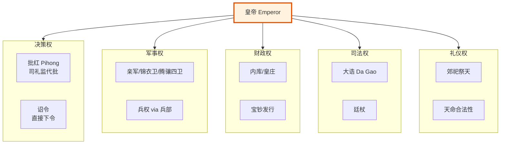

# 皇帝制度

> 📍 返回 [README](../00-总览/README.md) · [按编排模式反查](../99-附录/04-按编排模式反查.md)
> 🔗 相关主题：司礼监代批 · 内阁票拟 · 廷议

## 皇权来源与性质

明代皇权在洪武十三年（1380年）废除丞相制度后达到顶峰。皇帝既是国家元首也是政府首脑——六部直接对皇帝负责，没有任何中间层级。

**核心权力**：
- **批红权**：内阁票拟的建议用墨笔，皇帝用朱笔批写最终决定。不批红的票拟不是命令
- **最高决策权**：可推翻内阁和六部的任何建议，直接下发中旨（不经内阁的皇帝直接命令）
- **人事任免权**：三品以上官员由皇帝亲批，都察院都御史和六部尚书等重要职位由皇帝从廷推名单中选定
- **军权**：五军都督府的调兵权最终归属皇帝，宣战和议和由皇帝独断
- **诏狱启动权**：锦衣卫诏狱必须皇帝亲批才能启动（驾帖）
- **内承运库支配权**：皇帝可不经内阁直接支配内库资金
- **御马监调用权**：皇帝直属军队的调用

## 皇帝的日常工作（勤政时期）

以朱元璋为例——最勤政的明朝皇帝：
1. 天明前起床 → 阅览前一天的紧急奏章
2. 御门听政（在奉天门露天听取百官奏事并当场批示）
3. 退朝后批阅通政司转来的常规奏章（每天约200+份）
4. 接见内阁大学士讨论票拟中的重要问题
5. 审阅六科和都察院的弹劾奏章
6. 处理军情塘报（如果有边患）

后世勤政程度递减——到万历中后期完全不朝不批，政务由内阁+司礼监自行运转。

## 皇帝受什么制约

虽然专制，但明代皇帝并非可以为所欲为：

**制度制约**：
- **祖宗成法**：朱元璋定下的制度被赋予近乎神圣的地位。后世皇帝不能明着推翻（但可以通过"例"来绕开）——这种制度惯性是真实存在的约束
- **票拟流程**：不经内阁票拟直接下旨（中旨）被文官集团视为"不合程序"——虽然合法但会遭到抵制
- **六科封驳**：给事中可以封还皇帝的批红诏旨——虽然皇帝可以无视封驳强行下发，但频繁被驳会损害皇帝的政治声望

**人事制约**：
- 皇帝不能任意杀大臣（理论上需经过三法司审判）
- 皇帝不能任意撤换所有官员（大量中低级官员的任免由吏部按规则执行）
- 言官（御史和给事中）的集体"死谏"对皇帝形成道德压力

**财政制约**：
- 皇帝的个人消费从内承运库出——不能随意挪用太仓库（国库）的资金
- 太仓库的开支需要户部→内阁→批红的完整流程
- 预备金（灾备储备）的动用条件极严格

**信息制约**：
- 皇帝看到的所有信息都经过了多层过滤（通政司→内阁→司礼监）
- 密奏制度（东厂/监军密奏）是皇帝绕过信息过滤的唯一通道——但密奏本身也可能失真

## 皇帝监督谁

所有人——但监督的方式不同：

| 监督对象 | 监督方式 | 信息渠道 |
|:--|:--|:--|
| **内阁** | 批红（审批票拟）、可随时召见大学士问责 | 通政司奏章 + 东厂密奏 |
| **六部** | 批红（审批奏章）、通过内阁间接监督 | 六科抄送的奏章 + 都察院弹劾 |
| **都察院** | 可罢免都御史、可驳回弹劾 | 东厂对都察院的再监察 |
| **地方官** | 巡按御史报告、大计结果审批 | 巡按报告 + 密折 |
| **军事** | 调兵令需皇帝批红、监军密奏 | 塘报 + 监军密奏 |
| **宦官** | 随时可撤换、东厂内部监察 | 锦衣卫反监东厂 |
| **锦衣卫** | 诏狱启动需皇帝亲批驾帖 | 东厂监视锦衣卫 |

## 中旨（内降）：绕开内阁的皇帝直接命令

### 中旨是什么

"中旨"（也称"内降"、"内旨"、"中批"）是指皇帝不经内阁票拟直接下发的命令——理论上只有皇帝亲笔（或口谕由司礼监代笔）写就、不经过通政司→内阁→六科的常规流程。

在正常流程中，皇帝的任何决策需要经过：皇帝想要什么 → 内阁票拟（提处理建议） → 皇帝批红（批准或修改） → 六科签批（审查） → 下发执行。中旨跳过了内阁票拟——直接：皇帝批写 → 下发执行。

### 中旨的合法性争议

中旨在法律上**不是非法的**——皇帝拥有最终决定权，理论上可以以任何形式下达命令。但在政治文化中，中旨是**高度不合程序的**，被视为"不走正道"。文官集团对中旨的态度通常是：

- **低级事务（如任命知县、小规模拨款）**：容忍——因为不值得为小事与皇帝正面冲突
- **重大事务（如大规模增税、任命尚书、宣战）**：激烈抵制——六科封驳、内阁集体辞职威胁、言官上奏怒斥
- **绕过内阁给锦衣卫或东厂的特权**：最为敏感——因为这预兆着皇帝想用特务系统绕过文官体系

如果一个皇帝频繁发中旨，文官集团会得出一个结论：**"这个人不信任我们"**——而一旦这个结论形成，双方的合作关系就会迅速恶化。万历朝后期的"国本之争"就是一个深化的例子——皇帝和文官集团在中旨问题上互相消耗了二十多年。

### 中旨的实际用途

尽管有争议，中旨确实是皇帝绕开官僚拖延和抵制的一条重要通道：
- **紧急军事调度**：如果走正常流程（兵部→内阁票拟→批红→兵部檄文→五军副署→下发），边境已经丢了。用中旨直接下令总督便宜行事
- **直接调拨内承运库的资金**：正常预算流程太慢——中旨直接从内库拨银
- **直接调用御马监军队**：绕开兵部和五军都督府的调兵流程
- **对个别官员的特别保护或惩罚**：绕开吏部的正常人事流程

### 中旨的风险

中旨最大的问题不是"皇帝独裁"——而是**信息不充分导致的错误决策**。正常流程中，内阁票拟和六科封驳起到了"纠错"和"补充信息"的作用。一份中旨完全绕过了这些安全阀，皇帝可能基于错误或片面的信息做出决定——没有人在中间提醒他"这个事情其实不是你想的那样"。

明代最著名的中旨案例之一是正德帝朱厚照的中旨任命——他直接下中旨任命一个无任何功名的边疆商人做锦衣卫千户。内阁全体反对、六科封驳、言官弹劾。正德强行推行。该商人上任后果然贪腐成性。

---

## 皇权的衰落与系统自我运转

到明代中后期，几个因素导致皇帝的实际权力萎缩：
- 皇帝怠政（长期不朝不批）→ 司礼监代批权重上升
- 官僚体系惯性（内阁+六部可以自行运转常规政务）
- 文官集团对皇帝的限制手段成熟（封驳、死谏、集体辞职威胁）
- 中旨的"程序不正义"使皇帝不敢频繁使用——每次发中旨都会引发文官反弹

但制度上皇帝始终保留"一票否决"权和关键决策的最终决定权——即使十年不上朝的万历帝，在重大人事和军事决策上仍然会亲批。

---

## 编排参考

任事型编排系统中**总控 Agent** 直接对应皇权：
- "批红权" → 总控对规划方案做最终勾选/否决/组合——不可篡改的批红记录
- "司礼监代批" → 总控授权司礼监 Agent 代行常规批红，仅保留七类战略决策亲批权（模式切换、诏狱、灾备、大额拨付、御马监、国库调整、永久降权）
- "廷议" → 朝会模式辩论——门客发散→幕僚量化→帝皇批驳
- "中旨" → 总控不经内阁/总督的直发命令（内承运库拨付、御马监调用等）
- "亲批笺" → 人类关键介入点的七类决策清单——即使总控 AI 也无法代批

核心洞察：**一切权力归于总控，但总控可以分级授权，且关键权力绝不外放**。这既保证了日常效率（不用每个决策都等总控），又保证了极端情况下总控可以收回一切权力。
