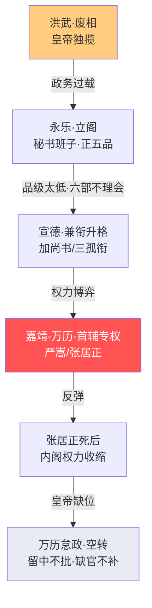
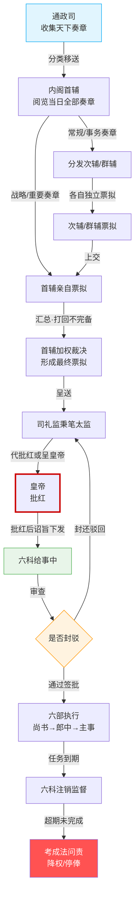
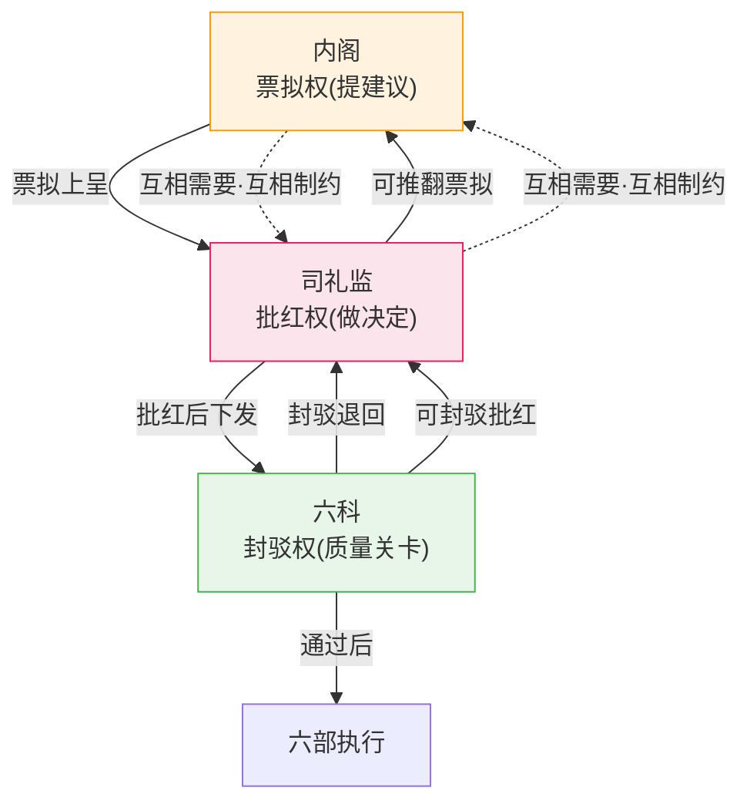

# 内阁制度

> 📍 返回 [README](../00-总览/README.md) · [按编排模式反查](../99-附录/04-按编排模式反查.md)
> 🔗 相关主题：首辅裁决 · 票拟流程 · 司礼监

## 演变过程——从秘书到"真宰相"的三次跃迁

内阁的权力并不是设计出来的——它是在一百多年的博弈中一步步"长"出来的。

### 第一阶段：洪武废相（1380年）——权力的真空

朱元璋杀胡惟庸后宣布永不设丞相，六部直接对皇帝负责。这意味着全国政务的最终决策压在了皇帝一个人身上。朱元璋以超人的精力扛住了——平均每天批阅200+份奏章。但他的子孙不可能做到。

**制度的根本矛盾**：废除丞相后，六部没有统一的协调者。吏部管人事、户部管财政、兵部管军事——但跨部门的事务谁来统筹？答案是没有人——或者说是皇帝。当皇帝精力不足时，决策就会在六部之间卡住。

### 第二阶段：永乐立阁（1402年）——秘书班子的登场

朱棣通过靖难之役夺位后，面临一个两难：他公开支持朱元璋"永不设丞相"的祖训（因为他是通过反对建文帝"破坏祖制"来合法化自己的），但他不可能像朱元璋那样全天批奏章（他长年在北方打仗）。

**解决方案**：从翰林院选编修、检讨等低级文官入值文渊阁——他们品级极低（正五品，比六部尚书低四级），没有独立的决策权，但可以在皇帝不在时处理文书工作。这些人被称为"内阁大学士"。

**关键设计**：他们可以用墨笔在奏章旁贴纸条写处理建议（"票拟"），但决定权仍在皇帝（"批红"）。大学士的本职品级只有正五品——制度设计者认为品级这么低不可能威胁皇权。

### 第三阶段：宣德-正统（1425-1449）——兼职衔的升格

制度漏洞在于：正五品的大学士在六部尚书（正二品）面前毫无权威——六部尚书可以不理会内阁的票拟。

**解决方案**：让内阁大学士**兼任**六部尚书或三公三孤衔。如"少师兼太子太师、吏部尚书、华盖殿大学士"——这一个人的官衔里包含了：三孤（从一品）+ 六部尚书（正二品）+ 内阁大学士（正五品）。他坐在文渊阁里的时候是"大学士"（低），但走出去谁也说不清楚他的级别（高）。

**结果**：内阁大学士的实际地位从"皇帝的秘书"变成了"皇帝与六部之间的协调者"——而兼职衔让他们有了与尚书对话的底气。

### 第四阶段：嘉靖-万历（1522-1620）——首辅专权与制度困境

严嵩、徐阶、高拱、张居正等强势首辅通过各种手段（控制票拟、与司礼监结盟、利用考成法追踪六部执行）实际上获得了接近丞相的权力。

**张居正的"方法论"**：
1. 与司礼监掌印太监冯保建立同盟（票拟+批红的无缝配合）
2. 推行考成法——六科必须追踪六部的任务完成进度，超期问责
3. 利用李太后的支持（万历年幼）
4. 六部在制度上仍直接对皇帝负责——但皇帝是个十岁的孩子、太后听张居正的——所以实际指挥链变成了：张居正 → 票拟 → 冯保批红 → 六部执行

**张居正死后的反弹**：万历帝全面否定张居正——抄家、剥夺一切荣誉、后代被流放。这不是因为张居正贪污（他生活简朴），而是因为他的权力运作方式本质上挑战了"内阁只是秘书机构"的制度设定。

### 第五阶段：万历怠政-明末（1590-1644）——内阁的空转

万历中后期不上朝不批奏章后，内阁进入了一个怪异的模式：
- 票拟照常进行（内阁大学士们仍然每天写票拟）
- 但批红越来越少（司礼监在没有皇帝授权时也不敢代批太多）
- 大量奏章被"留中"（宫中扣押不批不退回）
- 六部大量职位空缺（退休官员的继任者不被任命）
- 内阁和六部在"无人批准"和"无人执行"的状态下惯性运转

这个时期的教训：**当一个制度完全依赖顶层批准（批红），而顶层停止批准时——整个系统就进入了合法的瘫痪状态**。



---

## 内阁的组成与职位

### 首辅（内阁排位第一的大学士）

**做什么（日常）**：
- 每天最早到达内阁，浏览通政司转来的奏章
- 将奏章分类——哪些需要自己亲自票拟、哪些分给次辅/群辅处理
- 主持内阁晨会（非正式），讨论当天的重要奏章
- 审阅其他大学士的票拟，打回不完备的方案，加权裁决冲突意见
- 形成最终票拟，由司礼监呈送皇帝批红
- 参加廷议（皇帝召集重臣讨论重大国事）
- 每旬/每月向皇帝汇报政务概况（如果皇帝上朝的话）

**首辅不是丞相**：
- 没有六部的直接指挥权（制度上六部尚书直接对皇帝负责）
- 没有官员任免权（那是吏部和皇帝的事）
- 不能独立发布命令——一切都必须经过票拟→批红流程

**但实际上首辅可以非常强大**：
- 强势首辅（如张居正）通过票拟权+考成法+与司礼监的良好关系，实际上节制了六部
- 张居正的考成法让六科变成了他的"项目管理系统"——各部完成进度全部被追踪

**受谁制约**：
- 皇帝批红（可推翻首辅的票拟）
- 六科封驳（可封还首辅主导的票拟）
- 都察院弹劾（御史可弹劾首辅任何行为）
- 次辅和群辅的牵制（各有独立票拟权，不是首辅的下属）
- 司礼监代批（太监可以不按首辅的意思批红）
- 东厂密奏（厂公可向皇帝密报首辅的"不轨"）

**受谁监督**：
- 与制约相同——六科、都察院、东厂、锦衣卫

**监督谁**：
- 次辅和群辅（打回不完备票拟）
- 通过票拟间接影响六部（不是直接监督，而是通过批红后的诏旨来约束）

### 次辅（内阁排位第二的大学士）

**做什么**：
- 独立票拟——与首辅一样有完整的票拟权
- 通常分管特定领域的奏章（如军事、财政、人事）
- 首辅出缺时自动递补（制度惯例，不是硬性规定）
- 在首辅的票拟被认为有重大问题时，次辅的独立票拟可能被皇帝采纳（这是对首辅最有力的制衡）

**与首辅的关系**：
- 不是首辅的下属——次辅的票拟不需要首辅批准才能上呈
- 但首辅可以"打回"次辅的票拟要求重写
- 次辅如果想取代首辅，最有效的方式是在关键票拟中写出更受皇帝/司礼监认可的方案
- 实际上多数次辅选择配合首辅（等首辅退休或倒台后自然上位），但也有强势次辅与首辅公开对抗

### 群辅（其他大学士）

**做什么**：
- 每人独立票拟，分管各自擅长的领域
- 人数不固定——从三五人到七八人
- 群辅的来源：翰林学士、六部侍郎/尚书中的优秀者

**与首辅/次辅的关系**：
- 独立票拟权——群辅不经过首辅批准就能上报
- 但政治现实中，不会轻易在票拟中挑战首辅——挑战失败后政治生命基本终结

---

## 票拟流程详解

```
1. 通政司收集天下奏章 → 分类整理 → 移送内阁
   ↓
2. 首辅阅览当日所有奏章 → 分类分配
   ├── 重要/战略性奏章 → 首辅亲自票拟
   ├── 常规/事务性奏章 → 分配给次辅/群辅票拟
   └── 紧急军务奏章 → 标注"急递"优先处理
   ↓
3. 各大学士独立票拟（每个人在一张小纸条上写处理建议）
   ↓
4. 首辅汇总 → 合并同类项 → 打回不完备的票拟
   ↓
5. 形成最终票拟（对每份奏章的处理意见）
   ↓
6. 呈送司礼监 → 皇帝/秉笔太监批红
   ↓
7. 批红后交六科 → 给事中签批或封驳
   ↓
8. 六科签批通过 → 下发六部执行
```

**票拟的法律地位**：票拟只是建议——不经过批红就不是命令。但日常行政中，皇帝极少推翻内阁票拟（除非票拟本身有问题或皇帝有强烈的不同意见）。

---

## 内阁与各方的关系

### 内阁 vs 司礼监
- 内阁有票拟权（提建议）——司礼监有批红权（做决定）
- 两者互相需要：内阁需要司礼监批红来让票拟生效，司礼监需要内阁票拟来维持政务运转
- 两者互相制约：司礼监可以不按内阁的意思批红，内阁可以在票拟中防范司礼监越权
- 权力平衡关键在皇帝——皇帝信任哪边哪边就强势

### 内阁 vs 六部
- 制度上六部直接对皇帝负责——首辅不能命令尚书
- 实际运作中：首辅的票拟被批红后变成诏旨，六部必须执行——所以内阁通过票拟间接指挥六部
- 强势首辅（如张居正）通过与皇帝/司礼监的信任关系，再加上考成法追踪六部完成任务情况，实际上让六部变成了执行机构
- 但制度保障仍然存在——如果尚书铁了心和首辅对着干，首辅无法直接撤他（那是吏部和皇帝的事）

### 内阁 vs 六科
- 内阁票拟 → 皇帝批红 → 六科签批 → 下发执行
- 六科是内阁票拟的最后一道"程序关卡"——可以封驳
- 如果六科频繁封驳内阁主导的票拟，说明内阁的执政权威在下降

---

## 票拟批红全流程



## 内阁-司礼监-六科三角制衡



---

## 编排参考

- "内阁票拟" → 多名规划 Agent 各自生成拆解方案（独立票拟）
- "首辅裁决" → 首席规划 Agent 加权裁决冲突，打回不完备方案
- "票拟→批红" → 规划方案 → 总控批红确认
- "次辅独立票拟" → 规划 Agent 各自独立生成方案——不上报不冲突，但方案多样化增加。次辅可绕开首辅直呈皇帝——编排中任何一个规划 Agent 的独立方案都应保留为"备选路径"
- "内阁-司礼监-六科三角" → 规划层(内阁) + 决策层(司礼监/总控) + 监察层(六科/交互审核)的三方制衡
- "兼衔升格" → 编排系统中 Agent 的实际权重 = 角色权重 × 考功等级系数——类似内阁大学士兼任尚书衔。不能只看角色标签，还要看附加的权重标签
- "留中空转" → 总控沉默的破坏性——皇帝选择不批不退回（留中），导致系统在"合法但瘫痪"的状态下消耗。编排系统必须有批红超时机制——超过 N 天不发批红，自动判定为退回内阁重新票拟
- "张居正-冯保同盟" → 跨模块联盟的风险——当规划层（内阁）和审批层（司礼监）形成固定联盟，监察层（六科/都察院）可能被绕过。编排系统需要探测长期的"固定合作模式"，触发东厂的跨层审查

核心洞察：**决策建议权和最终批准权分离**——内阁可以自由提议，但不批准就不是命令。但内阁制度的演变也警示我们：**制度设计中的"临时安排"（秘书班子、兼职衔）在长期博弈中会固化为制度事实**——编排系统的扩展功能也必须警惕"临时后门"在长期使用后变成不可移除的"制度负债"。
