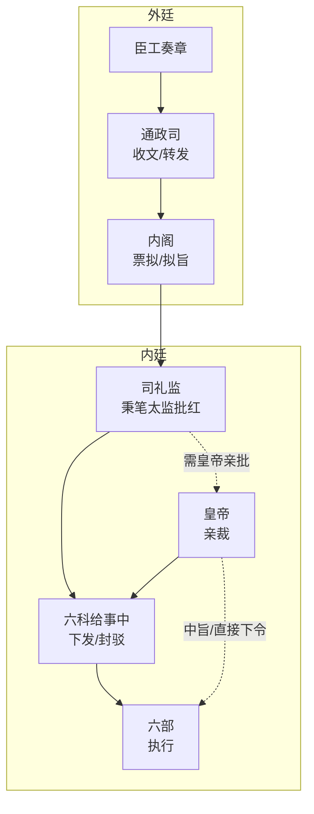

# 司礼监与宦官体系

> 📍 返回 [README](../00-总览/README.md) · [按编排模式反查](../99-附录/04-按编排模式反查.md)
> 🔗 相关主题：掌印秉笔分离 · 内阁 · 二十四衙门

## 二十四衙门总览

明代宦官系统空前庞大，设十二监、四司、八局，合称二十四衙门。全部由宦官管理，外朝官员无权干涉内部事务。

### 与本文相关的主要监

| 监 | 长官 | 核心职能 | 权力性质 |
|:--|:--|:--|:--|
| **司礼监** | 掌印太监 | 批红、掌玉玺、管理全体宦官 | **最高**——皇权的制度延伸 |
| **内承运库** | 掌库太监 | 皇帝私人库藏 | **高**——独立财政通路 |
| **御马监** | 提督太监 | 皇帝直属军队 | **高**——独立军事通路 |
| **尚宝监** | 掌印太监 | 管理皇帝各类印信符节 | **中**——权力硬件载体 |
| **东厂** | 提督太监 | 秘密监察、元监察 | **极高**——密奏直通皇帝 |

---

## 司礼监的核心职位与权力

### 掌印太监 —— 司礼监最高长官

**做什么（日常）**：
- 掌管皇帝玉玺——所有经批红的诏书需要掌印太监盖章才具有法律效力
- 管理全体宦官的人事任命和考核（二十四衙门的宦官由掌印太监分配和考评）
- 主持司礼监的日常运作——审阅秉笔太监的批红是否有越权
- 在皇帝缺位或年幼时，实际上是宫廷内权力最大的人

**制约**：
- "批红"和"盖章"两权分离——掌印太监管盖章(生效)，秉笔太监管批红(内容)。掌印不能自己批红，秉笔不能自己盖章
- 东厂提督太监通常是司礼监二把手（秉笔太监兼任）——掌印和东厂之间是内部制衡
- 皇帝随时可以撤换掌印太监（他没有独立权力基础）
- 锦衣卫监视（厂卫互监）——如果掌印太监与锦衣卫指挥使勾结，则制衡失效

**与内阁关系**：
- 掌印太监不直接参与票拟内容的讨论
- 但他控制盖章环节——可以"拖"着不盖章（虽然不能永远拖着）。这种"流程延迟权"在紧急事务上是一张隐形的牌

### 秉笔太监 —— 批红的实际执行者

**做什么（日常）**：
- 每天清晨，司礼监秉笔太监到文渊阁接收内阁的票拟
- 根据皇帝的意思（或自己的判断，在制度灰色地带）在票拟上批写最终决定
- 将批红后的诏旨下发六科
- 在授权范围内自主批红常规事务（朝廷流水线确认、非高风险子任务通过等）
- 超越权限的批红请求上报皇帝亲批

**批红的授权范围（律例预设）**：
- 可代批：常规行政事务、日常人事调动、一般预算审批
- 不可代批（必须皇帝亲批）：模式切换 → 诏狱启动 → 灾备切换 → 内库大额拨付 → 御马监调用 → 国库总额调整 → Agent永久降权/剔除

**制约**：
- 代批范围由律例明确限定——越权代批一经查实，当次批红作废，总控需重新亲批
- 六科给事中可封驳代批结果（"这个批红超越了授权范围，封还"）
- 代批记录留档——接受审计和东厂事后抽查
- 掌印太监的盖章权——没盖章就不生效

**受谁监督**：
- 六科给事中（封驳权——可以驳回代批结果）
- 都察院（可弹劾秉笔太监逾权）
- 东厂（内部监察——厂公通常是另一位秉笔太监，会盯着同僚）
- 审计（事后抽查代批记录）

**与内阁的关系**：
- 日常工作中接触最频繁——秉笔太监是内阁和皇帝之间的唯一文书通道
- 内阁无法越过秉笔太监直接找皇帝批红（除非皇帝主动召见）
- 秉笔太监可以在传递票拟时附加口头说明——这种"信息框架"能力非常微妙

---

## 其他关键宦官职位

### 东厂提督太监（厂公/督公）

（详见[东厂](../03-监察链/06-东厂.md)）

- 通常由司礼监二把手（排名第二的秉笔太监）兼任
- 密奏直通皇帝——不经内阁、不经司礼监内部审批
- 元监察：监察所有监察者
- 无执行权——只能收集情报和弹劾

### 内承运库掌库太监

- 管理皇帝私人库藏（白银、珠宝、珍玩）
- 皇帝可直接下令拨付——不经内阁和户部审批
- 内库支出不入国家财政账目
- 大额拨付需皇帝亲批

### 御马监提督太监

（详见[御马监与直控军队]()）

- 掌管皇帝直属军队（四卫营+勇士营，约2-3万人）
- 只听皇帝直接命令——绕开兵部和五军都督府
- 用于兜底执行和高风险任务直派

---

## 宦官权力的本质与边界

**权力来源**：宦官的所有权力都是皇权的延伸——他代表皇帝做事，不是自己有权力。皇帝信任他时他权倾朝野，皇帝一换或一不信任他瞬间失去一切。

**限制体系**：
1. **内部制衡**：掌印/秉笔/东厂三权分离（一个太监不能同时占这三个位子）
2. **外部制衡**：内阁（票拟权）、六科（封驳权）、都察院（弹劾权）
3. **制度约束**：律例明确限定了代批范围和大额拨付条件
4. **人身依赖**：太监无后代无家族，权力基础完全来自皇帝个人——这让他们极度危险（没有退路）又极度脆弱（没有独立根基）

---

## 编排参考

任事型编排系统对司礼监的映射：
- "司礼监掌印" → 批红盖章生效——对应编排中太仓库的预算账户扣减确认
- "司礼监秉笔代批" → 司礼监 Agent 在授权范围内代行常规批红
- "代批范围由律例定义" → 律例 Agent 维护代批权限白名单
- "越权代批作废" → 查实后当次批红作废，总控需重新亲批
- "代批记录留档" → 全部代批附带票拟索引和理由，审计和东厂抽查

核心洞察：**日常决策授权和终极控制权分离**。总控不需要批准每一个常规批红（那会让总控成为瓶颈），但战略级决策绝不授权。司礼监的设计使编排系统可以在"效率"（代批减少等待）和"安全"（关键决策必须亲批）之间找到平衡。
