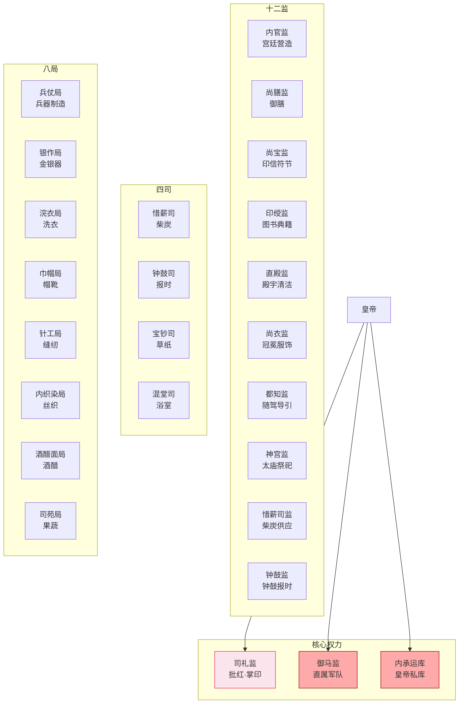
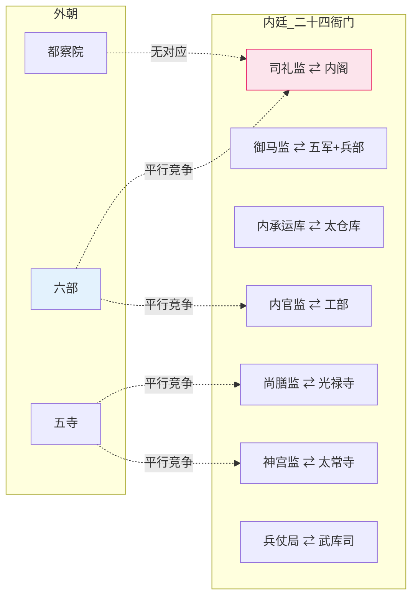

# 宦官二十四衙门全览

> 本文档补全[司礼监与宦官体系]()中未展开的二十四衙门完整结构。

## 二十四衙门总架构

明代宦官系统空前庞大，设**十二监、四司、八局**，合称二十四衙门。全部由宦官管理，外朝文官无权干预内部事务。二十四衙门在职能上与外朝的六部、五寺、府州县形成了一套平行的"内廷政府"。

---

## 一、十二监（全部由掌印太监管理）

| # | 监名 | 职能 | 与外朝对应机构 | 权力级别 |
|:--|:--|:--|:--|:--|
| 1 | **司礼监** | 批红、掌玉玺、总管全体宦官 | 内阁（票拟的审批方） | **最高** |
| 2 | **御马监** | 皇帝直属军队（四卫营+勇士营，约2-3万） | 兵部+五军都督府（绕开的对象） | **极高** |
| 3 | **内承运库** | 皇帝私人库藏（白银/珠宝/珍玩） | 太仓库（平行独立的另一套财政） | **极高** |
| 4 | **内官监** | 宫廷营造——宫殿/陵墓/园林的修缮和建造 | 工部（分包关系——内官监发包、工部承建） | 高 |
| 5 | **尚膳监** | 皇帝御膳和宫内宴会 | 光禄寺（协作——光禄寺备料、尚膳监烹饪） | 中 |
| 6 | **尚宝监** | 管理皇帝各类印信符节（非玉玺——玉玺在司礼监） | 尚宝司（外朝对应、互相核对） | 中 |
| 7 | **印绶监** | 管理古今图书典籍、书画收藏 | 翰林院（部分重叠） | 中 |
| 8 | **直殿监** | 各殿宇庭院的清扫和维护 | （无直接对应——纯内廷事务） | 低 |
| 9 | **尚衣监** | 皇帝冠冕、朝服、盔甲的制作和管理 | 工部（制作任务的分包） | 低 |
| 10 | **都知监** | 皇帝出行时随驾开路、清道、导引 | 鸿胪寺（外朝礼仪对应） | 低 |
| 11 | **神宫监** | 太庙和各皇陵的祭祀维护 | 太常寺（祭祀事务的协作方） | 低 |
| 12 | **惜薪监** | 宫廷取暖用柴炭的供应和管理 | （无直接对应——后勤职能） | 低 |

> 注意：东厂不是独立的"监"，而是由司礼监秉笔太监**兼任**的差遣，无独立编制。西厂同理。

### 司礼监内部细分

（详见[司礼监与宦官体系]()）

- **掌印太监**：管玉玺、管全宦官人事
- **秉笔太监**（若干人）：代皇帝批红、排名第一的通常兼东厂提督
- **随堂太监**：协助秉笔处理杂务、文书的流转

---

## 二、四司

| 司名 | 职能 | 备注 |
|:--|:--|:--|
| **惜薪司** | 管理宫中柴炭供应（与惜薪监分工——司管采购和存储、监管使用和分配） | 北京冬天供暖是刚需——惜薪司控制着关键资源 |
| **钟鼓司** | 管理宫中的钟鼓报时、节庆鼓乐 | 看似小事但涉及宫中时间节奏 |
| **宝钞司** | 制造宫廷专用的草纸（粗纸——非货币） | 名字有"宝钞"但跟大明宝钞无关——只做卫生用纸 |
| **混堂司** | 管理宫中的浴室 | 最小最边缘的宦官机构 |

> 四司的职能较十二监更加琐碎——它们负责的是宫廷的后勤微操，而非任何政治性事务。

---

## 三、八局

| 局名 | 职能 | 规模 |
|:--|:--|:--|
| **兵仗局** | 制造宫廷用的兵器（刀剑、弓弩、火药）——与工部和兵部的武库司有协作 | 大为宦官中的技术部门 |
| **银作局** | 打造金银器皿（赏赐用的金碗、银壶等） | 大 |
| **浣衣局** | 洗涤宫中衣物。**唯一不在紫禁城内的宦官机构**（在德胜门附近——方便用水） | 大 |
| **巾帽局** | 制作冠冕、朝帽、靴子 | 中 |
| **针工局** | 宫中缝纫——制作衣物和被褥 | 中 |
| **内织染局** | 丝织品和染色的生产 | 中 |
| **酒醋面局** | 酿造酒、醋、制面酱——宫中调料供应 | 中 |
| **司苑局** | 管理宫中园林种植——蔬菜、水果、花卉 | 小 |

> 八局的生产能力使宫中可以**自给自足**基本的生活物资——不需要经过外朝的采购体系。这是皇帝"绕开文官"的另一个维度：不是绕开政治决策，而是绕开日常生活的物资供应链。

---

## 二十四衙门的系统逻辑

### 与外朝的职能平行对应

### 为什么需要"内廷政府"

1. **皇帝不信任外朝**：外朝文官有自己的政治逻辑和利益，不一定与皇帝意志完全一致。有一个完全由宦官组成的、只对皇帝个人负责的平行系统，是对外朝的制衡
2. **绕过文官的低效**：如果修一扇窗户都要经过工部走公文流程，皇帝会疯掉。内官监的存在让日常维护可以"直接做"
3. **经济和军事的独立通路**：内承运库（财政独立）+ 御马监（军事独立）= 皇帝在最坏情况下仍有资源可用
4. **知识权力的保存**：翰林院（外朝的知识库）和印绶监（内廷的知识库）平行——皇帝可以从两个系统获取信息而非仅依赖一个

### 内廷自身的腐败问题

二十四衙门的庞大规模也产生了严重的制度腐败：
- 各监掌印太监在自己的职权范围内有**独立采购权**——这催生了巨大的腐败空间
- 内官监的大型工程（修宫殿/陵墓）经手巨额资金——工部的很多官员实际上成了内官监的转包商
- 到明朝中后期，想要在宫廷采购供应中分一杯羹，必须买通主管宦官

### 内廷外朝的具体对接机制（深化）

前面讲了内廷与外朝的"职能平行对应"——但两者不是完全隔离的，必须通过特定的对接机制完成事务交接。以下是几个关键的对接点：

#### 对接点一：司礼监 ↔ 内阁（决策对接）

- **文书交接**：内阁票拟通过司礼监随堂太监传入内廷，秉笔太监批红后通过随堂传出
- **禁止私人接触**：内阁首辅不能私下见司礼监太监，违者"结交近侍"罪
- **政治联盟的诱惑**：张居正 + 冯保的联盟虽有效但违反制度——历史证明这种联盟总是以反噬告终

#### 对接点二：内官监 ↔ 工部（工程对接）

- **发包关系**：大型工程（宫殿/陵墓）由内官监发包，工部营缮司承建
- **资金流**：预算从户部太仓库出，但内官监有独立采购权可绕过工部
- **腐败风险**：工部官员实际上变成内官监的转包商，双方勾结虚报工程款

#### 对接点三：尚宝监 ↔ 尚宝司（印信对接）

- **互相核对**：尚宝司（外朝）和尚宝监（内廷）都管理皇帝印信，但职能有区分
- **尚宝司**：管理外朝使用的印信（如六部印章、官印）
- **尚宝监**：管理皇帝私印和内廷印信
- **关键印信（玉玺）**：在司礼监掌印太监手中，不在尚宝司也不在尚宝监
- **核对的协调价值**：两套系统互相核对，防止任一方伪造印信

#### 对接点四：尚膳监 ↔ 光禄寺（膳食对接）

- **协作分工**：光禄寺（外朝）负责食材采购，尚膳监（内廷）负责烹饪
- **冲突点**：光禄寺采购扰民（低价强买），尚膳监不满意质量则向皇帝告状
- **制度化腐败**：光禄寺的采购预算被层层克扣，实际到食材上的钱很少

#### 对接点五：兵仗局 ↔ 兵部武库司（兵器对接）

- **两条生产线**：兵仗局（内廷）造宫廷用兵器，工部 + 兵部武库司（外朝）造军队用兵器
- **技术分工**：兵仗局偏向精工（皇帝佩剑、仪仗兵器），武库司偏向量产（军用火铨、盔甲）
- **产能重叠时的协调**：战争期间兵仗局也被征调量产军火，与武库司发生重叠

#### 对接点六：神宫监 ↔ 太常寺（祭祀对接）

- **分工**：太常寺（外朝）制定祭祀礼仪和执行，神宫监（内廷）负责太庙和皇陵的日常维护
- **冲突点**：太庙祭祀的祭品采购（光禄寺负责） vs 太庙维护（神宫监负责），两者经常互相推诿

### 内廷外朝对接的总原则

**原则一：双轨制** - 重要职能都设内外两套系统，皇帝可从两套系统中获取不同视角的信息

**原则二：禁止私人联盟** - 内廷太监与外朝文官的私人交往是重罪，防止内外勾结

**原则三：皇帝是唯一接口** - 内廷外朝之间没有制度化的直接沟通渠道，所有对接都通过皇帝中转（或通过文书流转系统）

**原则四：内廷优先** - 当内外两套系统冲突时，内廷的意愿优先（因为代表皇帝）——但这恰恰是腐败的源头

### 内廷外朝对接失败的根本原因

内外两套系统必然产生对接席擦，原因在于：
- **价值不同**：外朝文官重视制度/律例/道德；内廷太监重视皇帝个人意志/思宠
- **利益不同**：外朝官员的利益在朝廷体制内（升迁/名声）；内廷太监的利益完全依赖皇帝个人
- **能力不同**：外朝文官通过科举选拔，专业能力强；内廷太监文化水平参差不齐（除司礼监外）
- **信息不对称**：皇帝可以从两个系统获取不同信息，但两个系统之间信息不互通

这种设计本意是让皇帝从两套系统中获取多视角信息做出平衡决策，但实际上：
- 强势皇帝（朱元璋/永乐）能驾驭两套系统
- 弱势皇帝被两套系统操纲（明后期宦官专权）
- 多数皇帝被内廷控制（因为内廷高皇帝更近）

---

## 编排参考

- "二十四衙门的职能平行对应" → **编排系统中的影子组织**：为关键外部模块（六部/太仓库）配设内廷备份（司礼监/内承运库），在最坏情况下内廷备份仍可维持系统最低运转
- "内廷可自给自足" → **系统兜底的独立资源池**：编排系统的核心（总控+司礼监+内承运库+御马监）必须有独立的计算资源和通信通道，不依赖常规模块的持续运转
- "各监独立采购权" → **分权下的腐败风险**：分权是好事但每个被分权者都是新的腐败来源——编排系统中每个 Agent 的独立决策权都需要被审计和抽查
- "太监可随时被皇帝撤换" → **人身上的完全依赖**：内廷 Agent 不能有独立的持久化状态——其所有状态依赖总控的授权，总控可随时收回
