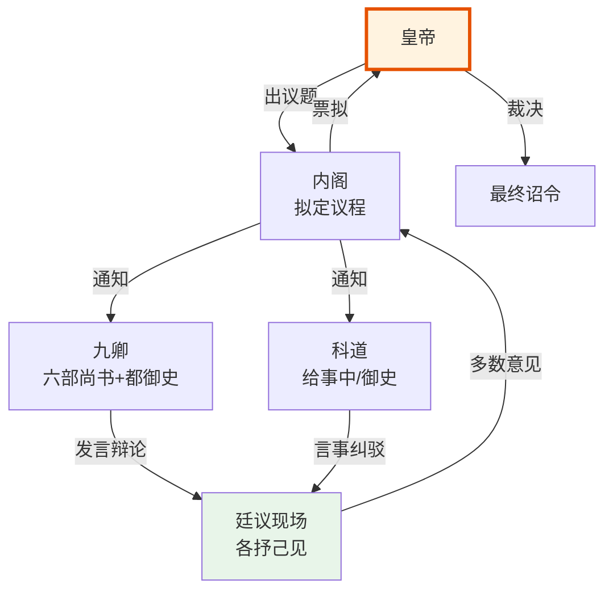

# 廷议与朝会

> 📍 返回 [README](../00-总览/README.md) · [按编排模式反查](../99-附录/04-按编排模式反查.md)
> 🔗 相关主题：廷推 · 朝会答辩 · 风闻言事




## 明代朝会的三种形式

### 大朝
每年正月初一和冬至举行，纯礼仪性质。皇帝御奉天殿（后改皇极殿），百官按品级列队朝贺。不讨论任何实际政务——是展示皇权威严的仪式，类似于"全体职工大会"。

### 常朝
日常行政议事。明初朱元璋每天御门听政（在奉天门露天办公），文武百官有事当面奏报，皇帝当场批示。但随着皇帝怠政（正统以后愈发严重），常朝逐渐流于形式，实际行政转移到内阁票拟 + 司礼监批红的通道。

### 廷议
针对重大国事，皇帝召集相关重臣（内阁、六部尚书、都御史、大理寺卿等）专题讨论：
- 廷议不投票——各官员表达意见，皇帝最终决定
- 廷议结果形成"廷议疏"（会议纪要），作为皇帝决策的参考
- 廷议讨论的典型议题：是否与蒙古开战、是否迁都、重大人事任免、新税法是否施行

廷议的本质是**扩大化的顾问会**——皇帝想听更多人的意见但不受任何人的意见约束。

## 朝会答辩制（考功公示）

在京察大计之后，吏部和都察院将考核结果（拟升、留、降、黜的名单）在朝堂上公示。相关官员可以当庭申辩（"答辩"），提出异议。如果异议合理，由大理寺（复核）重新审查。

这不是民主——答辩只是一个纠错机制。考核决定本质上由上级做出，答辩只是给被考核者一个"最后一次说话的机会"，减少冤错。

## "再议"机制

如果皇帝对票拟或廷议结果不满意，可以批"再议"——全文退回内阁或相关部门，附上皇帝的疑问或要求，责令重新讨论。再议可以反复进行，直到皇帝满意或放弃。这是皇帝否决票拟但又不是直接推翻的柔和方式。

## 廷议的辩论规则与发言顺序（深化）

廷议不是“各抒己见然后皇帝拍板”这么简单——明代发展出了一定结构的辩论规则，虽不如现代议事程序（如罗伯特议事规则）严格，但有明确的惯例。

### 发言顺序

廷议的发言顺序按以下原则组织：

| 顺序 | 角色 | 发言内容 | 为什么在这个顺序 |
|:--|:--|:--|:--|
| 1 | **皇帝（或司礼监代读）** | 宣布议题、提出疑问 | 定调子、不能预设结论 |
| 2 | **内阁首辅** | 陈述内阁的初步意见 | 内阁是行政中枢，先给出专业意见 |
| 3 | **吏部尚书** | 人事影响评估 | 涉及人员调动时吏部最先发言 |
| 4 | **兵部尚书** （如涉军事） | 军事可行性评估 | 专业领域评估在通用意见之后 |
| 5 | **户部尚书** （如涉财政） | 财政可行性评估 | 同上 |
| 6 | **都御史** | 监察视角意见 | 监察者最后发言，避免影响其他人表态 |
| 7 | **其他九卿** | 各部角度意见 | 按议题相关性依次发言 |
| 8 | **科道官（言官）** | 发表反对/疑虑意见 | 言官专门负责挑问题，最后发言可以针对前面所有人的意见 |

**关键原则**：
- **低品级后发言**——避免被高官意见“绑架”，不欺说真话
- **言官最后发言**——言官的任务是挑刺，需要看到所有人的意见才能发现疑点
- **不设发言时限**——但躬君惯例是“言不尽意不退”，不能中途打断

### 决议方式

廷议的决议有三种可能：

```
皇帝召集廷议
    ↓
各官员依次发言
    ↓
皇帝裁夺
    ├── 意见一致 → 采纳、下发作诏旨
    ├── 意见分歧但明显多数 → 采纳多数、少数异议留档
    ├── 意见严重分歧 → 批“再议”退回重新讨论
    └── 皇帝独断 → 不顾廷议意见直接下旨（但要承担政治代价）
```

**廷议不投票**——没有现代议会式的记名投票。决议是皇帝“听取众人意见后”独自做出。但多数意见会被记录在《廷议纪事》中，成为后续问责的依据。

### 廷议的三轮调论传统

重大议题的廷议可能会多轮进行，每轮的焦点不同：

| 轮次 | 焦点 | 典型产出 |
|:--|:--|:--|
| **第一轮** | 问题是什么、有哪些可选方案 | 多个初步方案 |
| **第二轮** | 各方案的优劣、可行性评估 | 方案评估报告 |
| **第三轮** | 最终推荐方案、反对意见留档 | 廷议硫上呈皇帝 |

### 言官的“风闻言事”特权

都蔡院御史和六科给事中（合称“言官”）有一项独特特权——**“风闻言事”**：可以在没有任何证据的情况下，仅凭传闻、甚至仅凭怀疑，就上奏弹劾官员或质疑政策。

**为什么允许风闻言事**：
- 言官若必须有实错才能弹劾，很多贪腐问题将无法被揭露（错证被销毁)
- 宁可多查十件冤案，也不能放过一件真贪
- 言官品级低、消息来源多，是朝廷的“耳朵”

**风闻言事的制约**：
- 诬告反坐——查证是诬告则言官受罚
- 但实践中反坐很少执行（保护言官积极性）

## 重大历史案例：廷议失灵的三种模式

### 案例一：大礼议（堅靖年间）

**起因**：堅靖帝以堂兄身份继位（武宗驾崩无子），欲追尊生父为“皇考”（皇帝父亲称号），群臣反对（认为应过继给孝宗才能合法继位）。

**廷议过程**：
- 多轮廷议，群臣多数反对追尊生父
- 堅靖帝不理廷议意见，强行下旨
- 杨慎等群臣在左顺门外哭谦（集体跪即抗议）
- 堅靖帝动用廷杖（打屁股）驱散群臣，多名官员被打死

**失灵模式**：**皇帝独断不顾廷议**——当皇帝决心已下，廷议只是仪式。

### 案例二：国本之争（万历年间）

**起因**：万历皇帝欲立皇三子为太子（违反嫡长子继承制），群臣坚持立皇长子。争议持续近 30 年。

**廷议过程**：
- 万历不断要求廷议讨论，但廷议始终坚持嫡长子
- 万历采取“奏章留中”对抗——既不批也不退
- 多次拟立的太子人选被群臣阻止
- 最终万历被迫立皇长子（后来的秦昌帝）

**失灵模式**：**僵局与默认默认**——皇帝与群臣均不退让，问题拖延数十年。

### 案例三：明末战和之争

**起因**：面对清军（后金）威胁，朝廷内部主战派与主和派僵持不下。

**廷议过程**:
- 主战派（东林党）以道德理由反对任何议和
- 主和派认为军事上无法取胜，必须议和换时间
- 廷议变成党争工具，不是理性讨论
- 袁崇焕等主战派将领被诬陷杀害

**失灵模式**：**党争工具化**——廷议不再服务于决策，而是服务于党派利益。


> **参见**：朝会复合态的设计启示（门客先发言/帝皇后发言/风闻言事/避免失灵模式）已拆出至 [06-私人智囊/03-朝会复合态](../06-私人智囊/03-朝会复合态.md)

## 廷推：高级官员的集体提名制度

### 廷推是什么

"廷推"是明代三品以上高级官员（六部尚书、都御史、总督等）出缺时的集体提名机制——它不是考试、不是皇帝直接任命、也不是吏部单独决定，而是由**九卿及以上的在京高级官员**集体会议推举候选人。

廷推的参与者：六部尚书（吏户礼兵刑工）+ 都察院左都御史 + 大理寺卿 + 通政使。这是"九卿"的标准阵容。参与者在会议上各自提出人选并说明理由，经讨论后形成2-3人的候选名单，上呈皇帝。皇帝从这个名单中选择一人任命——理论上皇帝也可以全部拒绝、要求重新廷推。

### 为什么需要廷推

廷推不是为了民主，而是为了解决三个问题：

**问题一：吏部尚书无法单独判断所有高级官员的合适性**。吏部文选司对中低级官员（五品以下）的选任有足够信息——但三品以上的职位涉及跨部门协调和战略判断，不是看履历表就能决定的。需要各部尚书各自提供本领域的信息。

**问题二：防止吏部尚书垄断高级人事权**。如果吏部尚书一个人能决定所有高级官员的去向，其他部尚书实际上就变成了吏部尚书的"下属"——破坏六部平行的制度设计。廷推让每个部尚书都有发言权。

**问题三：让皇帝有一个"安全"的决策锚点**。皇帝直接任命高级官员的风险很大——任命错了损失威望。但如果在廷推名单中选择，即使选错了也可以说"廷推推荐的名单里没有更好的人"。

### 廷推的政治博弈

廷推不是技术性的选人评估——它本质上是**政治博弈**：
- 内阁首辅的偏好会通过与会官员的表达间接影响廷推结果（首辅本人不参加廷推——他需要回避，但次辅和群辅会传达他的意思）
- 各部尚书之间的派系会反映在提名上——A派尚书提名A派人选、B派尚书提名B派人选
- 都察院都御史的提名往往最"干净"——因为御史被视为制度监督者，提出的人选不宜有明显的派系色彩
- 被提名人本身的意愿也很重要——有人"推而不就"（被廷推提名但本人拒绝就任）、有人"未推而求"（主动活动让廷推提名自己：前者被视为高风亮节，后者被视为德行有亏）

### 廷推与编排系统的对应

编排系统中多次借用"会推"概念：
- **六部协同中的"会推"**：吏部会同各部推选关键 Agent 的角色分配——对应廷推机制
- **廷推名单** → 规划层的"多规划Agent并行票拟"——多个方案并呈、总控选择
- **廷推的集体责任** → 编排系统中多Agent联合决策时的"责任分散"——没有人单独承担选错的全部后果
- **皇帝在廷推名单中选择** → 总控 Agent 在多个规划方案中选择而非自己从零制定——降低决策风险

核心洞察：廷推的本质是让**最了解某个领域的人共同推荐该领域的候选者**——而不是让一个人事部门（吏部）假装对所有领域都了解。编排系统借用这一逻辑：选将（调兵Agent）时参考的不是一个"全能人事数据库"，而是按任务类型匹配的专长标签——每个标签背后是该领域的"集体经验"。

---

## 编排参考

两个编排系统都借用了朝会议事概念：

- "廷议/朝会" → **朝会模式**（总智囊）：从门客/幕僚/帝皇三个子模式各抽 Agent 组成临时议会辩论
- "大朝" → 朝会答辩制：每次京察后，考功司将拟调整权重的 Agent 及理由通过礼部生成自然语言摘要公示，外部可提异议
- "廷议不投票" → 朝会辩论有辩论顺序但不投票——门客发散→幕僚量化→帝皇批驳→三轮辩论→最终方案
- "再议" → 用户选择或批"再议"——对批红Agent生成的方案选项不满意时，退回重新讨论
- "翰林学士列席" → 朝会模式下翰林格物学士作为无投票权的列席顾问，在辩论僵持时补充跨域解法参考

核心洞察：廷议在编排系统中的对应是**混合模式辩论**——不是简单的多Agent投票，而是结构化的辩论流程，各方按顺序发言而非同时发言，且最终决策权始终在总控（人类用户）手中。
