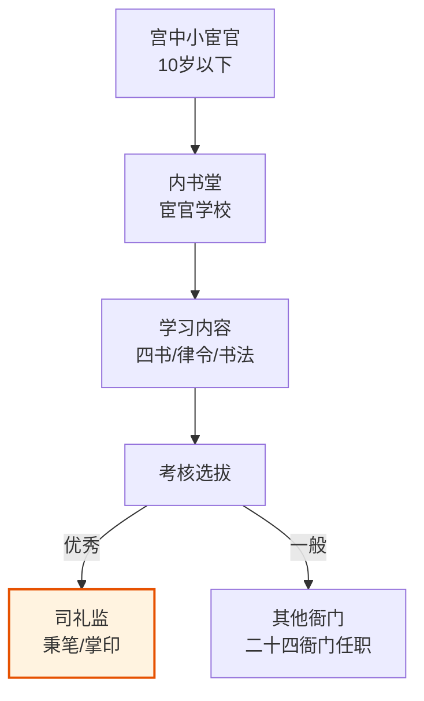

# 宗人府与三公三孤

> 宗人府的职责和宗室管理的完整逻辑，参见补充文档 **[藩王与宗室制度]()**——本文档聚焦宗人府机构本身和三公三孤的荣誉衔体系。

## 宗人府

### 机构设置

宗人府是明代管理皇族事务的最高机构。设：
- **宗人令**一人（由宗室中辈分最高、年龄最长的亲王担任）
- 左/右宗正各一人（由亲王担任）
- 左/右宗人各一人（由郡王担任）
- 经历司经历一人（正五品，由文官担任——负责日常文书和行政事务）

**权力结构**：名义上宗人令是宗人府的最高长官，但真正的决策权在皇帝手中。宗人府对宗室成员的处置建议（如扣俸、废为庶人、赐死）需要皇帝批红才能生效。

### 宗人府的职能

- **管理玉牒**（皇家族谱）：记录谁是谁的第几个儿子、生母是谁、生卒年月、妻妾子女。玉牒是确定宗室身份和俸禄的法律依据——你的名字在玉牒上你才是"皇族"
- **核定宗室俸禄**：亲王/郡王/镇国将军/辅国将军/奉国将军/镇国中尉/辅国中尉/奉国中尉——八级宗室爵位各有不同俸禄，从亲王年俸万石到奉国中尉年俸仅数十石。宗人府核定每个人的爵位和对应的俸禄标准
- **处理宗室成员违法**：轻则扣俸、中则降爵、重则废为庶人、极重则赐死。但涉及亲王郡王的大案通常由皇帝亲断，宗人府的裁决是形式
- **管理宗室子女婚嫁审批**：宗室成员的婚姻需要宗人府审批——这既是礼制也是控制（防止宗室通过联姻结盟）

### 宗室问题的积重

朱元璋规定宗室成员终身由国家供养。到明朝中后期，朱元璋的子孙后代膨胀到数十万人，每年宗室俸禄占用了巨大比例的财政开支，成为压垮明朝财政的因素之一。

**规模约束的缺失**是这一制度设计的致命缺陷：朱元璋在设计时没有预见到"每个宗室男子都生十几个儿子"的几何级增长后果。任何没有内置衰减机制的"终身供养"承诺，在时间维度上都是不可持续的。

> **→ 详见**：[藩王与宗室制度]() — 藩禁政策的完整梳理、宗室人口爆炸的数据分析、靖难之役后藩王权力的系统性削减。

## 三公三孤（荣誉衔）

**三公**（正一品）：太师、太傅、太保
**三孤**（从一品）：少师、少傅、少保

三公三孤在明代是**纯荣誉衔**——没有任何实际职掌。它们只代表皇帝对某个官员的最高礼遇。一个官员被加封"太子太师"不代表他真的去教太子——这只是一种政治地位的加码。

**实际作用**：三公三孤衔通常**兼**给已经身居要职的官员——如内阁首辅加"太师"衔、六部尚书加"太子太保"衔。这解决了内阁大学士本职品级太低（正五品）的问题——通过加三公三孤衔或六部尚书兼职衔，把实权的低级职位变成高级职位。

## 詹事府（东宫官职）

詹事府是太子（东宫）的行政班底，理论上负责太子的教育、生活、安全和未来的施政准备。詹事（正三品）主持詹事府，下设左/右春坊和司经局。

**实际上的鸡肋化**：明代很多皇帝与太子关系紧张（如万历与泰昌），太子的东宫班底实际上是皇帝监视太子的工具而非培养太子的团队。詹事府的职位常被用作翰林院官员的**兼衔**——一个翰林学士可能同时挂"左春坊左庶子"的兼衔，但不真去太子那里上班。

---

## 编排参考

- "宗人府" → 编排系统的**身份注册与资源配额管理**：类似宗人府管理玉牒（谁是什么身份/什么爵位/该领多少俸禄）——编排系统中每个 Agent 的身份标签（角色/权重/预算配额）由宗人府式的注册中心维护
- "宗室膨胀" → **规模约束的缺失是终身制福利的致命缺陷**：律例 Agent 必须为所有"终身制"资源设定硬上限——御马监上限（~2-3万）、内承运库上限（国库X%）、选锋标签上限。任何没有衰减机制的终身承诺都是系统崩溃的种子
- "玉牒" → **Agent 身份注册的不可篡改**：类似玉牒是身份的法律依据——编排系统中 Agent 的注册信息（创建时间/创建者/权限范围/历史角色）必须存储在不可篡改的档籍中
- "宗室婚嫁审批" → **Agent 之间的连接审批**：宗室成员不能自由联姻（防止结盟）——编排系统中高权限 Agent 之间的数据/消息通道连接需要审批
- "三公三孤" → **考功册中的荣誉标签与实权分离**：一个 Agent 可能考功等级高（卓异=三公）但当前任务权重低，反之亦然。荣誉衔不直接转化为执行权——类似内阁大学士正五品本职+太师兼衔的模式
- "詹事府兼衔" → **Agent 的多标签体系**：一个 Agent 可以同时有"本职"（当前角色）和"兼衔"（历史积累的标签）。如选锋标签就是在能力上的"兼衔"——不直接决定当前任务分配但影响优先级。类似詹事府官职常被用作翰林的兼衔而非真实去太子那里上班
- "藩禁与隔离" → 详见[藩王与宗室制度]()编排参考部分
