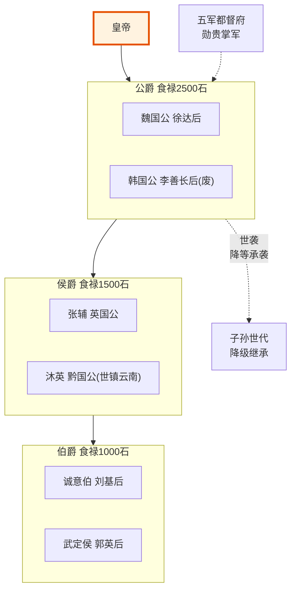

# 后宫与外戚制度

## 明代后宫制度的独特设计

明代后宫制度与前代（特别是汉、唐）的根本区别在于**系统性防止外戚专权**。朱元璋在设计后宫制度时以汉唐为鉴——吕后、武则天、杨贵妃家族的覆辙必须避免。

### 选秀制度——从民间选拔

明代后妃**不选自勋贵官宦之家**，而是从民间（主要是北直隶及周边地区的普通人家）选秀女入宫。这是明代外戚制度的根基。

**选秀流程**：
1. 朝廷定期派太监到北直隶、河南、山东等地挑选13-16岁少女
2. 初选看外貌和家世（必须是"良家"——无犯罪记录、非倡优、非医卜）
3. 入宫后由女官进行身体检查和多轮筛选
4. 入选者先做宫女，个别被皇帝看中后逐步晋升（嫔→妃→贵妃→皇贵妃→皇后）

**为什么从民间选**：
- 民间女子没有家族势力可依仗
- 其父兄即使被赐封，也只是得到了虚衔而没有政治根基
- 不存在"外戚集团"形成的土壤
- 与汉朝（皇后多出自大族如窦氏、梁氏）和唐朝（武氏、杨氏）形成鲜明对比

### 后宫的品级体系

| 品级 | 封号 | 人数 | 备注 |
|:--|:--|:--|:--|
| 皇后 | 皇后 | 1人 | 正妻、六宫之主 |
| 正一品 | 皇贵妃 | 1人 | 实际后宫第二人 |
| 正二品 | 贵妃 | 2人 | — |
| 正三品 | 妃 | 不限 | 贤/淑/庄/敬/惠/顺/康/宁等封号 |
| 正四品 | 嫔 | 不限 | — |
| 正五品 | 昭仪/昭容等 | — | 较少实际册封 |
| 正六品以下 | 婕妤/美人/才人/选侍/淑女 | — | 基层嫔御 |

> 明初朱元璋定下"妃位不过四"（防止后宫无限膨胀），但后世常有突破。嘉靖、万历时后宫人数膨胀到数千人。

### 女官制度——后宫的管理层

明代设**六局一司**的女官体系（全部由女性担任），负责后宫日常管理，与宦官系统平行但互不隶属：

| 局 | 职能 |
|:--|:--|
| 尚宫局 | 导引皇后、总管六局文书 |
| 尚仪局 | 礼仪起居、宴会次序 |
| 尚服局 | 服饰、宝玺保管（配合尚宝司） |
| 尚食局 | 御膳、宫中食材采购 |
| 尚寝局 | 寝宫管理、皇帝临幸记录 |
| 尚功局 | 女红、后宫手工业生产 |

女官从民间识字女子中选拔，有一定任期，可出宫——她们不是皇帝的嫔妃，是职业管理者。女官体系的设计意图是：**让女性管理后宫事务，减少宦官干预后宫的空间**。

---

## 外戚制度——封而不任

### 外戚的爵位

皇后父亲照例封侯（或伯），皇子外祖父封伯。但关键设计在于：

**有爵位、有俸禄、无实权、无军权、不预政**。

具体限制：
- 外戚封爵后**不得在朝中担任实职**（这是铁律，终明一代几乎未被突破）
- 外戚**不得入内阁**
- 外戚**不得掌兵权**（都督府、兵部都不许进）
- 外戚**不得参与廷议**（重大国策讨论）
- 外戚的俸禄从内承运库出（皇帝私库），不由太仓库（国库）负担——让他们在经济上也依赖皇帝个人

### 历史对比

| 朝代 | 外戚问题 | 明代对策 |
|:--|:--|:--|
| 汉 | 吕后称制、窦氏梁氏把持朝政 | 后妃选民间、外戚不任实职 |
| 唐 | 武周代唐、杨国忠专权 | 外戚封爵不预政、赋闲养在京 |
| 宋 | 相对较轻 | 明代在宋的基础上进一步制度化了"外戚不预政" |

**唯一的严重外戚事件**：明英宗时期的**孙太后**（英宗生母）在土木堡之变后主持立朱祁钰为帝（景泰帝）、稳住了政局——这被视为外戚制度的**正面案例**而非越权。因为孙太后的行为是在皇帝被俘的极端危机下维持皇权延续，符合制度逻辑而非破坏制度。

---

## 宦官与外戚的制衡关系

明代的**宦官权力远大于外戚**，这不是设计缺陷，而是**制度性的选择**：

| 维度 | 宦官 | 外戚 |
|:--|:--|:--|
| 政治根基 | 完全依附皇帝个人 | 有家族和血缘 |
| 传承性 | 无后代，权力不可继承 | 家族可世代积累 |
| 制度威胁 | 可能专权但不可能篡位 | 可能篡位（如王莽、杨坚） |
| 皇帝信任 | 高（从小在一起） | 中低（来自于婚姻） |

核心逻辑：**皇帝宁愿被奴才（宦官）骗，也不愿被亲戚（外戚）夺——前者最多贪腐，后者可能改朝换代**。

所以明代刻意做大宦官系统（十二监四司八局）、用他们去制衡外朝文官，同时把外戚彻底架空。这是一个经过计算的制度设计。

---

## 太后制度——后宫的最高权力

明代太后在制度上可以**垂帘听政**——但不常见。真正的**太后主政**只发生在两个场景：

1. **皇帝年幼**（如万历即位时年仅10岁，李太后在幕后支持张居正推行改革）
2. **皇帝缺位危机**（如土木堡之变后孙太后临危立帝）

但即使在这两种情况下，太后也不直接处理政务——她通过内阁和司礼监间接施加影响。她没有自己的"太后衙门"，不能单独下发命令。她的所有政治行为都要通过皇帝的名义执行。

**关键约束**：明代从制度层面规定了太后垂帘的"过期机制"——皇帝成年后（大婚后）太后立即还政，不能像晚清慈禧那样长期揽权。李太后在万历大婚后即退回后宫就是例子。

---

## 后宫制度与财政

后宫的运营费用来自**内承运库**（皇帝私库），而非太仓库（国库）。这既是"皇帝的事皇帝自己出钱"的原则，也是防范后宫开支拖垮财政的制度设计。

但到明朝中后期，内承运库的钱不够用时，皇帝会试图从太仓库（国库）"借"钱——这引发了皇帝和文官集团之间关于财政边界的长期拉锯。

---

## 编排参考

- "选秀从民间" → 编排系统中的**能力池招募**——不局限于预定义的"精英圈"，从广泛分布中筛选高质量成员，避免形成封闭的"世家"
- "外戚封而不任" → **荣誉标签与实权分离**——类似考功册的卓异/称职标签：一个 Agent 可以有高荣誉等级但不代表当前任务的高权重
- "太后过期待废" → **权限的时效性设计**——紧急授权有明确的过期条件，到期自动收回，不需要人工干预
- "后宫费用从内库出" → **资源池的隔离原则**——不同层级的资源池严格分离，跨池调用需要明确的审批和审计
- "宦官比外戚更可信" → **编排系统中的代理人选择原则**——倾向于选择"无独立根基"的代理（不能自我复制的 Agent），而非"有家族势力"的代理（能独立存在和成长的 Agent）
