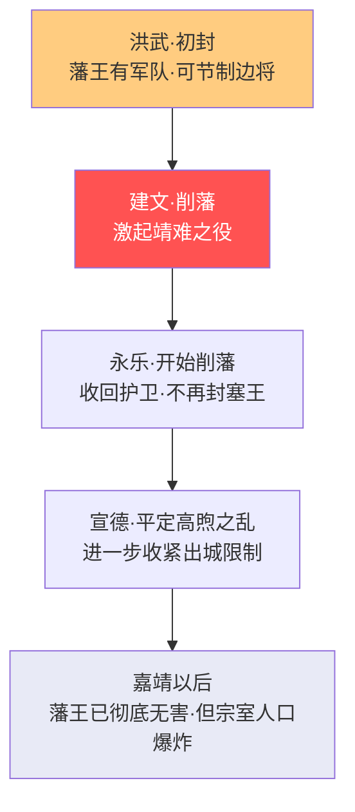

# 藩王与宗室制度

> 本文档补全[宗人府与三公三孤]()中未展开的藩王管理细节和宗室制度的完整演化。

## 朱元璋的藩王设计——理想与陷阱

### 初封制度（洪武年间）

朱元璋为巩固朱家天下，把24个儿子和1个从孙分封到全国各战略要地做藩王：

| 藩王类型 | 位置 | 代表 | 权力 |
|:--|:--|:--|:--|
| **塞王**（边防藩王） | 北方边境 | 燕王朱棣、宁王朱权、秦王朱樉、晋王朱棡 | **拥有护卫军队**（3000-19000人）、可节制边将 |
| **内地藩王** | 内地重要城市 | 周王朱橚、楚王朱桢、蜀王朱椿 | 有护卫但较少参与军事 |

朱元璋的设计意图是**藩王拱卫中央**——平时守边、皇室内乱时藩王起兵勤王。各藩王设王府官（长史司），由朝廷派文官担任，理论上对藩王形成监督。

**制度的致命缺陷**：塞王拥有军队且常年与边防将领合作——这给了他们**军事能力和人脉网络**。当中央出现弱势（建文帝年轻、激进削藩），最强大的藩王（燕王朱棣）就发动了靖难之役。

---

## 靖难之役后的系统性藩禁

朱棣以藩王身份夺位后，深知藩王制度的危险。他推行了一系列削减藩王权力的政策——**不是一次性废除，而是一步步割肉**：

### 藩禁政策全貌

| 限制维度 | 具体规定 | 制度后果 |
|:--|:--|:--|
| **军事** | 收回所有藩王护卫军队（仅保留少量仪仗） | 藩王再无军事力量 |
| **政治** | 藩王不得参与朝政、不得入京（除非皇帝召见）、二王不得相见 | 藩王被物理隔离于政治之外 |
| **地理** | 藩王出城需审批、不得离开封地、出城范围受限 | 变成了封地的终身囚徒 |
| **经济** | 藩王不得经商、不得置田产（但可以通过赐田获取）、不得参与盐铁专卖 | 经济上完全依赖朝廷俸禄 |
| **社会** | 宗室不得参加科举、不得做官、不得从事士农工商任何职业 | 宗室唯一的"职业"是活着领俸禄 |
| **人事** | 王府官由朝廷派遣，藩王无权任免 | 王府官实际是朝廷安插的监视者 |

### 藩禁的逐代强化

---

## 宗室人口爆炸——制度设计的最大代价

### 增长数据

| 时期 | 宗室人数（约） | 备注 |
|:--|:--|:--|
| 洪武末年 | 58人 | 朱元璋的子孙 |
| 永乐年间 | 约200人 | 靖难后人口收缩 |
| 正德年间 | 约3000人 | 开始成规模增长 |
| 嘉靖末年 | 约2万人 | 加速膨胀 |
| 万历末年 | **超过20万人** | 灾难性膨胀 |
| 崇祯末年 | 约30万人 | 财政彻底无法承受 |

### 膨胀机制

朱元璋规定：每一个宗室男子从出生起就由国家供养，终身领取俸禄。亲王的长子继承亲王爵位，其余儿子降一级封郡王；郡王的其他儿子再降一级封镇国将军……如此逐代递降，直到第六代为奉国中尉后不再降（永远领取底层宗室俸禄）。

这意味着：
- **每代宗室人数呈几何级数增长**（一个亲王可能有十几个儿子，各自又有十几个儿子）
- **底层宗室俸禄虽低但人数极多**——到万历年间，大量底层宗室（奉国中尉级别）的俸禄合计超过了顶层亲王
- **宗室不能从事任何职业**——他们不能通过自谋生计来减轻国家财政负担

### 财政冲击

到嘉靖年间，宗室俸禄支出已占全国财政的相当比例。朝廷被迫：
- **拖欠底层宗室俸禄**（只保证亲王和郡王的，底层宗室欠俸多年）
- **削减宗室俸禄标准**（如"减半支给"）
- **允许部分底层宗室"自谋生计"**（实际上突破了藩禁）

到万历年间，大量底层宗室穷困潦倒——他们是"皇族"，但因为长期领不到俸禄又不得工作，实际上生活水平还不如普通平民。这产生了一个荒诞的现象：**朱元璋的子孙在街上讨饭**——而他们碍于身份还不能承认自己是谁。

---

## 王府内部管理

### 王府官体系

每个亲王府设**长史司**（正五品），下辖：
- 左/右长史（各一人）——总管王府事务，由朝廷派遣的文官担任
- 审理正——管理王府内部司法
- 典簿——管理王府文书
- 典仪——管理王府礼仪

**朝廷派文官管藩王**的设计本质是：长史司名义上服务于藩王，实际上负责**监督和报告**藩王的一切行为。藩王不能撤换自己的长史——长史由吏部任免。

### 宗人府的角色

宗人府（见[宗人府与三公三孤]()）在宗室管理体系中的实际角色是**档案管理和违规处理**——它记录玉牒、核定俸禄、处理宗室成员的犯错。但真正的决策权在皇帝和内阁手中。

---

## 藩禁的制度后果

### 正面
- 终明一代**没有藩王之乱**（唯一的例外是正德年间的宁王之乱，仅43天被王阳明平定）
- 与汉（七国之乱）、晋（八王之乱）、唐（安史之乱的前身是节度使制度）相比，明代在皇族内乱问题上极为成功

### 负面
- 宗室人口爆炸成为压垮财政的关键因素之一
- 几十万宗室成员被圈养——人力资本被完全浪费
- 藩王虽然没有政治权力，但通过赐田和强占土地，在许多地方成了最大的地主
- 底层宗室的贫困化造成了严重的社会问题

---

## 编排参考

- "藩禁政策" → **权限的逐级衰减机制**：一个 Agent 被降权后，不仅在当前任务中降权，其"后代"（子 Agent）也逐级降权，防止特权在代际中积累
- "宗室人口爆炸" → **系统资源的无限增长约束**：编排系统必须对所有"终身制"资源有硬上限——御马监上限（~2-3万）、内承运库上限（国库X%）、选锋标签上限——防止任何一个特权群体像明朝宗室一样无限膨胀直至拖垮系统
- "二王不得相见" → **隔离原则**：高权限 Agent 之间设置物理/逻辑隔离，防止勾结
- "王府官由朝廷派遣" → **监控者嵌入被监控者内部**：监军御史的模式——从外部嵌入而非从内部选拔
- "底层宗室领不到俸禄" → **资源承诺的不可持续性**：编排系统不应做出"永久有效"的资源承诺——所有承诺应有明确的时效和上限，避免类似宗室俸禄的"制度性骗局"
