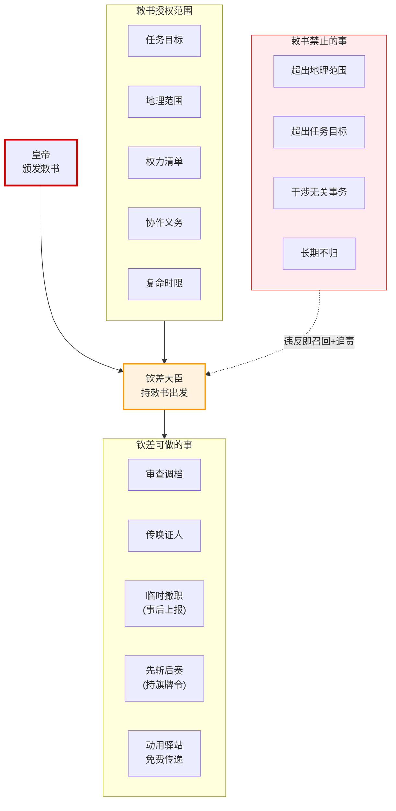

# 钦差大臣制度

> 钦差是明代最重要的**临时差遣**之一——皇帝特派处理特定事务的官员。它跨越所有常规部门（六部、都察院、地方），是皇帝直接介入协调的"插队机制"。理解钦差是理解明代差遣协调（[六大协调模式之五](../08-协调机制/01-明代六大协调模式总览.md)）的关键。

## 钦差的定位

### 什么是钦差

**钦差**（全称"钦差大臣"或"钦差官员"）是皇帝特命的临时差遣——钦差代表皇帝本人处理特定事务。钦差的设立解决了三个常规制度无法解决的问题：

| 问题 | 常规制度的局限 | 钦差的解法 |
|:--|:--|:--|
| **跨部门跨省份的重大事务** | 六部平行、地方三司互不统属——没有"总协调人" | 钦差携带"皇帝授权"打破部门壁垒 |
| **皇帝不信任地方督抚** | 督抚可能隐瞒真相、结党营私 | 钦差是"皇帝的眼睛"——直接听命于皇帝 |
| **突发紧急事务** | 常规流程冗长（票拟-批红-封驳） | 钦差可持旗牌令先斩后奏 |

### 钦差与其他差遣的区别

明代差遣体系庞杂，钦差与其他差遣容易混淆：

| 差遣 | 性质 | 与钦差的区别 |
|:--|:--|:--|
| **钦差** | 皇帝特派的**专项**差遣 | 钦差直接听命于皇帝，督抚听命于兵部/都察院 |
| **总督/巡抚** | 跨省/一省的**常驻**差遣 | 督抚有固定辖区，钦差无固定辖区（任务到哪到哪） |
| **经略** | 战时**战略**差遣 | 经略专管军事，钦差可管任何事务 |
| **巡按御史** | 都察院外派的**例行**差遣 | 巡按只监察不执行，钦差可执行 |
| **监军御史** | 军中**监督**差遣 | 监军不参与指挥，钦差可以指挥 |

**关键区分**：钦差的本质是**"皇帝人格的临时延伸"**——钦差到场等于皇帝亲临。其他差遣没有这种"皇帝人格"属性。

---

## 钦差的类型

明代钦差按任务性质分多种类型：

| 类型 | 任务 | 持续时间 | 品级要求 |
|:--|:--|:--|:--|
| **钦差审案** | 复查重大冤案、审理大案 | 数月 | 三品以上（刑部侍郎/大理寺卿） |
| **钦差赈灾** | 大灾时主持赈济 | 数月 | 户部侍郎/尚书 |
| **钦差督军** | 战时督师（与经略类似但更临时） | 战时 | 兵部尚书+都御史衔 |
| **钦差查账** | 清查地方财政、税关、盐政 | 数月 | 户部或都察院官员 |
| **钦差册封** | 册封藩王、外国国王 | 数月 | 礼部或翰林院官员 |
| **钦差祭告** | 祭告天地、宗庙、山川 | 短期 | 礼部或勋臣 |
| **钦差采办** | 为宫廷采购特定物资 | 不定 | 太监（多数情况） |
| **钦差河工** | 督办重大水利工程 | 数年 | 工部侍郎+都御史衔 |
| **矿税太监** | 为皇帝开矿收税（明后期弊政） | 长期 | 司礼监派出太监 |

---

## 钦差的授权机制

### 敕书：钦差权力的法律依据

每个钦差出发前，皇帝颁发**敕书**——明确钦差的权限范围。敕书是钦差行使权力的唯一法律依据。

**敕书必须写明**：
1. **任务目标**——具体要办什么事
2. **地理范围**——可以在哪些地方办事
3. **权力清单**——可以做哪些事（如审查、调档、传唤、临时撤职、先斩后奏等）
4. **协作义务**——哪些部门/地方必须配合
5. **回京复命时限**——什么时候回京汇报
6. **不能做的事**——明确禁止的越权行为



### 关键设计：敕书"明示权力"原则

**钦差只能做敕书上写明的事**——没有写的就不能做。这与一般官员"职掌之内皆可决断"不同。

**历史教训**：明神宗万历皇帝派出的"矿税太监"——敕书只写"开矿征税"，但矿税太监事实上干预民政、抢掠富户、滥施刑罚——超出敕书范围。这是明代最大的弊政之一，持续了二十多年。

### 信物：旗牌令和关防

钦差出发时携带皇帝颁发的信物：
- **旗牌令**——可调发当地军队护送、可在紧急情况下先斩后奏
- **关防**——钦差专用的印章，所有钦差文书盖关防才生效
- **勘合**——使用驿站免费传递文书和物资的凭证

---

## 钦差与地方督抚的协调

### 钦差 vs 督抚：谁说了算

这是钦差制度最复杂的协调问题——**钦差到地方后，与当地的督抚是什么关系**？

| 场景 | 协调规则 |
|:--|:--|
| **钦差查案 vs 巡抚** | 钦差审查的对象如果涉及巡抚本人，巡抚必须回避；不涉及则巡抚配合 |
| **钦差督军 vs 总督** | 钦差代表皇帝，总督必须服从钦差的战略指令（即使总督品级更高） |
| **钦差赈灾 vs 地方三司** | 钦差统筹资源分配，三司执行——钦差有"调配权"但具体执行归三司 |
| **钦差查账 vs 巡按御史** | 两者都是中央派出，但钦差是"专项"，巡按是"例行"——专项优先 |

### 钦差的"节制"权

**节制**是明代差遣协调的关键概念——节制不是"上下级指挥"，而是"协调时优先"。

```
钦差节制督抚 ≠ 钦差是督抚的上级
钦差节制督抚 = 督抚在做相关事务时必须听钦差的
```

**节制权的边界**：
- **事务相关**：钦差节制督抚仅限敕书规定的事务
- **时间限定**：钦差回京后节制权自动消失
- **不撤换权**：钦差不能撤换督抚（撤换督抚需皇帝批红）

### 协调失败模式

| # | 失败 | 原因 | 后果 |
|:--|:--|:--|:--|
| 1 | **钦差越权** | 敕书范围模糊，钦差自扩权力 | 干预无关事务，扰乱地方 |
| 2 | **督抚不配合** | 督抚不服钦差（特别是钦差品级较低时） | 钦差空有敕书办不成事 |
| 3 | **钦差久任不归** | 任务"无法完成"或皇帝不召回 | 变相成为地方新长官，破坏差遣制度 |
| 4 | **钦差与督抚勾结** | 钦差被地方收买 | 联合欺瞒皇帝 |
| 5 | **多重钦差叠床** | 同一地区同时有多个钦差（查账的、查案的、督军的） | 互相冲突，地方不知听谁的 |

---

## 钦差的复命与问责

### 复命：钦差的强制性汇报

**钦差回京后必须复命**——向皇帝当面汇报任务完成情况。复命不只是形式，而是关键协调环节：

```
钦差回京
   ↓
向皇帝面奏
   ├─ 任务完成情况
   ├─ 发现的问题
   ├─ 涉及的人员
   └─ 建议处理意见
   ↓
皇帝裁决
   ├─ 采纳建议 → 移交相关部门执行
   ├─ 不采纳 → 钦差徒劳
   └─ 怀疑钦差被收买 → 启动东厂调查
   ↓
钦差交还敕书和信物
   ↓
差遣结束，回归本职
```

### 钦差的法律责任

**钦差的责任比一般官员更重**：
- **越权罪**：超出敕书范围办事，撤职查办
- **受贿罪**：收受地方贿赂，重罪（钦差是皇帝的人，受贿等于背叛皇帝）
- **失职罪**：任务未完成或草率应付，降级
- **诬告罪**：复命时诬陷地方官员，反坐（加重处罚）

---

## 钦差制度的演变与教训

### 钦差制度的良性运行（明前期）

明前期（洪武-宣德）：
- 钦差派出频率低，只在真正重大事务时使用
- 敕书范围明确，钦差不敢越权
- 复命严肃，皇帝亲自听审
- 钦差回京后差遣立即结束

### 钦差制度的败坏（明中后期）

明中后期（正德-万历）：
- **矿税太监之弊**：万历派太监到各地开矿收税，敕书范围过宽，太监胡作非为二十多年
- **钦差泛滥**：同一事务派出多个钦差，互相冲突
- **久任不归**：部分钦差事实上成为地方新长官
- **复命流于形式**：皇帝怠政（万历），复命变成书面报告

### 设计启示

| 教训 | 启示 |
|:--|:--|
| 敕书范围必须明确 | 临时授权必须有清晰的"能做什么、不能做什么" |
| 钦差必须可回收 | 临时差遣不能演变成常驻，必须有明确结束时间 |
| 多重钦差叠床是大忌 | 同一地区不应同时有多个临时授权者 |
| 复命必须严肃 | 临时差遣结束后必须有强制性的复盘 |
| 越权必须追责 | 临时授权超出范围时必须有法律后果 |

---

## 编排参考

### 直接对应：编排系统的"钦差 Agent"

钦差制度是编排系统中**"临时专项 Agent"**的原型。当常规编排无法处理某类事务时，可以派出"钦差 Agent"专项处理：

| 明代钦差 | 编排系统的钦差 Agent |
|:--|:--|
| 皇帝特命派出 | 总控（用户）特派 |
| 携带敕书（明示权力） | 持任务规格书（明示能做什么/不能做什么） |
| 持旗牌令（先斩后奏） | 持特殊权限令牌（如降级熔断、强制中断） |
| 节制督抚（协调优先） | 协调时优先于常驻 Agent |
| 复命（强制汇报） | 任务结束必须复盘归档 |
| 交还敕书（差遣结束） | 令牌回收，临时 Agent 退出 |

### 何时派出钦差 Agent

| 场景 | 钦差 Agent 的价值 |
|:--|:--|
| **跨域重大异常** | 常规 Agent 各自处理自己领域，无法跨域协调——派出钦差 Agent 统筹 |
| **怀疑常规 Agent 集体失效** | 派出"皇帝的眼睛"独立调查 |
| **突发紧急任务** | 钦差 Agent 持旗牌令绕过常规流程 |
| **专项复核** | 如对某次大批量决策做独立复查 |

### 钦差 Agent 的设计规则

**铁律一：敕书明示原则**
- 钦差 Agent 启动时必须有明确的任务规格书
- 规格书写明：能调用的工具、能访问的数据、能影响的 Agent、不能做的事
- 没有"默示权力"——敕书没写的就不能做

**铁律二：节制而非指挥**
- 钦差 Agent 与常驻 Agent 协调时是"节制"关系，不是"上下级"
- 钦差 Agent 不能撤换常驻 Agent（撤换需总控批准）
- 节制权仅限于敕书规定的事务

**铁律三：可回收**
- 钦差 Agent 必须有明确的退出条件（任务完成/超时/被召回）
- 退出时必须交还令牌、不能保留任何持久化状态
- 钦差 Agent 不能"久任不归"——演变成常驻就是制度失败

**铁律四：强制复命**
- 钦差 Agent 任务结束必须生成复盘报告
- 报告内容包括：完成情况、发现的问题、相关 Agent 的表现、改进建议
- 复盘报告归入档籍，影响后续 Agent 设计

**铁律五：避免叠床**
- 同一任务/同一时间窗内不应派出多个钦差 Agent
- 如必须派出多个（如查账+查案+督军并行），必须有更上层的协调（如经略 Agent）

### 详细映射参见
- [06-总督与巡抚制度](../02-执行链/军事执行/07-总督与巡抚制度.md) — 其他差遣类型
- [01-明代六大协调模式总览](../08-协调机制/01-明代六大协调模式总览.md) — 差遣协调模式
- [01-皇帝制度]() — 皇帝直控权
