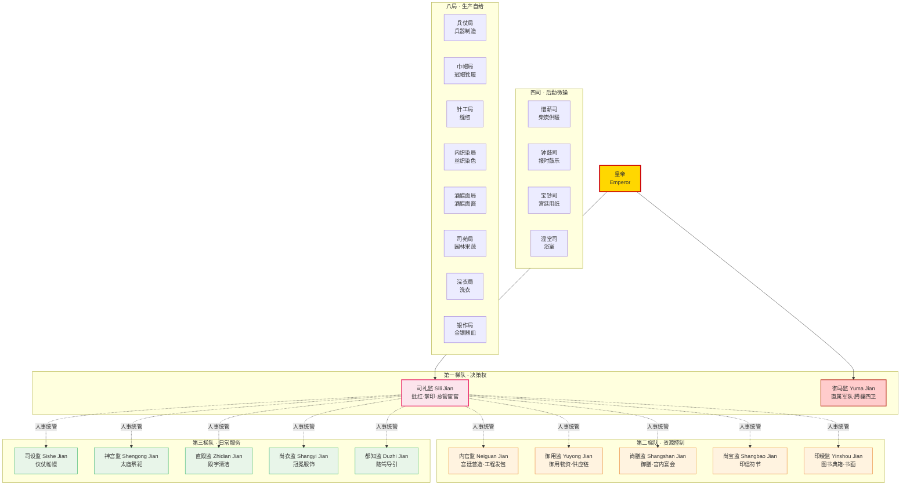

# 二十四衙门体系

> 📍 返回 [README](../00-总览/README.md) · [宦官二十四衙门全览]() · [司礼监与宦官体系]()
> 🔗 相关主题：内廷政府 · 权力梯队 · 内外职能平行

明代宦官系统空前庞大，设**十二监、四司、八局**，合称二十四衙门（Twenty-Four Offices）。全部由宦官管理，外朝文官无权干预内部事务。二十四衙门在职能上与外朝六部、五寺形成了一套平行的"内廷政府"（Inner Court Government）。

本文从**权力梯队**角度切入分析——哪些衙门掌握真正的决策入口，哪些只是服务支撑。详细的逐衙门职能表见[宦官二十四衙门全览]()，司礼监内部职位详见[司礼监与宦官体系]()。

---

## 二十四衙门权力梯队总图



> **颜色含义**：红色 = 决策权（第一梯队）；橙色 = 资源控制（第二梯队）；绿色 = 日常服务（第三梯队）。四司八局为后勤生产，无政治权力。司礼监对全体衙门有人事统管权（虚线），但不干预各监日常业务自主权。

---

## 一、十二监——权力梯队解析

十二监（Twelve Directorates）是二十四衙门的核心，全部由掌印太监管理。但十二监之间的权力差距极大——司礼监和御马监掌握帝国命脉，其余十监只是宫廷服务机构。

### 第一梯队：决策权（司礼监、御马监）

| 监 | 长官 | 核心权力 | 为什么是第一梯队 |
|:--|:--|:--|:--|
| **司礼监**（Sili Jian） | 掌印太监 + 秉笔太监 | 批红权（代皇帝决策）、掌玉玺、总管全体宦官人事 | **批红权 = 真正的决策入口**——内阁票拟必须经司礼监批红才能生效 |
| **御马监**（Yuma Jian） | 提督太监 | 统领腾骧四卫（约2-3万直属精兵），只听皇帝命令 | **独立军事通路**——绕开兵部和五军都督府，是皇帝手中的"禁军" |

**司礼监为何独大**：明代决策流程是"内阁票拟 → 司礼监批红 → 六科封驳 → 六部执行"。票拟只是建议，批红才是决策——**谁掌握批红权，谁就掌握皇权的实际运作入口**。司礼监秉笔太监在授权范围内可代批常规事务，掌印太监管盖章生效。两个职位分离制衡，但合在一起就是完整的决策闭环。（司礼监内部职位细分见[司礼监与宦官体系]()）

**御马监的军事职能**：御马监统领的腾骧四卫（滕骧左、右卫，武骧左、右卫）加上勇士营，是皇帝直属的独立军事力量。它不在五军都督府的军籍上，调兵不需兵部檄文，军饷从内承运库支出（不占太仓库预算）。这是皇帝在"最坏情况"下的兜底武力——当外朝军队不可信或调动太慢时，御马监是直接可用的刀。

### 第二梯队：资源控制（内官监、御用监、尚膳监、尚宝监、印绶监）

| 监 | 核心资源 | 与外朝对应 | 资源控制的意义 |
|:--|:--|:--|:--|
| **内官监**（Neiguan Jian） | 宫殿/陵墓/园林的修缮建造——大型工程发包权 | 工部（分包关系：内官监发包，工部承建） | 掌握宫廷物资供应链的核心节点，工程款经手巨额资金 |
| **御用监**（Yuyong Jian） | 皇帝日常御用物资的采办和制造 | （无直接对应——纯内廷供应） | 控制皇帝个人的物质生活来源，信息不对称的来源 |
| **尚膳监**（Shangshan Jian） | 皇帝御膳和宫内宴会 | 光禄寺（协作：光禄寺备料，尚膳监烹饪） | 接触皇帝饮食——看似后勤实则有安全意义 |
| **尚宝监**（Shangbao Jian） | 管理皇帝各类印信符节（非玉玺） | 尚宝司（外朝对应，互相核对） | 印信是权力运行的"硬件载体"——没有符节调不动军队 |
| **印绶监**（Yinshou Jian） | 管理古今图书典籍、书画收藏 | 翰林院（部分重叠） | 内廷的知识库——皇帝可从两个系统获取信息 |

**资源控制 = 隐性权力**：第二梯队的五个监没有决策权，但它们控制着宫廷运转所需的物资、印信和知识。这种资源控制产生隐性权力——当内官监发包工程时，工部实际上成了转包商；当尚宝监管理符节时，没有他们的配合，外朝的军事调动就无法完成文书验证。

### 第三梯队：日常服务（司设监、神宫监、直殿监、尚衣监、都知监）

| 监 | 职能 | 权力性质 |
|:--|:--|:--|
| **司设监**（Sishe Jian） | 皇帝仪仗、帷幔、陈设的布置和维护 | 纯服务——无政治权力 |
| **神宫监**（Shengong Jian） | 太庙和各皇陵的祭祀维护 | 与太常寺协作，礼仪性职能 |
| **直殿监**（Zhidian Jian） | 各殿宇庭院的清扫和维护 | 最基层的内廷事务 |
| **尚衣监**（Shangyi Jian） | 皇帝冠冕、朝服、盔甲的制作和管理 | 制作任务的执行方 |
| **都知监**（Duzhi Jian） | 皇帝出行时随驾开路、清道、导引 | 礼仪性随侍——与鸿胪寺外朝礼仪对应 |

> 第三梯队完全无政治权力。它们的职能是保证皇帝日常生活的物理运转——从穿衣到出行到殿宇清洁。但这些位置也不是完全没有价值：接近皇帝意味着有机会获得信任，历史上不少权阉正是从底层服务岗位起家。

---

## 二、四司——后勤微操

四司（Four Offices）负责宫廷的后勤微操，无任何政治性事务。

| 司 | 职能 | 备注 |
|:--|:--|:--|
| **惜薪司**（Xixin Si） | 管理宫中柴炭供应——采购、存储、分配 | 北京冬天供暖是刚需，惜薪司控制着关键生存资源 |
| **钟鼓司**（Zhonggu Si） | 管理宫中的钟鼓报时、节庆鼓乐 | 看似小事但涉及宫中时间节奏 |
| **宝钞司**（Baochao Si） | 制造宫廷专用草纸（粗纸，非货币） | 名字有"宝钞"但与大明宝钞无关——只做卫生用纸 |
| **混堂司**（Huntang Si） | 管理宫中的浴室 | 最小最边缘的宦官机构 |

> 四司是二十四衙门中权力最低的一层。但"权力低"不等于"无影响"——惜薪司在寒冬掌握供暖燃料的分配权，这种"生活必需品控制"在特定情境下可以变为隐性筹码。

---

## 三、八局——生产自给

八局（Eight Bureaus）使宫中可以**自给自足**基本生活物资，不需要经过外朝的采购体系。

| 局 | 职能 | 规模 |
|:--|:--|:--|
| **兵仗局**（Bingzhang Ju） | 制造宫廷用兵器（刀剑、弓弩、火药），与兵部武库司协作 | 大——宦官中的技术部门 |
| **银作局**（Yinzuo Ju） | 打造金银器皿（赏赐用金碗、银壶等） | 大 |
| **浣衣局**（Huanyi Ju） | 洗涤宫中衣物。**唯一不在紫禁城内的宦官机构**（德胜门附近，方便用水） | 大 |
| **巾帽局**（Jinmao Ju） | 制作冠冕、朝帽、靴子 | 中 |
| **针工局**（Zhengong Ju） | 宫中缝纫——制作衣物和被褥 | 中 |
| **内织染局**（Neizhiran Ju） | 丝织品和染色的生产 | 中 |
| **酒醋面局**（Jiucumian Ju） | 酿造酒、醋、制面酱——宫中调料供应 | 中 |
| **司苑局**（Siyuan Ju） | 管理宫中园林种植——蔬菜、水果、花卉 | 小 |

> 八局的生产能力是皇帝"绕开文官"的另一个维度：不是绕开政治决策，而是绕开日常生活的物资供应链。当外朝采购体系低效或腐败时，内廷八局保证了皇帝的基本生活不受影响。这是"内廷政府"自给自足的物质基础。

---

## 四、核心分析

### 司礼监为何独大——批红权 = 真正的决策入口

明代决策流程表面上是"皇帝决策"，但实际运作中：

```
内阁票拟（建议）→ 司礼监批红（决策生效）→ 六科封驳（审查）→ 六部执行
```

票拟只是建议权——内阁大学士提出处理意见，但最终生效需要批红。**批红权才是真正的决策入口**：谁控制批红，谁就控制了"哪些建议变成行动"。

司礼监的独特性在于它垄断了批红环节：
- **秉笔太监**在授权范围内可代批常规事务（朝廷流水线确认、非高风险子任务通过等）
- **掌印太监**管玉玺盖章——没有盖章，批红不生效
- 两权分离制衡，但都集中在司礼监内部

这使得司礼监成为皇权运作的"咽喉"——即使皇帝怠政（如万历数十年不上朝），只要司礼监运转正常，国家机器就能维持最低运转。反过来，控制了司礼监就等于掐住了帝国的决策通道，这也是为什么明代权阉（王振、刘瑾、魏忠贤）全部出自司礼监。

### 御马监的军事职能——皇帝手中的"禁军"

御马监的权力不在于"管马"，而在于它统领着一支独立于外朝军事体系的直属军队：

- **腾骧四卫**（腾骧左卫、腾骧右卫、武骧左卫、武骧右卫）+ **勇士营**，合计约2-3万人
- 这支军队**不在五军都督府的军籍上**——五军都督府管不了它
- 调动**不需兵部檄文**——兵部的调兵令对它无效
- 军饷**从内承运库支出**——不占太仓库的国家预算

御马监的存在使皇帝拥有了一条完全独立的军事通路。当外朝军队不可信（将领拥兵自重）、调动太慢（走兵部流程需要数周）、或者皇帝不想让外朝知道军事行动时，御马监是直接可用的武力。这是皇权在军事领域的"兜底执行"能力。

### 内官监/御用监的资源控制——掌握宫廷物资供应链

第二梯队的核心价值不是政治权力，而是**资源控制**：

- **内官监**掌握大型工程的发包权——宫殿、陵墓、园林的修缮建造由内官监发包，工部营缮司承建。预算从户部太仓库出，但内官监有独立采购权可绕过工部。这使得工部官员实际上成了内官监的转包商——掌握发包权就等于掌握了一个巨大的利益分配网络
- **御用监**控制皇帝日常御用物资的采办和制造——这看似后勤，实则是皇帝个人生活的物质命脉。当皇帝的日常需求被一个机构垄断供给时，这个机构就有了信息不对称的优势

资源控制产生的隐性权力无法用品级衡量，但在实际运作中极其重要：它决定了谁能接触到皇帝的日常生活，谁能在物资流转中获取利益，谁能在工程和采购中安插自己人。

### 二十四衙门与外廷六部的对接关系

二十四衙门不是孤立的内廷系统——它必须与外朝六部对接才能完成事务交接。关键对接点：

| 内廷衙门 | 外朝对应 | 对接性质 |
|:--|:--|:--|
| 司礼监 | 内阁 | 决策对接——票拟经批红生效，禁止私人接触 |
| 御马监 | 兵部 + 五军都督府 | 军事平行——御马监绕开两者，独立运作 |
| 内官监 | 工部 | 工程发包——内官监发包，工部承建 |
| 尚膳监 | 光禄寺 | 膳食协作——光禄寺备料，尚膳监烹饪 |
| 尚宝监 | 尚宝司 | 印信核对——两套系统互相验证防伪造 |
| 神宫监 | 太常寺 | 祭祀分工——太常寺执行礼仪，神宫监维护场所 |
| 兵仗局 | 兵部武库司 | 兵器生产——内廷精工（仪仗），外朝量产（军用） |

**对接的总原则**：双轨制（重要职能设内外两套系统）+ 禁止私人联盟（内廷太监与外朝文官私下交往是重罪）+ 皇帝是唯一接口（内外廷之间没有制度化直接沟通渠道，所有对接通过皇帝或文书流转中转）。

这种"职能平行 + 禁止串联"的设计本意是让皇帝从两套系统中获取多视角信息做出平衡决策。但实际上：强势皇帝（朱元璋、永乐）能驾驭两套系统，弱势皇帝被内廷控制——因为内廷离皇帝更近，在日常接触中占据信息优势。

---

## 编排参考

二十四衙门体系对 wuwo 编排系统的启发：

- **"第一梯队决策权 vs 第二梯队资源控制"的分层** → **Agent 权限分层设计**：编排系统中的 Agent 不应平等分配权力。掌握决策入口的 Agent（如批红/审批 Agent）属于第一梯队，需要最严格制衡；掌握资源控制的 Agent（如预算/物资管理 Agent）属于第二梯队，需要审计监督；纯服务型 Agent 属于第三梯队，权限最小。这种分层不是歧视而是**风险控制**——权力越大的 Agent 需要越多的制衡机制
- **"司礼监垄断批红 = 决策咽喉"** → **编排系统的关键路径保护**：任何编排系统都有"咽喉节点"——所有决策必须经过的入口。这个节点的设计原则是：授权代批（效率）+ 关键决策亲批（安全）+ 操作留档（审计）。不能让咽喉节点成为单点故障，也不能让它成为不受限制的独裁者。掌印/秉笔分离就是"咽喉节点的内部制衡"
- **"御马监 = 独立兜底武力"** → **编排系统的兜底执行通道**：编排系统需要一个完全独立的兜底执行通道——当常规执行链路（外朝军队 = 常规 Agent 编排）不可信或失效时，御马监（独立执行 Agent 池）可以直接行动。这个兜底通道有三个特征：独立资源池（内承运库 = 独立计算/通信资源）、独立指挥链（绕开兵部 = 不依赖常规编排）、规模有上限（防止兜底通道膨胀为替代品）
- **"内官监发包权 = 资源控制的隐性权力"** → **分权下的腐败风险审计**：每个掌握资源分配权的 Agent 都是潜在的腐败来源。编排系统中每个 Agent 的独立决策权都需要被审计和抽查——发包权、采购权、物资分配权看似是"服务职能"，但在信息不对称下会转化为隐性权力。对策是：发包记录留档、随机抽查、独立审计 Agent 事后核查
- **"内外廷双轨制 + 禁止私人联盟"** → **编排中的影子组织与隔离原则**：为关键外部模块配设内廷备份（影子组织），在最坏情况下内廷备份仍可维持系统最低运转。但两套系统之间必须保持隔离——禁止 Agent 之间的私人联盟（暗通道），所有对接通过总控中转。隔离的目的是防止"内外勾结"绕过制衡，但也带来了对接摩擦的代价
