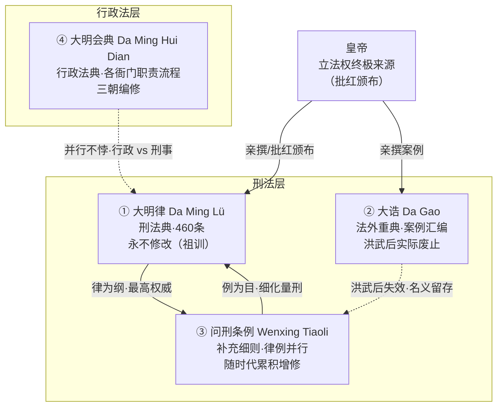

# 大明律与会典

> 📍 返回 [README](../00-总览/README.md) · [按编排模式反查](../99-附录/04-按编排模式反查.md)
> 🔗 相关主题：祖宗成法 · 律例并行 · 行政法典 · 皇帝立法权（见 [皇帝制度]()）

明代法制并非一部法典打天下，而是一套**四层叠加**的法律文本体系：律（刑法典）、诰（法外重典）、例（补充条例）、会典（行政法典）。四者各有渊源、各有适用范围、各有修订机制，共同构成一个"核心不变 + 外围可演"的规则库。本文聚焦**法律文本本身**的层级结构与相互关系；律例 Agent 的规则引擎映射见 [大明律与祖宗成法](../03-监察链/04-大明律与祖宗成法.md)，司法执行流程见 [大理寺与三法司](../03-监察链/03-大理寺与三法司.md)。

---

## 四层法律文本体系总览

**核心设计思想**：律是永不修改的"宪法级"刑法典，但现实在变——解法不是改律，而是**在外围叠加可增修的层**（例）和**平行的另一法域**（会典）。大诰则是开国君主以个人权威强行注入的"重典层"，人亡政息。

---

## 大明律：不可更改的刑法典

《大明律》（Da Ming Lü, Great Ming Code）是明代刑法体系的根基。朱元璋自洪武元年（1368年）起亲自主持编纂，历时三十年两度修订，于**洪武三十年（1397年）**颁布最终定本。

### 结构

大明律分**七篇、三十卷、四百六十条**。首篇"名例律"为总则，其余六篇按六部分类：

| 篇名 | 内容 | 条数（约） |
|:--|:--|:--|
| **名例律** | 刑罚总则、五刑定义、量刑通例 | 47 |
| **吏律** | 官员任免、考核、渎职、职制 | 73 |
| **户律** | 赋税、婚姻、田宅、钱债、仓库 | 95 |
| **礼律** | 祭祀、仪制、学规 | 26 |
| **兵律** | 军政、军令、驿传、宫卫 | 75 |
| **刑律** | 盗贼、人命、斗殴、受赃、诈伪 | 111 |
| **工律** | 工程营造、河防、钱法 | 13 |

### 五刑体系

大明律的法定刑罚分五等，称"五刑"（Five Punishments）：

| 刑等 | 名称 | 内容 |
|:--|:--|:--|
| 一 | **笞**（bastinado） | 用小竹板击打臀部/腿部，10-50 下 |
| 二 | **杖**（rod） | 用大竹板击打，60-100 下 |
| 三 | **徒**（banishment） | 强制劳役 1-3 年，并发配远方 |
| 四 | **流**（exile） | 流放 2000-3000 里 |
| 五 | **死**（death） | 绞、斩二等（凌迟为法外极刑） |

五刑之外另有**赎刑**（以铜/米赎罪）和**凌迟**（针对谋反等十恶），构成完整的刑罚阶梯。

### "永不修改"的祖训

朱元璋在大明律定本时留下遗训：**"子孙守之，群臣有稍议更改，即坐以变乱祖制之罪"**。这使大明律成为明代唯一一部法律上"冻结"的文本——终明一朝二百余年，律文460条一字未改。

但现实在变：洪武年间的量刑标准到嘉靖年间已严重脱节。解法不是改律，而是**在律之外另起"例"**（见下文问刑条例）。这是明代法制最精妙的设计——用"补充"绕开"禁止修改"，既维护了祖训的神圣性，又保持了法律的实用性。

> **编排洞察**：大明律的"不可改"并非真的不可改，而是**将变更成本转移到外围层**。核心层稳定带来可预测性，外围层灵活带来适应性。

---

## 大诰：法外重典与普法教材

《大诰》（Da Gao, Grand Pronouncements）是朱元璋亲自编纂的**案例汇编**，洪武十八年（1385年）起陆续颁布，共三编（初编、续编、三编）。性质上不属于正式律文，而是皇帝以个人权威发布的"法外重典"。

### 法外加重刑罚

大诰收录了大量朱元璋亲自审理的案件，判罚**远比大明律严酷**：

- **剥皮实草**：贪官处死后剥皮填草，悬挂于官府公座旁示众
- **族诛**：一案牵连数百甚至数千人
- **挑筋去指**：断指、割筋等肉刑

大诰的核心理念是**"以重典治乱世"**——朱元璋认为明初人心涣散，必须用超越常规律文的恐怖刑罚来震慑。

### 强制阅读的"普法教材"

大诰最独特的设计是**强制全民阅读**：

> **有大诰者罪减一等，无大诰者罪加一等。**

家家户户必须藏有大诰，学子必须背诵。犯人若能证明家中藏有大诰，可获减刑；若无，则加重处罚。这是中国历史上罕见的"以刑罚倒逼普法"的制度。

### 人亡政息

大诰的权威完全建立在朱元璋的个人意志上。朱元璋死后（1398年），建文帝即位，朝野普遍认为大诰过于严酷，实际停止执行。到永乐朝以后，大诰在司法实践中**名存实亡**——但名义上仍为有效文本，未正式废除。

> **编排洞察**：大诰是"以创始人权威注入的 override 规则"。创始人不在后，override 规则因缺乏权威背书而失效——但因为它从未被正式废除，系统里仍残留着一个"僵尸规则层"。

---

## 问刑条例：律文之外的补充细则

《问刑条例》（Wenxing Tiaoli, Criminal Regulations）是律文之外的**补充条例集**，是明代法律实际演进的主战场。

### 律例并行

大明律不可改，但社会在变。解法是"例"：

> 律为**纲**，例为**目**。律定罪名与刑等，例定具体量刑标准与适用细则。

例如此：大明律规定"贪污者斩"，但未区分金额。问刑条例补充："贪污十两以上斩，五两至十两流放，一两至五两杖责"——**细化而非改写律文**。

### 历代增修

问刑条例并非一次编成，而是随时代累积增修：

| 朝代 | 年份 | 修订内容 |
|:--|:--|:--|
| **弘治朝** | 1500年 | 首次编成《问刑条例》，279条 |
| **嘉靖朝** | 1550年左右 | 重修，增至约 380 条 |
| **万历朝** | 1580年代 | 再次重修，并着手清理冗杂矛盾 |

条例的增修流程（详见 [大明律与祖宗成法](../03-监察链/04-大明律与祖宗成法.md)）：刑部/都察院发现律文脱节 → 三法司讨论 → 内阁票拟 → 皇帝批红 → 试行 → 正式编入。

### 冗杂矛盾与万历清理

两百年累积导致条例**冗杂前后矛盾**——同一罪行，不同朝代所定条例量刑不一，地方官无所适从。万历朝着手清理（张居正改革时期），裁汰重复、统一标准，但未竟全功。

> **编排洞察**：条例的冗杂是"补丁累积导致规则冲突"的典型——这正是 [大明律与祖宗成法](../03-监察链/04-大明律与祖宗成法.md) 中律例 Agent"反振荡检测"和"冷却期"机制要解决的问题。

---

## 大明会典：行政法典

《大明会典》（Da Ming Hui Dian, Administrative Code）是明代的**行政法典**，性质与现代"行政程序法"相近——记载各衙门的职责、编制、办事流程、文书格式。与前述律/诰/例（刑事法）分属不同法域。

### 与大明律的关系

| 维度 | 大明律 | 大明会典 |
|:--|:--|:--|
| 法域 | **刑法**（刑事犯罪与刑罚） | **行政法**（政府组织与程序） |
| 内容 | 罪名 + 刑罚 | 衙门职责 + 办事流程 + 文书规范 |
| 修订 | 不可改（律文冻结） | 三朝重修（持续更新） |
| 性质 | "不准做什么 + 后果" | "该怎么做事" |

二者并行不悖：大明律管"犯罪与刑罚"，大明会典管"行政运作"。一个官员贪腐，按大明律定罪量刑；但他所在衙门的日常运转流程，由大明会典规定。

### 三朝编修

大明会典历经三朝编修，版本迭出：

| 版本 | 编修朝代 | 特点 |
|:--|:--|:--|
| **正德会典**（弘治编、正德序） | 弘治朝编成，正德四年（1509年）序 | 首部会典，180 卷 |
| **嘉靖会典** | 嘉靖朝重修 | 增补修订，未正式颁行 |
| **万历会典** | 万历十五年（1587年）重修 | 最完备版本，228 卷，传世定本 |

会典以**六部为纲**，逐衙门记载其职掌、员额、历年事例、办事程式。是研究明代行政运作最系统的原始文献。

> **编排洞察**：会典是"操作手册/SOP 库"的古代对应——它不规定"不准做什么"（那是律的职责），而是规定"各角色该怎么协作办事"。这正是编排系统中"工作流定义"的雏形。

---

## 法律解释权

律文是死的，案件是活的。同样的律文如何适用于具体案件，涉及**解释权**的分配。明代法律解释主要有三种机制：

### 律文解释（律疏）

对律文中字词、概念的权威解释。类似唐律的"疏议"，明代虽无统一的"大明律疏"，但刑部和三法司在长期审判中形成了**惯例性解释**，以问答形式汇编流传。

### 比附（类推适用）

当案件情形律文无明文规定时，采用**比附**——援引最相近的律文定罪量刑。例如律文无"伪造火车票"（明代无火车），可比附"伪造印信"律条。

比附的约束：必须经三法司会审认可，且比附结果须奏报皇帝，防止滥引。这是在"律文不可改"约束下的**弹性适用机制**。

### 情轻情重（自由裁量）

对同一罪行，根据情节轻重在法定刑等内**上下调整**。如"盗窃"法定杖六十至一百，审案官可视情节（初犯/惯犯、数额大小、是否悔过）在区间内裁量。

裁量权受三重约束：① 法定刑等区间（不可越等）；② 大理寺复核（见 [大理寺与三法司](../03-监察链/03-大理寺与三法司.md)）；③ 都察院监察（防贪赃枉法）。

---

## 四层体系的运作逻辑

### 适用优先级

当多层文本对同一情形均有规定时，适用次序大致为：

1. **先律后例**——律有明文者依律，律无明文或律文过粗者引例
2. **律例冲突时**——原则上律优先，但实际操作中"有例从例"（条例已是律的细化）
3. **会典独立**——行政事务依会典，不与刑事律例混用
4. **大诰残留**——洪武后实际不引，但理论上仍有效力

### 制度的深层智慧

四层体系的精妙之处在于**用空间分层解决时间演进**的问题：

- 核心层（律）冻结 → 提供**可预测性**和**合法性根基**
- 重典层（诰）失效 → 创始人权威退场后自然衰减，但不留修法先例
- 补充层（例）增修 → 提供**适应性**，变更成本可控
- 行政层（会典）独立 → 行政与刑事**解耦**，各自演进

这是一种**"不变的核心 + 可变的外围"**的经典架构——用核心的稳定性换合法性，用外围的灵活性换实用性。

---

## 编排参考

明代四层法律文本体系为 wuwo 多 Agent 编排系统提供了关于**规则库架构**的核心启发：

- **"大明律永不修改" → 不可变核心规则**：系统中存在一类"宪法级"规则（如熔断条件、国库总额度、人类关键介入点清单），一经设定不可由 Agent 自行修改——对应律文冻结。变更必须走"例"的流程（多层审批 + 试行），而非直接改律。
- **"律为纲，例为目" → 核心规则 + 可演化细则的双轨结构**：律例 Agent 维护两层规则——不可变的"律"（规则总纲）和可增修的"例"（适用细则、阈值参数）。例可以演化（冷却期、反振荡检测），但演化过程被严格约束。详见 [大明律与祖宗成法](../03-监察链/04-大明律与祖宗成法.md)。
- **"大诰强制阅读、有则减刑" → override 规则的时效与衰减**：创始人/总控以权威注入的 override 规则（大诰）在权威背书消失后自然失效。编排系统应区分"基于规则的约束"（律，持久）和"基于权威的指令"（诰，时效性），后者需设过期机制，避免残留"僵尸规则"。
- **"大明会典独立于大明律" → SOP 库与规则库解耦**：会典规定"怎么做事"（工作流/SOP），律规定"不准做什么"（约束/禁区）。编排系统中工作流定义（会典）与合规规则（律）应分层维护、独立演进——改流程不必动规则，反之亦然。
- **"比附"类推适用 → 规则空白时的安全兜底**：当系统中出现规则未覆盖的情形时，律例 Agent 可"比附"最相近的已有规则给出处置建议，但必须标记为"类推适用"并上报审核（对应三法司会审），防止滥引。

核心洞察：明代四层法律文本体系解决的是**"一个庞大的规则库如何在两百多年里既保持核心稳定又适应时代变化"**的问题——答案是分层：不可变的律提供合法性根基，可增修的例提供适应性，独立的会典管行政流程，失效的诰自然退场。编排系统的规则引擎继承了这一分层智慧：**核心冻结、外围演化、行政解耦、权威衰减**——四个机制共同保证了规则库的长期可维护性。
