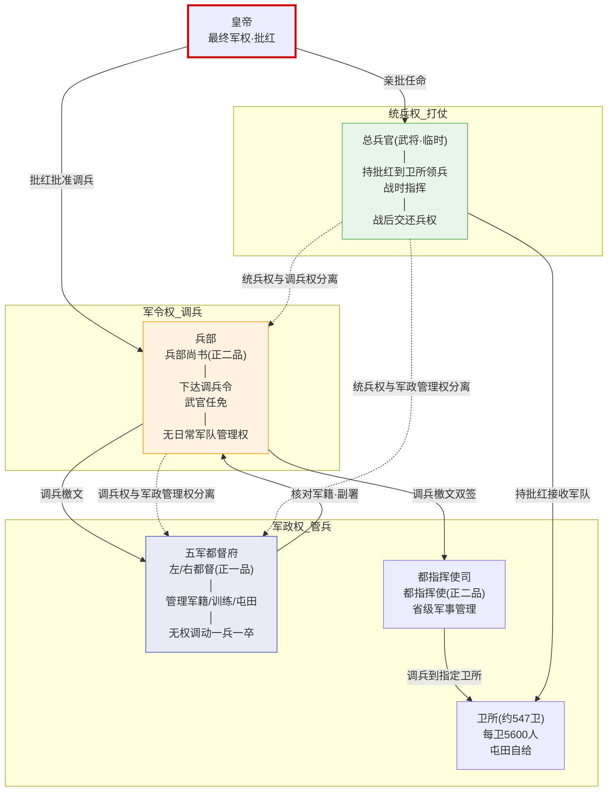
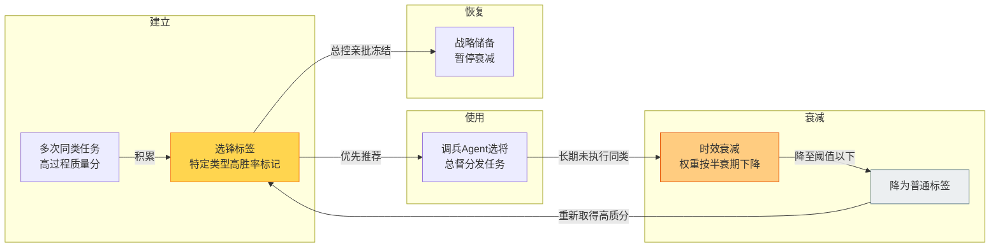

# 五军都督府

## 军政与军令分权

明代军事体系最核心的设计原则是**"军政/军令分离"**——管军队的和调动军队的是两个完全不同的机构，谁也不依赖谁。

| 权力类型 | 掌握机构 | 具体职能 | 关键限制 |
|:--|:--|:--|:--|
| **军政权** | 五军都督府 | 管理军籍、训练、屯田、军饷、器械 | **无权调动一兵一卒** |
| **军令权** | 兵部 | 下达调兵令、任免武官、制定作战计划 | **没有日常军队管理权**——调兵檄文需五军都督府核对军籍 |
| **统兵权** | 临时指定的总兵官 | 战时统率指定部队作战 | **战后必须交还兵权** |

三者互相制衡——五军都督府管军队但无权调动；兵部可以发调兵令但需五军都督府核对才能生效；总兵官战时指挥但战后兵权归还。没有任何一方可以单独发起军事行动。

## 五府的划分

五军都督府分前/后/左/右/中五府，各管不同的都司和卫所：

| 府 | 所辖主要都司 | 管多少卫所（约） |
|:--|:--|:--|
| **左军都督府** | 浙江/辽东/山东 都司 | 约100卫 |
| **右军都督府** | 陕西/四川/云南/贵州/广西 都司 | 约120卫 |
| **中军都督府** | 中部都司+中都留守司+河南都司 | 约90卫 |
| **前军都督府** | 湖广/福建/江西/广东 都司 | 约110卫 |
| **后军都督府** | 北平/山西/大宁/万全 都司 | 约120卫 |

各府分辖的卫所总数约547个——五府不会互相争夺卫所，因为每个卫所只归一个府管。

## 职位与职责

### 左/右都督（正一品，各府各一人）

**做什么**：
- 总管本府的军籍（所辖卫所的全部军户档案）
- 审核本府所辖卫所的训练和战备情况
- 管理本府所辖卫所的屯田和军饷
- 接收兵部的调兵檄文 → 核对军籍确认兵力存在 → 副署 → 檄文生效
- 管理本府所辖武官的能力档案（供兵部武选司参考）

**受谁制约**：
- 兵部——调兵权分离（兵部的檄文左都督可以拒绝副署——如果檄文要调的兵根本不存在）
- 兵科给事中——监督五军都督府的日常运作
- 都察院——可弹劾左都督
- 皇帝——左都督由皇帝亲批任免

**受谁监督**：
- 兵科给事中、都察院、东厂

**监督谁**：
- 所辖各都指挥使（省级军事长官）
- 通过都司间接管理所辖卫所

### 都指挥使（正二品，各省都司长官）
（详见[卫所制度]()和[地方行政体系](../../02-执行链/文官执行/04-地方行政体系.md)）

**做什么**：管理一省所有卫所——训练、屯田、军饷、兵籍。

**与五军都督府的关系**：都指挥使的日常管理受五军都督府监督——五军都督府定期检查各省都司的军政执行情况。

**与兵部的关系**：调兵令由兵部直接发给五军都督府和都司——都指挥使在收到调兵檄文后配合总兵官完成兵员交接。

## 调兵流程（每一步都需要多部门合验）

```
1. 军情发生 → 兵部职方司分析敌情 → 提出调兵建议
      │
2. 兵部尚书审阅调兵建议 → 上呈内阁票拟
      │
3. 内阁票拟同意调兵 → 皇帝批红批准
      │
4. 兵部发出调兵檄文 → 送至五军都督府
      │
5. 五军都督府核对军籍 → 确认指定卫所有足够兵力可调
      │                    如果兵力不足 → 驳回檄文要求修改
      ▼                    如果兵力充足 → 副署
6. 调兵檄文(兵部+五军都督府双签) → 发至对应都司 → 卫 → 千户所
      │
7. 指定的总兵官持皇帝批红到指定卫所接收军队
      │
8. 战后总兵官交还兵权 → 军队回归原卫所 → 五军都督府恢复日常管理
```

**每一步的牵制**：
- 兵部不能独自调兵（需五军都督府核对）
- 五军都督府不能调兵（没有调兵权）
- 总兵不能保留军队（战后交还）
- 都司不能拒绝交兵（但可以向上申诉调兵檄文的合理性）

## 选锋机制（配合调兵）

（详见[调兵与选锋]()）

五军都督府维护所有武官的**能力档案**——包括选锋标签（在哪些类型的战斗中表现优异）。当兵部/总督需要选将时，五军都督府提供候选名单和档案。选锋标签有时效衰减——长期不参加某类战斗，标签权重下降。

---

## 军政-军令-统兵三权分离图



## 选锋标签生命周期



---

## 编排参考

任事型编排系统中五军都督府被改造为**调兵 Agent**：
- "五军都督府管理军籍" → 调兵 Agent 维护所有提督的能力档案
- "兵部发调兵令" → 总督 Agent 指定任务要求，调兵 Agent 推荐最佳人选
- "军政/军令分离" → 调兵（推荐）与指挥（任务分配）分离
- "调兵需五军副署" → 总督选将需调兵 Agent 匹配合适的提督——匹配不上则无法有效分配

核心洞察：**"了解谁能干什么"和"决定让谁干什么"必须分离**。否则负责分配任务的人会因掌握能力数据而偏袒特定执行者。调兵 Agent 只做匹配不做决策，总督只做决策不维护档案。
