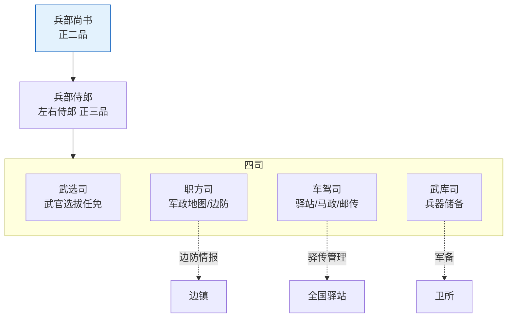

# 兵部深度制度

> 兵部是六部中与军事体系交叉最深的部门，也是明代"以文制武"的制度枢纽。

---




## 兵部在六部中的特殊地位

兵部是六部中唯一一个**不直接拥有任何执行权**的部——它管的是"发令"而不是"执行"：
- 兵部可以下达调兵檄文，但不能自己调动一兵一卒（管兵的是五军都督府）
- 兵部可以任命总兵官（战场指挥），但不能自己上场指挥（总兵对总督负责）
- 兵部可以管理武官档案，但不能插手军队的日常训练

这种"有令无权"的设计不是兵部弱——恰恰是**为了防止一个机构同时拥有发令权和执行权**。

兵部的权力来源是"最终军事决策权归于文官集团"这一原则——皇帝通过文官（兵部尚书）而不是武将（五军都督）来决定战争与和平。

---

## 兵部四司详解

### 职方司：战争的"情报大脑"

职方司是兵部最重要、最受重用的司。它的核心产出是**战略态势评估**——基于全国军事地图和敌情情报，回答"打还是不打、打哪里、用什么兵力打"这三个问题。

**日常职责**：
- 维护和更新全国军事地图（"舆图"）——标注所有卫所位置、兵力、军粮储备、地形
- 收集和分析边境情报——蒙古各部的动向（鞑靼/瓦剌）、倭寇活动规律、西南土司动态
- 编制"边防册"——每个九边重镇的防御态势评估
- 每遇军事行动，职方司首先出具"进兵方略"——推荐进军路线和兵力部署
- 管理全国军事驿站的位置和配置

**情报来源**：
- 九边总督和巡抚的定期军情奏报
- 塘报系统（前线急递直达兵部）
- 锦衣卫和东厂对边境的情报收集（非正式渠道）
- 行人司的外交情报反馈

**在编排中的对应**：职方司对应推理Agent的"策略模板库"和"推理框架"。它的核心逻辑是——打仗之前先搞清楚战场长什么样。

### 武选司：武官的人事部

**职责**：全国千户以上武官的选任、考核（"军政考选"）、升迁和降黜。

与吏部文选司不同之处在于——武选司面对的是一群世袭的武将。武官的流动性远低于文官——因为千户/百户职位很多是世袭的（父死子继）。武选司的"选任"更多是"核实继承资格"而不是"从零选拔"。

**考核方式**：武官每五年一次"军政考选"——由武选司郎中会同五军都督府派人到各卫所现场考核（查验军籍、检阅操练、查看军饷账目）。结果分三等：卓异（推荐升迁）、称职（留任）、不称职（降调或勒令致仕）。

**在编排中的对应**：武选司对应"武官档案维护"和"长期能力标签"——与调兵Agent的能力档案共享数据。

### 车驾司：后勤调度中心

**职责**：管理全国军马调配和军事驿站调度。

- **军马**：马匹从太仆寺（负责全国马匹养殖）供应，车驾司负责分配到各卫所和九边。一匹战马的消耗是普通士兵的3-5倍——所以马匹分配是军费预算的重头
- **驿传**：全国约1000个驿站的军事调度部分由车驾司管——调兵时沿途驿站需要给行军部队提供住宿和粮草
- **皇帝出行的车驾**：在皇帝出行时，车驾司负责整个交通队的组织和安全

**与太仆寺的关系**：太仆寺养马——车驾司从太仆寺接收马匹——分配到军队。两者是完全独立的系统——太仆寺不能自己决定把马给谁，车驾司不能自己决定养什么马。

**在编排中的对应**：车驾司对应"推理链编排"和"步骤调度"——管理计算资源的流动和分配。

### 武库司：军火库总管

**职责**：全国兵器制造和储备的总管理。

- **火器**：火铳（早期火枪）、火炮、火箭——明朝火器技术世界领先，武库司负责分配和更新。神机营的火器全部通过武库司供应
- **冷兵器**：刀、矛、弓、弩、盔甲——标准化的制式武器
- **与工部协作**：武器的木铁工部分由工部营缮司制造——但规格和数量由武库司定；工部只负责"做"，武库司负责"要什么"和"给谁用"

**在编排中的对应**：武库司对应"推理工具管理"和"模型选择"——维护可用的工具列表和评估函数。

---

## 兵部与五军都督府的互锁关系

这是整个明代军事制度最精巧的部分。调兵的每一步都需要两个平行系统的合验：

```
兵部提议调兵
    ↓
内阁票拟
    ↓
皇帝批红
    ↓
兵部发调兵檄文 ←─────────┐
    ↓                    │
五军都督府核对军籍 ───────┤  ← 关键！五军都督府核查：
    │                    │     1. 指定卫所有足够的兵可调
    │                    │     2. 指定军队不是"空籍"(军户已逃)
    │                    │     3. 该军队的装备和训练状态
    ↓                    │
若军籍核对无误 → 副署檄文 ─┘
    ↓
檄文双签发（兵部+五军都督府）→ 都司 → 卫所
    ↓
总兵官持批红到卫领兵
```

如果五军都督府拒绝副署（"发现军籍有问题，不同意调"），调兵令无法执行。这就是**调兵权与军政管理权的互锁**——没有五军都督府的确认，兵部无法单方面调兵；没有兵部的檄文，五军都督府也无法自行出兵。

---

## 兵部的权力边界与受制

| 制约方 | 制约方式 |
|:--|:--|
| **五军都督府** | 调兵檄文需其核对军籍并副署——兵部不能擅自调兵 |
| **兵科给事中** | 对口封驳兵部奏章、注销兵部任务——调兵檄文可封还 |
| **都察院** | 可弹劾兵部尚书和四司郎中——用人不当可被弹劾 |
| **吏部** | 武官的人事任免规则由兵部执行但**高级武官的廷推中吏部尚书有发言权** |
| **户部** | 调兵需要军费预算——没钱兵部调不动兵 |
| **内阁** | 所有调兵建议需内阁票拟——兵部不能绕过内阁直接调兵 |
| **总督（在战区）** | 战区内的具体战术部署由总督决定——兵部不在现场不能微操 |
| **监军御史** | 对军队执行情况有独立监督和密奏权——兵部的调兵令执行效果由监军汇报 |

**兵部不能做的事**：
- 不能自己调动一兵一卒——管兵权在五军都督府
- 不能任命总兵以下的战场指挥官——总兵由皇帝亲批任命
- 不能决定战区的具体打法——那是总督的事
- 不能自己增加军费预算——超支需户部→内阁→皇帝审批
- 不能绕过内阁直接向皇帝提出调兵建议（实际上可以——但文官系统会封驳）

---

## 编排参考

任事型编排系统中兵部被分为"推理与决策"模块，做了完整的现代化映射：

| 历史职能 | 编排对应 | 工程实现 |
|:--|:--|:--|
| 职方司（地图/敌情/策略） | 策略模板库 + 推理框架 | 不同问题类型的求解框架和推理路径模板 |
| 武选司（武官任免） | 方案比选 | 多方案之间的优劣评估、多臂老虎机选优 |
| 车驾司（军马/驿传） | 推理链编排 | 多步推理的顺序设计、中间步骤调度 |
| 武库司（兵器储备） | 推理工具管理 | 可用推理算法、决策模型、评估函数 |
| 兵部-五军互锁 | 调兵Agent与总督分离 | 选将的(调兵)和用将的(总督)不能是同一个人 |

核心洞察：兵部在编排系统中之所以被映射为"推理"而非"执行"——是因为兵部的权力不是"亲自做"而是"判断、计划、建议、审核"。它不调兵但研判战局、不指挥但提名指挥官、不打仗但决定战略。这种"智力权力"与"物理权力"的分离正是编排系统中规划层与执行层分离的蓝本。

---

## 相关文档

- [五军都督府]() — 调兵互锁的另一端
- [六部体系](../../02-执行链/文官执行/01-六部体系.md) — 六部整体架构
- [调兵与选锋]() — 调兵流程和选锋机制
- [总督与巡抚制度]() — 战区的实际指挥权
- [竞功与军功考核]() — 武官考核体系
