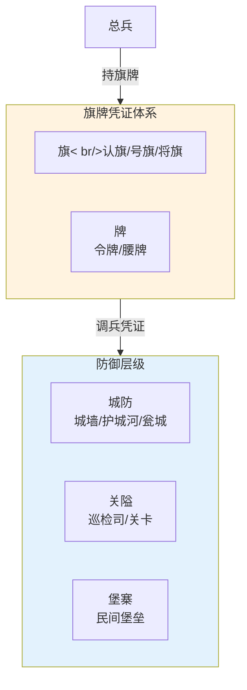

# 九边防御体系

## 九边的形成

明朝推翻元朝后，蒙古残部退居漠北（史称"北元"），形成了持续二百余年的北方边患。为应对蒙古骑兵的反复南下骚扰，明朝在北方边境自东向西依次建立了九个军事重镇，合称"九边"。

| 重镇 | 今地理位置 | 防御方向 |
|:--|:--|:--|
| **辽东镇** | 辽宁北镇/辽阳 | 东北方向（女真/兀良哈） |
| **蓟州镇** | 河北迁西 | 拱卫京师（最重要） |
| **宣府镇** | 河北宣化 | 蒙古鞑靼部南下要道 |
| **大同镇** | 山西大同 | 蒙古土默特/俺答汗部 |
| **延绥镇** | 陕西榆林 | 河套蒙古 |
| **宁夏镇** | 宁夏银川 | 西套蒙古 |
| **固原镇** | 宁夏固原 | 河套侧翼 |
| **甘肃镇** | 甘肃张掖 | 西域方向 |
| **太原镇**（偏关） | 山西偏关 | 山西内线防御 |

## 三角制衡：总督-巡抚-总兵

九边各镇实行**三权分立**的治理结构：

| 角色 | 来源 | 职能 |
|:--|:--|:--|
| **总督** | 文官（朝廷派出的都察院副都御史衔） | 跨镇军事统筹、战略协调 |
| **巡抚** | 文官（各省派出） | 管理本镇民政后勤、监督军事行动 |
| **总兵官** | 武将 | 直接指挥军队作战 |

总督节制多镇，有战略协调权但一般不直接下场指挥。巡抚管钱粮、征兵、后勤，确保军队有饭吃。总兵只管打仗。文官（总督/巡抚）节制武将（总兵），避免武将拥兵自重——这就是"以文制武"在边镇的具体体现。

## 九边卫所的通信与自治

九边各镇距离京城遥远（最远的甘肃镇离北京约2000公里），常规指令往返需要数周到一个月。因此九边被授予较高的自主权：

- 在蒙古小规模骚扰时，总兵可自行决策迎战，事后报备
- 重大军事行动（如主动出击深入草原）必须先奏报朝廷批准
- 为加快通信，设急递铺和烽火台系统——但通信延迟仍然是九边战事的核心约束

九边的这种"半自主 + 总部最终控制"模式，类似于现代分布式系统中的**边缘计算节点**。

---

## 编排参考

任事型编排系统将九边的"半自主 + 远程通信"特征抽象为：
- "九边坐镇" → 特定类型的提督 Agent 配置为九边坐镇模式，享有独立长连接信道和本地缓存
- "本地自治" → 九边坐镇提督在处理日常低复杂度任务时可基于本地缓存自行决策，重大决策上报总督
- "总督节制" → 总督 Agent 对各路提督的管控类似于九边总督对各镇的节制——协调但不事必躬亲
- "烽火/急递" → 塘报旗牌使的时限预警机制和监军密奏通道，对应九边的烽火台和急递系统

核心洞察：九边在编排系统中的启发是**"距离约束下的分布式决策"**——当通信延迟大到中央实时指挥不现实时，给边缘节点自主权但保持关键决策的中央审批，是平衡效率和控制的唯一解法。
