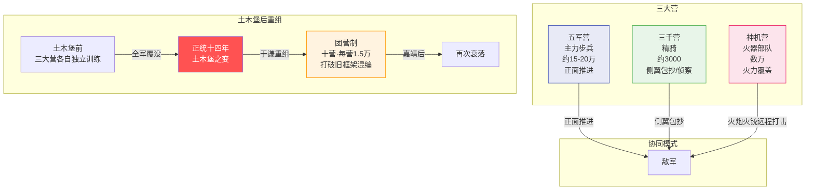
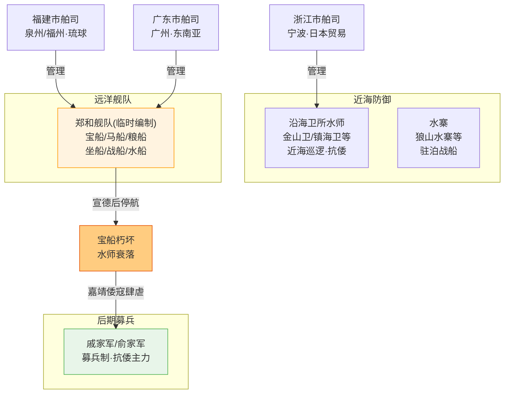

# 京营三大营与水师

## 京营（京师三大营）

永乐年间，朱棣迁都北京后，在京城周围建立了明代最精锐的野战兵团——**京营**。它不是卫所制的守备部队，而是常备野战军，随时准备出塞远征或拱卫京师。京营编为三大营：

| 营 | 兵种 | 兵力（额定） | 职能 |
|:--|:--|:--|:--|
| **五军营** | 步兵 | 约15-20万 | 主力野战兵团，从各卫所选调精锐组成 |
| **三千营** | 骑兵 | 约3000精骑 | 快速突击和侦察，核心是归附的蒙古骑兵 |
| **神机营** | 火器部队 | 约数万 | 世界上最早的成建制火器部队，配备火铳/火炮/火箭 |

## 三大营的协同战术

五军营正面推进、三千营侧翼包抄、神机营火力覆盖——这是明代最先进的联合作战体系。神机营的火铳在三轮轮射下可以形成连续弹幕，对付蒙古骑兵冲击时效果显著。但这种协同对训练和指挥要求极高，一旦训练松懈就退化为各自为战。

## 土木堡之变与团营改革

正统十四年（1449年），明英宗在王振怂恿下亲征瓦剌，京营主力在土木堡全军覆没——约二十万精锐化为乌有，三大营名存实亡。

景泰年间，兵部尚书**于谦**创立**团营**制度：从残余的京营和各卫所重新挑选精兵约15万，分十营训练（每营约1.5万人），打破原来的三大营框架重新编组。团营的指挥权和统兵权重新分配，防止权力过分集中于某个将领。

到嘉靖年间，团营也逐渐腐朽，战斗力再次下降。

## 明代水师

明代水师在建国时（朱元璋对抗陈友谅的鄱阳湖水战）发挥了关键作用。永乐时期水师达到顶峰——郑和下西洋的舰队是当时世界最强大的海军力量。

**水师的编制**：
- **沿海卫所水师**：驻防各沿海卫所（如金山卫、镇海卫），负责近海巡逻和抗倭
- **水寨**：在重要水域设水寨（如长江口的狼山水寨），驻泊战船
- **远洋舰队**：郑和舰队的临时编制，任务结束后解散

**水师的衰落**：宣德以后，远洋航行停止，宝船朽坏不再更新。到嘉靖年间倭寇肆虐时，水师已经虚弱到连近海都防不住了，不得不依赖戚继光、俞大猷的募兵。

---

## 京营三大营协同作战体系

## 明代水师体系

---

## 编排参考

京营和团营制度对编排系统有多重启发：
- "三大营协同" → 类似于**大明模式**的多路混合编排：五军营(朝廷模式正面推进)、三千营(竞功模式快速探索)、神机营(火器/工具调用)——不同兵种对应不同编排模式
- "土木堡覆没→团营重组" → 类似于编排系统的**灾备切换**：系统在某层整体失效后，从残余资源重组影子系统
- "于谦团营打破旧框架" → **效率转模**的启发：当原框架(三大营)效率低下或崩溃时，果断重构(团营)或转换模式(竞功)，不要死守原结构
- "水师远洋自洽" → **九边卫所屯田**的海洋版：长周期孤立任务需要自循环的后勤和资源池
