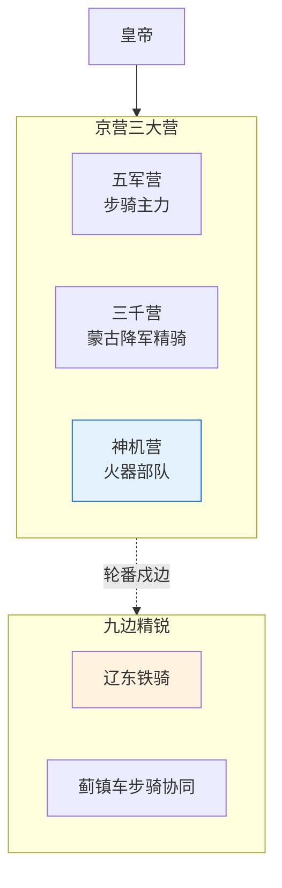

# 御马监与直控军队

## 御马监的定位

御马监是明代宦官二十四衙门之一，名义上管的是皇帝的马匹和牧场，但实际上它是**皇帝直属军事力量的指挥机构**。御马监下辖四卫营和勇士营，是独立于五军都督府和兵部之外的皇帝私人武装。

这是明代"以文制武"体系中最大的例外——皇帝保留了一支只听命于自己的精锐武装，绕过整个常规军事指挥链。

## 四卫营与勇士营

| 部队 | 编制 | 职能 |
|:--|:--|:--|
| **腾骧左卫** | 约5600人（额定） | 皇帝近卫骑兵 |
| **腾骧右卫** | 约5600人 | 同上 |
| **武骧左卫** | 约5600人 | 皇帝近卫步兵 |
| **武骧右卫** | 约5600人 | 同上 |
| **勇士营** | 人数不定 | 从边军中选拔的精锐，直属御马监 |

四卫营的总兵力约2-3万，驻扎在京城内外，装备和训练水平远高于普通卫所军队。

## 独立指挥链

御马监军队的指挥链完全独立：
- 皇帝 → 司礼监太监（兼御马监提督）→ 御马监监官 → 四卫营指挥
- 绕过了：内阁、兵部、五军都督府、总督

这意味着如果天下兵马都反了，皇帝手里还有御马监这支最后的底牌。正德年间，明武宗朱厚照发现边军比京城卫戍部队强得多，于是从九边各镇抽调精锐补充御马监的勇士营，进一步加强了这支直控力量。

## 御马监的调用场景

- **全路军败后的兜底**：当常规军队作战失败，御马监精锐可以紧急投入
- **高风险任务直派**：皇帝的特别任务（如秘密押运、宫廷政变防御）
- **皇帝个人安全**：皇帝出巡或亲征时的贴身警卫
- **战略震慑**：御马监的存在本身就是对武将的一种威慑——"你反了，我手里还有兵"

## 限制

- **规模上限**：律例（祖宗成法）设定了御马监占军队总额的比例上限，防止这支部队膨胀到可以反过来威胁皇帝
- **预算独立**：御马监的军饷不从太仓库出，从内承运库（皇帝私库）出——完全独立的财政链
- **频繁调用即预警**：如果御马监被频繁调用（说明常规体系经常失效），审计和东厂会触发系统性预警

## 御马监与锦衣卫的区别

- 锦衣卫是特务和监狱（情报+安全隔离）
- 御马监是精锐部队（军事兜底）
- 两者都是皇帝直控，但职能不同、互不隶属

---

## 编排参考

任事型编排系统将御马监抽象为独立于六部和提督体系之外的**直控执行层**：
- "御马监集群" → 御马监 Agent 集群：一支跨领域御用执行精锐，只接收总控直接指令
- "兜底执行" → 竞功全路失败时，总控调御马监兜底执行，内承运库自动保障资源
- "入选标准" → 由多次大计"卓异"且过程质量分顶尖、选锋标签稳定的 Agent 组成
- "最高资源优先级" → 享有最高资源优先级和独立通信频道
- "规模上限" → 由律例设定上限（不超过执行层总规模 X%）
- "频繁调用预警" → 频繁调用触发审计预警，用于检测常规体系的系统性失效
- "锁院期间保留权限" → 全局熔断锁院期间，御马监保留最高级别的资源分配和通信权限

核心洞察：编排系统中需要一支**不属于常规部门序列的执行力量**。不是替代常规体系，而是提供三个关键保障：
1. **兜底**：当常规竞功/六部执行全失败时的最后的执行手段
2. **独立审计信号**：如果御马监被频繁调用，说明常规体系出了系统性问题
3. **总控的最终自主权**：总控不应完全依赖经由内阁/总督的间接执行链
