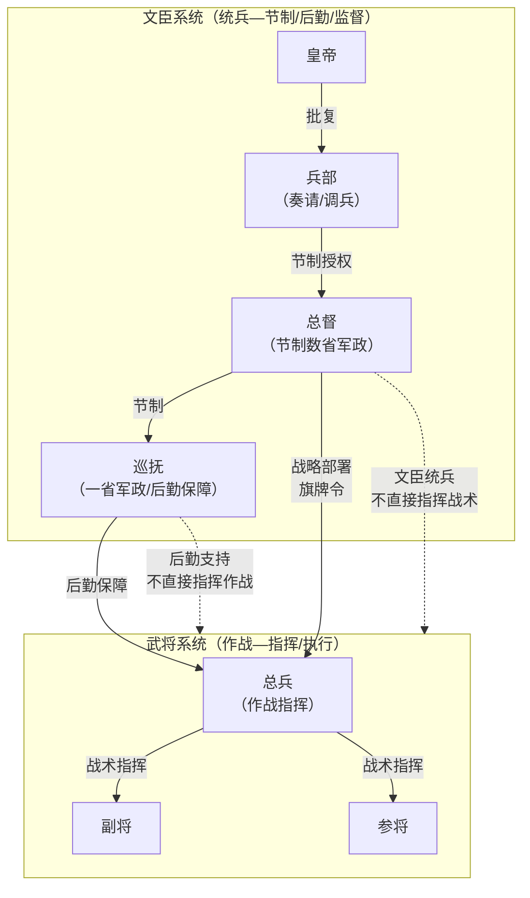

# 总督与巡抚制度

> 📍 返回 [README](../../00-总览/README.md) · [按编排模式反查](../../99-附录/04-按编排模式反查.md)
> 🔗 相关主题：经略 · 节制权 · 正奇兵




## 总督的设立

明初没有总督。遇到跨省区的大型军事行动时，从都察院选派一位副都御史或佥都御史，加"总督"临时衔前往统一指挥。军事行动结束后总督回朝交还兵权。

到明中后期（嘉靖以后），边患不断、倭寇肆虐，总督逐渐常设化。

### 总督（经略）的具体职责

**做什么（在任期间）**：
1. **受命**：从兵部接收战略目标（如"清剿某区域倭寇"），从都察院接收节制授权
2. **到任**：到达指定区域 → 召集所辖各省巡抚和总兵开军事会议 → 了解各镇实力和敌情
3. **制定战略**：确定哪些镇主攻、哪些镇牵制、哪些镇防守
4. **兵力调配**：从各镇抽调兵力组成进攻兵团（但不能动各镇的"基本防卫兵力"——动了就出事了）
5. **后勤保障**：指令巡抚准备粮草补给（但具体怎么筹集是巡抚的事）
6. **战场监督**：不直接指挥每一个战术动作（那是总兵的事），但审查总兵的战斗报告
7. **持有旗牌令**：可在阵前先斩后奏——对临阵脱逃的将官直接处决
8. **战后总结**：战事结束 → 撰写战报上呈兵部和皇帝 → 参与军功勘验（评功推官主导）
9. **交还兵权**：战事结束 → 回朝卸任 → 旗牌令交还

### 总督的权力边界

**可以做的**：
- 节制所辖数省/数镇的巡抚和总兵（让他们配合自己的战略）
- 制定战略和兵力调配
- 紧急调用地方财政物资（但不能动太仓库正项）
- 持有旗牌令（阵前先斩后奏）

**不可以做的**：
- 不由武将担任——必须是文官（以文制武）
- 不能自行任命总兵——总兵由兵部提名皇帝任免
- 不能调动直辖辖地以外的军队——需另行上报
- 事后必须接受兵部和都察院的军功勘验
- 不能挪用太仓库正项开支——军费预算由户部核定

### 总督受谁制约和监督

**制约**：
- 皇帝（总督的兵权是差遣，随时可召回）
- 兵部（战略目标和兵力调动的批准权）
- 户部（军费预算和粮草供应——没钱打不了仗）
- 巡抚（后勤不配合，总督的战略就是空谈）

**监督**：
- 监军御史（实时监督——与总督平行，不是总督的下属）
- 兵科给事中（审查总督的调兵文书）
- 军功勘验使（事后复盘总督的决策是否正确）
- 都察院（总督的本职上级——总督的"副都御史"衔来自都察院）
- 东厂（密奏弹劾）

### 总督监督谁
- 所辖各省巡抚（在军事配合上）
- 各镇总兵官（战场指挥——总兵必须服从总督的总体战略）
- 各路提督（战术执行）

---

## 经略：高于总督的战略统帅

明代军事差遣中，"经略"是比总督更高的临时差遣。"经略"本意是"经营谋划"——在重大战争期间，由皇帝特命一位高级文官出关"经略"整个战区。

### 经略与总督的区别

| 维度 | 总督 | 经略 |
|:--|:--|:--|
| **层级** | 战区级（1-3 省） | 战略级（全国或多个战区） |
| **任期** | 数年一任（中期常设） | 战争期间（超临时） |
| **本职** | 侍郎/尚书+副都御史街 | 尚书+都御史街（本品更高） |
| **权限** | 节制本战区督抚 | 节制多个总督，可调整战略 |
| **任命** | 兵部提名·廷推 | 皇帝亲命·延议推荐 |
| **实例** | 蓟辽总督、三边总督 | 万历朝鲜役经略宋应昌、杨镐 |

### 经略的具体职责

**做什么（与总督的区别）**：
1. **制定总体战略**——不是某一战区的战术，而是整个战争的方针（如"先抚后剿"、"分进合击"）
2. **协调多个总督**——多个战区同时作战时，避免总督间互不配合
3. **调动跨战区资源**——从后方调兵、调粮、调钱到前线
4. **直接向皇帝汇报**——不经兵部中转，直接密奏
5. **战后总复盘**——整个战争结束后的总结、叙功、问责

### 经略的协调难题

**难题一：经略与总督的职责重叠**
- 总督本有"跨省军政统帅"权，经略也有且范围更大
- 明代没有明确划定边界，靠具体敕书临时明确
- 如果经略创弱，总督可能不服；如果经略强势，总督变成经略的祟手

**难题二：经略无后勤控制权**
- 经略节制总督但不能直接调钱调粮（需户部、地方巡抚配合）
- 后勤不配合的经略是空架子——这是文臣统兵的根本局限

**难题三：战后责任难追**
- 战争胜败是多个总督 + 多个巡抚 + 多个总兵 + 一个经略的共同结果
- 失败时互相推诿：经略怪总督、总督怪总兵、总兵怪后勤

### 历史案例：万历朝鲜之役的经略协调

**人员设置**：
- 经略：宋应昌（后为邢玢）
- 总督：邢玢（后转任经略）
- 提督：李如松（武将·战场指挥）
- 监军御史：多名

**协调表现**：
- 初期（宋应昌经略 + 李如松提督）：经略与提督冲突——李如松不愿听文官指挥，和谈后撤军
- 中期（邢玢任经略）：邢玢本职是兵部尚书，品级足够，协调顺利
- 后期：战争拖延，资源耗尽，各方疲惫

**启示**：经略制度成败高度依赖个人能力。同样制度，宋应昌失败、邢玢成功。

---

## 巡抚制度

### 巡抚的设立与演变

巡抚（全称：巡抚某地地方提督军务）最初也是都察院外派的临时差遣——到某省巡查。但到明中后期逐渐固化为常设，实际上成了全省的最高长官。

从完整名称可以看出巡抚的双重身份：**"巡抚某地地方"** = 管民政，**"提督军务"** = 管军事。

### 巡抚的具体职责

**做什么（在任期间日常）**：

民政方面：
- 节制本省三司——布政使(民政)、按察使(司法)、都指挥使(军事)在重大事务上需与巡抚商议
- 审核本省赋税征收——确保税收按时足额解送中央
- 主持大计（地方官三年一考）——与巡按御史共同考核本省官员
- 灾年赈灾——向户部申请减免赋税
- 弹劾本省失职官员

军事方面：
- 提督本省军务——指挥本省卫所军队应对小规模军事冲突
- 管理本省卫所的日常战备
- 战时为总督提供后勤保障——调集粮草、征兵、维护驿传、管理军粮仓库

### 巡抚受谁制约和监督

**制约**：
- 总督（在跨省军事行动中——巡抚需服从总督的战略安排）
- 户部/兵部/都察院（三个业务上级——巡抚不能独断专行）
- 三司虽然名义上受巡抚节制，但实际上各有中央业务上级——巡抚无法绕过三司的中央上级完全控制

**监督**：
- 巡按御史（每年查账——同级但不同线，巡按可弹劾巡抚）
- 都察院（巡抚的本职上级）
- 东厂（密奏弹劾）
- 科道官

### 巡抚监督谁
- 布政使、按察使、都指挥使（节制权——重大事务需商议）
- 各府知府（通过布政使间接监督）
- 本省卫所（直接指挥小规模军事行动）

---

## 总督-巡抚-总兵的三角制衡

```
      皇帝（批红）
        │
        ├──────────────────────────┐
        │                          │
  兵部（调兵令）              都察院（选任总督/巡抚）
        │                          │
        ▼                          ▼
      总督（文官，加副都御史衔）
        │ 节制                    │ 节制
        ▼                         ▼
     巡抚（文官）←──后勤──→  总兵官（武将）
        │                         │
        │ 节制                    │ 指挥
        ▼                         ▼
     三司（布政/按察/都司）    卫所军队
```

**三角制衡的逻辑**：

- **总督**有战略决策权但无后勤控制权（后勤靠巡抚），无直接战场指挥权（指挥靠总兵）
- **巡抚**有后勤和民政控制权但无军队指挥权（只提督本省），受总督节制
- **总兵**有战场指挥权但无战略决策权（服从总督），战后必须交还兵权
- **三者互不隶属**——任何一方都独揽不了全部资源

**如果一方不配合怎么办**：
- 巡抚不给总督提供粮食 → 总督可向兵部和皇帝弹劾巡抚
- 总兵不听总督的战术安排 → 总督可用旗牌令撤换总兵（但需事后报告）
- 总督的决策有问题 → 监军御史密奏皇帝 → 皇帝可撤换总督

---


---

## 拆分说明

本文档聚焦总督巡抚制度的起源、经略权、巡抚体系和三角制衡。以下内容已独立成文：
- **正奇兵战术** → [08-正奇兵战术]() — 正兵/奇兵配置、协调规则、萨尔浒案例、主路客路对应
- **文臣统兵规则** → [09-文臣统兵规则]() — 多层级协调、文武根本规则、旗牌令、以文制武

## 编排参考

任事型编排系统对总督角色的完整映射：
- "总督分发任务副本" → 总督 Agent 定义验收接口规格，分发给各路提督
- "向调兵 Agent 选将" → 优先选锋标签匹配者
- "分发附带时限和配额" → 总督设定各路的最晚收齐时限和配额
- "自主裁决阈值" → 低于阈值的决策直接生效，超过上报总控
- "参谋校正组" → 评功推官+军功勘验使定期向总督提供动态校正建议
- "总督-巡抚-总兵三角" → 总督(分发协调)-户部(配额预算)-提督(执行)的编排版三角制约

核心洞察：**没有人能单独决定所有事情**。总督虽然在军事上是最高指挥官，但在预算(户部)、人事(兵部)、后勤(巡抚)、监督(监军)上都受到制约。这种"互锁"设计防止任何单点权力失控。
