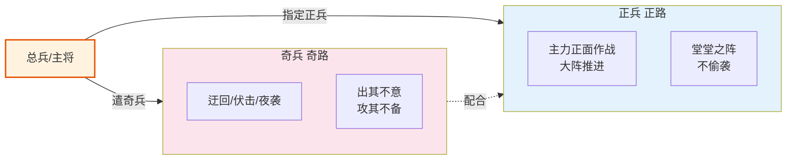

# 正奇兵战术

> 从总督与巡抚制度拆出。明代正兵与奇兵的战术协调原型，竞功模式主路/客路的直接来源。



## 正兵与奇兵：明代战术协调的原型

### 正奇兵的概念

**正兵**（zhengbing）和**奇兵**（qibing）是中国古代军事的核心战术区分，源于《孙子兵法》——“凡战者，以正合，以奇胜”。

| 兵种 | 定位 | 战术角色 | 明代典型配置 |
|:--|:--|:--|:--|
| **正兵** | 主力、正规、公开 | 正面决战、吸引敌方主力、阵型维持 | 总督直辖兵、九边镇军 |
| **奇兵** | 机动、隐蔽、出其不意 | 包抄、迂回、偷袭、诱敌 | 游击将军所领、选锋突击队 |

### 明代的正奇兵配置

明代在重大战役中通常同时配置正兵和奇兵：

```
总督战略
    ├── 正兵（总兵领）→ 正面推进、与敌主力对阵
    ├── 奇兵一路（游击领）→ 从侧翼包抄
    ├── 奇兵二路（游击领）→ 断敌退路
    └—— 奇兵三路（选锋领）→ 直搂敌主帅
```

### 正奇兵的协调规则

**规则一：正兵先动，奇兵后动**
- 正兵与敌接触、脚持敌方主力后，奇兵才能出动
- 如果奇兵先动被敌方发现，就失去了“奇”的效果

**规则二：奇兵不告总兵具体路径**
- 奇兵的路线由游击将军自主决定，只报目标
- 防止万一正兵中有人泄密，敌方预知奇兵路线

**规则三：正兵不能撤退拖下奇兵**
- 正兵如果未获总督许可擅退，奇兵的侧后就会暴露
- 正兵后退必须与奇兵协同——这是阵型的完整性

**规则四：奇兵不能抢正兵的功**
- 奇兵的任务是包抄和断退路，不是抢首级
- 奇兵与正兵争夺首级会导致阵型崩溃

### 正奇兵协调的失败模式

| # | 失败 | 原因 | 后果 |
|:--|:--|:--|:--|
| 1 | **正兵仓促进攻** | 总督未等奇兵到位就发动 | 奇兵失去包抄机会，战局僵持 |
| 2 | **奇兵提前暴露** | 奇兵被敌方发现 | “奇”变“正”，包抄失效 |
| 3 | **正兵擅退** | 正兵将领贪功或惧战 | 奇兵侧后暴露，被反包围 |
| 4 | **奇兵抢功** | 奇兵不顾任务去抢首级 | 阵型崩溃，包围失效 |
| 5 | **正奇不分** | 所有部队都是正兵或都是奇兵 | 失去战术弹性，要么僵持要么冒险 |

### 历史案例：萨尔浒之战的正奇兵失灵

**背景**：万历末年（1619），明军四路围剿后金努尔哈赤。

**配置**：
- 西路：杜松领正兵（主力）
- 东路：刘経领奇兵（包抄）
- 南路：李如柏领正兵（助攻）
- 北路：马林领奇兵（断退）

**失灵过程**：
1. 杜松的正兵仓促进攻，渡浑河时遭后金突袭
2. 其他三路未能及时到位（奇兵未动而正兵已败）
3. 努尔哈赤集中兵力各个击破，明军全军覆没

**教训**：正奇兵协调需要严格的时间同步——正兵不能脱离奇兵单独行动。

## 主路与客路的编排对应

竞功模式中的“主路提督”和“客路提督”是正奇兵的现代版演化：

| 维度 | 明代正奇兵 | 竞功主客路 |
|:--|:--|:--|
| **角色区分** | 正兵 vs 奇兵 | 主路 vs 客路 |
| **任务区分** | 正面vs包抄 | 主攻关 vs 辅助路 |
| **协调机制** | 总督统一调度 | 总督分发 + 塘报同步 |
| **失败模式** | 正奇不配合 | 主客不同步 |

**重要差异**：明代正奇兵是“配合”关系（正兵脚持、奇兵包抄），竞功主客路是“竞争”关系（都攻关同一目标、择优）。这是从“战术协作”到“市场竞争”的转化。

---

