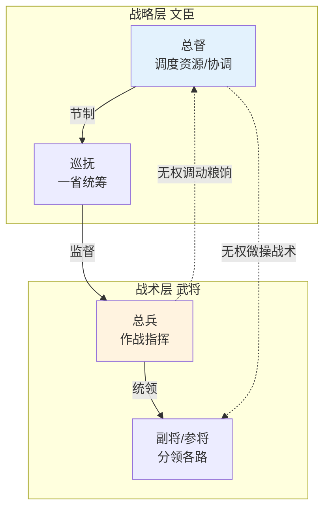

# 文臣统兵规则

> 从总督与巡抚制度拆出。明代文臣统兵的多层级协调与根本规则。



## 督抚叠床：多级差遣的协调问题

### 明代的叠床问题

明中期后，同一地区常出现多个差遣同时存在：

```
某战区（如蓟辽）
   ↑
经略（超临时·战略）
   ↑ 节制
总督（中期常设·战区）
   ↑ 节制
巡抚（常驻·一省）
   ↑ 节制（军事配合）
总兵官（战时·战场指挥）
   ↓ 平行
监军御史（不参与指挥·只监督）
```

### 叠床的协调失败模式

| # | 失败 | 场景 | 后果 |
|:--|:--|:--|:--|
| 1 | **职责重叠** | 经略与总督都认为自己能调动某资源 | 资源调不动，双方推诿 |
| 2 | **多重指挥** | 总兵同时收到总督、经略、巡抚的指令 | 不知听谁的，贻误战机 |
| 3 | **推责叠饼** | 战败后经略怪总督、总督怪巡抚、巡抚怪总兵 | 无人负责 |
| 4 | **监军烂权** | 监军御史太多，每个都能密奏，前线决策被后方干扰 | 指挥瘫疒 |
| 5 | **久任不归** | 临时差遣（经略/总督）事实上变成常驻 | 制度被掏空 |

### 明代应对叠床的三种机制

**机制一：明确节制优先级**
- 敕书明确规定：谁节制谁、在什么事上节制
- 高级差遣在战略事务上节制低级差遣
- 低级差遣在具体执行上有自主权

**机制二：信息禄商化**
- 所有差遣的命令文书必须抄送兵部和内阁
- 兵部负责发现冲突并上报皇帝
- 内阁负责协调跨部资源配合

**机制三：事后统一问责**
- 战后叙功时不只评功，也追责
- 责任追到具体环节：谁的决策错了、谁的不配合导致了失败
- 避免集体负责等于无人负责

---

## 文臣统兵：文武协调的根本规则

### 以文制武的基本原则

明代军事制度的根本设计是**"以文制武"**——武将无论能力多强、品级多高，在战区事务上必须服从文官统帅（总督/巡抚/经略）。

### 文武分工的边界

| 事务 | 文官（督抚） | 武将（总兵/提督） |
|:--|:--|:--|
| **战略决策** | 制定 | 执行（可建议但无决定权） |
| **兵力调配** | 决定哪些部队打什么 | 提出本部能力评估 |
| **后勤保障** | 统筹（实际靠户部/地方） | 不介入 |
| **战场指挥** | 不介入（除非紧急） | 全权指挥 |
| **战场纪律** | 持旗牌令可阵前斩将 | 执行军法 |
| **战后叙功** | 主导叙功册 | 接受叙功 |
| **兵员训练** | 不介入 | 全权负责 |
| **装备维护** | 不介入 | 全权负责 |

### 为什么文官节制武将

**原因一：防止武将造反**
- 唐末五代武将夺权的历史教训深刻
- 朱元璋木人 ux 设计：以文制武是祖训

**原因二：文官有全局观**
- 武将关注本部得失，文官关注整体战略
- 战略与战术的分离需要更高层级的人统揽

**原因三：文官可追责**
- 武将造反可以逃跑，文官逃跑无处可去（家眷、田产、名声）
- 文官身家绑定于朝廷，不会轻举变动

### 文武协调的失败模式

**失败一：文官过于激进**
- 不懂军事的文官瞎指挥，强迫武将执行不可能的任务
- 历史案例：明代某些总督仓促进攻导致大败

**失败二：武将阴奉阳违**
- 表面服从文官节制，实际按自己想法打
- 出问题后怪罪文官瞎指挥

**失败三：文官过于保守**
- 怕担责任的文官不愿决断，贻误战机
- 武将请战被拒，士气衰落

**失败四：监军过虑**
- 监军御史太多，每个都能密奏，文武双方都不敢决断
- 实际出现"五将军打仗、五十个监军看"的奇景

### 设计启示：文武协调的本质

文武协调不是"谁听谁的"——而是**战略决策权与战术执行权的分离**：
- 战略决策权归文官（含整体风险、全局利益考量）
- 战术执行权归武将（含具体技术、现场判断）
- 两者在"战场纪律"上有交集（文官持旗牌令可干预）
- 这种分离要求双方互信，否则变成互相掣肘

---

