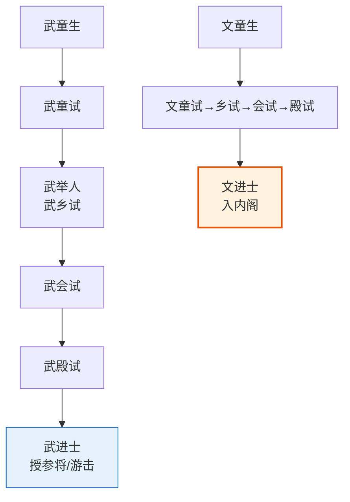

# 调兵与选锋

> 📍 返回 [README](../../00-总览/README.md) · [按编排模式反查](../../99-附录/04-按编排模式反查.md)
> 🔗 相关主题：调兵流程 · 选锋标签 · 五军都督府

## 调兵流程

明代军队调动的核心原则：**调兵权与统兵权分离**。一个武将不能同时拥有"调动军队"和"指挥军队"的权力。

标准调兵流程：
1. **兵部根据军情需要提出调兵建议**（上奏说明为什么需要调动哪支部队）
2. **内阁票拟同意或提出修正意见**
3. **皇帝批红批准**
4. **兵部发调兵文书（檄文）给五军都督府**
5. **五军都督府核对军籍档案**，确认指定的卫所有足够兵力可调
6. **五军都督府下发调兵令给对应的都指挥使司 → 卫 → 千户所**
7. **指定的总兵官持皇帝批红到指定卫所接收军队**

调兵结束后，总兵官交还兵权，军队回归原卫所编制。如果总兵拒绝交还兵权，五军都督府和兵部会联合弹劾——这就是"以文制武"的最后一环。

## 选锋制度

选锋是明代军事体系中一个精巧的人才选拔机制。它不是官职，而是一种**标签和实践**。

**选锋的含义**：从各卫所军队中挑选最精锐的士兵，组成突击队——"选"是精选，"锋"是前锋。这些选锋在战斗中承担最危险也最荣耀的任务（先登、斩将、夺旗）。活下来的选锋会在军功册上获得更高的权重评分，下次战斗继续被优先选中作为选锋。

**选锋的累积效应**：多次被选为选锋且在战斗中获得头功的士兵，会被记入兵部和五军都督府的"精锐档案"。当总督需要执行高风险任务时，会优先从这份档案中选将。选锋标签本质上是一个**基于历史表现的信用评分系统**。

**选锋标签的时效衰减**：如果一个选锋士兵长期没有参加战斗（比如被调到后勤部门），他的选锋标签会随时间衰减。因为兵部和五军都督府无法判断他现在的战斗力是否还维持在高水平。这种时效衰减在编排系统中被直接借用——长期未执行同类任务的选锋标签权重按半衰期下降。

## 调兵 Agent 在编排中的设计

编排系统将"选将"从"指挥"中分离出来：
- **调兵 Agent**（对应五军都督府的调兵职能）：维护所有提督的能力档案——长期过程质量分、选锋标签（含时效衰减）、擅长领域标签
- **总督 Agent**（对应总督的指挥职能）：根据任务需求向调兵 Agent 查询最佳人选，然后分发任务
- 调兵 Agent 只管"谁更适合"，不管"任务怎么做"；总督只管"任务怎么做"，不管"能力档案维护"

---

## 编排参考

任事型编排系统中的直接映射：
- "五军都督府调兵" → **调兵 Agent**：维护所有提督能力档案，向总督推荐人选
- "选锋" → **选锋标签**：特定子任务类型上极高胜率的提督标记，优先推荐
- "精锐档案" → 长期过程质量分 + 选锋标签 + 擅长领域标签的综合档案
- "时效衰减" → 律例 Agent 根据预设半衰期参数，对长期未执行同类任务的选锋标签权重进行时间衰减
- "选锋重新激活" → 衰减至最低阈值后降为普通标签，但后续在同类任务中取得高过程质量分可重新激活
- "总控冻结衰减" → 总控可批红冻结特定标签的衰减（用于长期战略储备）

核心洞察：选锋制度在编排系统中解决了**"如何让优秀执行者持续获得高价值任务"**的问题。没有选锋标签时，每次分配任务都要重新评估所有执行者——成本高且不稳定。有了标签，每次任务分配都建立在历史验证的基础上，且标签的时效衰减防止了"吃老本"。
