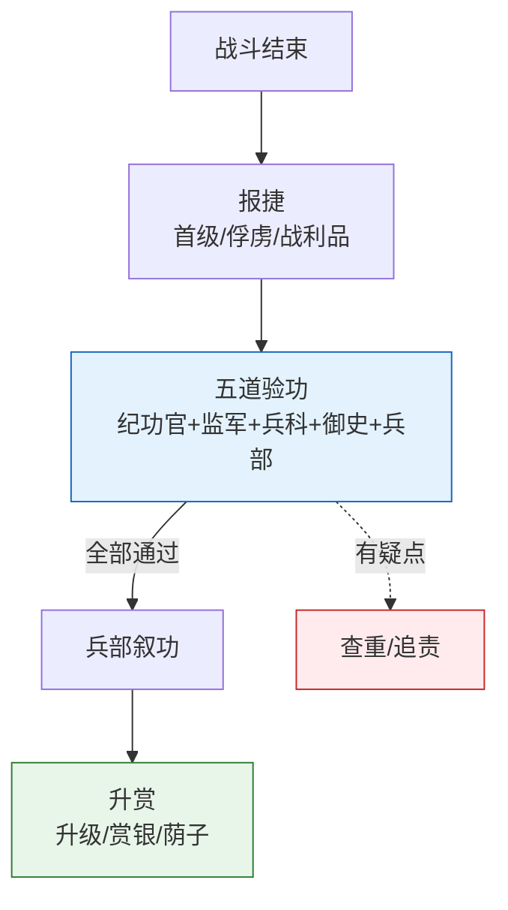

# 竞功与军功考核

> 📍 返回 [README](../../00-总览/README.md) · [按编排模式反查](../../99-附录/04-按编排模式反查.md)
> 🔗 相关主题：首功制 · 五道验功 · 选锋




## 首功制（首级计功）

明代军功考核的核心是**首功制**——按战斗中斩获的敌人首级数量计功行赏。这是最简单、最可量化、也最残酷的计功方式。

**为什么用首功制**：战斗结果难以客观评估。将领自己报"大胜"可能是虚报，报"力战"可能是逃跑。而割下来的敌人首级是硬证据——造假难度高（虽然后期也出现了"杀良冒功"的问题）。

**计功标准**（不同时期有所不同）：
- 斩获蒙古真夷首级一颗 → 升一级，或赏银若干两
- 斩获倭寇真夷首级一颗 → 同上（倭寇更难打，赏格稍高）
- 杀良冒功（割平民首级冒充敌人）→ 查证后斩首

**首功制的缺陷**：
- 导致士兵只顾割头不顾追击（正追杀敌人时停下来割头）
- 队伍之间争抢首级（"这颗头是我先砍的"）
- 杀良冒功（军队屠村割百姓首级报功）

## 参与军功考核的各方角色

### 各路将领（总兵/提督）—— 自报战功

**做什么**：战后向兵部/总督提交战报——自报本路斩获首级数量、俘虏、缴获、战斗过程。

**制约**：自报的数据会被交叉比对——如果和其他路的报告矛盾，触发进一步调查。

### 兵部职方司 —— 战功核实初验

**做什么**：收到各路战报后 → 查阅塘报和行军日志（过程回放）→ 比对各路自报数据（交叉比对）→ 标注矛盾点 → 提交评功推官

### 监军御史 —— 独立第三方验证

（详见[都察院与十三道御史](../../03-监察链/01-都察院与十三道御史.md)）

**做什么**：
- 在战斗前后全过程独立记录——不经过总督或总兵的审批
- 核实各路自报的杀敌数量和战斗经过
- 发现虚报、杀良冒功、冒领战功 → 密奏皇帝
- 可挂白旗暂停有问题的将领（需总督联署才能正式生效）

**制约**：
- 不能独立撤销将领（需总督联署）
- 不参与军事指挥——只管监督不管打仗
- 监军报告需与其他证据交叉验证

### 评功推官 —— 五道验功

**五道验功流程**：

1. **第一验（自报核验）**：各路自报斩获数量和战斗过程 → 提供首级实物和目击证词
2. **第二验（交叉比对）**：各路数据互相核对——A路说在某地杀了30个敌人，但B路的塘报显示那天某地没有敌军活动 → 标注矛盾
3. **第三验（过程回放）**：查阅塘报原件、行军日志、监军报告——证实战斗是否按自报中描述的过程发生
4. **第四验（多部门会审）**：兵部职方司 + 都察院（派御史） + 监军御史联合审定——三方一致认定才能通过
5. **第五验（最终敲定）**：汇总各方核实结果 → 编制叙功册 → 上呈兵部尚书 → 内阁票拟 → 皇帝批红

**评功推官的制约**：
- 评功结果需多部门会审——不能单方面决定
- 叙功册最终需皇帝批红确认
- 军功勘验使（事后复盘）可推翻评功推官的结论

### 军功勘验使 —— 事后复盘

**做什么**：战事结束、叙功册已发之后 → 军功勘验使复盘整个评功过程是否公正：
- 是否有该赏的没赏到？
- 是否有冒功的得了赏？
- 评功推官有没有在验功过程中偏袒某人？

**权力**：不改变当次叙功结果（已发的不收回），但：
- 降低评功推官的信誉分（影响下次任务中评功推官的选用）
- 形成竞功专属错误模式简报（"某类战斗的评功流程容易在第三验出问题"）
- 疑有联合作弊的 → 请求总控启动复核

### 参谋校正组 —— 执行中的动态反馈

在竞功各路还在执行过程中，**评功推官和军功勘验使临时组成参谋校正组**，利用实时功次快报向总督提供动态校正建议：
- "某路消耗过快但进度滞后 → 建议降权或合并"
- "某路出现突破迹象 → 建议追加配额"
- "多路都在同一方向攻坚 → 建议某路转向不同角度"

**制约**：校正建议不具强制力——总督可以拒绝但需附理由留档。这是为了防止参谋校正组越权指挥。

---

## 叙功册

每次战役后兵部职方司编制叙功册——这是升迁、赏银、封爵的原始依据。

**叙功册包含**：
- 头功（最大贡献者——通常在决定性战斗中起关键作用的将领）
- 次功（辅助贡献者——牵制/后勤/情报中做出重要贡献的）
- 各参战将官的具体斩获数量和评估
- 过程质量分——不光看结果(杀多少敌)，还看过程（战术是否合理、军纪是否良好、伤亡是否控制在合理范围）
- 失期名单（没有按时到达指定位置的）
- 失期处罚——降权、扣赏、影响下次选将

**叙功册的流向**：
- 抄送吏部考功司 → 更新相关将领的长期权重
- 抄送兵部武选司 → 影响下次选将
- 抄送五军都督府 → 更新武官能力档案
- 正本存档皇史宬

---

## 竞功-军功考核的制约关系图

```
战役结束
  │
  ├── 各路总兵/提督 自报战功 ──────────────┐
  │                                            │
  ├── 监军御史 独立快报 ────────────────────┤
  │                                            ▼
  ├── 塘报原件/行军日志 ─────→ 评功推官 五道验功
  │                                  │
  │                                  ├── 第一验：自报核验
  │                                  ├── 第二验：交叉比对
  │                                  ├── 第三验：过程回放
  │                                  ├── 第四验：多部门会审（兵部+都察院+监军）
  │                                  └── 第五验：最终敲定 → 叙功册
  │                                                     │
  │                                                     ▼
  │                                            内阁票拟 → 皇帝批红
  │                                                     │
  │                                                     ▼
  │                                            叙功册生效（赏罚执行）
  │                                                     │
  └──────── 军功勘验使 事后复盘 ←─────────────────────┘
                │
                ├── 评估评功推官是否公正
                ├── 发现冒功/漏功 → 降低评功推官信用分
                └── 形成错误模式简报 → 上报律例/考功司
```

---

## 编排参考

任事型编排系统的竞功机制完整复刻了明代军功考核：
- "首功制" → 资源效率分+质量分+配额使用率的量化评分
- "叙功册" → 叙功册（头功赏+过程质量分+失期罚）→ 更新长期权重
- "五道验功" → 评功推官五个验证步骤——每步对应不同的验证方式
- "监军密奏" → 监军 Agent 密奏直通总控——绕过常规监察链
- "参谋校正组" → 评功推官+军功勘验使在执行过程中提供动态校正建议
- "军功勘验事后复盘" → 审计 Agent + 军功勘验使的交叉验证

核心洞察：首功制解决了**多路径并行后的公平选优**问题。在编排系统中，多条路径同时执行，如何淘汰差的选出好的？答案是"只看硬证据（资源效率分/质量分），不听自夸（各路自报），多眼交叉验证"。
