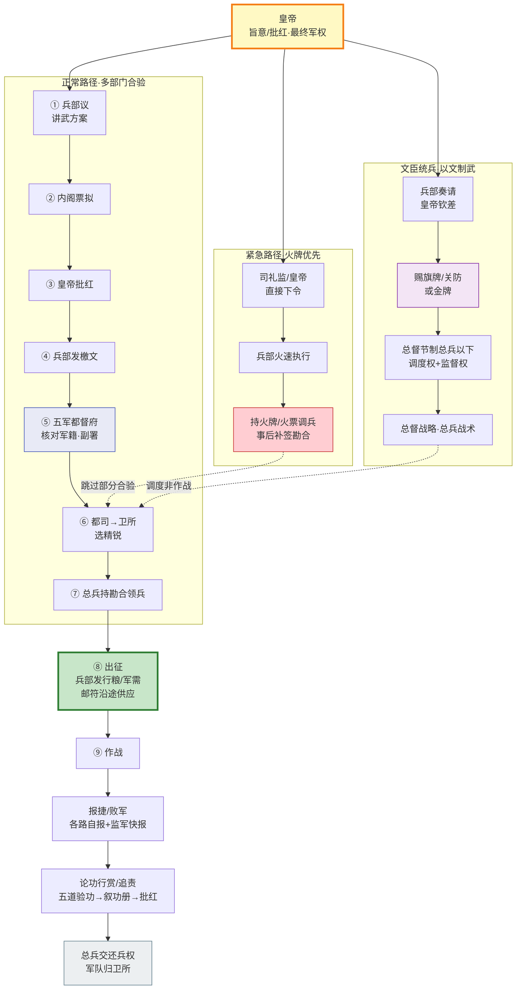

# 调兵完整流程

> 📍 返回 [README](../../00-总览/README.md) · [按编排模式反查](../../99-附录/04-按编排模式反查.md)
> 🔗 相关主题：调兵凭证 · 正常/紧急/文臣三路径 · 出征闭环

## 定位

本文档聚焦**动态调兵过程**——从皇帝下旨到战场报捷的完整执行链。不讲静态机构（机构见 [01-五军都督府]()、[02-兵部深度制度]()、[07-总督与巡抚制度]()），只讲**流程怎么跑、凭证怎么验、权力怎么交接**。

明代调兵有三条并行路径，在"出征"节点汇合，再进入统一的作战—报告—叙功闭环：

| 路径 | 触发场景 | 关键特征 | 耗时 |
|:--|:--|:--|:--|
| **正常调兵** | 例行征讨、边防换防 | 多部门合验、权力互锁 | 数周至数月 |
| **紧急调兵** | 敌军突袭、京师告急 | 火牌优先、程序简化 | 数日 |
| **文臣统兵** | 跨省征剿、长期战区 | 钦差旗牌、节制总兵 | 数月 |

---

## 调兵凭证体系

调兵不是一句话的事——每一道指令必须附带物理凭证，凭证的种类决定权限边界。明代形成了四级凭证体系，从高到低：

| 凭证 | 颁发者 | 持有者 | 权限 | 适用场景 |
|:--|:--|:--|:--|:--|
| **金牌**（gold tally） | 皇帝亲赐 | 总督/经略 | 节制数省军政、阵前先斩后奏 | 大规模征讨、战略级授权 |
| **旗牌/关防** | 兵部奏请·皇帝钦赐 | 总督/巡抚 | 节制本战区总兵以下、调发粮草 | 战区常设统帅 |
| **勘合**（warrant） | 兵部+五军都督府双签 | 总兵官 | 到指定卫所接收指定军队 | 正常调兵的标准凭证 |
| **火牌/火票**（fire tally） | 皇帝/司礼监·兵部加签 | 钦差/急使 | 沿途优先一切、可临时征调 | 紧急军情、信息急递 |
| **邮符**（postal pass） | 兵部车驾司 | 差役/信使 | 驿站食宿换马、传递塘报 | 军情传递、后勤文书 |

**核心规则**：凭证与权限严格绑定。总兵持勘合只能领兵不能节制他路；持旗牌的总督不能自行任命总兵；持金牌的经略不能动直辖地外的兵。凭证错配 → 调兵令无效 → 卫所有权拒绝交兵。

---

## 正常调兵流程（九步闭环）

这是制度设计最完整的路径，每一步都有牵制节点。**任一步卡住，整条链停摆**——这是特性不是 bug。

**第一步·皇帝下旨**
军情奏报送达 → 皇帝发出"旨意"（口传或手诏），交给兵部议。旨意只给战略目标（"剿某处倭寇"），不指定具体打法。

**第二步·兵部议**
兵部职方司分析敌情 → 起草**讲武方案**（调哪些卫所、派多少兵、谁挂帅、粮草从哪出）→ 兵部尚书审阅 → 上呈内阁。详见 [02-兵部深度制度]()。

**第三步·内阁票拟**
内阁对方案提出同意/修正意见。可封还（"此方案不可行"），封还则兵部重议。

**第四步·皇帝批红**
内阁票拟通过 → 皇帝批红正式批准。批红是调兵令的最终合法性来源——没有批红，后续一切不成立。

**第五步·五军都督府发兵牌**
兵部发调兵檄文 → 五军都督府**核对军籍**：指定卫所是否真有足够兵力？是不是空籍（军户逃亡）？装备训练是否达标？核对通过 → 副署；核对不过 → 驳回。详见 [01-五军都督府]()。

**第六步·卫所选精锐**
双签檄文下达都司 → 卫 → 千户所 → 指定卫所按檄文数额选兵。选锋标签高的士兵优先入选，组成突击队。详见 [10-调兵与选锋]()。

**第七步·将领领兵**
指定总兵官持**勘合**（兵部+五军都督府双签）到卫所接收军队。卫所长官验合放兵——勘合数额与实际交付必须一致，多调少调都违规。

**第八步·出征**
兵部车驾司下发**行粮/军需**调令 → 沿途驿站凭**邮符**供应食宿草料 → 军队开拔。后勤是调兵的隐性前置——没有行粮，军队走不到战场。

**第九步·报捷/败军 → 论功行赏/追责**
战斗结束 → 各路自报战功 → 监军御史独立快报 → 评功推官五道验功 → 叙功册上呈 → 皇帝批红 → 升赏或追责。总兵官**交还兵权**，军队回归原卫所。详见 [11-竞功与军功考核]()。

**每一步的牵制**：
- 兵部不能独自调兵（需五军副署）
- 五军不能调兵（无调兵权，只有核对权）
- 总兵不能保留军队（战后交还）
- 都司不能拒绝交兵（但可申诉檄文合理性）
- 内阁可封还、兵科给事中可注销

---

## 紧急调兵流程

敌军突袭、京师告急时，九步流程太慢。明代设计了**简化紧急链**，用火牌/火票绕过部分合验。

**典型场景——土木堡之变（1449）**：瓦剌南下 → 明英宗在王振怂恿下亲征 → 司礼监直接下令 → 兵部火速执行 → 京营主力仓促出征 → 土木堡全军覆没。这条链**跳过了内阁票拟和五军核对**，速度极快但风险极高——土木堡之败正是紧急调兵程序失范的代价。

**紧急链**：
1. 皇帝/司礼监直接下令（不经内阁票拟）
2. 兵部火速执行（讲武方案从简或事后补）
3. 持**火牌**调兵——火牌沿途优先一切，驿站见牌即供，任何关卡不得阻拦
4. 京军或就近卫所出征（可能跳过选锋环节）

**紧急凭证的权限**：
- **火牌**：信息与人员急递的最高优先级，可征用沿途一切运力
- **火票**：军情急报专用，传递速度高于普通邮符
- 紧急调兵的勘合**事后补签**——先出发后补手续

**代价与制衡**：紧急链以速度换安全。为防止滥用，事后必须接受都察院和兵科给事中的**程序倒查**——如果紧急调兵被证明并非真紧急，发起者（通常是司礼监或兵部）担责。御马监直控军队是另一条独立紧急通道，详见 [06-御马监与直控军队]()。

---

## 文臣统兵路径

总督/巡抚是文官，不能直接作战，但有**调度权**（资源分配）和**监督权**（战场 oversight）。这条路径的核心是"以文制武"——战略归文官，战术归武将。规则细节见 [09-文臣统兵规则]()。

**授权链**：
1. 兵部奏请设总督/巡抚 → 皇帝钦差
2. 赐**旗牌/关防**（常设战区）或**金牌**（战略级经略）
3. 总督节制所辖总兵以下——可调配兵力、可阵前斩将、可撤换不力之将（事后报告）
4. 总督制定战略 → 分发任务给各路总兵 → 总兵负责战场指挥
5. 巡抚负责后勤保障——粮草、征兵、驿传，但不介入战术

**文臣的权力边界**：
- **可以**：调度兵力、审查战报、阵前军法、紧急调用地方物资
- **不可以**：直接指挥战术动作、自行任命总兵、动直辖地外的兵、挪用太仓库正项

**关键区分**：总督的"节制权"不等于"指挥权"。总督说"打东边"，总兵决定"怎么打东边"；总督不能微操每一个战术动作。这条边界一旦被文官突破（瞎指挥），或被武将无视（阴奉阳违），整条文臣统兵链就失效。

---

## 三路径汇合图

**读图要点**：
- 三条路径在"卫所选精锐"处汇合——无论授权方式如何，最终的物理兵源都来自卫所
- 紧急路径与文臣路径用虚线接入正常路径，表示**跳过或简化了部分合验**
- 出征之后所有路径归一，共用作战—报告—叙功闭环
- "总兵交还兵权"是闭环终点——没有这一步，下一轮调兵无法启动（兵权不归位 = 制度瘫痪）

---

## 失败模式与制度防弊

| 失败模式 | 触发条件 | 后果 | 制度防弊 |
|:--|:--|:--|:--|
| **凭证错配** | 总兵持旗牌却想领兵（应持勘合） | 卫所拒绝交兵 | 卫所长官验合放兵，错配即无效 |
| **空籍调兵** | 卫所军户逃亡，檄文要调的人不存在 | 五军核对驳回 | 五军都督府核对军籍环节 |
| **紧急滥用** | 司礼监以"紧急"为名绕过内阁 | 权力失控（如土木堡） | 事后都察院+兵科程序倒查 |
| **文官瞎指挥** | 总督微操战术动作 | 贻误战机、武将离心 | 战略/战术分离规则 + 监军密奏 |
| **武将阴奉阳违** | 总兵表面服从、实际乱打 | 战败后推责文官 | 旗牌令阵前斩将 + 五道验功交叉比对 |
| **兵权不归位** | 战后总兵拒不交还兵权 | 军阀化、制度瘫痪 | 五军+兵部联合弹劾，以文制武最后一环 |

---

## 编排参考

调兵完整流程在 wuwo 任事型编排中对应**"任务下发 → 资源匹配 → 执行 → 报告 → 复盘"的完整 Loop**：

- **"三路径汇合"** → **多模式任务分发**：同一任务可走正常分发（多步合验）、紧急分发（简化链）、专家委派（钦差模式）。编排系统应支持多模式任务下发，而非一刀切。
- **"凭证体系"** → **任务令牌与权限绑定**：不同任务令牌携带不同权限（可调度资源量、可越过哪些审批节点、有效期）。令牌与角色权限严格绑定，错配即拒绝执行——对应金牌/旗牌/勘合/火牌的分级。
- **"九步闭环 + 战后交还兵权"** → **执行权用后即弃**：任务完成后，执行者必须释放占用的资源（上下文、配额、锁），归位到资源池。没有"交还兵权"机制，下一轮任务无法启动——资源泄漏即制度瘫痪。
- **"火牌事后补签 + 程序倒查"** → **紧急通道与事后审计**：编排系统应保留紧急快速通道，但所有跳过的合验步骤进入"待补审"队列，由审计 Agent 事后核验是否真紧急。滥用紧急通道 → 触发系统性预警。
- **"总督调度权≠作战指挥权"** → **规划权与执行权分离**：编排层（总督 Agent）决定"做什么、谁来做、资源怎么分"；执行层（提督 Agent）决定"具体怎么做"。两层职责分离，越界即降级。

核心洞察：**调兵流程的本质是"权力在多个节点间传递与互锁，每一节点只能做自己那一段，谁也无法独占全链"**。这正是编排系统中"任务分解 → 权限下放 → 交叉验证 → 资源回收"闭环的历史原型。
