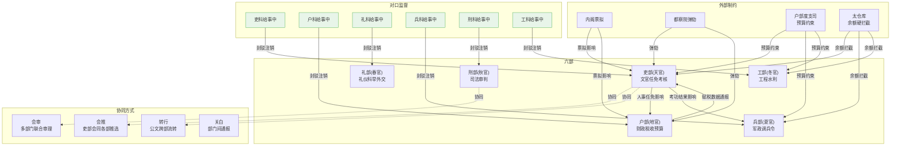
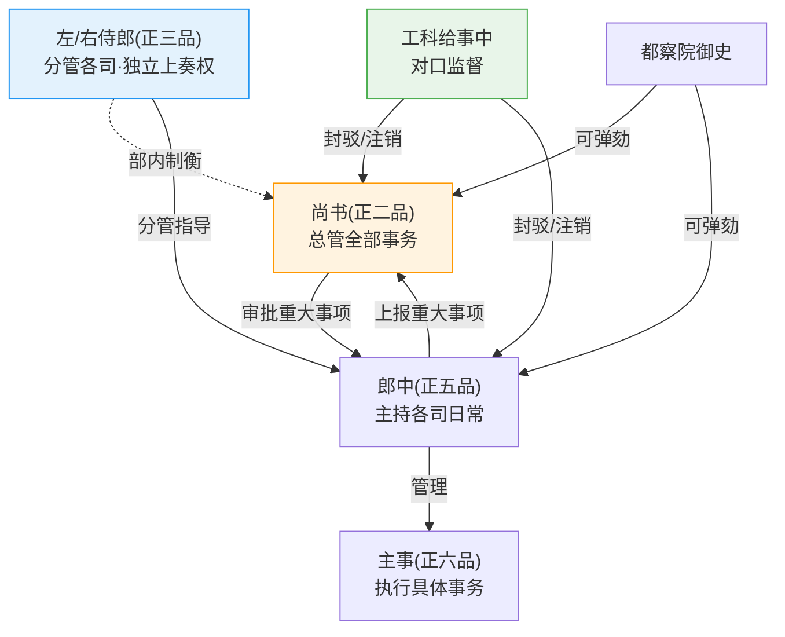
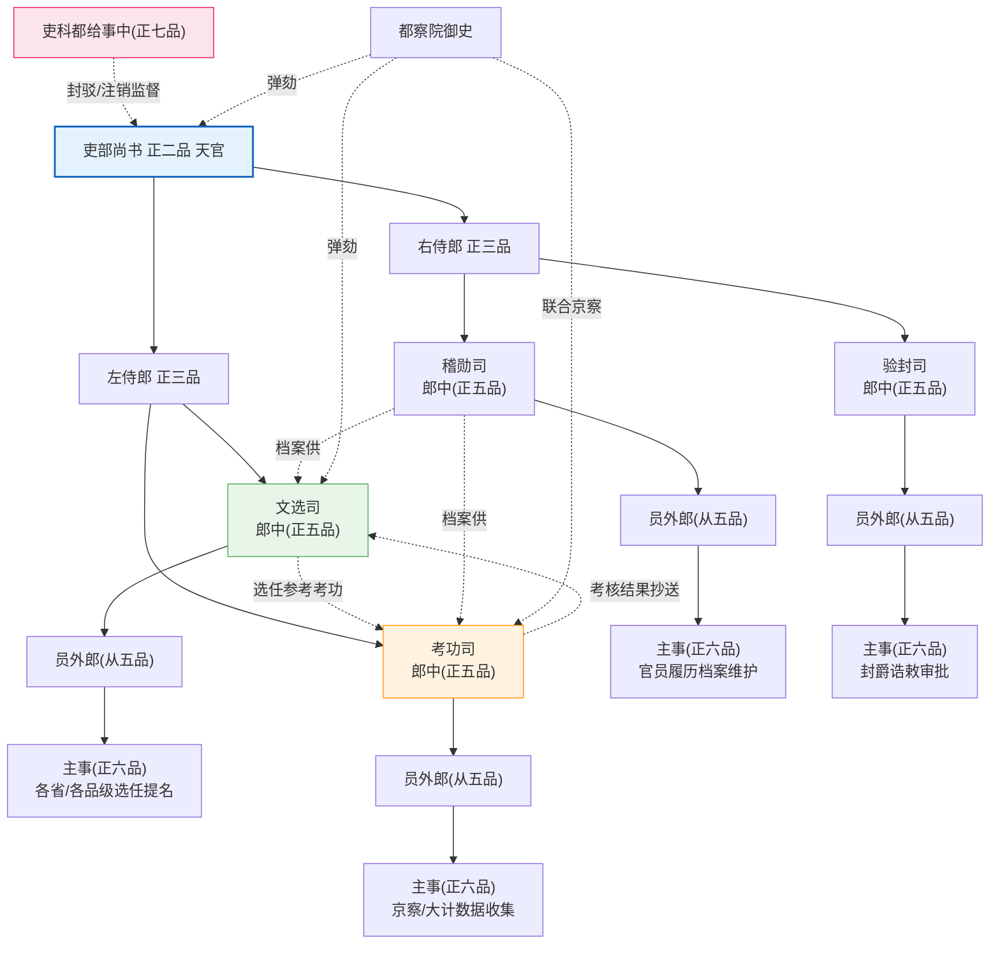
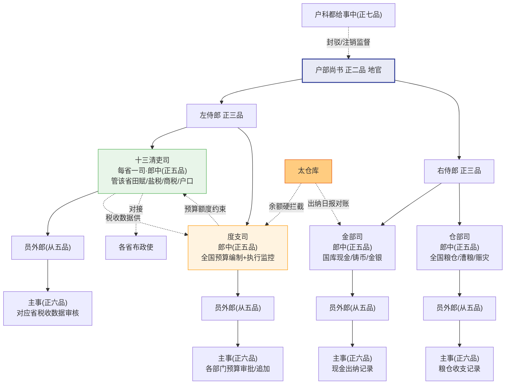
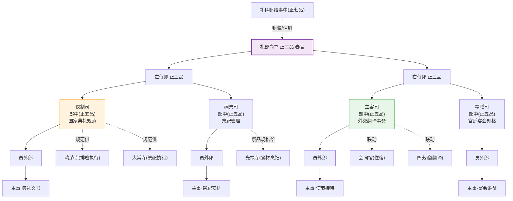
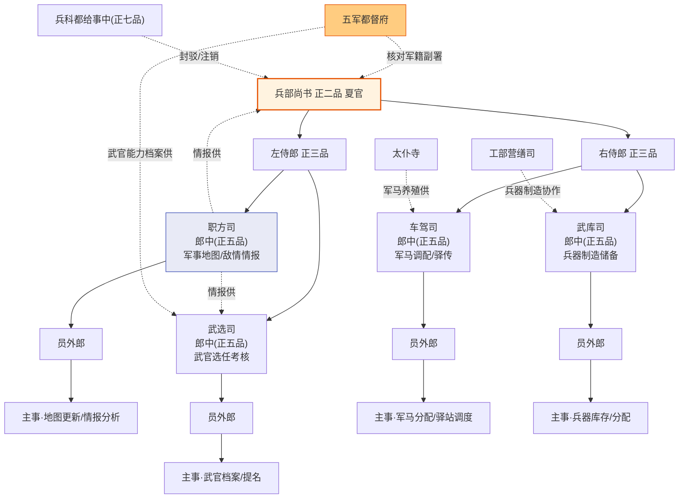
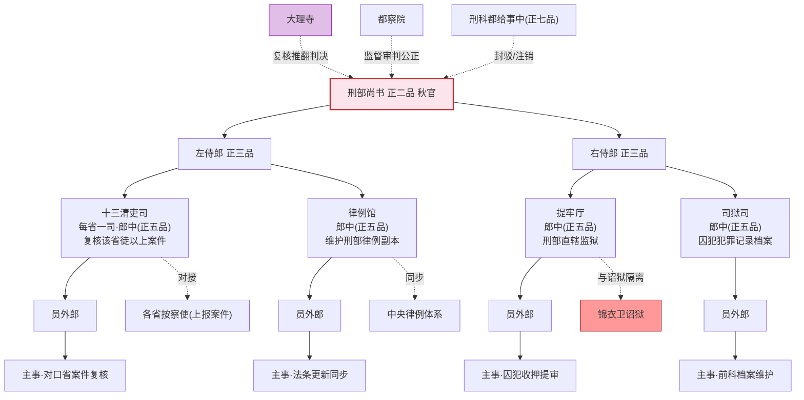
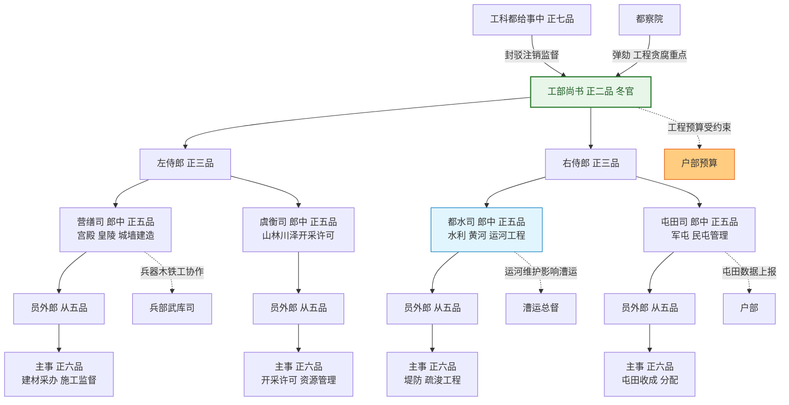

# 六部体系

> 📍 返回 [README](../../00-总览/README.md) · [按编排模式反查](../../99-附录/04-按编排模式反查.md)
> 🔗 相关主题：会推/会审/转行/关白 · 六科 · 户部

## 六部总览

六部是明代中央行政的执行主干。洪武十三年（1380年）废除丞相后，六部直接对皇帝负责。六部尚书合称"六卿"，与都察院都御史、大理寺卿、通政使共同组成"九卿"。

| 部 | 核心职能 | 尚书（正二品） | 侍郎（正三品） | 司数 | 对口监察 |
|:--|:--|:--|:--|:--|:--|
| **吏部** | 文官任免、考核、升迁 | 吏部尚书（天官） | 左/右侍郎各一 | 四司 | 吏科给事中 |
| **户部** | 财政、税收、户籍、土地 | 户部尚书（地官） | 左/右侍郎各一 | 十三司 | 户科给事中 |
| **礼部** | 礼仪、教育、外交、科举 | 礼部尚书（春官） | 左/右侍郎各一 | 四司 | 礼科给事中 |
| **兵部** | 军政管理、武官任免、调兵令 | 兵部尚书（夏官） | 左/右侍郎各一 | 四司 | 兵科给事中 |
| **刑部** | 司法审判、刑律执行 | 刑部尚书（秋官） | 左/右侍郎各一 | 十三司 | 刑科给事中 |
| **工部** | 工程营造、水利、屯田 | 工部尚书（冬官） | 左/右侍郎各一 | 四司 | 工科给事中 |

## 内部层级与职责细节

### 尚书级（正二品）—— 部的最高长官

**尚书**：总管本部全部事务。每天阅读本部各司上报的文书，签署驳回或批准。参加廷议（皇帝召集重臣讨论重大国事）。向内阁报送本部的重大事项请求票拟。各尚书之间互不隶属（废除丞相后六部平行）。

**左/右侍郎（正三品）**：各一名。尚书的副手，分管本部不同领域的司，在尚书出缺时代理。侍郎有独立上奏权——可以不经过尚书直接向皇帝报告（虽然这样做往往意味着与尚书不和）。

**尚书与侍郎的实际关系**：制度上侍郎是尚书的副手，但由于侍郎有独立上奏权，他在本部内部也是制衡尚书的力量。重大决策尚书不能独断——需与侍郎商议。

**受谁制约**：
- 皇帝批红（所有重大决策）
- 内阁票拟（尚书不能越过内阁直接执行重大事项）
- 本部给事中（对口监督，可封驳本部的奏章）
- 都察院御史（可弹劾尚书）
- 户部预算约束（本部开支受户部核定预算限制）

**监督谁**：本部各司郎中、员外郎、主事。

### 司级（郎中正五品 / 员外郎从五品）—— 部的核心执行单位

**郎中（正五品）**：每司最高长官，主持司内全部事务。负责审批本科主事上报的所有案子，决定哪些上报侍郎和尚书。是部内实质性的决策执行者——侍郎和尚书管"大方向"，郎中管"具体怎么办"。

**员外郎（从五品）**：郎中的副手，分管司内科务，郎中出缺时代理。

**郎中与尚书/侍郎的关系**：郎中独立处理司内日常事务（不需要每件事都上报），重大事项上报侍郎→尚书。尚书不能绕过郎中直接指挥科级——这保持了司的完整性。

**受谁制约**：
- 本部尚书/侍郎（审批重大事项）
- 本部给事中（对口监督）
- 都察院（可弹劾郎中渎职）
- 相关制度的约束（如吏部文选司受选任规则的约束）

### 科级（主事正六品）—— 最基层的行政单位

**主事（正六品）**：每科最高长官（在京各部约数百名主事）。负责具体事务的执行——如吏部文选司某科的主事负责某省或某品级官员的档案整理和选任提名。

**主事的工作方式**：接收侍郎/郎中交办的具体任务 → 查阅相关档案和规则 → 提出初步方案 → 上报郎中审批 → 根据批示执行或修改。

**受谁制约**：
- 本司郎中/员外郎（直接上级）
- 相关规则和档案（如吏部主事受选任规则的严格约束）
- 如果涉及跨部事务，需通过本部尚书协调

---

## 各部司职详解

### 吏部四司

吏部是六部之首——管人。所有文官的命运始于吏部。

#### 文选司（文选清吏司）

**职责**：全国文官的选任和调配。某地知县出缺 → 文选司郎中从候选名单（进士/举人/监生中符合条件者）中提名 → 吏部尚书审批 → 上报内阁/皇帝。

**日常工作**：
- 维护全国文官职位的"缺簿"（哪些职位空着、谁在候补）
- 根据考功司的考核结果决定升/降/调
- 管理官员的回避制度（不得在原籍任职、亲属回避）
- 处理夺情（父母丧事期间是否留任）请求

**制约**：
- 高级官员（三品以上）任免需"廷推"（六部尚书+都御史+大理寺卿会推）——文选司不能独断
- 选任规则由《大明律》和《吏部则例》严格规定——郎中不能凭个人好恶选人
- 选任结果需吏部尚书和内阁确认

#### 考功司（考功清吏司）

**职责**：文官考核——京察（六年一次，京官）、大计（三年一次，地方官）。按"四格"（守/才/政/年）评分，按"八法"（贪/酷/浮躁/不及/老/病/罢软/不谨）劣汰。

**日常工作**：
- 收集全国官员的考核数据（巡按御史报告、知府对下属的评语、科道弹劾记录）
- 编制每期考功册——卓异/称职/平常/不称职四级
- 将考功册上报吏部尚书和都察院都御史联合审定
- 考功结果抄送文选司——决定下次选任

**制约**：
- 考功结果不是吏部独断——需与都察院联合主持（吏部管"升"，都察院管"黜"）
- 朝会答辩制——公示期被考核者可申辩
- 考功册最终由皇帝批红

#### 稽勋司（稽勋清吏司）

**职责**：文官档案管理——每个官员从入仕到退休的所有履历、功过、品级变动、散官勋级的完整记录。是吏部的"数据库"。

#### 验封司（验封清吏司）

**职责**：管理封爵（公侯伯等世袭爵位）和诰敕（给官员本人及父母/祖父母的荣誉封号）。世袭爵位的承袭审批。

### 户部十三司 + 四职能司

户部是最大的部——因为它管钱管粮管户口。

#### 十三清吏司

**职责**：每司管一省财政——对应省的田赋征收、盐税、商税、户口统计、土地丈量。各省布政使在财政事务上向对应的户部清吏司汇报。

**日常工作**：
- 审核对应省的税收上报数据
- 编制该省的年度收支预算
- 处理该省的超支追加申请
- 与太仓库对接——确认该省解送的税银已入库

#### 度支司

**职责**：全国预算编制和执行的监控中枢。汇总十三省的税收预估和六部的支出计划 → 做全国收支平衡 → 上呈户部尚书 → 内阁票拟 → 皇帝批红。

**对预算执行的监控**：各部/各项目每次支取需度支司的"度支票拟"——没有度支司的批准，太仓库不付款。

#### 金部司

管理国库现金、铸币、金银储备。与太仓库每月的出纳日报对照。

#### 仓部司

管理全国粮仓（京通二仓、水次仓、各省预备仓）。漕粮入仓验收、军粮调拨、赈灾放粮。

### 礼部四司

#### 仪制司

制定国家典礼规范——朝会礼仪（谁站哪、怎么行礼）、祭祀流程、皇帝出行仪仗规格。所有正式场合的"规矩"都从仪制司出。鸿胪寺（排班执行）和太常寺（祭祀执行）按照仪制司定的规矩来执行。

#### 祠祭司

管理全国祭祀——祭天地/社稷/孔子/宗庙/山川。决定祭祀日期、祭品规格、参加官员品级。管理各地文庙（孔子庙）的维护。

#### 主客司

管理外交事务——朝贡国使节的接待规格（哪个国家在什么级别的招待所住、给什么级别的赏赐）、翻译事务协调、朝贡贸易管理。与会同馆（住宿）、四夷馆（翻译）、鸿胪寺（引见）、市舶司（海上贸易）联动。

#### 精膳司

管理宫廷宴会和赐宴——外藩使节国宴、官员升迁赐宴、祭祀后分胙（分祭肉）。与光禄寺（食材采购和烹饪）是"定菜单"和"做菜"的关系。

### 兵部四司

**关键分权**：兵部有调兵令但没有军政管理权（日常训练/军籍在五军都督府）。兵部的调兵檄文必须经五军都督府核对军籍后才能生效。

#### 职方司

全国军事地图的绘制和更新、敌情情报分析、战略态势评估。是兵部最重要的司——所有军事决策的前提是对地理和敌情的了解。

#### 武选司

全国武官的选任和考核。千户以上武官由武选司提名，兵部尚书→内阁→皇帝。与五军都督府共享武官能力档案。

#### 车驾司

管理全国军马的调配（马匹从太仆寺来）、全国驿站的军事调度、皇帝出行的车驾仪仗。

#### 武库司

兵器制造和储备的管理——全国火铳/火炮/盔甲/刀矛的产量、库存、分配。与工部营缮司（制造铁件和木件）合作。

### 刑部十三司 + 四职能司

#### 十三清吏司

每司管辖对应省的刑事案件。各省按察使上报的徒以上（流放/死刑）案件必须经对应刑部清吏司复核——没有刑部的复核，地方不能执行死刑。

#### 律例馆

维护刑部本地的《大明律》和《问刑条例》副本。确保本部和各省判案时引用的法条是最新版本。与中央律例体系同步。

#### 提牢厅

管理刑部直辖监狱（不是锦衣卫诏狱）——囚犯收押、提审、减刑、释放。刑部监狱和锦衣卫诏狱是完全隔离的两个系统。

#### 司狱司

管理囚犯的犯罪记录和前科档案——本囚犯上次犯了什么罪、判了什么刑、减了几次刑。为审判提供历史依据。

### 工部四司

#### 营缮司

宫殿、皇陵、京城的建造和维修。最大规模的工程是皇帝陵墓（一修几十年）和紫禁城维护。与兵部武库司合作制造兵器的木工铁工部分。

#### 虞衡司

管理全国的山林川泽资源——采木许可、采石许可、冶铁许可。本质上是"自然资源开采权"的管理者。

#### 都水司

全国水利工程——黄河治理（最头疼）、大运河疏浚、灌溉渠修建、防洪堤。每年的黄河汛期是都水司最紧张的时候。

#### 屯田司

管理全国的屯田——军屯（卫所的屯田）和民屯（移民垦荒）。屯田的收成直接影响军粮供应。

---

## 六部协同机制与制约关系

### 四种协同方式

| 协同类型 | 含义 | 流程 | 谁监督 |
|:--|:--|:--|:--|
| **会推** | 吏部会同各部推选重要官员 | 吏部发出会推通知 → 相关部尚书+都御史+大理寺卿会商 → 结果上报皇帝 | 吏科给事中 |
| **会审** | 多部门联合审理重大案件 | 提议方发起会审请求 → 相关部派司参加 → 联合审理 → 结论上报 | 都察院 |
| **转行** | 公文在部门之间流转处理 | 发起部拟公文 → 发送协作总线 → 接收部处理 → 回传结果 | 六科给事中 |
| **关白** | 部门间通报信息 | 发起部拟通报 → 通过协作总线广播 → 相关部门签收 | 六科给事中 |

### 制约关系网络

| 制约方 | 被制约方 | 制约方式 |
|:--|:--|:--|
| **六科给事中** | 对应的六部 | 对口监督——每科对应一部，封驳奏章、注销未完成任务 |
| **都察院御史** | 六部所有官员 | 弹劾违法失职、巡按检查财政账目、京察参与考核 |
| **户部度支司** | 所有六部 | 预算约束——任何部的开支不能超过预算，超支需户部审批 |
| **太仓库** | 所有六部 | 余额硬拦截——预算账户余额不足自动拦截 |
| **大理寺** | 刑部（审判） | 复核推翻——可驳回刑部判决要求重审 |
| **内阁** | 六部（奏章） | 票拟权——所有重要奏章需经内阁票拟后才能上呈皇帝 |
| **兵部** | 无（与五军都督府互锁） | 调兵檄文需五军都督府核对军籍才生效——调兵权和军政管理权分离 |
| **吏部文选司** | 无（与考功司互锁） | 选任需参考考功结果——选人的人和考核的人是同一个部的不同司 |

### 部内制约链

```
尚书 ←────── 左/右侍郎（有独立上奏权，是部内制衡）
  │
  ├─────────── 各司郎中（独立处理司内日常事务，重大事项上报）
  │               │
  │               └──── 员外郎（郎中的副手）
  │               │
  │               └──── 各科主事（执行具体事务）
  │
  ▼
吏科/户科/礼科/兵科/刑科/工科 给事中（对口监督）
  │
  ▼
都察院御史（可弹劾尚书及以下任何人）
```

---

## 六部协同与制约关系图



## 部内制约链



---

## 六部各自内部职位架构

### 吏部职位架构



### 户部职位架构



### 礼部职位架构



### 兵部职位架构



### 刑部职位架构



### 工部职位架构



## 编排参考

任事型编排系统对六部做了完整的现代化改造：

- **吏部 → 知识与信息**：文选司(知识源选择)、考功司(检索质量自评)、稽勋司(引用溯源)、验封司(信源可信度评估)
- **户部 → 数据与计算**：十三司(分领域计算节点)、度支司(资源配额管理)、金部司(缓存管理)、仓部司(中间数据暂存)
- **礼部 → 生成与表达**：仪制司(输出格式规范)、祠祭司(对话上下文管理)、主客司(多语言/格式转换)、精膳司(后处理润色)
- **兵部 → 推理与决策**：职方司(策略模板库)、武选司(方案比选)、车驾司(推理链编排)、武库司(推理工具管理)
- **刑部 → 合规与风控**：十三司(分领域安全检测)、律例馆(本地规则引擎)、提牢厅(沙箱隔离执行)、司狱司(违规历史库)
- **工部 → 工具与执行**：营缮司(代码生成与检查)、虞衡司(API网关/工具管理)、都水司(文件处理/数据管道)、屯田司(本地工具缓存优化)

每个部门有独立的**预算科目和考核指标**——将资源约束嵌入组织结构。预算科目的分离（吏部检索Token、户部计算Token、礼部生成Token等）使得考功司可以精确追踪每个部的资源效率。
