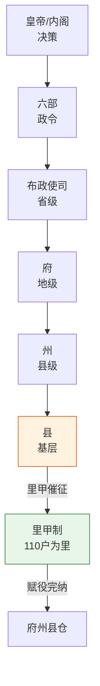

# 五寺体系

## 五寺总览

六部之外，明代中央行政还有**五寺**——五个独立的专业行政机构，各自掌管特定领域，与六部平行但职能更专一。它们合称"九卿"的一部分（六部尚书 + 五寺卿 + 通政使）。

| 寺 | 长官 | 品级 | 核心职能 |
|:--|:--|:--|:--|
| **大理寺** | 大理寺卿 | 正三品 | 最高复核机关（已详述，见[大理寺与三法司](../../03-监察链/03-大理寺与三法司.md)） |
| **太常寺** | 太常寺卿 | 正三品 | 掌管祭祀、礼乐、宗庙 |
| **光禄寺** | 光禄寺卿 | 从三品 | 掌管宫廷膳食、宴会、祭祀供品 |
| **太仆寺** | 太仆寺卿 | 从三品 | 掌管全国马政、军马养殖 |
| **鸿胪寺** | 鸿胪寺卿 | 正四品 | 掌管朝会礼仪、外藩接待、典礼排班 |

## 太常寺 —— 祭祀与礼乐

太常寺负责国家最核心的礼仪活动：祭天地（天坛/地坛）、祭宗庙、祭社稷、祭孔子。它管理全国的乐舞生的培训，制定国家典礼的仪式规范。太常寺的职能与礼部有重叠，但礼部管的是"礼制政策"，太常寺管的是"礼仪执行"——一个定规则，一个干实事。

## 光禄寺 —— 宫廷膳食

光禄寺负责宫廷的宴会、祭祀的供品、赐宴外藩使节。它管理着庞大的食材供应链，从全国各地采购特定食材。光禄寺的预算来自太仓库，但实际采购常常扰民——地方官员为了满足光禄寺要求，会向民间低价强买。

## 太仆寺 —— 军马养殖

太仆寺在明代中前期极其重要——蒙古骑兵威胁下，军马是战略资源。太仆寺在全国设有多处牧马监（军马养殖场），管理数万匹军马。马政的兴衰直接关系到九边防线的战斗力。到明后期马政渐废，太仆寺的重要性下降。

## 鸿胪寺 —— 外藩接待

鸿胪寺负责朝会上的百官排班（谁站哪、什么顺序行礼）和外藩使节的接待礼仪。朝鲜、安南、琉球、暹罗的使节来朝，从进城门到见皇帝的每一步都是鸿胪寺引导的。鸿胪寺还负责在朝会上"唱名"——高声宣报官员姓名和官职。

---

## 编排参考

编排系统将五寺的职能拆分映射到不同模块：
- "大理寺复核" → **复核 Agent**（已详述）
- "太常寺祭祀" → **礼部祠祭司**：管理对话上下文和记忆——"哪些信息需要记住、哪些可以遗忘"，类似祭祀中"哪些传统必须保留、哪些可以调整"
- "光禄寺供品" → **太仓库内库分离**：光禄寺食材从太仓库领预算但实际采购扰民 → 类似财政预算中的"预算≠实销"，审计需要发现偏差
- "太仆寺马政" → **太仆寺式资源管理**可以启发**选锋标签时效衰减**：军马长期不训练会退化，类似选锋标签长期不执行同类任务会衰减
- "鸿胪寺排班" → **朝会主持人**：朝会模式中的辩论主持、发言顺序编排——"谁先发言、什么顺序"
