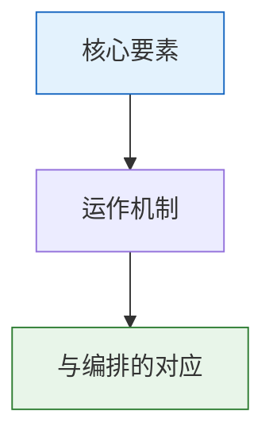

# 詹事府尚宝司与符节

## 詹事府（东宫班底）

詹事府是太子（东宫）的行政班底，理论上负责太子的全面培养。但在明代皇权高度集中、皇帝普遍猜忌太子的背景下，詹事府的实际功能非常微妙。

**组织架构**：
| 官署 | 长官 | 职能 |
|:--|:--|:--|
| 詹事府 | 詹事（正三品） | 总领东宫事务 |
| 左春坊 | 左庶子（正五品） | 太子的经史教育 |
| 右春坊 | 右庶子（正五品） | 太子的政务实习 |
| 司经局 | 洗马（从五品） | 管理太子的图书典籍 |

**兼职衔的实际用法**：詹事府职位在明代更多被用作翰林院官员的**兼衔**——一个翰林学士可能同时挂"詹事府少詹事"的头衔，但他从来不真去东宫上班。这种"实职+兼衔"的双层身份体系在明代官制中非常普遍。

## 尚宝司（宝玺管理）

尚宝司掌管皇帝的各类印玺，是皇帝权力的**硬件载体**的管理者。没有尚宝司的用印，任何诏书都不能生效。

**宝玺种类**：
- **皇帝奉天之宝**：用于祭祀天地
- **皇帝之宝**：用于诏书和圣旨（最常用）
- **皇帝行宝**：用于赏赐
- **皇帝信宝**：用于调兵令
- **制诰之宝**：用于敕书和诰命
- **敕命之宝**：用于对低品级官员的敕命

尚宝司卿（正五品）不决定何时用印（决策权在皇帝/司礼监），但负责保管宝玺和确保用印流程合规。每一次用印都必须记录——用印时间、文书名称、用印人。这与编排系统中太仓库的"每次扣减必须记录"逻辑完全相同。

## 符节（虎符/令牌/令旗）

符节是军事指挥信物。明代最重要的符节：
- **虎符**：调兵凭证，兵部和五军都督府各持一半，合符方可调兵
- **令旗**：总督/总兵持有的战场指挥信物，可在阵前先斩后奏
- **令箭**：具体军事行动的命令传送信物，传递到某部即必须执行

符节制度的核心逻辑：**权力不是口头说了算，必须持有物理信物**——你嘴上说是皇帝让你调兵的不行，必须拿虎符来合。

---

## 编排参考

- "詹事府兼衔" → **Agent 的多标签体系**：一个 Agent 可以同时拥有"当前执行角色"(实职) + "历史累积标签"(兼衔: 选锋标签、擅长领域标签)——前者决定当前任务，后者影响长期权重
- "尚宝司用印" → **太仓库预算扣减 + 批红记录**：用印 = 批红生效 = 太仓库预算从账户扣除——都是"将纸面决策变成物理执行"的环节
- "虎符合符调兵" → **调兵 Agent 的选将规则**：总督选将(半边虎符) + 调兵 Agent 推荐(另半边虎符) → 合符(匹配)才能调兵
- "令旗令箭" → **旗牌令**的直接历史来源
