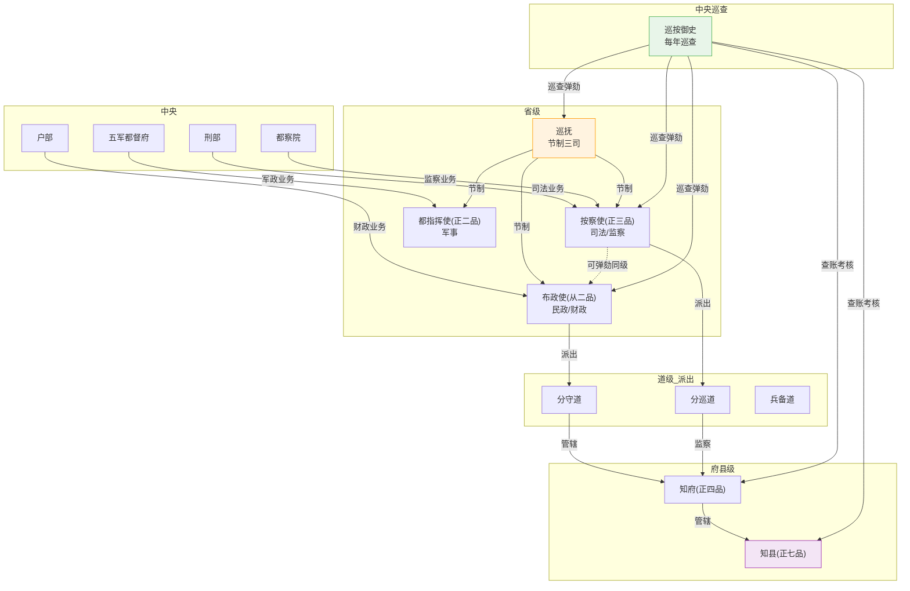

# 地方行政体系

## 三司并立的省级结构

明代省级行政实行**三司并立**——一省有三个平行长官，互不隶属、互相制衡。这是为了防止地方权力集中（唐朝的节度使是前车之鉴）。

### 承宣布政使（从二品）—— 省级民政长官

**做什么（日常）**：
- 管理全省民政和财政——向各府州县下达税收指标、审核各府的财政报告
- 编制本省年度收支预算上报户部十三司中对应的省司
- 考核本省各府知府的政绩
- 灾年组织赈灾——向户部申请减免赋税和调拨赈灾粮
- 管理本省户籍（编造黄册）和土地（丈量鱼鳞册）
- 监督本省的学校和科举（府试/院试的组织）

**受谁制约**：
- 户部（财政事务上——税收指标由户部下达，预算需户部审批）
- 巡抚（节制权——布政使在做重大决策前需与巡抚商议）
- 按察使（可弹劾布政使——同级监察权）
- 巡按御史（查账、考核布政使）
- 都指挥使（军事独立不受布政使管辖——征兵后勤方面需协作但无权指挥）

**受谁监督**：
- 巡按御史（每年查账一次）
- 按察使（省级司法监察长官，可弹劾同级布政使）
- 户科给事中（中央层面监督布政使的财政报告）

**监督谁**：各府知府（在民政财政事务上）、本省知县（通过知府间接管理）

### 提刑按察使（正三品）—— 省级司法长官

**做什么（日常）**：
- 管理全省司法——重审各府上报的徒以上（流放/死刑）案件
- 弹劾本省违法官员——从布政使到知县均可弹劾
- 管理本省驿传系统（驿站是否正常运转、是否有官员滥用驿站）
- 向中央刑部上报本省死刑案件复核
- 参与大计（地方官三年一考）——与巡按御史共同主持

**与布政使的制衡关系**：
- 按察使和布政使品级不同（正三品 vs 从二品），但权力平行
- 按察使可弹劾布政使——**同级监察权**
- 布政使无法撤换按察使（按察使由中央任免）
- 如果两人严重冲突，上报巡抚和中央裁决

**受谁制约**：
- 刑部（司法事务——本省死刑案件需刑部复核）
- 都察院（监察事务——按察使的弹劾需都察院备案）
- 巡抚（节制权）
- 巡按御史（可审查按察使的司法记录）

**受谁监督**：
- 巡按御史、刑科给事中、东厂

**监督谁**：各府知府（在司法事务上）、本省所有官员（弹劾权）

### 都指挥使（正二品）—— 省级军事长官

（详见[卫所制度](../../02-执行链/军事执行/03-卫所制度.md)和[五军都督府](../../02-执行链/军事执行/01-五军都督府.md)）

管理本省所有卫所的日常训练、屯田、军饷、兵籍。受五军都督府管辖（在军政管理上），但调兵需兵部檄文。

**与布政使/按察使的关系**：三司并立——都指挥使的军事行动不受布政使/按察使的干预，同时都指挥使也无权干预民政和司法。

---

## 巡抚——从差遣到实际上的省长

巡抚最初是都察院外派的临时差遣（加"副都御史"或"佥都御史"衔），任务是巡查地方。但到明代中后期逐渐固定化为常设，实际上成了全省的最高长官。

**巡抚的权力**：
- 节制三司——布政使/按察使/都指挥使在重大事务上必须与巡抚商议
- 提督军务——可指挥本省卫所军队应对小规模军事冲突
- 主持大计——与巡按御史共同考核本省地方官
- 战时为总督提供后勤保障

**巡抚不是布政使的上级**——制度上他们来自不同的系统（都察院 vs 六部-户部）。巡抚的节制权是临时的、弹性的，取决于皇帝对他的信任和他的个人威望。

---

## 省以下层级与职位

### 道（正四品~从四品）

道不是正式行政层级（法律上只有省→府→县三级），但实际运作中道员是重要的中间管理层。

| 道 | 派出自 | 做什么 | 管辖范围 |
|:--|:--|:--|:--|
| **分守道** | 布政司 | 分管数府的民政和财政 | 约3-6个府 |
| **分巡道** | 按察司 | 分管数府的司法和监察 | 约3-6个府 |
| **兵备道** | 双重（兵部+地方） | 军事要地的文武合一职位 | 军事要地及周边 |

**分守道的日常工作**：巡查所管数府的税收征收进度、审核各府的财政报告、处理各府之间的民政协调事务。

**分巡道的日常工作**：巡查所管各府的司法案件、直接审理重大上诉、弹劾失职知府和知县。

**兵备道**：在九边沿线或倭寇活跃的沿海地区设置。兵备道可以调动本地卫所军队（是文官中少有的直接军事指挥权）——这种文武合一是为了应对紧急军事需要。

### 知府（正四品）—— 府级行政长官

**做什么（日常）**：
- 管理一府（约辖数县至十数县）的全部政务
- 初审本府各县上报的徒刑案件（杖以下知县可自行裁决）
- 考核下属知县——评语直接影响知县在吏部的考功结果
- 征收本府赋税——汇总各县上缴的税银和税粮解送省城
- 管理本府的教育（府学）和治安
- 灾年组织赈灾——向布政使报告灾情申请减免赋税

**受谁制约**：
- 布政使（民政财政）、按察使（司法）、分守道/分巡道（日常巡查）
- 巡抚（节制权）
- 户部预算（本府税收任务）
- 律例——知府本人如被弹劾，由按察使和巡按御史处理

**受谁监督**：
- 巡按御史（每年查账、重审案件）
- 分巡道（日常司法监督）
- 按察使（可弹劾知府）
- 六科/都察院（中央层面）

**监督谁**：下属所有知县——知县的考核、升迁、处罚首先由知府提出。

### 知州（从五品）

直隶州直属省（地位同府，直接向布政使汇报），散州属府（地位介于府和县之间）。职责类似知府/知县。

### 知县（正七品）—— 最基层的朝廷命官

全国约1171个县，知县是朝廷与百姓之间的唯一接口。

**做什么（日常——极其繁重）**：
- 征收本县赋税——挨家挨户催缴，完不成任务上级追责
- 司法——初审本县民刑案件，笞杖案件自行裁决，徒以上上报知府
- 治安——管理本县的巡检司（派出所），缉捕盗贼
- 教育——管理县学，主持童试（科举第一级）
- 户口——每十年编制一次黄册（户籍册），上报布政司
- 赈灾——灾年开仓放粮，向知府和布政使报告灾情
- 驿传——维护本县境内的驿站
- 各种杂务——接待过往官员、押解犯人、协调水利纠纷、处理宗族械斗

**知县的"夹心层"压力**：
- 上面：知府、道员、布政使、巡按御史层层压力和考核
- 下面：地方豪强（不配合征税）、胥吏（阳奉阴违）、普通百姓（真的拿不出更多钱了）
- 税收任务完不成 → 考功降级 → 丢官
- 税收任务完成了但百姓被逼反 → 同样丢官甚至丢命

**受谁制约/监督**：上面所有人——知府、分守道、分巡道、布政使、按察使、巡抚、巡按御史，全部可以监督和考核知县。

---

## 地方体系的制约关系图

```
中央
  ├── 户部 ←────────── 布政使（民政/财政）
  ├── 刑部+都察院 ←─── 按察使（司法/监察）
  ├── 五军都督府 ←─── 都指挥使（军事）
  └── 兵部（调兵令）

省级
  巡抚（节制三司，从都察院派出）
    │
    ├── 布政使（从二品）←──互不隶属──→ 按察使（正三品，可弹劾布政使）
    │     │                                  │
    │     └── 分守道 ←─────────────→ 分巡道
    │              │                        │
    │              └──── 知府（正四品）────┘
    │                        │
    │                        └──── 知县（正七品）
    │
    └── 都指挥使 ←────────→ 兵备道（文武合一）
           │
           └── 卫所

巡按御史（巡回，一年一轮）──→ 可审计/弹劾以上所有地方官
```

---

## 地方行政层级与监督图



---

## 编排参考

- "三司并立" → 编排系统六部之间的权力分离——执行/监督/审计三权不集中在单一 Agent
- "布政使-按察使互不隶属" → **审计 Agent 对监督 Agent 没有指挥权**，两者独立运作但信息共享
- "道员作为派出机构" → 监军御史定期巡查——不常驻（防止结党）但保持检查频率
- "知县夹心层" → 编排系统中的**科级 Agent**——承上启下的执行单元，预算/时限/验收的多重约束
- "巡按一年一轮" → 监督 Agent 的巡按定时器——周期冻结状态比对，防止监察者自身腐化
