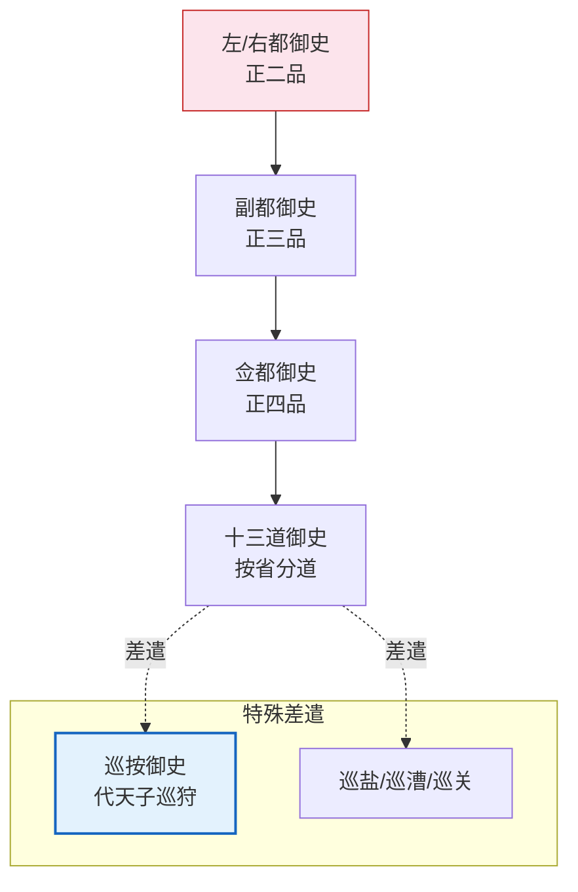

# 都察院与十三道御史

> 📍 返回 [README](../00-总览/README.md) · [按编排模式反查](../99-附录/04-按编排模式反查.md)
> 🔗 相关主题：弹劾 · 巡按御史 · 六科给事中




## 都察院的定位

都察院是明代最高监察机关，与六部平级，直接对皇帝负责。它的核心职能是**"纠劾百官、辨明冤枉、提督各道"**——弹劾违法失职官员、昭雪冤案、管理全国一百多名监察御史。

都察院不参与行政决策——它只管"谁做错了什么"。

## 职位与职责

### 左/右都御史（正二品）—— 最高监察长官

**做什么（日常）**：
- 审查御史上报的弹劾奏章——决定哪些上报皇帝、哪些补充证据、哪些驳回
- 与吏部尚书联合主持京察（六年一次的全体京官考核）
- 参加廷议（皇帝召集重臣讨论重大国事）——在廷议中代表监察立场
- 管理十三道御史的人事分配和工作考核
- 接收巡按御史从各省发回的巡查报告

**与吏部的关系**：
- 京察由吏部尚书和都御史联合主持——吏部偏向"选优"（选谁升），都察院偏向"汰劣"（查谁该黜）
- 两人的意见如果严重分歧，上报皇帝裁决
- 这是明代制度设计中的经典"双首长制"——没有人能单独决定全部人事

**受谁制约**：
- 皇帝（都御史的弹劾皇帝可以不采纳）
- 东厂元监察（可弹劾都御史本人）
- 锦衣卫（厂卫互监）
- 都御史不能指示某个御史弹劾或不弹劾谁——御史有独立上奏权

**受谁监督**：
- 东厂、锦衣卫、六科给事中（科道互察）

**监督谁**：
- 十三道御史、巡按御史、百官

### 左/右副都御史（正三品）—— 都御史的副手

日常分管十三道中的若干道，处理御史上报的弹劾案。外派时加"副都御史"衔担任总督或巡抚——这是最重要的"去地方挂帅"的加衔。

### 左/右佥都御史（正四品）—— 都御史的低级副手

在都察院时分管特定领域的监察事务。外派时加"佥都御史"衔担任巡抚——这是巡抚最常见的加衔。

## 十三道监察御史

明代按全国十三省设十三道监察御史。每道7-11人不等，共约110人。**关键制度设计：品级极低（正七品）但权力极大。**

### 监察御史的日常

**在京时**：
- 审阅分管道（对应省）的公文和弹劾线索
- 独立上奏弹劾——不需要经过都御史批准（这是最核心的权力保障）
- 巡视北京各衙门——检查各部门的文书、账目、工作流程
- 参与京察——在考核中提供对相关官员的评价

**独立上奏权的含义**：
- 一个正七品的御史可以弹劾正二品的尚书——而且不经都御史签字
- 弹劾奏章直接上呈皇帝——都御史只能在事后知道
- 如果都御史试图"压住"某个御史的弹劾，这本身就是都御史被弹劾的新罪行

**受谁制约**：
- 弹劾必须附证据——恶意诬告者反坐（受到同样处罚）
- 弹劾内容如果被证明是捏造，御史自己会被重罚
- 都御史可以调整御史的"分管道"——把"不听话"的御史调到不太敏感的领域
- 东厂可质疑弹劾的动机和证据

**受谁监督**：
- 东厂（元监察——如果御史系统性地漏报某类问题，东厂会弹劾）
- 锦衣卫
- 都御史（考核御史的工作质量）

### 巡按御史（正七品，外派差遣）

巡按御史是从十三道御史中轮选派出的。**每年一轮换**，代天子巡狩地方。

**做什么（巡回各省期间）**：
- 到达一省 → 先查布政司的财政账目（比对税收和支出）
- 重审地方已结案的重大案件（可直接提审犯人）
- 考核从布政使到知县的地方官员
- 发现重大问题可先暂停相关官员职务，再奏报皇帝
- 检查驿传是否畅通、学校是否正常教学、武备是否充足

**权力有多大**：
- 品级正七品但面对从二品的布政使也毫不退让——因为他代表的是皇帝
- "大事奏裁，小事立断"——小事可以自行决定，大事上奏皇帝裁决
- 可重审地方已判结的案件——一旦推翻，原审官员面临弹劾

**受谁制约**：
- 一年任期——到期必须回京（防止在地方结党形成利益链条）
- 不能带家属（防止地方官通过家属贿赂）
- 巡按期间发现的问题必须在报告中如实陈述——瞒报被查出则反坐

**受谁监督**：
- 都察院（审查巡按报告的质量）
- 东厂（如果巡按和地方官勾结，东厂有密奏渠道）

**与巡抚的关系**：
- 巡抚是常驻（长期驻一省），巡按是巡回（每年来一两个月）
- 巡按可以弹劾巡抚——同级但不同线

### 监军御史（都察院派出的军队监督）

（详见[竞功与军功考核](../02-执行链/军事执行/11-竞功与军功考核.md)）

都察院在重大军事行动中派出监军御史——代表皇帝监督军队。与总督平行（不是总督的下属），有密奏权直通皇帝。

---

## 都察院与各方的制约关系

```
都察院都御史（正二品）
  │
  ├── 十三道御史（正七品，独立弹劾权）── 弹劾 → 六部尚书/内阁/地方官/任何官员
  │     │
  │     ├── 巡按御史（外派，一年一轮）── 巡查 → 各省财政/司法/官员考核
  │     └── 监军御史（随军）── 监督 → 前线军事行动和军功自报
  │
  ├── 受谁制约
  │     ├── 东厂（元监察，可弹劾都御史和御史）
  │     ├── 锦衣卫（厂卫互监）
  │     ├── 六科给事中（科道互察）
  │     └── 皇帝（弹劾是否采纳由皇帝决定）
  │
  └── 与谁协作
        ├── 吏部（联合主持京察）
        ├── 刑部+大理寺（三法司会审时参与监督审判）
        └── 六科（科道共同构成监察体系）
```

---

## 编排参考

任事型编排系统中都察院的功能被拆分到多个 Agent：
- "都御史弹劾" → **审计 Agent**：事后对输出质量审查和评分
- "十三道御史" → 审计 Agent 分领域审计
- "巡按御史" → **监督 Agent**巡按定时器：周期冻结状态比对
- "监军御史" → **监军御史 Agent**：实时监控 + 密奏通道
- "京察大计" → **考功司 Agent**周期性综合考核
- "三法司会审" → 诏狱诊断中的三法司会审

核心洞察：**最低品级配备最大监察权**是明代监察体系的核心特征。在编排系统中，监督Agent和审计Agent不能同时拥有执行权（否则它们会用自己的权力来保护自己的执行错误）。
