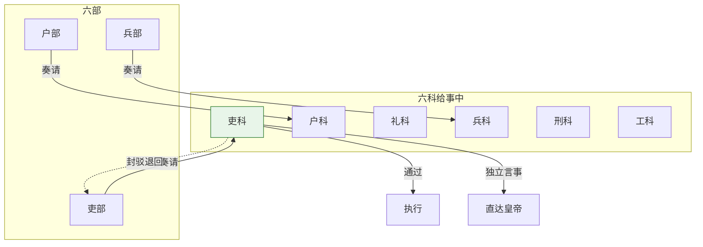

# 六科给事中

> 📍 返回 [README](../00-总览/README.md) · [按编排模式反查](../99-附录/04-按编排模式反查.md)
> 🔗 相关主题：封驳 · 注销 · 都察院

## 六科的独特地位

六科给事中是明代非常独特的监察机构——每条科对应监督一个特定的部，形成一对一的"对口监察"。同时每科都独立于对应部运作，不受部的任何约束。

| 科 | 长官（都给事中） | 对应监督的部 | 核心权力 |
|:--|:--|:--|:--|
| **吏科** | 都给事中（正七品） | 吏部 | 监督文官任免是否符合规则 |
| **户科** | 都给事中（正七品） | 户部 | 监督度支预算和税收征收 |
| **礼科** | 都给事中（正七品） | 礼部 | 监督科举和外交礼仪 |
| **兵科** | 都给事中（正七品） | 兵部 | 监督武官任免和调兵令 |
| **刑科** | 都给事中（正七品） | 刑部 | 监督司法审判和刑律执行 |
| **工科** | 都给事中（正七品） | 工部 | 监督工程营造和预算 |

每科编制：都给事中1人（正七品，正科长）+ 左/右给事中各1人（从七品，副科长）+ 给事中若干（从七品，约4-10人不等）。

## 职位与职责

### 都给事中（正七品，各科正科长）

**做什么（日常）**：
- 每天审阅对口部发来的奏章和诏旨——检查内容是否合规
- 决定是否行使封驳权——如果发现诏旨违制，签署封驳意见封还
- 管理本科给事中的工作分配——谁负责审核哪类文书
- 参加廷议时代表本科立场
- 每月汇总本科的"注销"记录——对口部有哪些任务到期未完成——上报内阁

**封驳权的行使**：
- **封还**：皇帝/司礼监批红后的诏旨下发到六科 → 都给事中审查 → 如果内容有问题（违法、与事实不符、超越权限）→ 将诏旨原样封还给皇帝，附上封还理由
- **驳正**：六部上报的奏章 → 给事中发现错误或不当 → 驳正要求修改
- 封驳不是经常使用的权力——每天都驳的话政治代价很大。但它的存在本身就是威慑

**制约**：
- 皇帝可无视封驳强行下发（但频繁封驳的都给事中会被撤换）
- 封驳必须附详细理由——不能"我就是觉得不对"
- 滥用封驳权（没有正当理由反复封驳）会被都察院弹劾
- 东厂可质疑封驳的动机

**受谁监督**：
- 都察院（可弹劾给事中滥权）
- 东厂（元监察）
- 科道互察（给事中和御史互相监督）

**监督谁**：对口部的尚书、侍郎、郎中及以下所有官员——通过每日的文书审核。

### 左/右给事中（从七品，副科长）

分管科内的不同审核领域。都给事中出缺时递补。独立署名权——可以独立提出封驳意见。

### 给事中（从七品，普通监察员）

每科约4-10人。各自负责对口部不同司的文书审核。可以独立提出驳正意见——不需要都给事中批准。

## 三大核心职能

### 封驳权（事中监督）

文书到达六科后的流程：给事中审阅 → 发现问题 → 与都给事中商议 → 决定封驳并附理由 → 封还或驳回原发文方。

**封驳覆盖的文书类型**：
- 皇帝/司礼监批红的诏旨（可以封还——这是最高级别的封驳）
- 六部上报内阁的奏章（可以驳正）
- 内阁发往六部的票拟批复（可以驳正）

### 注销权（事中监督 + 事后问责）

每部每完成一项任务或到期未完成，对口给事中要登录"注销"：
- 完成了 → 注销（从监督清单上划掉）
- 到时限未完成 → 不注销，上报内阁 → 启动考成法问责
- 任务被驳回重做 → 记录驳回原因和重新时限

注销权的意义：**所有任务都有明确的"完成/未完成"状态，不会被遗忘**。

### 科抄（信息分发）

给事中将皇帝批红后的诏旨**抄写多份**——发送给所有相关的部和机构。这是明代中央政府的信息分发系统。没有科抄，地方部就不知道中央做了哪些与其相关的决定。

## 与各方的关系

### 六科 vs 六部
- **对口监督**——吏科只管吏部，不管户部
- 给事中可以驳正对应部的奏章——尚书也不能压制
- 但给事中不能"指挥"部——他只能封驳和注销，不能下命令

### 六科 vs 内阁
- 六科可以封还内阁主导的票拟（经皇帝批红后）
- 如果六科频繁封驳内阁的文书，说明内阁的执政能力在受到质疑
- 内阁不能撤换给事中（那是吏部和都察院的事）

### 六科 vs 都察院（科道）
- 给事中管"内"——行政文书流程的监察
- 御史管"外"——官员个人行为和政绩的监察
- 科道互察——给事中可以弹劾御史，御史也可以弹劾给事中

### 六科 vs 通政司
- 通政司是奏章的"入口"（从外向内）
- 六科是文书的"出口"（从中向外）——批红后的诏旨经六科抄发才能下达

---

## 编排参考

任事型编排系统对六科给事中的映射：
- "封驳权" → **交互审核 Agent**：审查最终输出与原始意图的一致性，可驳回（附偏离度评分）
- "注销监督" → **监督 Agent**：执行注销闭环，子任务结果必须校验通过才能结项
- "六科对口监督" → 监督 Agent 对六部执行层的一对一监督
- "科抄" → **协作总线**上的消息路由和广播
- "都给事中" → 监督 Agent 的每个监督模块对应一个部的监督策略

核心洞察：**流程监察和人事监察的分离**（六科管文书流程，都察院管官员行为）。编排系统继承了这一分离——交互审核 Agent 管输出质量(文书)，审计 Agent 管 Agent 的长期表现(人事)。
