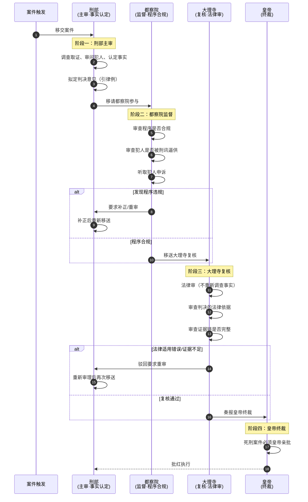

# 大理寺与三法司

> 📍 返回 [README](../00-总览/README.md) · [按编排模式反查](../99-附录/04-按编排模式反查.md)
> 🔗 相关主题：复核 · 三法司会审 · 九卿会审

## 大理寺的定位

大理寺是明代最高复核机关。它不直接审理案件，而是**对刑部和都察院已判决的案件进行再次审查**，确保判决合法、证据完整、程序正确。可以理解为司法体系中的"质量复审"环节。

**主要官员**：
- 大理寺卿（正三品）
- 左/右少卿（正四品）
- 左/右寺丞（正五品）

## 复核权

大理寺的核心权力是**复核（覆核）**——对已判决的案件做二次审查：
- 如果认为判决正确，维持原判，案子结案
- 如果认为判决有问题（证据不足、适用法律错误、或程序违规），可以**驳回要求重审**
- 大理寺的复核结论覆盖刑部和都察院的一审结果

复核不是重新审案——大理寺不做事实调查，只看**法律适用和程序是否合规**。很像现代的"法律审"而非"事实审"。

## 三法司会审

对于重大疑难案件（如谋反大案、涉及高级官员的贪腐案、或可能判处死刑的命案），明代启动**三法司会审**：

| 机构 | 角色 |
|:--|:--|
| **刑部** | 主审，负责案件审理和事实认定 |
| **都察院** | 监督审判过程是否公正，审查程序是否合规 |
| **大理寺** | 复核判决的法律依据和证据链是否完整 |

三方一致同意后，判决才能成立。如果三法司意见不一致，奏报皇帝裁定。这是明代司法体系中最高的审判层级，体现了"多部门交叉验证以降低错判概率"的制度设计。

## 三法司会审的协调流程

三法司会审不是简单的"三个部门一起审"——而是有**明确的角色分工和协调次序**：

### 三法司的角色边界

| 角色 | 能做的 | 不能做的 | 协调关键 |
|:--|:--|:--|:--|
| **刑部** | 调查、取证、审问、初审、拟定判决 | 不能直接执行死刑判决；判决需经大理寺复核 | 移送都察院时必须附完整卷宗 |
| **都察院** | 监督程序合规、听取申诉、可要求补正 | 不能替代刑部审案；不能改判 | 不能越过刑部直接介入案件 |
| **大理寺** | 法律审、审查证据链、可驳回重审 | 不能重新调查事实；不能主动发起案件 | 驳回必须附法律意见 |

### 三法司协调的关键设计

1. **依次介入而非同时介入**——刑部先完成事实审，都察院再审查程序，大理寺最后做法律审。每个环节都有明确产出，前一环节的产出是后一环节的输入。
2. **任何一方可"打回"**——但打回必须附理由（程序违规/法律错误/证据不足），不能无理由驳回
3. **死刑案件必须皇帝终裁**——三法司一致同意的死刑判决也需皇帝批红才能执行
4. **三法司意见不一奏报皇帝**——不是投票决定，而是各自上奏，皇帝裁定

## 其他会审类型

除了三法司会审，明代还有多种专门会审，各有适用场景：

| 会审类型 | 适用案件 | 参与方 | 特点 |
|:--|:--|:--|:--|
| **三法司会审** | 重大疑难案件、谋反大案 | 刑部+都察院+大理寺 | 标准会审 |
| **九卿会审** | 极重大案件、涉及高级官员 | 三法司+六部尚书+通政使 | 最高规格会审（九卿齐集） |
| **大审** | 皇帝特命、大规模复核积案 | 司礼监太监+三法司 | 宦官介入司法的特殊形式 |
| **热审** | 署热季节（农历五月）复核案件 | 太监+三法司+锦衣卫 | 监狱人满为患时减刑释放轻犯 |
| **寒审** | 严寒季节（农历十二月）复核案件 | 同热审 | 冬季减少监狱人口 |
| **春审** | 每年春季复核死刑案件 | 三法司+皇帝 | 死刑案件的年度集中复核 |

### 九卿会审（最高规格）

九卿会审是明代规格最高的审判形式。当案件涉及皇亲国戚、一品大员、或谋反大案时，由皇帝特命启动九卿会审：

**九卿阵容**：六部尚书（吏户礼兵刑工）+ 都察院都御史 + 大理寺卿 + 通政使。

**九卿会审的协调特点**：
- **集体决议**：九卿共同讨论，多数意见形成判决建议
- **回避原则**：与案件有关的九卿必须回避
- **皇帝亲听**：重大案件皇帝可能亲临听审
- **决议上呈**：九卿的判决建议需皇帝批红

### 大审（宦官介入的特殊形式）

明宪宗成化年间开始，皇帝特命**司礼监太监**参与三法司的会审——这是宦官干政的标志性事件之一。大审每五年举行一次，对京城监狱的积案进行集中清理。

**大审的协调问题**：
- 司礼监太监在会审中地位最高（代表皇帝），但他不懂法律
- 三法司官员必须考虑太监的意见，即使该意见在法律上站不住脚
- 大审实际效果：一方面减少了监狱积压，另一方面干预了司法独立

**历史教训**：当监察者（太监）介入审判（执行）时，制衡协调会失效。

## 三法司会审的失败模式

| # | 失败模式 | 原因 | 后果 | 历史案例 |
|:--|:--|:--|:--|:--|
| 1 | **三法司合谋** | 三方勾结，互相放水 | 冤案无人纠正 | 魏忠贤时期大量冤案 |
| 2 | **宦官干预** | 司礼监太监介入会审 | 法律意见让步于政治意见 | 明宪宗后大审泛滥 |
| 3 | **皇帝亲裁绕过会审** | 皇帝直接下旨判决 | 三法司制衡失效 | 廷杖官员（不经司法程序） |
| 4 | **案件积压** | 会审流程冗长 | 长期关押未决 | 明代监狱人满为患 |
| 5 | **驳回死循环** | 大理寺驳回→刑部重审→再驳回 | 案件永无结案 | 复杂案件的程序陷阱 |

### 防止合谋的元监察

三法司本身是制衡，但三者可能合谋——因此还需要**元监察**：
- **东厂**可派人旁听会审，密奏异常
- **锦衣卫**可独立调查案件真相，与会审结果对照
- **六科刑科给事中**审查会审的程序合规
- **朝会公示**：重大案件判决需公示，接受百官质疑

---

## 大理寺的权力边界

- 只能复核，不能主动发起案件调查
- 只能在案件已审结后介入（事后复核）
- 大理寺的复核决定可以被皇帝推翻

---

## 编排参考

任事型编排系统中大理寺对应两个关键机制：

- "大理寺复核" → **复核 Agent**：对高风险任务进行二次复核，可强行推翻结果并要求重做
- "三法司会审" → 诏狱诊断中的三法司会审：锦衣卫（冻结隔离）+ 复核 Agent（审查）+ 审计 Agent（证据）联合审理
- "中途复核" → 也是复核 Agent 的职能：在朝廷模式中，高风险子任务到达预设关键节点时强制暂停，复核 Agent 比对执行状态与原始规划，给出放行/中止/调整建议

### 三法司会审的协调启示（新增）

三法司会审给编排系统的协调设计提供了五个关键启示：

1. **依次介入而非同时介入**——多个审核 Agent 应该按次序介入，前一个的产出是后一个的输入。同时介入会导致职责混乱。
    - 编排映射：规划 Agent → 审核 Agent（程序合规）→ 复核 Agent（质量审）依次介入，而非并行投票
2. **任何一方可打回但需附理由**——纯否决权会瘫痪流程，可打回但需具体理由才能避免恶意拖延。
    - 编排映射：审核 Agent 驳回时必须给出"哪里偏离了规则"的具体证据，不能简单说"不满意"
3. **死刑案件必须皇帝终裁**——最高风险决策必须保留人类（用户）的最终裁决权。
    - 编排映射：高风险操作（如永久删除数据、外发邮件、调用付费 API）必须用户亲批，不能由 Agent 自主决定
4. **意见不一是奏报而非投票**——多 Agent 意见分歧时不是投票决定，而是各自上奏由总控/用户裁定。
    - 编排映射：规划 Agent 之间意见分歧时，把分歧点列清楚交给用户，而不是用加权投票强行合一
5. **元监察防止合谋**——多个审核 Agent 可能"合谋放水"，必须有元监察（东厂 Agent）做最后兜底。
    - 编排映射：东厂 Agent 定期抽查审核 Agent 的审核记录，发现"全部通过"的异常模式时启动深度审查

核心洞察：大理寺的"事后复核"和复核 Agent 的"中途复核"是两个不同但互补的机制。前者确保最终输出质量，后者确保执行过程不脱轨。编排系统中同时保留两者，对应了风险控制的两种思路：**事后检验**（质量把关）和**事中干预**（防止浪费资源在已经跑偏的子任务上）。
