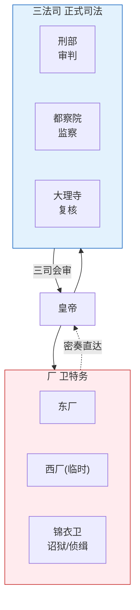

# 大明律与祖宗成法

## 律例体系的定位

明代法制体系的精髓在于**"律"和"例"的双轨结构**。这不是简单的法律条文集合，而是一个随时更新、自我维护的规则库。编排系统中的"律例 Agent"直接建立在这一历史模型之上。

## 大明律

《大明律》于洪武三十年（1397年）正式颁布，朱元璋下令"子孙守之，群臣有稍议更改，即坐以变乱祖制之罪"。大明律分七篇、三十卷、四百六十条：

| 篇 | 内容 | 编排类比 |
|:--|:--|:--|
| 名例律 | 刑罚总则、五刑定义 | 律例 Agent 的规则总纲 |
| 吏律 | 官员任免、考核、渎职 | 考功/选将相关规则 |
| 户律 | 赋税、婚姻、田宅、钱债 | 预算/财政相关规则 |
| 礼律 | 祭祀、仪制 | 输出格式/交互规则 |
| 兵律 | 军政、军令、驿传 | 调兵/竞功/通信规则 |
| 刑律 | 刑事犯罪的规定和刑罚 | 安全/合规/诏狱规则 |
| 工律 | 工程营造、河防 | 工具调用/API 规则 |

## 问刑条例（例的更新机制）

到了弘治年间（1488-1505），《大明律》颁布已过百年，许多条文已与现实脱节。但朱元璋严禁修改律文。解法是**"例"**：

> 例不是修改律文，而是在律文的基础上增加新的适用细则和量刑标准。比如大明律说"贪污者斩"，问刑条例补充："贪污十两以上斩，五两至十两流放，一两至五两杖责"——细化而不是改写。

弘治十三年（1500年）编成《问刑条例》，此后嘉靖、万历两朝又两次重修。例的更新流程：
1. 刑部或都察院发现某条律文与现实脱节 → 提交"条例修订票拟"
2. 三法司会审讨论 → 内阁票拟 → 皇帝批红
3. 新例试行若干年 → 效果评估
4. 正式编入《问刑条例》，全国统一适用

## 祖宗成法

"祖宗成法"是明代政治文化中一个非常有力的概念——朱元璋定下的制度被赋予近乎神圣的地位，后世皇帝在制度上很难明着推翻。这创造了一种特殊的制度惯性：**想改变但不能明着推翻 → 创造补丁（例）而不是改写原文（律）**。

## 规则修订的约束

- **试行期**：新规则不能直接生效，必须先在小范围试行
- **不可篡改的记录**：每次规则变更必须留档（含变更原因、提议人、表决经过）
- **审计回溯**：重大规则变更事后必须被审计
- **白话诏书**：每次修订必须发布通俗解释，让执行层理解变化原因

---

## 编排参考

任事型编排系统中的**律例 Agent** 是对明代律例体系的完整映射：
- "大明律" → 律例 Agent 维护的规则库：首辅加权规则、高风险判定标准、熔断阈值、考功参数等
- "问刑条例" → 规则试行期机制：新规则进入试行期，审计重点监控，试行结束自动评估效果
- "律例修订票拟" → 律例 Agent 周期性生成规则修订票拟上报总控，变更记录不可篡改
- "祖宗成法" → 核心规则（如国库总额度、熔断条件）的稳定性约束——不可频繁修改
- "26类参数" → 律例 Agent 维护的所有预设参数：冷启动、防振荡、效率转模触发阈值、人类关键介入点、灾备同步延迟容忍度等

核心洞察：明代律例体系解决的是**"规则引擎如何自我进化而不失控"**的问题——律不可改但例可增修，每次增修必须经过多层审批、试行检验和事后审计。编排系统的律例 Agent 继承了这一设计：规则可以演化，但演化过程被严格约束（冷却期、步长限制、反振荡检测）。
