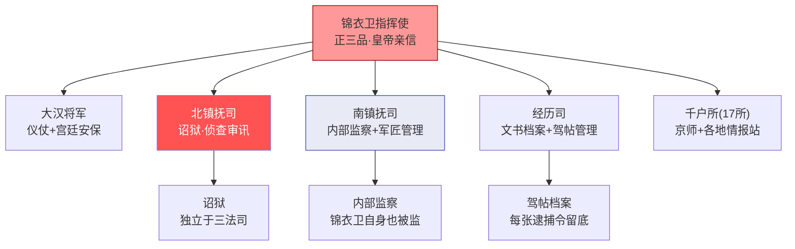

# 锦衣卫

## 起源与性质

锦衣卫（正式名称：锦衣亲军都指挥使司）由朱元璋于洪武十五年（1382年）设立，前身是拱卫司。它的本质是**皇帝直属的军事特务机构**，不隶属于五军都督府或兵部，绕开所有常规军事指挥链，只听命于皇帝一人。

## 组织架构

锦衣卫的组织远比"指挥使+北镇抚司"复杂——它是一台多功能的皇权机器，内部有清晰的分工和互锁。

**指挥使**：锦衣卫最高长官，正三品，由皇帝亲信（勋贵子弟或武将）担任。在明初勋贵（开国功臣后代）把持此职，到明中后期逐渐转为皇帝宠臣或宦官盟友。

**核心分支**：

- **大汉将军**（约1500人）：皇帝的仪仗护卫队——大朝会时列队站班、皇帝出行时护卫开道、宫中日常安保。这是锦衣卫最"体面"的一面——他们不是特务而是活动布景，但他们在宫中的存在本身就是威慑。大汉将军由"大汉将军指挥"率领，与北镇抚司的诏狱系统互相独立

- **北镇抚司**：最核心、最令人恐惧的部门——拥有独立于三法司（刑部/都察院/大理寺）之外的**诏狱**。北镇抚司镇抚使（从四品）直接对指挥使负责，但其诏狱的启动需要皇帝亲批的驾帖

- **南镇抚司**：锦衣卫的"内部监察"部门——负责监督锦衣卫自身的人员（是否有腐败、泄密、滥用职权），同时管理锦衣卫的军匠（制造兵器和刑具的技术人员）和本卫的俸禄发放。南镇抚司的存在使锦衣卫不能成为一个"法外之地"——它内部也有人在盯着

- **经历司**：锦衣卫的文书和档案部门——管理驾帖（逮捕令）的登记和存档、审讯记录的整理、情报报告的归档。经历司是锦衣卫的"记忆"——所有行动都在此留有记录。理论上这些记录可以被事后审查（但实际上审查极为罕见）

- **十七千户所**：锦衣卫下辖十七个千户所（每所约1120人），分布在京师和全国各地，负责情报收集、秘密监视、配合北镇抚司执行逮捕。各地的千户所是锦衣卫的"触角"

## 北镇抚司与诏狱

**诏狱**是锦衣卫权力的制度体现：
- 不经刑部，直接逮捕、审讯、关押
- 审讯过程不受三法司监督
- 审讯结果直接呈报皇帝，不经任何中间环节
- 关押条件极其恶劣，死亡极高——"入诏狱者十九死一生"

**诏狱的运作逻辑**：它不是常规司法体系的替代品，而是专门处理"皇帝关心但常规司法不便于处理的案件"——官员谋反、结党、泄密、对皇帝不敬等。本质上是一个政治安全工具。

**限制**：
- 诏狱不能自行启动，必须有皇帝命令（驾帖）
- 诏狱案卷事后可被都察院和东厂审查（理论上）
- 嘉靖年间后，刑科给事中获得了对锦衣卫逮捕令（驾帖）的签批权——没有刑科佥签，驾帖不合法

## 与其他机构的关系

- **与东厂互监**：东厂监视锦衣卫是否有滥用权力或隐瞒情报，锦衣卫监视东厂是否越权。这叫"厂卫互监"
- **与三法司的关系**：锦衣卫诏狱与常规司法系统平行但独立。在极端重要案件（如谋反大案）中，三法司会与锦衣卫会审

## 锦衣卫的权力边界

锦衣卫虽然可怕，但不是没有限制：
- 北镇抚司只管侦查审讯，不管审判——审判仍归刑部
- 锦衣卫不能自行发布逮捕令，需要皇帝签发的驾帖
- 如果锦衣卫制造冤案，都察院御史可以弹劾（虽然可能引火烧身）
- 理论上三法司可以复审锦衣卫的案件结论

---

## 锦衣卫的权力演变

### 洪武-永乐：从禁卫到特务

朱元璋设立锦衣卫的初衷是皇帝需要一支"自己的手"——不经过文官、不经过五军都督府、不经过三法司的直控力量。洪武后期，朱元璋感觉锦衣卫权力过大（在胡惟庸案和蓝玉案中锦衣卫进行了大规模逮捕和刑讯），曾短暂"焚锦衣卫刑具"以安抚人心——但锦衣卫的权力基础（皇帝直控）从未动摇。

朱棣通过靖难之役夺位后极度依赖锦衣卫来监控和镇压反对他的建文旧臣——锦衣卫的权力在永乐朝达到了第一个高峰。

### 嘉靖-万历：诏狱的制度化与常态化

到嘉靖和万历时，锦衣卫诏狱已成为一套成熟的政治工具：
- 牵连案件的"标准操作"已经高度制度化
- 驾帖的签发和审批流程已经稳定（皇帝亲批 → 刑科签批 → 锦衣卫执行）
- 诏狱的刑讯手段和审讯周期有了"行业惯例"
- 厂卫互监成为日常——东厂和锦衣卫互相派驻人员

### 天启年间：制度被绕过

魏忠贤当权期间，锦衣卫指挥使（田尔耕）成为阉党的执行臂——驾帖不再需要天启帝亲批，魏忠贤的口头指令就足以让锦衣卫抓人。这是锦衣卫历史上最黑暗的时期——不是因为权力大，而是因为**制度约束被绕过**。诏狱从"皇帝的政治安全工具"变成了"权阉的私人报复工具"。

---

## 编排参考

- "北镇抚司诏狱" → 锦衣卫 Agent 接收总控诏狱启动令后，立即冻结目标 Agent，移入隔离区
- "诏狱启动需皇帝亲批" → 诏狱必须总控亲批，无独立启动权。驾帖（逮捕令）需刑科签批——编排中锦衣卫的启动需要双重确认（总控+律例 Agent 审查）
- "南镇抚司内部监察" → 锦衣卫自身的 Agent 也需要被另一个"内部监察 Agent"监控——防止执行机构自身腐化。编排系统中的锦衣卫模块应该有内置的南镇抚司式的自检机制
- "经历司档案" → 全部驾帖和审讯记录的不可篡改归档——事后可由审计和东厂双重审查
- "十七千户所情报网" → 锦衣卫不只是执行逮捕——它还有分布各地的情报收集节点（"千户所"），持续监视关键 Agent 的行为模式
- "离线诊断" → 确定性测试集重放 + 行为轨迹回放 + 输入输出审计 → 诏狱案卷
- "处置选项" → 修复释放（降权观察）/ 永久废黜 / 移交三法司会审
- "厂卫互监" → 锦衣卫反向监视东厂，防止单方坐大
- "天启教训" → 制度约束被绕过的风险——诏狱的启动条件（驾帖需要皇帝亲批+刑科签批）在编排中必须是**硬编码**的，不能有任何 Agent（包括总控）能单独跳过

核心洞察：锦衣卫的本质是**皇权对常规系统的安全兜底**——当考功、监督、审计等常规手段都不足以应对某个 Agent 的异常时，总控需要一个可以直接冻结、隔离、诊断该 Agent 的终极工具。但锦衣卫自身也需要被制度约束——南镇抚司、经历司、刑科签批驾帖、东厂反监——形成"即使是最强力的工具也不能脱离制度监控"的设计。
