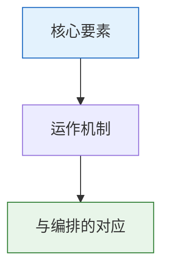

# 东厂

## 起源与性质

东厂由明成祖朱棣于永乐十八年（1420年）设立。朱棣通过靖难之役夺位后，对外朝的文武百官极不信任，需要一个不受外朝牵制、只忠于自己的情报机构。

东厂的全称是"东缉事厂"，因衙门位于皇城东安门北侧而得名。它是一个由**宦官掌管**的秘密监察和情报机构。

## 组织架构

**提督太监（厂公/督公）**：东厂最高长官，由司礼监掌印太监或秉笔太监兼任。这个安排极其重要——东厂督公同时是司礼监的核心成员，意味着东厂的情报可以直接影响批红决策。

**内部层级**：
- 掌刑千户 → 理刑百户 → 档头 → 番子（基层情报员）
- 番子遍布京城，渗透到各个官员府邸、商铺、寺庙甚至青楼

## 核心职能

**元监察（再监察）**：这是东厂最本质的职能。六科给事中监察六部，都察院监察百官，东厂监察"所有监察者"——它审查监察体系本身是否有系统性漏报、瞒报、或滥用监察权。东厂是监察体系的监察者。

**密奏直通**：东厂的情报不经内阁（外朝）、不经通政司（正常奏章通道），直接呈送皇帝。这意味着皇帝可以绕过整个外朝体系获取信息。东厂督公的密奏可以弹劾任何人——内阁首辅、六部尚书、甚至锦衣卫指挥使。

**监视锦衣卫**：东厂监视锦衣卫的一举一动。任何锦衣卫滥权、隐瞒重要情报、与被调查对象勾连，东厂都可以弹劾。同时锦衣卫也监视东厂——厂卫互监。

## 权力的边界

- **无执行权**：东厂不能逮捕、审判、撤换任何官员，只能收集情报和弹劾
- **弹劾需附证据**：不能凭"感觉"弹劾，必须有实质证据
- **弹劾频次有上限**：防止滥用弹劾权干扰正常行政
- **自身也受监督**：锦衣卫反监东厂，都察院也可以弹劾东厂违制

## 东厂为什么可怕

不是因为东厂有什么武力——而是因为它的情报直达皇帝，被弹劾者没有申辩通道。一个东厂密奏说某首辅"结交边将图谋不轨"，首辅在听到弹劾内容之前可能就被拿下了。信息的单向透明才是东厂权力的来源。

---

## 编排参考

任事型编排系统对东厂的角色定位极为精准：
- "元监察" → 东厂 Agent 对所有监察 Agent（监督、监军、审计、军功勘验使）的监察过程和结果做再监察
- "密奏通道" → 东厂密奏专线直通总控，不经司礼监代批
- "可弹劾任何 Agent" → 包括司礼监、锦衣卫、总督、考功司——东厂是唯一可以弹劾所有级别的监察者
- "无执行权" → 不可冻结、撤换、修改 Agent 状态，只能弹劾
- "弹劾频次上限" → 由律例设定，防止滥用
- "厂报" → 东厂定期向总控提交监察体系健康度评估

核心洞察：东厂解决了"谁来监察监察者"的经典问题。在一个多层监察体系（监督→审计→复核→考功）中，如果某层监察者自己出了问题怎么办？答案是在所有监察层之上再加一层元监察，且这层元监察**只向最高决策者汇报**。
