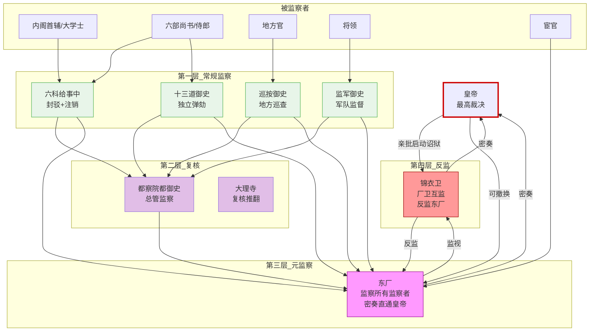

# 厂卫互监与皇权控制

## 多重监察体系的互锁设计

明代监察体系的设计逻辑非常清晰：**让每个监察者也被监察**，形成闭环互锁。没有任何一个机构可以"最后说了算"而不受监督。

```
六部执行 → 六科给事中监察（封驳、注销）
六科 → 都察院监察（可弹劾给事中）
都察院 → 东厂监察（密奏直通皇帝，弹劾都御史）
东厂 → 锦衣卫监视（东厂如有不法，锦衣卫可密报皇帝）
锦衣卫 → 东厂反监（锦衣卫滥用诏狱，东厂可弹劾）
皇帝 → 所有人受皇帝最终控制
```

## 厂卫互监

**东厂监视锦衣卫**：
- 锦衣卫的任何行动（逮捕、审讯、关押）随时有东厂番子在暗处观察
- 如果锦衣卫故意隐瞒重要情报或与被调查者勾连，东厂可直报皇帝
- 东厂督公是司礼监太监，与锦衣卫指挥使没有利益关系

**锦衣卫监视东厂**：
- 锦衣卫有调查权（诏狱），可以对东厂人员的违法行为调查取证
- 东厂督公虽然是司礼监红人，但锦衣卫指挥使是勋贵武将，两者体系不同

**互监而不是互斗**：厂卫互监的目的不是让两者掐架，而是互相提供信息确保皇帝获得更完整的情报。如果两者联手欺瞒皇帝，那就没有意义了——所以皇帝故意让两者"面和心不和"。

## 皇权如何通过制衡维持控制

皇帝通过五个杠杆维持对所有机构的控制：

1. **任命权**：所有关键职位由皇帝亲批任免，任期不定（皇帝可以随时撤换）
2. **预算权**：太仓库预算需批红，内承运库直接归皇帝支配
3. **最终裁决权**：任何机构之间的冲突，最终都由皇帝裁决
4. **密奏系统**：通过东厂和监军密奏绕过常规信息链
5. **终极武力**：锦衣卫诏狱 + 御马监（皇帝直属军队）

---

## 多层监察互锁图



---

## 编排参考

任事型编排系统的多重监察互锁设计直接源自厂卫互监：
- "东厂元监察" → 东厂 Agent 对所有监察 Agent（监督、监军、审计、军功勘验使）的监察过程和结果做再监察
- "锦衣卫反监东厂" → 厂卫互监，东厂抽查审计报告，锦衣卫监视东厂权力是否滥用
- "密奏直通" → 东厂和监军都有密奏直通总控，绕过司礼监代批
- "弹劾频次上限" → 防止任何一个监察者滥用权力破坏系统稳定
- "诏狱留档" → 锦衣卫诏狱全流程记录不可篡改，事后审计和东厂双重审查

核心洞察：厂卫互监在编排系统中的精髓是**"谁监察监察者"的终极解法——不是找第三个人来监察前两个人，而是让两者互相监察，且信息都直达最高层**。监察链不是单向的金字塔，而是一个闭环。
