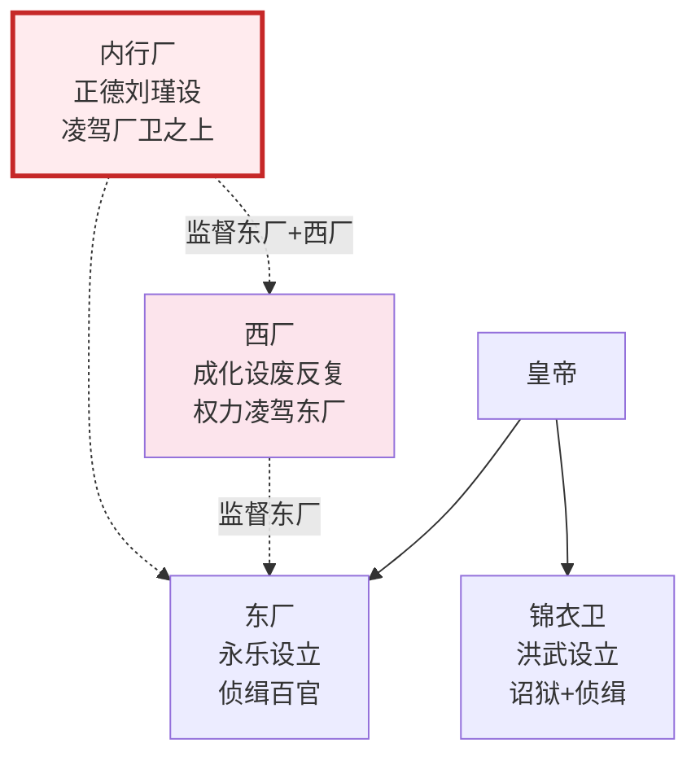

# 登闻鼓院与直诉

## 登闻鼓的设立

登闻鼓是悬挂在皇宫午门外的一面大鼓。任何百姓或低级官员如果有重大冤情，可以击鼓鸣冤——鼓声直达皇帝，绕过所有中间层级。这是明代司法体系中最后的直诉通道。

朱元璋设登闻鼓的初衷：如果都察院和刑部都被蒙蔽了，或者冤案牵涉到高级官员导致没人敢受理，至少还有一面鼓能让皇帝直接听到。

## 直诉的运作

击鼓流程：有人击鼓 → 通政司派人接状 → 初审（是否属于重大冤情，防止滥用） → 如属实，交三法司会审 → 结果呈报皇帝

**直诉的限制**：
- 必须是真的重大冤情（轻罪或民事纠纷击鼓会被杖责）
- 如果击鼓申诉的内容被证明是诬告，击鼓者反坐（受同样刑罚）
- 同一案件不能反复击鼓（防止滥用）

**登闻鼓的实际效果**：它象征意义大于实际操作。真正通过击鼓翻案的案例极少——大多数底层百姓根本到不了午门，或者不敢冒杖责和反坐的风险。但它的存在本身就是一种威慑：上级官员知道下面的人理论上可以击鼓直达皇帝，所以在制造冤案时会有所顾虑。

## 规则市场与痛点榜的类比

编排系统中的"规则痛点榜"借用了登闻鼓院的逻辑：

> 任何 Agent 可以在协作总线匿名频道上提交"规则痛点"——某条规则长期导致效率损失、误判等。痛点提交者匿名但痛点采纳后可在考功中作为"规则优化贡献"加分。

这类似于登闻鼓的机制：
- **低门槛提交**（匿名频道 / 击鼓）
- **限滥用**（需多方验证 / 反坐风险）
- **直通最高决策层**（律例 Agent / 皇帝）

## 铜匦投书（补充概念）

编排系统中"匿名反馈出口（问策入口）"的"铜匦投书"概念来源于武则天时期（唐代），不是明代。武则天设四个铜匦（铜制意见箱）于朝堂：东匦（延恩）收自荐信、南匦（招谏）收朝政建议、西匦（伸冤）收冤情申诉、北匦（通玄）收天象军情密报。

编排系统借用这个概念表达：每个最终输出附带一个反馈入口，用户可以匿名打分并附理由，但不直接改变 Agent 实时权重——而是作为京察时的"外部参照分"纳入综合考核。

---

## 编排参考

任事型编排系统中的对应：
- "登闻鼓院" → **规则市场（痛点榜）**：协作总线上设匿名频道，任何 Agent 可提交规则痛点
- "鼓声直达皇帝" → 痛点直通律例 Agent，由律例每京察周期汇总纳入规则修订票拟
- "防滥用反坐" → 痛点榜只采纳累计至少3个不同 Agent 提交的相同痛点，防止个别 Agent 干扰规则进化
- "铜匦投书" → **匿名反馈出口（问策入口）**：每个最终输出附带反馈入口，匿名评分纳入外部参照分
- "外部参照分" → 不直接改变实时权重，在京察时作为综合考核的一个维度（类似明代考功中"民意"的参考作用）

核心洞察：登闻鼓院解决的是**常规反馈渠道失效时的终极反馈通道**问题。编排系统中，如果监督 Agent 和审计 Agent 都没有发现某个规则问题，但多个执行 Agent 都在匿名频道抱怨同样的问题，痛点榜机制让这些问题能够浮出水面。
