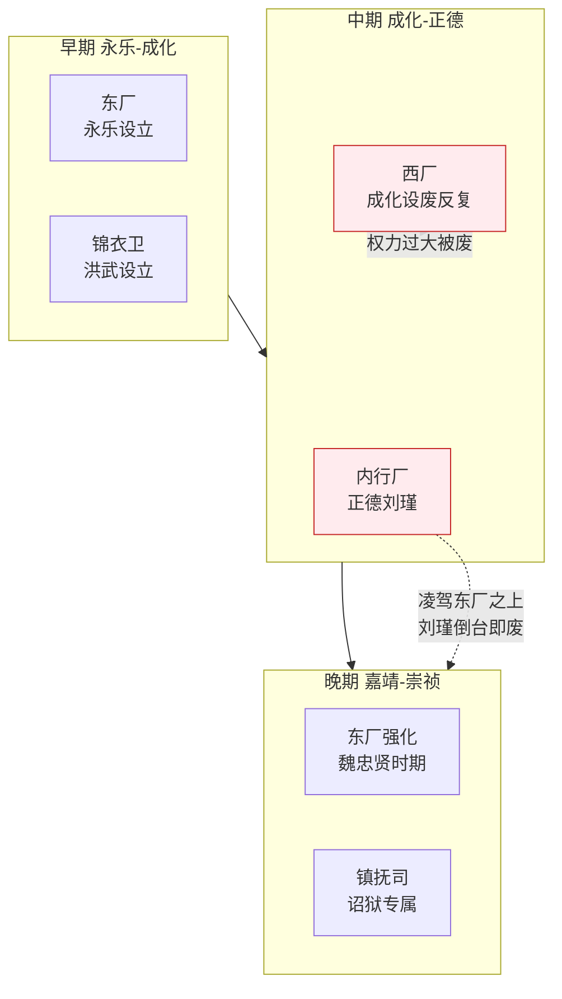

# 党争与制度异化

> 本文档分析明代监察与考核制度如何从"制衡机制"异化为"党争工具"——以及这对制度设计的警示。

## 党争的制度根源

明代制度设计的核心逻辑是"分权制衡"——内阁、六部、六科、都察院、司礼监互相制约，没有人能独断。但这一设计的隐含前提是：**各机构行使权力的动机是履行职责，而非打击对手**。当这个前提失效时，制衡机制就成了党争的合法武器。

### 为什么明代党争特别激烈

| 制度因素 | 如何催生党争 |
|:--|:--|
| **京察作为政治清洗工具** | 每六年一次，由吏部和都察院主持——如果这两个机构被朋党控制，京察就变成"合法清洗异己" |
| **言官"风闻言事"权** | 御史和给事中可以"听到风声"就弹劾——不需要确凿证据——这让弹劾成了低成本的政治攻击武器 |
| **廷推的集体博弈** | 重要官员由廷议推荐候选人——变成各派推自己人、互相否决的混战 |
| **科举同年/座师门生关系** | 同一年中进士的人形成"同年"网络，殿试的主考官（座师）与进士（门生）形成政治纽带——这是朋党的天然基础 |
| **内阁首辅之争** | 首辅不是法定最高行政长官（制度上内阁只是秘书机构），但其实际权力极大——每一次首辅更替都是一场政治战争 |
| **皇帝缺位造成的权力真空** | 万历几十年不上朝——无人仲裁，各派只能通过互相攻击来争取优势 |

---

## 主要党争事件

### 大礼议（嘉靖初年，1521-1524）

**起因**：正德帝无子，堂弟嘉靖帝以藩王身份入继大统。文官集团要求他认正德帝的父亲（弘治帝）为父，认自己的生父为叔父（"继嗣"）。嘉靖拒绝——坚持认自己的生父为皇考。

**本质**：不是礼仪之争，而是**皇权与文官集团的话语权之争**。文官集团想用儒家礼法约束新皇帝——"你得以我们说的方式当皇帝"；嘉靖想证明"皇帝说了算"。

**结果**：嘉靖帝用廷杖打死打伤数十名反对官员，强行推行自己的立场。表面上是皇帝赢了——但他和文官集团的关系从此破裂，此后几十年他躲在西苑修道炼丹、不再上朝。

**制度教训**：当"规则解释权"成为政治战场时，客观的制度就会变成主观的武器。

### 国本之争（万历朝，1586-1614）

**起因**：万历帝宠幸郑贵妃，想立她生的皇三子朱常洵为太子，而非皇长子朱常洛（王恭妃所出）。文官集团以"立嫡立长"的祖宗成法为由，坚持必须立皇长子。

**过程**：这场拉锯持续近30年——
- 文官集团：数百名官员前赴后继上书请立太子，被贬被罚也在所不惜
- 万历帝：拖延、不批、不上朝、缺官不补——用消极怠工对抗
- 最后万历帝被迫让步，立朱常洛为太子，但整个文官系统在三十年的消耗中元气大伤

**制度异化**：国本之争期间，所有正常的政务都成了党争的工具——
- 京察成了清流攻击"与郑贵妃有关系"官员的武器
- 六科封驳从"审查违规"变成"只要是对方提的就驳"
- 缺官不补（万历故意不任命退休官员的继任者）导致六部半数司职空缺——制度空转

### 东林党与阉党（天启朝，1621-1627）

**这是明代党争的顶点**：

东林党（以顾宪成、高攀龙等为核心，讲学于无锡东林书院）主张道德政治、弹劾腐败、反宦官干政。阉党（以魏忠贤为核心）是宦官+部分文官的联盟，利用天启帝的信任全面打压东林党。

**制度完全工具化的表现**：
- 锦衣卫诏狱成了魏忠贤消灭东林党人的武器——不需皇帝亲批驾帖（制度被绕过）
- 京察被阉党用来清洗东林党官员
- 六科封驳在东林党人手下封不住阉党的命令
- 三法司会审沦为走过场——审的都是阉党指定的结论

**结果**：东林党骨干被屠杀（"东林六君子"等被拷打致死），魏忠贤权倾朝野。直到崇祯即位铲除魏忠贤，但文官体系已被摧毁到难以修复。

---

## 制度异化的五种模式

从明代党争中可以归纳出制度异化的五种经典模式：

| 模式 | 明代表现 | 通用逻辑 |
|:--|:--|:--|
| **1. 审查权武器化** | 六科封驳不再审查文书合规性，而是党同伐异 | 任何"审查"权力都可以变成"找茬"的权力 |
| **2. 考核权政治化** | 京察/大计从政绩考核变成清洗异己 | 考核标准在政治压力下必然变形 |
| **3. 弹劾权滥用** | "风闻言事"让弹劾从证据驱动变成舆论驱动 | 低成本举报必然产生大量虚假举报 |
| **4. 否决权僵持** | 皇帝缺位时各派互相否决、无人能决策 | 没有任何一方的否决权大于其他方时，系统陷入"否决僵局" |
| **5. 规则解释权争夺** | 大礼议的本质——谁有权解释祖宗成法 | 规则的文本固定但解释可变——控制解释权就是控制规则 |

---

## 为什么制度设计没有预防党争

明代设计者在"防止个人独裁"上做得很好（分权制衡、多眼验证），但在"防止集体性制度腐败"上几乎是空白。

根本原因：**分权制衡假设每个权力方会尽职行使权力——但当多个权力方形成联盟（阉党）共同侵害制度时，分权反而让破坏更彻底**。一个独裁者至少还要担心合法性，一个跨机构的朋党联盟可以在每个环节都"合规"地做不合法的事。

这是所有分权制度的阿喀琉斯之踵——**对抗个体暴君的能力恰恰使系统在面对集体暴政时更脆弱**。

---

## 编排参考

- "京察政治化" → **考核标准的不可篡改性**：考功册的评分应由多维数据源独立输入（类似五道验功的多眼交叉验证），而非由单一"主持方"主观评定。如果吏部+都察院联合就能控制京察——说明考核的数据源不够多元
- "风闻言事" → **弹劾需要证据门槛**：编排系统中的监督 Agent 不能"听说"就弹劾——必须附具可追溯的数据引用（类似"弹劾须附证据否则反坐"）。低成本的举报会导致高成本的混乱
- "国本之争的空转" → **否决僵局的破解机制**：如果系统进入无法决策的僵局状态（各派互相否决），必须有"强制议事"机制——总控朝会模式的辩论+时限——超时则总控独断
- "跨机构朋党" → **监察者的联盟检测**：东厂+锦衣卫互监的本质是"防止任何两方形成不被监控的联盟"——编排系统需要类似的联盟探测：如果三个独立 Agent 的输出突然高度一致，触发审查
- "规则解释权争夺" → **规则的可审计性而非可解释性**：律例 Agent 维护的规则必须是"可执行代码"级别的精确，而非自然语言的"灵活解释"——大礼议之所以能持续三年是因为"礼"无法被精确判定
