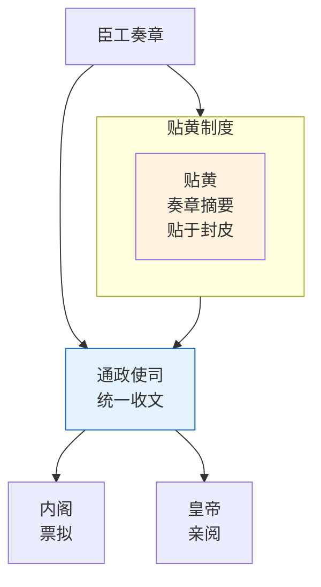

# 通政司与贴黄

## 通政司的定位

通政司（全称：通政使司）是明代中央政府的"办公厅"或"信访总局"。它的核心职能是**接收天下奏章和民间上访，并分类转呈相关部门处理**。通政司是外部信息进入中央政府的第一道门。

**主要官员**：
- 通政使（正三品）：最高长官
- 左/右通政（正四品）
- 左/右参议（正五品）

## 奏章流转

在外官员和百姓向中央政府递交的文书（奏章、上访信、报告等）全部先送通政司。通政司做初审后：
1. 将奏章原件存档
2. 抄写副本送内阁票拟
3. 紧急军务奏章不受常规排期限制，可走急递通道直达皇帝

通政司不决定奏章内容的对错——它只负责分类、登记、分发。但谁先看到奏章谁就掌握了信息的第一手解读权，所以通政司在信息流中具有微妙的影响力。

## 贴黄制度

**贴黄**是明代奏章处理的核心创新。每份奏章内容通常很长（文言文，动辄数千字），皇帝和内阁不可能逐字阅读所有奏章。于是产生了贴黄：

> 通政司在每份奏章末尾附上一张小黄纸条，用最简短的文字（通常不超过100字）概括奏章的核心内容和请求。这张黄纸条就叫"贴黄"。

贴黄不是摘要——它是**结构化的信息提取**：只写清三件事：谁上的奏章、什么事、请求什么。皇帝和内阁先看贴黄，如果觉得重要再调阅原始奏章全文。

## 原始奏章的保护

无论贴黄如何摘要，原始奏章全文始终被保存。通政司将原始奏章移交内阁后，内阁存档。如果需要追溯某次决策的依据，可以通过原始奏章还原完整上下文（含当时的措辞、情绪、附加材料等）。

> **参见**：条陈、中旨、急递通道的详细分析已拆出至 [02-条陈中旨与急递]()

## 编排参考

在任事型编排系统中，通政司和贴黄被精确对应到交互层：

- "通政司接收奏章" → **交互审核 Agent**：接收用户输入，翻译为内部指令
- "贴黄摘要" → 交互审核 Agent 生成"贴黄 + 结构化指令列表"，保留原始请求映射
- "原始奏章存档" → 生成"原始奏章"（全文存档 + 内容哈希），交档籍 Agent 持久化
- "分层压缩" → 上下文超阈值时：第0层原始奏章永不删，第1层锚点快照永不冲刷，仅压缩第2层动态上下文
- "急递通道" → 任务执行中收到用户新输入时，判断是中止/转向信号还是新任务

核心洞察：通政司和贴黄解决的是**信息压缩与信息保真**之间的矛盾。贴黄让决策者不被信息淹死，原始奏章保证压缩信息可以回溯验证。编排系统中的分层压缩策略（第0层不删/第1层不冲刷/第2层可压缩）直接延续了这一思路——**摘要用于效率，原件用于审计**。
