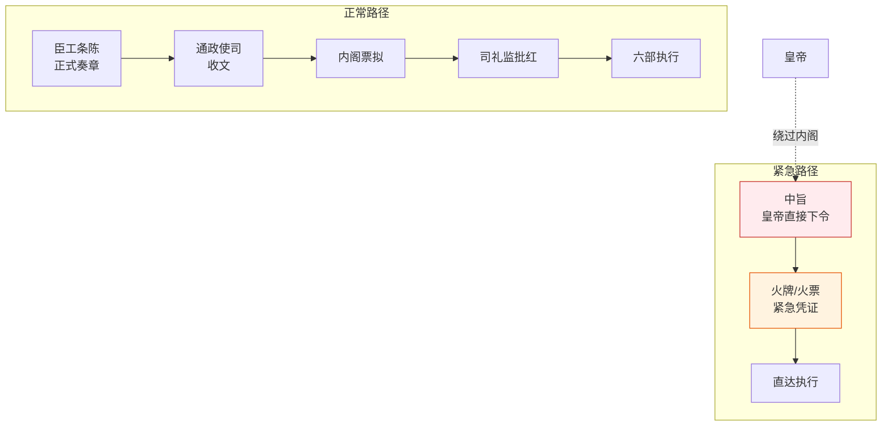

# 条陈、中旨与急递

> 从通政司与贴黄拆出。聚焦明代三种特殊文书类型。

## 明代文书的特殊类型：条陈、中旨、急递（深化）

除了常规奏章，明代还有几种特殊的文书类型，各自有不同的流转规则和权力含义：

### 条陈（分条陈述）

**条陈**是官员上奏的一种特殊形式——将复杂事务分条目陈说，每条独立说明问题、原因、建议。

**条陈的特点**：
- **结构化**——不是散文式的万言书，而是“一、二、三...”分条列出
- **每条独立**——每条有完整的问题描述+建议，可以单独采纳或驳回
- **问题导向**——条陈通常针对具体算政问题提出改革建议

**条陈的典型用途**：
- 新任官员提交施政建议（如巡抚上任条陈本地利弊）
- 都蔡院御史条陈多项弹劾事项
- 边防官员条陈军事改革方案
- 六部尚书条陈本部改革计划

**条陈与一般奏章的区别**：
- 一般奏章：针对单一事项请示/汇报
- 条陈：针对多项相关问题提出系统性建议

**条陈在编排中的演化——“条陈预授权”**：

编排系统中的“条陈预授权”（BatchApproveCharter）是条陈概念的创造性扩展：
- 明代条陈：官员主动上奏提出多项建议
- 编排条陈预授权：总控预先授权司礼监可以在这些条目范围内代批
- **关键区别**：明代条陈是“建议”，编排条陈预授权是“授权”

### 中旨（皇帝直接下旨）

**中旨**是皇帝不经过内阁票拟、不经过六科封驳，直接发出的诏旨。这是皇帝越过常规决策流程的特殊通道。

**中旨的两种类型**：

| 类型 | 含法性 | 典型场景 |
|:--|:--|:--|
| **合法中旨** | 合法但例外 | 皇帝紧急决策、私人事务（如黄赐外戚）、内阁空缺时 |
| **违制中旨** | 违反程序 | 皇帝越过六科封驳强行任命官员、违规开支 |

**中旨的争议**：
- 明代文官集团认为“不经内阁票拟的诏旨不合程序”
- 但明代没有制度性机制阻止皇帝发中旨（皇权至上）
- 六科给事中可以封驳中旨（但皇帝可以无视封驳）
- 实践中，强势皇帝发中旨习以为常，弱势皇帝发中旨会引起政治风波

**中旨的历史教训**：
- 万历皇帝的中旨任命官员（越过吏部和内阁）引起多次政治风波
- 堅靖帝的中旨追尊生父（大礼议）引发左顺门事件
- 中旨泛滥是明代后期决策制度崩坏的表现

### 条陈 vs 中旨 vs 一般奏章

| 维度 | 一般奏章 | 条陈 | 中旨 |
|:--|:--|:--|:--|
| **发起方** | 官员上行 | 官员上行 | 皇帝下行 |
| **内容** | 单一事项 | 多项系统性建议 | 皇帝直接决定 |
| **流转** | 通政司→内阁票拟→批红 | 同一般奏章 | **不经内阁**，直接发六部 |
| **封驳** | 可被六科封驳 | 可被六科封驳 | 名义上可封驳，实际难以封驳 |
| **典型用途** | 请示/汇报 | 施政建议/改革方案 | 紧急决策/私人事务/越权任命 |

### 急递（特殊通道）

**急递**是明代文书的加急通道——标记“飞递”或“马上飞递”的文书可绕过常规排队，直接优先处理。

- **军事急递**：塘报系统，日行 400-600 里
- **民事急递**：重大灾情、谋反大案等
- **审核机制**：急递不是自封的，必须由特定级别的官员标记，且事后审查是否滥用

## 这些文书类型在编排中的映射

| 明代文书 | 编排对应 | 使用场景 |
|:--|:--|:--|
| **一般奏章** | 常规用户请求 | 标准任务流程
| **条陈** | 多项关联请求/复杂任务拆解 | 用户一次提多个相关问题 |
| **条陈预授权** | 司礼监代批的条陈清单 | 简单低风险请求快速返回 |
| **中旨** | 总控直接下发指令（绕过常规流程） | 紧急指令、特殊任务 |
| **中旨争议** | 总控越过规划Agent直接指挥 | 需谨慎，可能破坏制衡机制 |
| **急递** | 急递通道 | 用户中途中止/转向任务 |

**关键设计启示**：
- **条陈预授权必须有边界**——明代条陈是“建议”，编排条陈预授权是“授权”，授权范围必须有律例明确设定
- **中旨不能滥用**——如果总控经常绕过常规流程直接指挥，制衡机制就会失效
- **急递需要审核**——不是所有请求都能走急递，必须有特定条件

---

