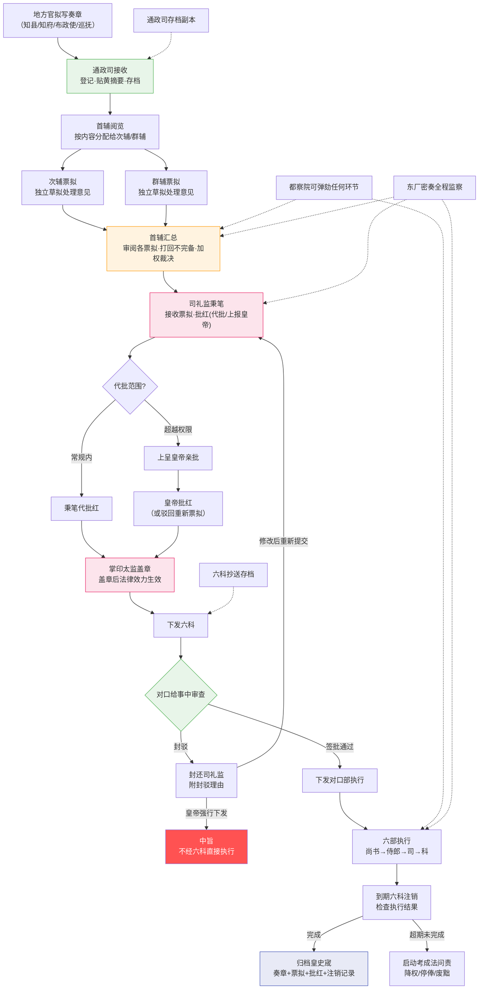

# 奏章流转完整路径图

> 一份奏章从地方官员落笔到最终被执行的完整生命周期——经过多少双手、被多少次审查、在哪些环节可能被卡住或操纵。

## 端到端全景流程

---

## 逐环节详解

### 环节 1：奏章拟写与发出

**谁可以上奏**：
- 在京官员：三品以上可随时上奏（但实际受通政司接收时间限制）
- 地方官员：布政使、按察使、巡抚、巡按御史可上奏日常事务
- 特殊通道：监军御史、东厂可密奏（不经通政司、不经内阁、直达皇帝）
- 登闻鼓院：平民可通过击鼓直诉（理论上——实践中极难）

**奏章的格式**：题本（正式公文——用印、有固定格式）和奏本（个人化——可谈私事或建议）

**奏章的物理传递**：
- 地方 → 中央：驿传系统（每60-80里设驿站、日行300里）
- 紧急军情：塘报系统（日行400-600里、换马不换人）

### 环节 2：通政司——奏章的入口

（详见[通政司与贴黄](../04-信息链/01-通政司与贴黄.md)）

**做什么**：
- 接收天下所有奏章（除了密奏——密奏不经通政司）
- 登记奏章信息（日期/来文者/主题/紧急程度）
- **贴黄**：在每份奏章末尾附一张黄纸，写上100-200字的内容摘要
- 将奏章原件存档（"副本"）、将贴黄版转送内阁
- 如果奏章的格式不全或贴黄不对——打回重来

**为什么重要**：通政司是信息进入决策体系的第一道关口——它在"信息到达决策者之前"就已经做了第一次筛选和格式化。通政使选择哪些贴黄怎样措辞——这个权力虽然微小但非常致命。

**通政司与密奏的区别**：
| | 普通奏章 | 密奏 |
|:--|:--|:--|
| 通道 | 通政司→内阁→司礼监→皇帝 | 直接→皇帝 |
| 谁可见中间过程 | 通政使、内阁全体、司礼监 | 只有皇帝 |
| 归档 | 通政司+皇史宬 | 皇帝私人保存 |
| 风险 | 多层过滤可能失真 | 密奏本身可能失真（无交叉验证） |

### 环节 3：内阁票拟

（详见[内阁制度](../01-决策链/02-内阁制度.md)）

**流程**：
1. 首辅阅览通政司转来的贴黄——根据奏章主题分配给次辅或群辅
2. 次辅/群辅各自独立阅读奏章原文+贴黄——草拟处理意见（"票拟"——写在小纸条上贴在奏章旁）
3. 首辅汇总各人的票拟——审阅——打回不完备的——自行加权裁决——形成"最终票拟"（通常是将最佳票拟整理后上呈，有时会综合多方意见）
4. 最终票拟上呈司礼监

**关键设计**：票拟是**建议**不是**决策**——内阁不能说"这事就这么定了"，只能说"关于这件事我们建议这么处理，请皇帝/司礼监批红"。

**票拟可能被操纵的环节**：
- 首辅选择把奏章分给谁票拟（分给跟你意见一致的人 → 票拟当然跟你一致）
- 首辅打回谁的票拟（打回跟你意见不一致的人的票拟 → 只剩下你想要的意见）
- 但次辅/群辅可以绕开——直接把自己的票拟和首辅的最终票拟一起上呈皇帝

### 环节 4：司礼监批红

（详见[司礼监与宦官体系](../01-决策链/03-司礼监与宦官体系.md)）

**流程图已在司礼监文档中**。这里补充与奏章流转相关的关键点：

**"批红"的具体形式**：秉笔太监在票拟旁边用朱笔写上最终决定。可以：
- **"如拟"**：同意票拟建议（最常见——表示一切按内阁建议执行）
- **"改批"**：部分同意但修改了具体内容（如预算从10000两改成8000两）
- **"不准"**：否决票拟——打回内阁重新票拟
- **"留中"**：不批也不退回——奏章被扣在宫中（这是对奏章最严厉的回应——等于说"我不想理你这件事"）

**代批红的边界**：（详见司礼监文档，此处列出7类不可代批决策）

越权代批一经查实：当次批红作废 → 总控重新亲批 → 秉笔太监信用降等。

### 环节 5：六科审查

（详见[六科给事中](../03-监察链/02-六科给事中.md)）

**批红后的诏旨下发到对口六科**——这是执行前的最后一道审查：

- **签批（通过）**：给事中在文书上签章 → 下发对口部执行
- **封驳（拒绝）**：给事中封还文书 → 附书面理由 → 退回司礼监

**封驳的两种类型**：
- **封还**：封还皇帝的诏旨——"这个决策与祖宗成法/现行制度冲突，请重新考虑"
- **驳正**：驳正六部的奏章——"这个执行方案有漏洞，请补充修正"

**封驳的代价**：给事中频繁封驳会得罪皇帝和内阁——所以虽然有封驳权，但实际使用率不高（除非给事中已经有"大不了被贬"的心理准备）。这也是为什么七品给事中配给了巨大的法律保护——没有保护没人敢用这个权力。

### 环节 6：六部执行

诏旨通过六科签批后，下发六部执行。六部内部（尚书→侍郎→司→科）按"会推/会审/转行/关白"的协同机制执行。

**执行中的跟踪**：
- 每项任务有明确的完成时限（由票拟/批红阶段标注）
- 六科给事中持有该任务的"注销"副本——到期后检查完成情况
- 执行过程中的重大变更需要重新走票拟→批红流程

### 环节 7：注销监督

这是奏章生命周期的闭环：

- 每项下发任务，六科持有副本标注了**完成时限**
- 到期日，六科给事中向执行部索要**完成报告**
- 如果完成：注销记录—归档皇史宬
- 如果超期：启动**考成法**问责程序——降权/停俸/废黜

**注销的重要意义**：这是整个奏章流转系统的"闭环"——没有注销监督，前面的所有环节（票拟/批红/封驳）就失去了意义（因为不能追踪是否执行了）。张居正推行考成法，正是把"注销"从走过场变成了真正的时间约束。

---

## 奏章流转的三种路径对比

| | 常规路径（日常政务） | 紧急路径（军事/灾情） | 密奏路径（情报/监察） |
|:--|:--|:--|:--|
| 入口 | 通政司 | 塘报/驿传急递 | 东厂/监军御史直呈 |
| 中间经过 | 通政司→内阁→司礼监→六科→六部 | 兵部+内阁（简略流程） | 直接皇帝 |
| 时间 | 3-7天（正常） | 1-3天 | 当天 |
| 谁可见 | 全程可见（公开） | 内阁+兵部核心官员可见 | 只有皇帝 |
| 归档 | 皇史宬（公开档籍） | 皇史宬 | 皇帝私人保存（不归档） |
| 风险 | 慢但程序完整 | 程序简略→可能有信息遗漏 | 信息可能失真→无交叉验证 |

---

## 编排参考

- "奏章生命周期的七个环节" → **编排系统中的任务生命周期**：任务创建（通政司）→ 规划（内阁票拟）→ 审批（批红）→ 审查（六科）→ 执行（六部）→ 验证（注销）→ 归档（皇史宬）。每个环节都有独立的 Agent 负责，且每个环节都可以审查和拦回前一个环节
- "留中" → **总控的消极否决权**：皇帝选择"留中"（不批不退回）是最消极但最有力的否决——完全沉默。编排系统的总控如果对某个方案不发批红也不退回——就等于"留中"——任务被无限搁置。这需要超时机制：如果总控超过 N 天不批，自动退回内阁重新票拟
- "贴黄" → **摘要的不可篡改和可追溯**：通政司的贴黄是原始奏章的摘要——编排系统中每个子任务也必须有一份"贴黄"（结构化摘要：谁提交/要什么/紧急程度/预估资源），存档于档籍 Agent——原始内容不可被摘要替换
- "注销" → **任务闭环的最后一个环节**：没有注销就没有闭环——编排系统中的每项任务都必须有"注销日期"和"注销检查"（实际完成 vs 计划完成）。如果只规划不检查（只有票拟没有注销），系统将在几个月内积累大量"僵尸任务"
- "三种路径" → **编排系统的三通道设计**：常规通道（标准流程）、紧急通道（简化流程，灾备/军事）、密奏通道（直达总控，不被中间层过滤）——三者并行使系统在不同复杂度/紧急度的任务间灵活切换
