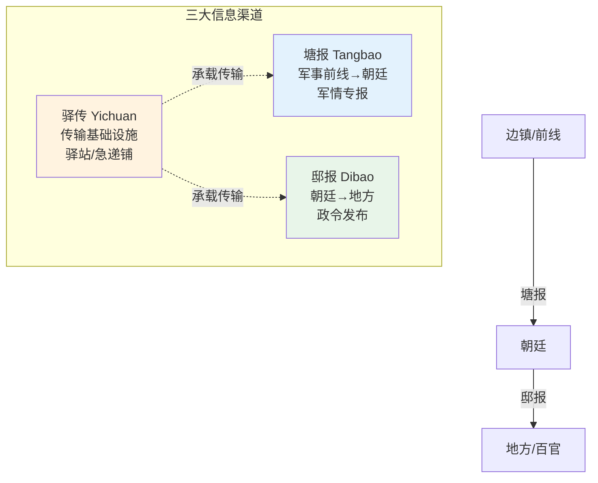

# 塘报邸报驿传与行人司

## 三种通信体系

明代的信息传递有三条平行的体系，各自服务不同的对象和目的：

| 体系 | 性质 | 服务对象 | 速度 | 保密级别 |
|:--|:--|:--|:--|:--|
| **驿传** | 国家邮政网络 | 朝廷与地方的公文、官员出差 | 标准（日行300里） | 低/中 |
| **塘报** | 军事通信系统 | 前线→指挥部→兵部 | 急递（日行400-600里） | 高 |
| **邸报** | 官方新闻公报 | 各级官员 | 周期性抄发 | 低（公开） |

## 驿传制度

明代全国设驿站约1300处，分水驿（船）和马驿（马）。驿站提供：
- 换马（官员每到一个驿站换一匹新马继续赶路）
- 住宿和饮食
- 公文传递（站站接力）

**驿传的层级**：中央通政司 ↔ 各省布政司 ↔ 各府 ↔ 各县 → 层层传递公文。

**驿传的衰落**：到明末，驿站开支巨大而效率极低。崇祯二年（1629年），一位叫李自成的驿卒被裁撤下岗——他后来成为了推翻明朝的那个人。

## 塘报（军事急递）

塘报是军事专用通信系统，速度远高于普通驿传。塘报的运作：
1. 前方将领派塘马（最快的战马）传递军情
2. 沿途设塘汛（军事通信站），换马不换人
3. 紧急军情标注"飞递"或"马上飞递"，可日行600里以上
4. 到达兵部后直接转呈内阁和皇帝，不经过普通文书排队

**塘报的内容**：战况进展、敌情侦察、粮草消耗、伤亡统计、请求增援——本质上是战场的实时状态快报。

## 邸报（官方新闻公报）

邸报是明代特有的官方信息发布系统。通政司将皇帝批红的诏旨、重要人事变动、奖惩通告等汇编成邸报，抄发各省衙门。地方官员通过邸报了解中央动态。

邸报不是报纸——它只在官员内部传阅，不向百姓发行。但它是维系庞大帝国信息一致性的关键工具：一个在广东的知县可以通过邸报知道北京的人事变动，不需等私人信件。

> **参见**：行人司的详细分析（组织/职能/失败模式/军情转译使原型）已拆出至 [05-行人司]()

## 编排参考

任事型编排系统的通信层直接借用了这三套体系：
- "驿传/通政司" → **协作总线**（订阅-发布模式）：六部之间间接通信，所有消息自动归档，消息分级（例行/决策）
- "塘报" → **塘报旗牌使**：总督点对多号令分发任务，各路提督独立频道上报战果，时限预警
- "邸报" → **协作总线上的资源用量公告**：定时广播各部/各路资源消耗，增强全局感知
- "行人司" → **军情转译使**（竞功模式）：翻译用户请求为军令，生成原始战报存档
- "急递/飞递" → **急递通道**：用户中途可中止/转向任务，不排队直接处理

核心洞察：明代三套通信体系解决的是**不同优先级的信息走不同通道**的问题。编排系统中，常规协同走协作总线（对应驿传），竞功军令走塘报旗牌使（对应塘报），全局状态同步走邸报式广播。如果所有信息都挤在同一条通道上，紧急军情会被日常公文淹没。
