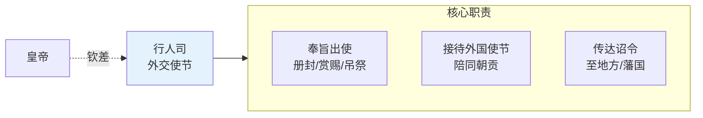

# 行人司

> 从塘报邸报驿传与行人司拆出。明代外交与特殊使命传达机构。

## 行人司

行人司是明代专门负责**外交和特殊使命**的机构。行人（正八品）被派往外藩（朝鲜、安南、琉球等）传达诏旨，也在国内执行特殊的钦差任务。行人的品级虽低，但代表皇帝出使时象征意义巨大。

### 行人司的组织

- **行人司长官**：行人司正（正九品）— 品级比行人还低，但负责管理全体行人
- **行人**：约 30-40 人，从举人/监生中选拔
- **选拔标准**：仪表端正、口才好、借礼仪、能写公文
- **培训内容**：外藩语言基础、礼仪、公文写作、外交规则

### 行人的主要即能

| 职能 | 说明 | 历史案例 |
|:--|:--|:--|
| **传诏外藩** | 册封朝鲜/琉球/安南国王、传达皇帝诏旨 | 明初多次派行人册封朝鲜国王 |
| **吊哨使** | 外藩国王去世时吊哨、赐谥、册封新王 | 朝鲜国王去世后的吊哨使 |
| **进贡护送** | 护送外藩进贡使团进出边境 | 与会同馆、勤胪寺协作 |
| **特殊钦差** | 国内执行特殊使命、如宗室事务、军务传旨 | 与锦衣卫、钦差重叠 |
| **情报收集** | 出使期间收集外藩信息上报兵部职方司 | 行人的情报职能常被忽视 |

### 行人与其他通信角色的区别

| 角色 | 主要职能 | 与行人的区别 |
|:--|:--|:--|
| **塘报旗牌使** | 军事急递 | 行人是外交/特殊使命，塘报是军情急报 |
| **驿传** | 常规公文传递 | 行人传达的是特定使命（口传+手动），驿传是公文物流 |
| **会同馆** | 接待外藩使节住宿 | 行人负责“动”（出去），会同馆负责“静”（接待进来） |
| **四夷馆** | 外语翻译 | 行人借助四夷馆译字生，但行人本人不一定懂外语 |
| **勤胪寺** | 朝会礼仪、引见外藩 | 行人是使命执行者，勤胪寺是礼仪组织者 |

### 行人作为“军情转译使”的原型

编排系统中的“军情转译使”以行人司为原型，但有创造性扩展：

| 维度 | 明代行人 | 军情转译使 |
|:--|:--|:--|
| **职能** | 外交/特殊使命传达 | 翻译用户请求为军令 |
| **翻译方向** | 双向（中文↔外藩语） | 双向（用户意图↔军令） |
| **复杂度评估** | 无（行人只传话） | 有（军情复杂度评分） |
| **原始记录** | 无系统化要求 | 生成原始战报存档 |

**为什么以行人司为原型**：
- 行人是“代表皇帝传达使命”的角色——军情转译使代表用户传达任务意图
- 行人必须准确传达、不能篡改——军情转译使必须保留原始意图映射（翻译可逆）
- 行人品级低但象征意义大——军情转译使不是决策者但是关口

### 行人司的失败模式

| # | 失败 | 原因 | 后果 |
|:--|:--|:--|:--|
| 1 | **行人越权** | 行人撞自决策、超过传达使命 | 外藩误解明朝意图 |
| 2 | **行人被收买** | 外藩收买行人夸大或篡改诏旨 | 外交事故 |
| 3 | **翻译失真** | 外藩语翻译不准 | 误会、甚至战争 |
| 4 | **情报职能被忽视** | 行人的情报收集不被重视 | 错失重要外藩信息 |

**启示**：军情转译使的“翻译可逆”要求直接源自行人传达使命的“准确性”要求——如果翻译不可逆，就无法验证是否篡改了原始意图。

---

