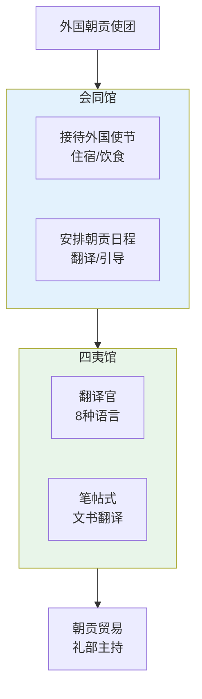

# 会同馆四夷馆与外交

## 明代的朝贡外交体系

明代外交的核心是**朝贡体系**——周边国家以"朝贡"的形式承认明朝的宗主地位，明朝以"回赐"的形式承认其政权的合法性并给予贸易特权。这不是现代外交（平等主权国家间的关系），而是以中国为中心的等级化国际秩序。

主要朝贡国：朝鲜（最频繁，一年数贡）、安南（越南）、琉球、暹罗（泰国）、占城、爪哇、满剌加（马六甲）、苏门答腊、日本（足利幕府期间）、以及郑和远航后建立的非洲东海岸朝贡关系。

## 会同馆

会同馆是明代接待外国使节的**官方招待所**，设在北京。使节到达后入住会同馆，食宿由朝廷提供。在馆期间，会同馆负责：
- 安排使节何时觐见皇帝（通过鸿胪寺排班）
- 管理使节带来的贡品和朝廷准备的回赐
- 监视使节在京活动（防止间谍）

外国使节在会同馆住的时间可能长达数月——等待觐见排期、等待回赐准备、等待季风（海上来的使节需要在正确季节返航）。

## 四夷馆（翻译机构）

四夷馆是明代的官方翻译和外语培训机构，设在北京，专门负责与各朝贡国的文书翻译和口译。设八个馆：
| 馆 | 负责语言/文字 |
|:--|:--|
| 鞑靼馆 | 蒙古文 |
| 女直馆 | 女真（满文前身） |
| 西番馆 | 藏文 |
| 西天馆 | 梵文（印度） |
| 回回馆 | 波斯文/阿拉伯文 |
| 百夷馆 | 傣文（云南/缅甸） |
| 高昌馆 | 维吾尔/察合台文 |
| 缅甸馆 | 缅甸文 |

每馆设译字生（翻译学员），从国子监或地方选拔聪颖少年学习外语。四夷馆同时承担一个极其重要的情报职能——翻译境外文书中隐藏的军事情报。

## 市舶司（海上贸易管理）

明代在沿海设三个市舶司管理海上朝贡贸易：
| 市舶司 | 负责区域 |
|:--|:--|
| **浙江市舶司**（宁波） | 日本朝贡贸易 |
| **福建市舶司**（泉州→福州） | 琉球朝贡贸易 |
| **广东市舶司**（广州） | 东南亚/西洋朝贡贸易 |

市舶司的职能：检验朝贡文书、清点贡品、征收关税（部分）、管理随贡船来的私人贸易。市舶司的关键限制——只能做"朝贡贸易"（随贡使团来的贸易），不能做纯粹的私人海外贸易。明朝的海禁政策使得大量合法贸易需求被迫转为走私。

---

## 编排参考

外交体系对编排系统的启发：
- "会同馆" → **幕府 Agent 的任务接收清单**：使节(各路提督)到达后入住会同馆(进入worktree)，等待排期(评功时限)，会同馆监控活动(监军监控执行过程)
- "四夷馆" → **军情转译使** + **行人司**：翻译外部信息(用户输入→内部指令)，同时具备情报筛选能力
- "市舶司" → **太仓库的预算账户拦截**：市舶司是海上贸易的"闸门"(没有市舶司许可不能交易)，太仓库在 Token 预算中的余额拦截是资源消耗的"闸门"——都是硬约束的关卡
- "朝贡回赐" → **竞功配额-补助机制**：朝贡国的贡品(提督上交战果) → 明朝回赐(评功后发放奖赏配额/权重更新)——输入和输出不对称但长期平衡
