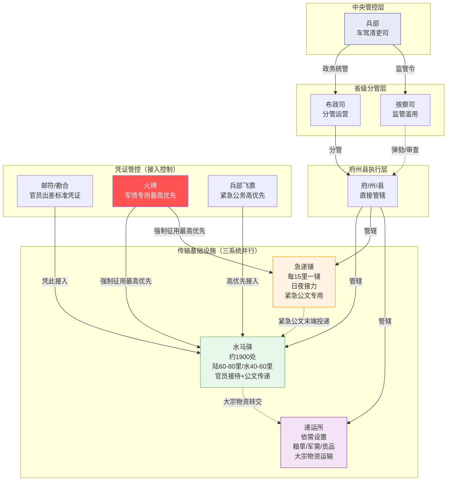

# 驿传制度：国家传输基础设施

> 明代官方信息传递与物资运输的物理网络——驿、铺、所三系统并行，凭证管控接入。本文聚焦基础设施与运营规则；信息内容类型见 [04-塘报邸报驿传]()，文书流转生命周期见 [03-奏章流转完整路径图]()。

---

## 三系统总览

明代的国家传输基础设施由三个职能不同的子系统组成，各自解决一类问题：

| 系统 | 核心职能 | 介质 | 间距 | 日速 | 是否接待 |
|:--|:--|:--|:--|:--|:--|
| **水马驿** | 官员接待 + 公文传递 + 物资中转 | 马 / 船 | 陆60-80里，水40-60里 | 约300里 | ✅ 食宿换马 |
| **急递铺** | 紧急公文专用纯传递 | 人力接力 | 每15里一铺 | 300-400里 | ❌ 不接待 |
| **递运所** | 官方大宗物资运输 | 车 / 船 / 人力 | 依需设置 | 依载重而定 | ❌ 只运物 |

**分工逻辑**：驿站管"人"（接待出差官员），递运所管"物"（运输粮草军需），急递铺管"信"（纯信息传递）。三者物理上常共址设置（一地有驿有铺有所），但归属和运营独立。

---

## 水马驿（Shui Ma Yi）—— 官方驿站网络

### 网络规模与类型

全国驿站约 **1900 余处**（盛期数据，各朝有浮动），分三种类型：

| 类型 | 设置区域 | 运力 | 典型场景 |
|:--|:--|:--|:--|
| **马驿** | 陆路沿线 | 马30-80匹/站 | 南北两京官道、九边军线 |
| **水驿** | 江河运河沿线 | 船10-20只/站 | 京杭大运河、长江水系 |
| **水马驿** | 水陆交汇枢纽 | 马+船兼备 | 襄阳、扬州等枢纽节点 |

**间距标准**：
- 陆路：每 **60-80 里**（约30-40公里）设一驿——这是马匹一日续航的极限距离
- 水路：每 **40-60 里**（约20-30公里）设一驿——船速较慢但可夜航，间距可更密

### 职能

1. **官方接待**：出差官员凭邮符到驿，驿站提供食宿、换马（或换船）。官员身份与等级决定供给标准（马的等级、饭菜规格）。
2. **公文传递**：驿站之间站站接力传递公文。普通公文随驿马传递，日行约300里。
3. **物资中转**：少量官方物资可随驿路中转（大宗物资走递运所）。

### 运营

- **主管**：兵部 **车驾清吏司**（全国驿传政务总管）
- **地方分管**：布政司协管日常、按察司监管是否滥用（见 [04-地方行政体系](../02-执行链/文官执行/04-地方行政体系.md)——按察使"管理本省驿传系统"）
- **经费**：驿站经费来自地方民徭（百姓服役）+ 部分财政拨款。每驿设驿丞（未入流），统管站务。

---

## 急递铺（Ji Di Pu）—— 紧急公文传递网

急递铺是独立于驿站的**纯信息传递系统**，不负责接待，只为速度而设。

### 设置与运作

- **密度**：每 **15 里** 设一铺——密度是驿站的4-5倍
- **运转**：**日夜不停**，昼夜两班轮值
- **传递方式**：铺兵（递夫）接力——上一铺鸣铃走递至下一铺，下一铺接到立即出发，不停留

### 速度

- **日常传递**：日行 **300 里**
- **加急传递**：日行 **400 里**（紧急公文）/ **600 里**（塘报军情，见 [04-塘报邸报驿传]()）

### 用途限定

急递铺不处理一般行政公文（那些走驿站），**专用于**：
- 军情急报（塘报系统的末端投递）
- 灾荒急报（饥荒、水旱灾害速报）
- 重大刑案（谋反、大逆要案）
- 钦差紧急公文

**铺兵来源**：从附近州县征发民夫充任，属徭役义务。铺兵地位低下、工作繁重，逃役者众。

---

## 递运所（Di Yun Suo）—— 官方物资运输网

递运所是与驿站配合但职能独立的**物资运输系统**。

### 职能分工

| | 驿站 | 递运所 |
|:--|:--|:--|
| 管什么 | 人（官员接待） | 物（物资运输） |
| 凭什么 | 邮符 / 勘合 | 兵部/户部调拨令 |
| 运什么 | 人 + 少量公文 | 大宗粮草/军需/贡品 |
| 用什么 | 马 / 船 | 车 / 船 / 征发人力 |

### 运输内容

- **粮草运输**：各地税粮解送（运往京仓或边仓）、军粮前送
- **军需物资**：兵器、甲胄、火药等军事补给
- **贡品运输**：各地特产贡品（如丝织、瓷器、药材）解送京城

### 运力来源

递运所自身无固定运力——**车辆、船只、人力均由地方征发**。具体做法：
- 需要车 → 向途经州县征发民车
- 需要船 → 向水路沿线州县征发民船
- 需要人力 → 向沿途里甲征发徭役

这导致递运所的效率高度依赖地方配合度——地方拖延或推诿时，运输链条立即断裂。

---

## 凭证体系—— 接入控制

驿传系统不是任何人都能使用的，必须凭特定文书接入，这正是明代防止滥用的核心机制。

| 凭证 | 用途 | 持有者 | 优先级 |
|:--|:--|:--|:--|
| **邮符 / 勘合** | 官员出差凭证 | 因公出差官员 | 标准 |
| **火牌** | 紧急军情专用 | 军事传令使 | **最高——优先于一切** |
| **兵部飞票** | 紧急公务 | 兵部特派差役 | 高 |

**邮符 / 勘合制度**：
- 官员出差前向兵部车驾清吏司申请邮符
- 邮符载明：出差人、目的地、经过路线、可使用马匹数、有效期
- 到驿后交验邮符——驿站按供给标准执行（超规格供给，驿丞有权拒绝）
- 归还：差毕回京交还邮符，否则以"冒滥"论处

**火牌**：
- 专用于军情急递，持牌者可**强制征用**沿途一切马匹
- 优先级最高——任何公文、任何官员均须让路
- 发放严格管控：仅前线将领、总督、巡按御史等高级军政官员可签发

**滥用的演化**：
- 明初管控严格，使用规范
- 明中后期：权贵私用驿站成风——无邮符强行索要马匹、超规格接待
- 崇祯年间裁撤驿站以节省开支——**李自成原为银川驿卒，被裁后失业**，最终成为推翻明朝的人

---

## 管理架构

驿传系统实行**中央统管、地方分管**的双轨制：

```
兵部（中央）
  └── 车驾清吏司（驿传政务总管）
        │
        ├── 布政司 → 分管各府驿/铺/所日常运营
        ├── 按察司 → 监管是否滥用（弹劾权）
        │
        └── 府州县
              ├── 驿丞（管驿站）
              ├── 铺长（管急递铺）
              └── 大使（管递运所）
```

**双轨制设计意图**：
- 布政司管运营（保证系统运转）
- 按察司管监管（独立监察，可弹劾同级布政使）——与省级三司并立的制衡逻辑一致

---

## 驿传网络拓扑



---

## 编排参考

驿传制度对编排系统的传输层设计有直接映射：

- **"驿/铺/所三系统分离" → 传输通道按负载类型分流**：编排系统中，人员调度（Agent 生命周期迁移）、消息传递（控制信号）、数据搬运（大规模上下文/工件传输）应走不同通道。如果所有流量挤在一条通道上，紧急控制信号会被大数据搬运阻塞——正如明代驿站（人+信+物混行）后期效率崩溃。

- **"凭证体系（邮符/火牌）" → 传输优先级与接入控制**：编排系统的消息传输层必须有凭证化优先级机制——常规消息走标准通道（邮符），紧急控制指令走高优先通道（火牌，强制抢占）。没有凭证分级，所有消息同等对待 → 紧急指令排队等待 → 系统在关键时刻无法响应。火牌的"强制征用最高优先"对应编排系统中的**抢占式调度**——高优先级消息可中断低优先级传输。

- **"急递铺每15里一站、日夜接力" → 低延迟控制环路的密集节点设计**：急递铺的高密度（15里 vs 驿站60-80里）是为了降低单段延迟。编排系统中，需要低延迟的控制环路（如心跳/超时检测/状态同步）应部署高密度的轻量中继节点——每个节点不做复杂处理，只做快速转发。复杂处理（如驿站的综合接待）交给低密度重型节点。

- **"递运所运力靠地方征发" → 弹性运力的按需征调**：递运所无固定运力，按需向沿途节点征调——编排系统中的大文件传输/大规模计算也可采用"沿途征发"模式：不设专用重型传输管道，而是按需向空闲 Agent 征调运力。但这引入风险（地方配合度 = Agent 可用性），需要降级策略。

- **"李自成被裁" → 基础设施裁撤的系统性风险**：驿传系统在明末被视为"可裁省的开支"，但裁撤后整条信息链条断裂，失业驿卒反而成为颠覆力量。编排系统中，传输/监控基础设施看似不产生直接价值，但一旦裁撤 → 信息链断裂 → 系统失去协调能力 → 不可逆崩溃。基础设施是系统的生命线，不可视为可选项。
