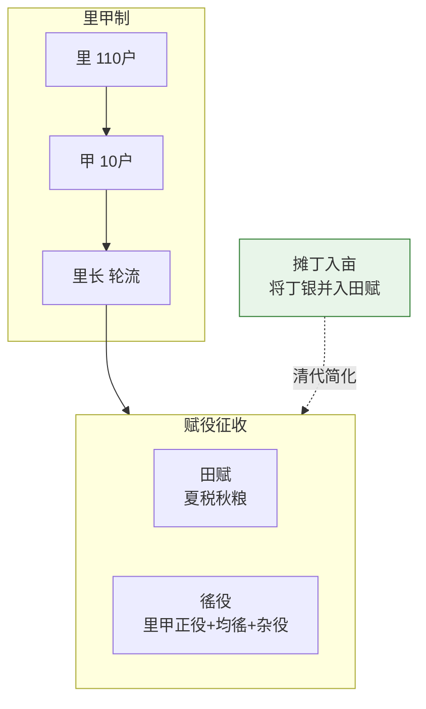

# 户部与财政制度

## 户部的双重角色

户部在明代是最大的部——设十三清吏司（按省分工），编制远超其他五部。户部同时扮演两个角色：

1. **财政部**：编制全国年度收支预算、核定各部门开支、征收全国赋税
2. **数据统计中心**：管理全国户籍(黄册)、土地(鱼鳞册)、税收数据

户部尚书（正二品，地官）总管。左/右侍郎（正三品）分管不同领域的司。

## 度支预算流程

### 预算编制的参与方

**十三清吏司郎中**（每省一司，各省的数据入口）：
- 从各省布政使收集该省明年预计税收数据
- 编制本省的收支预估上报度支司

**度支司郎中**（全国预算的编制者）：
- 汇总十三省税收预估 → 汇总六部和其他中央机构的明年开支计划
- 做全国收支平衡——如果预计支出超过收入，找尚书讨论砍预算
- 编制全国度支预算草案 → 上呈户部尚书

**户部尚书**：
- 审阅度支司的预算草案 → 与内阁协商 → 修改 → 上呈内阁票拟
- 如果内阁对某些项目的预算有异议，退回修改

**内阁-皇帝**：
- 内阁票拟 → 皇帝批红 → 预算生效（具有法律约束力）

### 预算生效后的执行

**太仓库**（详见[太仓库与内承运库]()）：
- 为各部门/各项目开设"预算账户"——标注该项目可以支出的上限
- 每次支取时从账户扣除 → 实时更新余额
- 余额不足 → 硬拦截 → 告警户部和监督部门

**各部门**：
- 在预算额度内支出——不能超支
- 超支需向户部度支司申请追加 → 度支司审核 → 户部尚书审批 → 小额户部可自批，大额需内阁→皇帝

## 超支审批层级

| 超支幅度 | 审批层级 | 说明 |
|:--|:--|:--|
| X%以内 | 户部度支司 审核 → 户部尚书 批准 | 小额追加，户部可自主处理 |
| 超过X% | 户部尚书 → 内阁票拟 → 皇帝批红 | 大额追加，走完整的决策链 |
| 紧急且超限 | 户部审阅 → 内阁速议 → 皇帝亲批(或从内承运库先借支) | 紧急情况绕过部分流程 |

## 开中法（食盐专卖换后勤）

洪武年间创立的巧妙制度：商人自愿向边关运粮 → 运到验收后朝廷发给"盐引"（食盐专卖许可证） → 商人凭盐引到产地支盐 → 运到指定地区销售获利。

**精妙之处**：朝廷不出运输费和人力——商人有利可图自会去运。这形成了"盐引→商人运粮→边关有粮→国家安全"的正循环。但到后期盐引超发、盐场产能不足，导致无人愿运。

## 一条鞭法（张居正的赋税简化）

万历九年（1581年），将所有复杂赋税合并为一项，统一折算银两征收。简化了纳税流程，大幅缩小贪官上下其手的空间。但也让习惯于实物经济的农民面临卖粮换银的额外环节。

## 参与方的制约关系

| 制约方 | 被制约方 | 制约方式 |
|:--|:--|:--|
| **户科给事中** | 户部尚书及全部下属 | 对口监督——封驳户部的收支计划，监督预算执行 |
| **内阁** | 户部 | 票拟——户部的重大预算调整需内阁票拟同意 |
| **太仓库** | 户部 | 管实物和管账目分离——户部批了预算但太仓库的余额才是硬约束 |
| **都察院** | 户部 | 弹劾——户部官员在度支中的贪腐或严重失职 |
| **巡按御史** | 各省布政使（在财政事务上） | 到省查账——比对布政使上报的税收数据和实际征收情况 |
| **审计（度支偏差简报）** | 户部 | 事后决算——预算vs实销的偏差分析 |
| **东厂** | 所有人 | 可弹劾预算中的系统性贪腐 |

---

## 编排参考

任事型编排系统对户部的映射：
- "户部财政面" → 户部 Agent 核定各子任务 Token 预算（参考历史消耗、任务复杂度、考成等级）
- "十三司" → 分领域计算节点
- "度支司" → 预算编制和监控——生成度支票拟
- "超支审批层级" → 小额户部自批，大额总控亲批，紧急动内承运库
- "开中法" → 预算试探期弹性系数——冷启动时所有预算加弹性缓冲
- "一条鞭法" → 预算系数动态回归——连续偏差偏高时自动下调基准系数

核心洞察：**预算是事前约束而非事后记账**。编排系统的 Token 预算机制继承了明代度支制度的核心——在任务开始前就核定预算额度（度支票拟），在执行中实时扣减监控（太仓库出纳日报），在结束后审计偏差（度支偏差简报）。全流程无死角。
