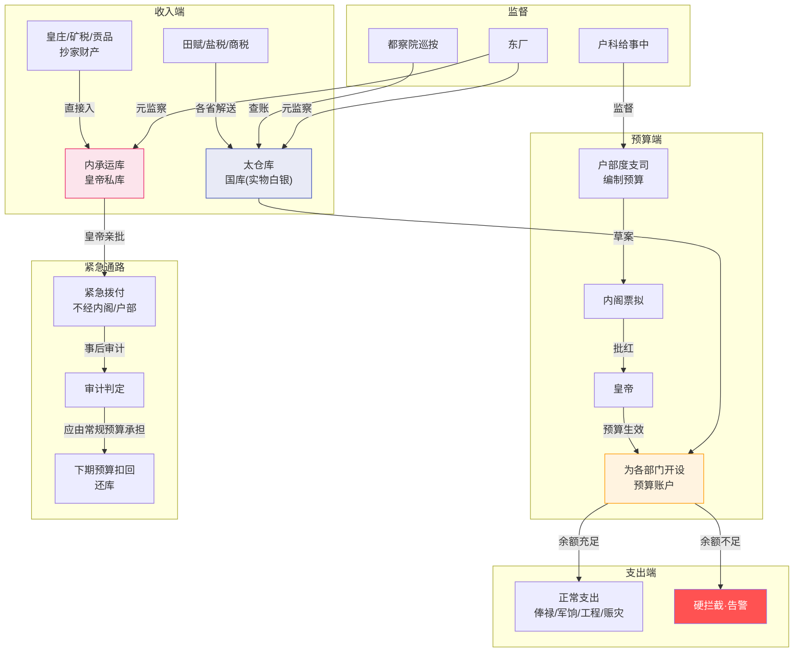

# 太仓库与内承运库

## 国库与内库的完全分离

明代财政制度最核心的设计是**两个钱袋子的完全分离**。这不仅是会计上的分账，而且是物理上的分库——太仓库的银子不能和内承运库的银子混在一起。

| | 太仓库（国库） | 内承运库（内库） |
|:--|:--|:--|
| **性质** | 国家正项财政收支 | 皇帝私人库藏 |
| **收入来源** | 田赋、盐税、商税等正项收入 | 皇庄收入、矿税、贡品、抄家财产 |
| **支出对象** | 官员俸禄、军饷、工程、赈灾 | 宫廷消费、皇帝赏赐、特别军事行动 |
| **管理者** | 太仓库太监（管实物）+ 户部度支司（管账） | 内承运库太监 |
| **支配决策者** | 户部提议 → 内阁票拟 → 皇帝批红 | 皇帝直接支配，不经内阁 |

## 太仓库的运作

### 职位与职责

**太仓库太监**（管实物白银的库房）：
- 管理国库的实体库房——白银的收纳入库和支出
- 根据户部批红的预算，为各部门/各项目开设"预算账户"
- 每次支出时核对——是否有度支司的批文、是否在预算额度内
- 余额不足自动拦截——不付款并告警
- 每日下班前生成"出纳日报"——结算当天的收支，比对预算执行率
- 太仓库太监不能改预算——他只能执行，不能决定

**户部度支司郎中**（管账）：
- 编制各部门的预算额度
- 审批各部门的支出请求是否在预算内
- 与太仓库每日的出纳日报比对

**"管账的不能碰钱，管钱的不能批账"**——这是太仓库和户部之间最关键的制约关系。

### 预算账户的运作

当内阁和皇帝批红了一个项目的预算后：
1. 太仓库为该项目的开设预算账户（上限为批红额度）
2. 该项目每次需支出时 → 向户部度支司申请 → 度支司批文 → 太仓库核对后从账户扣减
3. 账户余额不足 → 太仓库不付款 → 自动告警通知户部和该项目
4. 项目结束后 → 余额自动上缴 → 账户关闭

### 出纳日报

太仓库每天生成"出纳日报"：
- 当日所有支出明细（谁取的、多少钱、干什么用）
- 当日所有收入明细（各省解送的税银入库）
- 各部门预算账户的当日余额
- 哪些账户已接近见底

出纳日报一式多份——一份送户部度支司（对账）、一份存档（供审计事后查询）、一份送通政司备案。

### 预备金

太仓库总额度中划出一部分作为预备金（灾备储备）——常规项目不能动用。启用条件：
- 真实重大紧急情况（大灾、大战）
- 太仓库常规池已见底
- 内承运库也已告急
- 皇帝亲批

预备金使用记录单独归档，事后审计和东厂双重审查——防止任何"假紧急真花钱"。

## 内承运库的运作

### 内承运库太监

**做什么**：
- 管理皇帝私人库藏（白银、珠宝、珍玩）的保管
- 接收皇帝的派遣——按皇帝命令拨款
- 内库支出不需经过户部审批、不需内阁票拟
- 维护内库账本——每笔拨付的时间、对象、用途、数量

**制约**：
- 内库总额不能超过太仓库总额的X%（律例设定上限）
- 大额拨付（超过内库总额的15%）需皇帝亲批——不能由司礼监代批
- 每次拨付必须记录——事后审计和东厂审查
- 如果审计发现某笔拨付应由常规预算承担 → 从被救对象的下期预算扣回（还库）

### 内库借支与归还（还库机制）

紧急情况下，皇帝可从内库先行拨付（绕开太仓库的审批流程）：
1. 紧急拨付 → 内承运库太监执行 → 生成"内库借支记录"
2. 事后审计 → 判断这笔钱是否本应由太仓库预算承担
3. 如果是 → 通知户部 → 从被救对象的下期预算中扣除 → 还入太仓库

这个"借→审→还"的闭环防止了内库被系统性用作绕过预算审批的暗道。

## 两库之间的制约关系

| 制约方 | 被制约方 | 制约方式 |
|:--|:--|:--|
| **户部度支司** | 太仓库 | 管账——决定每个项目的预算额度。但户部碰不到实物钱 |
| **太仓库** | 户部度支司 | 管实物——度支司批了但余额不够时自动拦截。但太仓库不能改预算 |
| **律例** | 内承运库 | 上限约束——内库总额不得超过国库总额X% |
| **内承运库** | 太仓库 | 紧急通道——太仓库走不通时可以紧急拨付（但事后审计判定是否该还） |
| **审计** | 两库 | 事后审查——度支偏差简报和内库借支记录的双重审计 |
| **东厂** | 两库 | 元监察——可弹劾两库的系统性滥用 |

## 太仓库与其他部门的交互

| 交互方 | 交互内容 | 频率 |
|:--|:--|:--|
| **六部** | 各部从其预算账户支取 → 太仓库扣减 | 每日多次 |
| **户部度支司** | 太仓库出纳日报 → 度支司对账 | 每日一次 |
| **太仓库 → 户部尚书** | 超预算警报 | 触发时即时 |
| **监督 Agent** | 预算账户冻结/解冻 → 太仓库执行 | 考成问责时 |
| **审计 Agent** | 度支偏差简报 | 每项目/周期结束后 |
| **总控** | 预算池调整批红 → 太仓库执行转移 | 大明模式中 |
| **内承运库** | 紧急拨付 → 太仓库后期扣回(还库) | 审计结论后 |

---

## 国库内库双轨流转图

---

## 编排参考

任事型编排系统对太仓库/内承运库的映射：
- "太仓库" → **太仓库 Agent**：管理中央资源池（Token配额/API调用），为各部门开设预算账户，实时扣减，余额硬拦截
- "内承运库" → **内承运库 Agent**：皇帝直控独立资源池，总控可直接拨付
- "出纳日报" → 太仓库每任务结束后生成出纳日报，比对预算执行率
- "内库借支" → 内库拨付后生成借支记录，事后审计认定该由常规预算承担则还库
- "预备金" → 律例预设预备金比例，仅在内库枯竭时由总控亲批开启
- "管账的不能碰钱" → 户部(预算核定)和太仓库(实际扣减)的职能分离

核心洞察：两库分离创造了**双重财政通路**。常规通道（太仓库）保障预算纪律和可审计性；紧急通道（内承运库）保障特殊情况下不因制度延迟而卡死。编排系统如果只有太仓库一条通路，则在全局熔断或紧急兜底时会出现"需要资源但预算审批流程走不通"的死锁。
