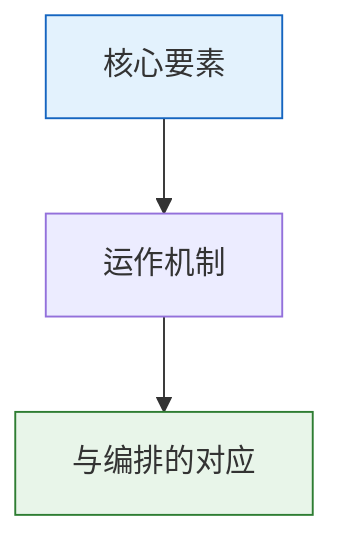

# 预算与资源调度

## 预算核定

明代户部核定各部门预算时参考多个因素：
- **历史同类项目开支**：去年修黄河花了多少，今年类似工程以此为基线
- **任务复杂度**：工程量、用工量、材料需求
- **优先级**：边关军饷的优先级远高于宫廷修缮
- **相关单位的考成等级**：如果一个部门历史上的预算执行率很差（总是超支或严重浪费），下一年预算会收紧

## 超支审批

执行中超预算不能自动追加，有严格的审批层级：
- **小额超支（X%以内）**：户部可直接批准追加
- **大额超支（超过X%）**：必须报内阁票拟 → 皇帝批红
- 如果审批流程太慢但情况紧急，可以从内承运库先借支（但事后必须经过审计确定是否该由常规预算承担）

## 预算池动态调整

在大规模行动中（如九边多镇同时作战），户部会预先切分多个**预算池**（如宣府镇预算池、大同镇预算池）。但在执行过程中可能出现：
- 宣府镇用不完预算而大同镇预算不够用
- 户部会监控各池的资源消耗率，主动建议重新切分
- 调整幅度有上限（防止剧烈波动影响其他任务的预算安全）

## 预算系数动态回归

如果审计连续多个周期发现某类任务的预算核定总是偏高（钱花不完）或总是偏低（每次都要追加），户部会自动调整该类任务的预算基准系数：
- 连续偏高 → 下调基准系数
- 连续偏低 → 上调基准系数
- 调整有步长限制（每次下调不超过上次调整的50%），防止震荡
- 试行一段时间后评估，稳定则正式定例

## 奏销制度

所有项目结束后必须**奏销**——向户部和审计部门提交完整的支出明细，包括：
- 预算金额 vs 实际支出
- 每笔超支的原因和审批记录
- 未使用的余额自动上缴回国库

奏销审计后生成"度支总结"，作为下一轮预算核定的参考依据。

---

## 编排参考

任事型编排系统几乎完整复刻了明代预算体系：
- "预算核定" → 户部 Agent 为各子任务核定 Token 预算，参考历史同类任务消耗、任务复杂度、考成等级
- "超支审批" → 超X%以内户部直接批，超X%需总控亲批；紧急情况动内承运库
- "预算池动态调整" → 大明模式中户部实时监控朝廷预算池和竞功池消耗率，触发条件后主动向总控提交预算池调整票拟
- "预算系数动态回归" → 审计 Agent 检测连续多周期预算虚高，户部生成下调建议上报律例试行
- "奏销" → 审计 Agent 事后决算比对预算与实销，生成度支偏差简报（含原因分类），反馈户部和考功司
- "步长限制防振荡" → 权重单步±5%上限、系数步长限制、规则冷却期

核心洞察：编排系统的预算机制不是笼统的"限制 Token 总量"，而是**子任务级的精细预算**——每个子任务在规划阶段就被绑定了预算额度。没有精细预算，考成法的"超期问责"就无从谈起——你都不知道一个任务"应该"消耗多少资源，怎么判断它是否"超支"？
