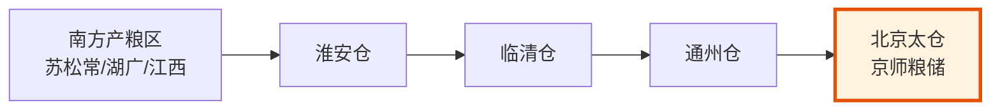

# 盐法漕运马政




## 盐法（食盐专卖）

盐法是明代最重要的国家垄断经济制度。盐税收入在明代中后期占国家财政的较大比重（有时接近一半）。

**开中法**（详见[户部与财政制度]()）：商人运粮至边关 → 换取盐引 → 凭盐引到产盐地支盐 → 运到指定地区销售。本质是"用食盐专卖权换商人的后勤服务"。

**盐引的运作**：
- 每张盐引标注可以支取多少斤食盐、在哪些地区销售
- 盐引不可转让（虽然实践中大量被倒卖）
- 伪造盐引者斩（盐引是国家信用的具象化，伪造=挑战信用根基）

**盐法的衰落**：到明中后期，盐引发放过度、盐场产量不足、边关需求变化，开中法逐渐失灵。大量盐引积压（商人手里有盐引但支不到盐），导致无人愿意再运粮到边关。

### 盐政体系的多头管理（深化）

明代盐政不是单一部门管理，而是**多部门分工 + 跨部协调**：

| 机构/差遣 | 职责 | 与其他部门的协调 |
|:--|:--|:--|
| **户部山东清吏司** | 全国盐政总管·盐引印制 | 与工部（盐场建设）、地方官（盐场执行）协调 |
| **两淮/两浙/长芦/河东盐运使司** | 各产盐区的实际运营 | 与地方巡抚协调·接受巡按御史巡查 |
| **盐政御史**（都察院派出） | 专项巡查盐政·查缉私盐 | 独立于户部·直报都察院和皇帝 |
| **巡盐御史**（每年轮派） | 例行年度巡查 | 一年一轮·防结党 |
| **内臣（太监）提督盐课**（中期废除） | 明中期太监干政·直接抢夺盐利 | 绕过户部·与文官体系冲突 |

### 盐政协调的核心冲突

**冲突一：中央财政 vs 地方利益**
- 户部要求尽量多征盐税入太仓库
- 地方盐运使和巡抚考虑盐场生产能力、灶户生计
- 双方在盐引发放额度上长期拉锯

**冲突二：合法贸易 vs 私盐泛滥**
- 官盐价高质差，私盐在地下泛滥
- 盐政御史查缉私盐遇到地方保护主义
- 实际上明中后期私盐贸易量超过官盐

**冲突三：开中法的初衷 vs 实际运作**
- 开中法设计：商人运粮边关→换盐引→支盐销售
- 实际运作：权贵直接奏讨盐引（不运粮）→ 倒卖获利
- 这就是为什么开中法最终崩溃

### 盐政协调失败的根本教训

**制度设计依赖单一资源（盐）同时承担多重目标**：
- 财政收入最大化（多征盐税）
- 边防后勤保障（开中法运粮）
- 民生供应（百姓吃盐）
- 抑制权贵（防止奏讨盐引）

**多重目标冲突时，制度优先保财政，导致其他目标崩溃**。

---

## 漕运

漕运是把南方的粮食（主要是江南的税粮）经大运河运到北京的运输体系。每年漕运粮食约400万石，是维持京城和九边军饷的生命线。

**漕运体系的组织**：
- **漕运总督**（文官）：总管全国漕运
- **各省兑粮关**：南方各省将税粮集中到运河沿线，装上漕船
- **运河关津**：沿途设钞关（收费站）
- **通州仓**：漕粮到达通州后卸入京通各仓，分批入京

**漕运的维护成本**：维持大运河的通航需要常年疏浚、修闸、养纤夫。黄河泛滥经常冲毁运河段。漕运的维护成本是明代财政的持续压力。

### 漕运总督的差遣性质（深化）

漕运总督是明代最重要的**资源型跨省差遣**——本职是户部侍郎或兵部侍郎，加都御史衔，差遣"总督漕运兼提督军务"。

**双重身份**：
- **文职身份**（户部侍郎）：管漕粮征收、运输调度、仓储管理
- **军事身份**（提督军务）：管漕军（专门护送漕船的军队）、剿灭抢掠漕船的盗匪

### 漕运总督的协调网络

漕运总督驻淮安（运河中段的关键节点），向上向下协调：

```
                皇帝（批红）
                    │
        ┌───────────┼───────────┐
        │           │           │
    户部          兵部        都察院
   （粮源）    （漕军军籍）（本职上级）
        │           │           │
        └───────────┼───────────┘
                    │
              漕运总督（驻淮安）
                    │
        ┌───────────┼───────────┐
        │           │           │
   沿海各省      运河沿线     河道总督
   （产粮区）   （钞关/通州）（黄河运河维护）
        │           │           │
        └───────────┼───────────┘
                    │
                京通各仓
              （漕粮到达终点）
```

### 漕运协调的三大难题

**难题一：与河道总督的协调**
- 河道总督管黄河和大运河的治理（维护通航）
- 漕运总督管运输（使用运河）
- 黄河决口→河道总督抢险→漕运总督等运河恢复→漕粮延误
- 两者经常因"运河是治理优先还是运输优先"争执

**难题二：与地方巡抚的协调**
- 漕运总督要南方各省按时把税粮运到兑粮关
- 地方巡抚考虑本地赋税征收难度、百姓承受力
- 巡抚拖延→漕船空载等粮→影响整年漕运计划

**难题三：与户部的协调**
- 漕运总督执行运输，户部管账
- 漕粮损耗（运输中的鼠耗、潮湿、漂失）的认定：漕运总督希望高报损耗（少交责任小），户部希望低报（多入仓）
- 每年漕粮入库时的"损耗认定"是漕运总督和户部博弈的焦点

### 漕运协调失败的历史教训

**教训一：河道总督与漕运总督分立导致扯皮**
- 明代河道总督和漕运总督是两个独立的差遣
- 治河优先还是运粮优先？双方各执一词
- 经常出现"漕船等河道疏浚、河道等漕船通过"的死锁

**教训二：漕军腐败无法根治**
- 漕军是世袭军籍，长期承平后战斗力衰退
- 漕军勾结盗匪、盗卖漕粮、虚报漂失
- 多次整顿无果——因为漕军体系本身是既得利益集团

**教训三：单一运输通道的脆弱性**
- 大运河是京城粮食供应的唯一通道
- 一旦黄河决口、运河断航，京城立即断粮
- 海运方案多次被提但始终未采纳（漕军和沿岸利益集团阻挠）

---

## 马政

马政由太仆寺掌管（见[五寺体系](../02-执行链/文官执行/02-五寺体系.md)），在明初极其重要——对抗蒙古骑兵必须有充足的军马供应。

**马政的组织**：
- **官牧**（太仆寺直属牧马监）：在北方水草丰美处设官营牧场，养军马
- **民牧**：在北方部分省份划出"养马户"，百姓替官府养马，免部分赋税
- **茶马贸易**：用四川/陕西的茶叶从藏区和青海蒙古换取马匹

**马政的衰落**：到明中后期，牧马监的草场大量被豪强侵占，养马户因养马导致破产逃亡，太仆寺存马数从永乐年间的数十万匹降到崇祯年间的数千匹。九边防线的骑兵无马可乘。

### 茶马贸易的协调机制（深化）

茶马贸易是明代特有的"战略物资交换"——用汉地的茶叶换藏区和蒙古的马匹。

**协调网络**：
- **茶马御史**（差遣）：主持茶马交易
- **四川/陕西布政司**：负责茶叶征收和运输
- **洮州/河州/西宁茶马司**：边境交易点
- **兵部车驾司**：接收军马分配到卫所

**协调难题**：茶叶从四川/陕西运到西北边境路途遥远，运输成本高；私茶泛滥冲击官茶贸易；藏区有时不愿意交易（自己用马）。

---

## 编排参考

三项经济制度对编排系统的启发：
- "盐引" → **太仓库的预算额度**：盐引标注了"可以提取多少盐、在什么地方销售"——预算额度标注了"可以消耗多少 Token、在什么任务上"。盐引超发导致贬值(通胀) → 预算超批导致资源量入不敷出
- "漕运" → **协作总线的消息路由**：漕运是江南→北京的物资大动脉(关键物流链)，协作总线是六部之间的信息大动脉(关键信息链)。漕运堵塞则京城饥饿，协作总线阻滞则系统瘫痪
- "茶马贸易" → **外部资源交换**：编排系统内部资源和外部资源(如人工审核/数据)之间需要一个"茶马贸易"式的交换机制——不是买卖而是战略物资的等值交换
- "马政衰落的教训" → **选锋标签时效衰减**：军马不训练会退化，选锋标签不执行同类任务会衰减——都是"战略性资产需要持续投入维护"的逻辑

### 资源型跨省协调的启示（新增）

**启示一：单一资源承担多重目标必然冲突**
- 盐引既是财政工具又是边防后勤工具又是民生工具
- 编排映射：预算 Token 不能同时承担"成本控制"、"激励分配"、"质量评估"三种角色——必须用不同的资源池

**启示二：关键物流链必须有冗余**
- 大运河是京城粮食的唯一通道，一旦断航立即危机
- 编排映射：协作总线必须有备份通道（如降级到本地消息队列、应急直连通道）

**启示三：运输者与维护者的协调分离**
- 漕运总督（运输）和河道总督（维护）分立导致扯皮
- 编排映射：信息传输 Agent 和基础设施维护 Agent 之间必须有明确的协调机制，否则会互相推诿

**启示四：世袭体系必然腐败**
- 漕军世袭导致既得利益集团形成
- 编排映射：长期固定角色的 Agent 会形成"路径依赖"，必须定期轮换或引入新 Agent 竞争
