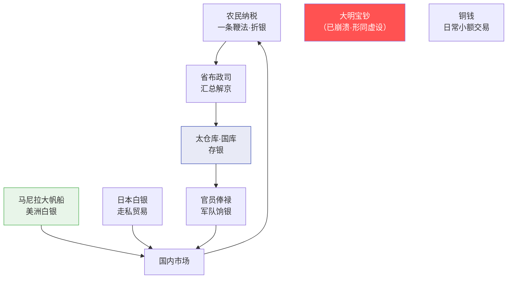

# 货币制度与白银货币化

> 本文档分析明代的货币体系演变——从洪武宝钞的崩溃到白银的全面货币化，以及这个过程对整个财政和社会结构的深层影响。

## 明代货币的三层体系

明代实际流通的货币有三层，但三者之间没有制度化的兑换机制：

| 货币形态 | 发行者 | 流通范围 | 信任基础 |
|:--|:--|:--|:--|
| **大明宝钞**（纸币） | 朝廷（唯一发行方） | 官方用钞、民间拒收（明中后期） | 朝廷信用（→消耗殆尽） |
| **白银** | （非官方铸造） | 大额交易、纳税（一条鞭法后）、跨省贸易 | 银本身的价值 |
| **铜钱** | 朝廷（官方铸造）+ 民间私铸 | 日常小额交易、百姓生活 | 铜本身的价值 + 官方铭文 |

---

## 一、大明宝钞——从雄心到崩溃

### 洪武宝钞的设计

洪武八年（1375年），朱元璋发行大明宝钞——这是世界上最早的纯信用纸币体系之一，比欧洲的纸币实验早了近300年。

**宝钞的基本特征**：
- 面额：一贯（1000文）为最高面额，下有一百文至五百文的多种面额
- 材质：桑穰纸（耐用）
- 发行：无准备金、无兑换承诺、完全依赖朝廷信用
- 强制使用：税收必须接受宝钞、禁止民间用金银交易

**朱元璋的意图**：用一张纸取代笨重的铜钱和稀缺的白银——如果成功，朝廷就掌握了无限的货币发行权（"点纸成金"）。

### 崩溃的原因

宝钞制度在洪武末年已经开始崩溃，到宣德年间已彻底失败。原因有几个层面：

1. **无节制的发行**：朝廷缺钱就印宝钞。洪武年间每年发行宝钞相当于数千万两白银——远超经济的实际需要。通货膨胀急剧：永乐年间一贯宝钞在市场上只能兑200-300文铜钱（贬值70-80%），到宣德年间只有10-20文（贬值98%以上）

2. **只发不收**：朝廷发宝钞给官员做俸禄、给军队做军饷、做赏赐——但征税时只收少量宝钞，主要收实物（粮食和布匹）。宝钞的回收渠道几乎不存在，市场上宝钞越积越多

3. **无兑换保证**：持有宝钞的人不能随时去朝廷兑换银两或铜钱——宝钞就是一张纸，信则值钱不信则废纸

4. **伪造问题**：宝钞的防伪技术有限，伪造泛滥加速了信用崩溃

5. **民间用银的惯性**：朝廷禁止民间用金银交易，但民间照用不误——白银在大额交易中太方便了

### 宝钞崩溃后的制度真空

宝钞在民间被弃用后，朝廷并没有放弃它——官员的俸禄仍部分以宝钞支付（等于变相削减俸禄，因为宝钞实际价值远低于面值），税收中的"钞关税"仍征收宝钞（虽然已形同虚文）。这创造了一个荒诞的局面：**朝廷继续使用一种所有人（包括朝廷自己）都知道一钱不值的货币**。

---

## 二、白银货币化——自下而上的革命

### 白银如何成为主流

白银的货币化不是朝廷设计的——是**民间自发推动**的，朝廷只是在张居正推行一条鞭法时追认了这一事实。

**驱动因素**：

| 因素 | 机制 |
|:--|:--|
| **宝钞崩溃** | 民间需要可靠的大额交易媒介→白银天然适合 |
| **海外白银流入** | 嘉靖后西班牙从美洲经菲律宾运入大量白银（马尼拉大帆船贸易）→中国成为世界白银的"终极归宿" |
| **日本白银** | 倭寇和走私商人从日本大量运入白银（日本是当时世界主要白银产地） |
| **经济规模增长** | 明中后期商品经济繁荣→铜钱面额太小不便于大宗交易→白银填补了这个需求 |
| **实物税的不可持续性** | 征粮征布的效率极低→折色（实物折成银两）从试点逐步推广 |

### 一条鞭法与白银的全面胜利

万历九年（1581年），张居正在全国推行一条鞭法。其核心内容：

**一条鞭法** = 将各种赋税和徭役合并 → 统一折成银两 → 按土地和人丁分摊 → 官府用征收的银两雇人服徭役（不再直接征发劳力）

这一改革对货币体系的影响是革命性的：
- **白银从"民间选择"变成"法定货币"**：现在交税必须用银两，每个农民都必须把粮食换成银两才能完税
- **白银需求爆炸式增长**：全国数千万农户都需要白银来交税
- **"银荒"问题**：农民纳税时集中出售粮食→粮价暴跌→"谷贱伤农"→实际税负增加

### 白银化的代价

一条鞭法从财政效率上是进步的（统一折银减少征收成本），但对基层社会产生了深远影响：

- **农民与市场强制绑定**：以前交粮食交布匹可以自给自足完成纳税——现在必须把粮食卖了换银，受制于市场波动
- **"火耗"剥削**：地方官在征收碎银熔铸成锭时号称有损耗（火耗）→加收10%-30%甚至更多→火耗成为地方官的灰色收入
- **银两成色混乱**：没有统一的银两成色标准——各地银两的纯度不同，每次交易都需要"验银"和折算

---

## 三、铜钱——日常生活的底层货币

### 官方铸钱

明朝的官方铸钱始终不够——朝廷没有把铸钱当作货币供应的主要手段：
- 洪武初年铸造"洪武通宝"
- 之后多位皇帝不铸钱（永乐、宣德铸钱很少）
- 到嘉靖、万历时才重新大规模铸钱

**铸钱不足的原因**：朝廷的重点在宝钞（明前期）和征实物税（米/布），铜钱被视为辅助。铸钱有成本（铜料+工费）——如果铜价高于钱的面值，朝廷就亏本——所以懒得铸。

### 私铸泛滥

官方铸钱不够 → 民间自铸 → 私铸铜钱的质量参差不齐：
- 好的私铸钱和官铸差不多
- 差的私铸钱薄如纸片、一捏就碎
- 市场上有数十种不同质量的铜钱在流通——交易成本极高

### "钱法"的难题

明朝始终没有解决铜钱和白银之间的兑换问题——两者在市场上自由浮动，没有官方定价。这导致每笔交易都涉及双重计算——多少铜钱折多少白银。

---

## 四、货币体系的编排参考

### 货币流动全景图

### 编排参考

- "宝钞无节制发行→崩溃" → **Token 预算的超发风险**：太仓库如果没有硬余额约束（像洪武印宝钞那样无限量审批），就会"通货膨胀"——预算批得太多而实际资源不够。**太仓库余额的硬拦截是绝对的，不可被绕过**
- "一条鞭法统一折银" → **统一的资源计量单位**：编排系统中所有资源消耗（Token、计算时间、存储）应该统一折算为一个"度支单位"（类似白银）——而不是各模块各自计数。这才能全局优化
- "谷贱伤农" → **集中兑付的冲击效应**：当大量 Agent 同时在"纳税节点"集中请求资源时，会造成瞬时拥塞——类似农民集中卖粮导致粮价暴跌。预算系统需要平滑机制
- "火耗剥削" → **中间层截留的审计难点**：地方官在熔铸银两时加收火耗——编排系统的中间层（总督/巡抚/知府）在执行资源调度时也有类似"火耗"的灰色空间——需要东厂式的抽查和审计
- "白银+铜钱的双重货币" → **多层级资源体系**：类似大明有白银（大额交易）和铜钱（日常小额），编排系统也可以有不同的资源粒度——Token 是"白银"（大额调度用），API 调用次数或内存是"铜钱"（日常小额计量用）
- "马尼拉大帆船的白银流入" → **外部资源的依赖风险**：明末白银经济高度依赖海外白银的持续流入——如果外部输入中断，整个货币体系会崩塌（明末确实部分发生了这事）。编排系统的外部资源（如人工审核、外部 API）也必须有"中断预案"
