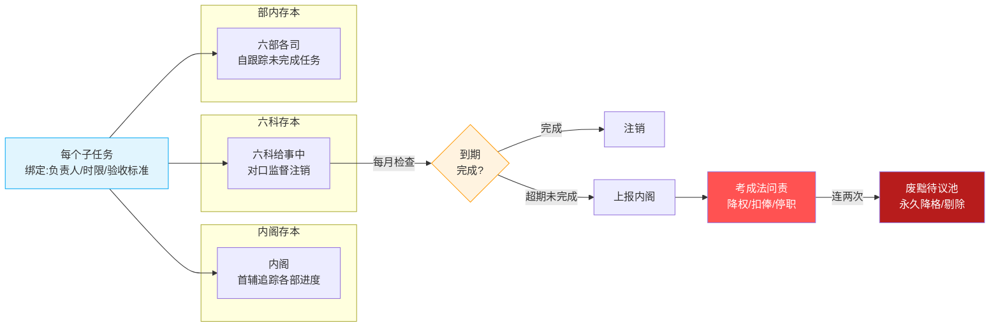
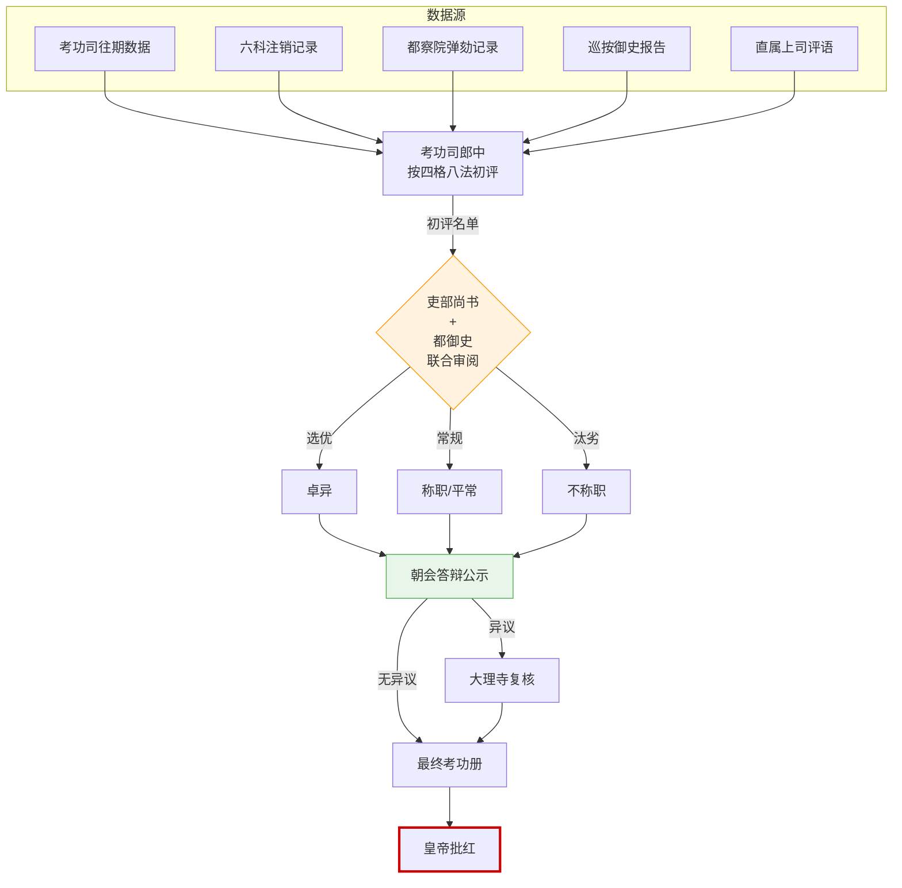

# 考功制度

> 📍 返回 [README](../00-总览/README.md) · [按编排模式反查](../99-附录/04-按编排模式反查.md)
> 🔗 相关主题：京察 · 大计 · 考成法 · 跨部协调

## 两套考核体系

明代的考功不是一套笼统的"年度考评"，而是两套并行、相互独立又互相参照的体系：

| 体系 | 对象 | 周期 | 主持者 | 核心产出 |
|:--|:--|:--|:--|:--|
| **考满** | 所有官员（按任期） | 三年一考、六年再考、九年通考 | 吏部考功司 | 称职/平常/不称职（决定升/留/降） |
| **考察** | 京官（京察）/ 地方官（大计） | 京官六年、地方官三年 | 吏部+都察院联合 | 四格评分 + 八法劣汰名单 |

## 京察（京官六年一次）

### 参与方和各自职责

**吏部尚书**（联合主持）：
- 总管京察全过程——定标准、审名单、划等级
- 偏向"选优"——卓异名单主要由吏部提出
- 与都御史的权力制衡——吏部不能单方面定人黜人

**都察院都御史**（联合主持）：
- 与吏部尚书共同签名——京察结果才有效
- 偏向"汰劣"——不称职名单主要由都察院提供证据
- 保障监察视角不被吏部的人情网络软化

**考功司郎中**（具体操办）：
- 收集全体京官（约2000+人）的考评数据
- 按四格（守/才/政/年）初评打分
- 按八法标记应该被处罚的官员
- 编制初评名单 → 上报吏部尚书和都御史终审

**六科给事中**（提供监督数据）：
- 各科提供对接部的官员"注销"记录——哪些官员任务完成、哪些超期
- 这一数据直接影响政绩评分

**十三道御史**（提供弹劾数据）：
- 提供各自分管道官员的弹劾记录和巡按报告

**朝会答辩**（公示纠错）：
- 初评名单在朝堂公示 → 被考核者可申辩 → 异议合理的由大理寺复核
- 这不是民主投票而是纠错机制——给被冤枉的人最后一个说话机会

### 考核流程

```
吏部考功司 收集全体京官数据
    ├── 从考功司自己：往期考功结果
    ├── 从六科：各官的"注销"记录（任务完成情况）
    ├── 从都察院：御史弹劾记录
    ├── 从巡按御史：地方巡查报告（针对曾在地方任职的官员）
    └── 从本官上司：直属上级的评语
          │
          ▼
考功司郎中 按四格八法初评
    ├── 四格：守(品德) / 才(能力) / 政(政绩) / 年(精力)
    └── 八法：贪/酷/浮躁/不及/老/病/罢软/不谨
          │
          ▼
吏部尚书 + 都御史 联合审阅
    ├── 吏部偏向"选优"——卓异名单
    └── 都察院偏向"汰劣"——不称职名单
          │
          ▼
朝会公示 → 被考核者申辩 → 异议转大理寺复核
          │
          ▼
最终名单 → 内阁票拟 → 皇帝批红 → 考功册生效
```

## 大计（地方官三年一次）

流程类似京察但主持者不同：
- **巡抚**和**巡按御史**联合主持（在省里）
- 考核结果上报吏部考功司汇总
- 大计结果直接决定地方官的升迁和黜降

## 四格八法详解

### 四格（评分维度）

| 格 | 考察内容 | 数据来源 | 谁提供数据 |
|:--|:--|:--|:--|
| **守** | 操守品德——清廉还是贪婪 | 御史弹劾记录、巡按报告 | 都察院 |
| **才** | 能力——长于何事、是否胜任 | 上司评语、任务完成率 | 六科（注销记录） |
| **政** | 政绩——勤勉还是怠惰 | 考成法进度表、税收完成率 | 户部度支司、六科 |
| **年** | 精力——年龄和身体状况 | 吏部稽勋司的年龄档案 | 吏部 |

### 八法（劣汰标准）

| 八法 | 含义 | 处理 |
|:--|:--|:--|
| **贪** | 贪污受贿 | 革职拿问（最严重——锦衣卫直接介入） |
| **酷** | 残酷暴虐对待百姓 | 革职 |
| **浮躁** | 轻浮不稳重——不适合目前岗位 | 降级调离 |
| **不及** | 能力不胜任当前职位 | 降级到更低的职位 |
| **老** | 年老体衰 | 致仕（强制退休） |
| **病** | 身体有严重影响工作的疾病 | 致仕 |
| **罢软** | 庸懦无能——没有政绩也没有大错 | 革职或降级 |
| **不谨** | 行为不端——生活作风/礼仪问题 | 革职 |

## 考成法（张居正改革的精髓）

万历元年（1573年），张居正推行考成法。这不仅是考核制度的改革，更是明朝后期最有效的**执行追踪系统**。

### 考成法的三本簿册

每个任务建立三本簿册——信息冗余设计保证任何一本丢失或失实都能被另外两本纠正：

| 簿册 | 存放处 | 谁持有 | 用途 |
|:--|:--|:--|:--|
| **内阁存本** | 内阁 | 首辅/次辅 | 内阁追踪各部完成进度 |
| **六科存本** | 六科 | 各科给事中 | 对口监督——到期未销上报内阁 |
| **部内存本** | 六部 | 各司郎中 | 自跟踪——自己知道还有哪些活没干完 |

### 考成簿的内容

每项任务必须写清：**负责人、完成时限、验收标准**——条件不清的考成簿被打回重新拟定。

### 考成的问责机制

- 每月六科检查一次——到期未完成的直接上报内阁
- 超期 → 降权（降级、扣俸、停职）
- 超期严重 → 直接从考功册划入"不称职"
- 连续两次大计"不称职" → 送入"废黜待议池"——建议永久降格或剔除

## 考功册的等级

| 等级 | 含义 | 结果 | 编排对应 |
|:--|:--|:--|:--|
| **卓异** | 最优——多维度都出类拔萃 | 升迁、加俸、记录在案 | 选锋标签、御马监入选资格 |
| **称职** | 合格——正常完成本职工工作 | 留任或按序升迁 | 正常权重，下次任务正常分配 |
| **平常** | 边缘——不突出也不差 | 留任但不得升迁，限期改进 | 权重不增，进入观察期 |
| **不称职** | 不合格——严重问题 | 降级、调离或革职 | 降权、暂停调用、废黜池观察 |

## 参与方之间的制约关系

| 制约方 | 被制约方 | 制约方式 |
|:--|:--|:--|
| **都察院** | 吏部 | 联合主持京察——吏部不能单独定升黜 |
| **六科** | 考功司 | 提供注销数据——如果考功司隐瞒某官的差评，六科的注销记录是对照 |
| **大理寺** | 考功司 | 朝会答辩——被考核者可申辩，异议由大理寺复核 |
| **东厂** | 所有考核参与者 | 可质疑考核结果是否有利益输送 |
| **皇帝** | 所有人 | 最终批红——考功册不经皇帝批红不生效 |

## 跨部协调机制深度（新增）

### 吏部与都察院联合主持的协调规则

京察是明代跨部协调最复杂的场景之一——吏部尚书和都察院都御史必须**联合签名**京察结果才能生效。这种"双首长制"的协调规则是：

| 协调维度 | 吏部（选优偏重） | 都察院（汰劣偏重） |
|:--|:--|:--|
| **主导事项** | 升迁名单、加衔、调优 | 纵劾名单、黜陟、弹劾证据 |
| **数据优势** | 考功司历史数据、稽勋司档案 | 御史弹劾记录、巡按报告 |
| **决策规则** | 升迁名单以吏部为主，都御史不反对则通过 | 黜陟名单以都察院为主，吏部不反对则通过 |
| **冲突解决** | 双方意见不一时，各自上报皇帝，由皇帝裁定 | 同上 |
| **责任分担** | 升迁错误·吏部责任大 | 黜陟错误·都察院责任大 |

### 为什么不让吏部单独主持

**问题**：如果吏部单独主持京察，会出现三个问题：
1. **吏部尚书权力过大**——既管人事任命又管考核，等于一人独掌人事权
2. **人情网络软化考核**——吏部与百官日常接触多，容易被求情、被收买
3. **考核视角单一**——只看档案和政绩，不看官员的实际行为（是否贪、是否酷）

**解法**：引入都察院作为第二主持人——都察院的御史独立弹劾权使他们不被吏部的人情网络软化，能提供"另一个视角"的考核数据。

### 大计的跨部协调：巡抚 + 巡按

大计（地方官考核）的跨部协调与京察不同——主持者是**巡抚和巡按御史**（都在省里），而不是吏部尚书和都御史（在京城）：

**大计的协调规则**：
- **巡抚**（常驻）：提供地方官的日常表现、税收完成率、民政处理能力
- **巡按御史**（每年轮换）：提供监察视角——是否有贪腐、是否有冤案、是否违法
- **两者联合签名**上报吏部考功司汇总
- **巡抚偏重"能"（能力），巡按偏重"守"（品德）**

### 大计协调中的冲突

**冲突一：巡抚与巡按意见不一**
- 巡抚认为某知府能力胜任（日常表现好）
- 巡按认为该知府有贪腐问题（收到举报）
- 解决：双方各自上报，由吏部和都察院裁定

**冲突二：巡抚袒护下属**
- 巡抚常驻地方，与下属形成人情网络
- 巡抚可能袒护有问题的下属
- 解决：巡按一年一轮的轮换制度防止被收买

**冲突三：巡按滥用弹劾权**
- 巡按为了立功或报私仇，滥劾地方官
- 巡抚为下属辩护，双方僵持
- 解决：被弹劾者可朝会答辩，最终由大理寺复核

### 跨部协调的失败模式

| # | 失败模式 | 原因 | 后果 | 历史案例 |
|:--|:--|:--|:--|:--|
| 1 | **吏部与都察院合谋** | 双方勾结·互相放水 | 考核变成形式 | 明后期朋党化 |
| 2 | **巡抚袒护下属** | 人情网络软化考核 | 劣质官员不会被纵劾 | 明末地方吏治败坏 |
| 3 | **巡按滥用弹劾** | 御史报私仇或立功心切 | 冤假错案 | 偶发的冤案 |
| 4 | **考功司隐瞒数据** | 考功司被某部收买 | 考核数据不全 | 六科注销数据是对策 |
| 5 | **朝会答辩失效** | 异议不被采纳 | 冤错无法纠正 | 东林党争时期 |

### 设计启示：跨部协调的本质

**跨部协调不是"谁听谁的"——而是"让不同利益、不同视角的部门共同参与决策"**：
- 吏部和都察院有不同的利益、不同的数据来源、不同的考核偏重
- 强制双方联合签名，迫使双方协商
- 双方意见不一时各自上报，让上级（皇帝）裁定
- 这种"共识 + 上诉"机制是跨部协调的核心

编排映射：当多个 Agent 联合评估某个高风险决策时，
- 不要让单一 Agent 独断（防权力集中）
- 不要让多个 Agent 投票决定（防多数暴政）
- 让每个 Agent 从自己的专业视角独立评估，然后汇总各自意见给总控/用户裁定

---

## 考成法三本簿册追踪系统



## 京察考核数据流



---

## 编排参考

任事型编排系统几乎直接复刻明代考功制度：
- "京察/大计" → 考功司 Agent 周期性综合考核全体 Agent
- "四格" → 多维度考核——审计评分+军功勘验+失期记录+考成结果+Token效率+预算偏差+错误模式
- "八法" → 四等划分——卓异/称职/平常/不称职
- "考成法三本簿册" → 档籍(内阁存本)+监督(六科存本)+执行(部内存本)——信息三冗余
- "考成簿" → 规划阶段生成的考成簿（负责人/时限/预算额度/验收标准）
- "考成问责" → 超期/超支停俸（冻结预算账户）
- "朝会答辩" → 公示京察拟调列表——外部可异议
- "废黜待议池" → 连续不称职送入废黜池

核心洞察：考成法解决了编排系统中的**"执行黑洞"**问题——没有考成法时，一个子任务发出去了，到底完成没有？什么时候完成？谁负责？全都不清楚。考成法的"三本簿册+超期问责"使系统从"发出去了就不管了"变成"发出去了每个月都有人检查"。
